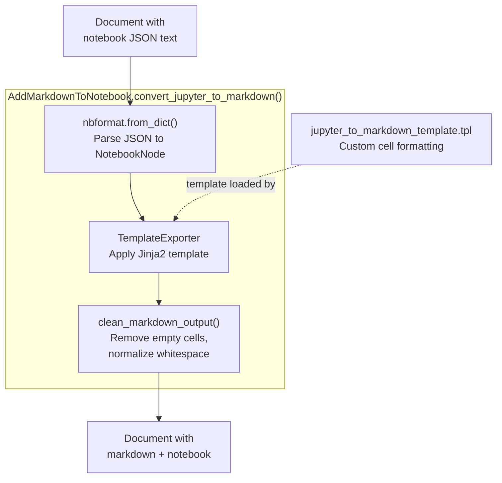
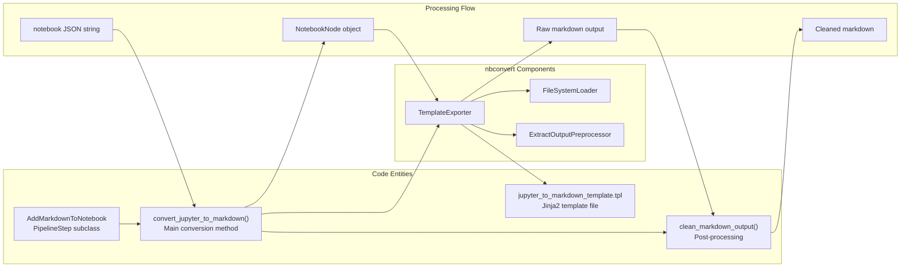
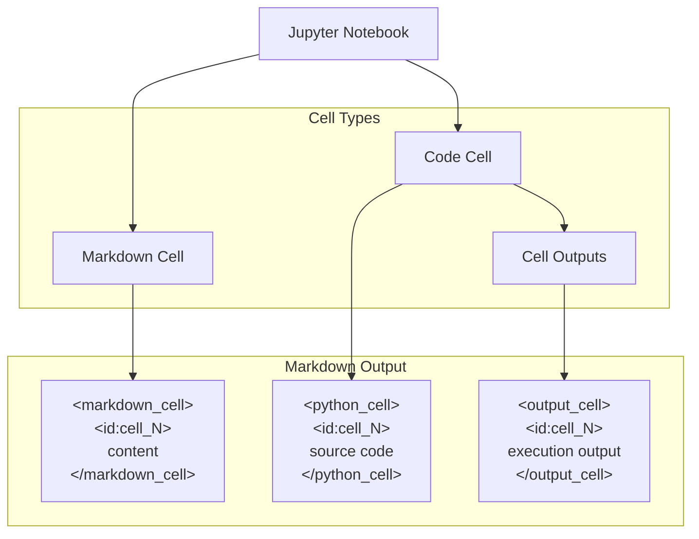
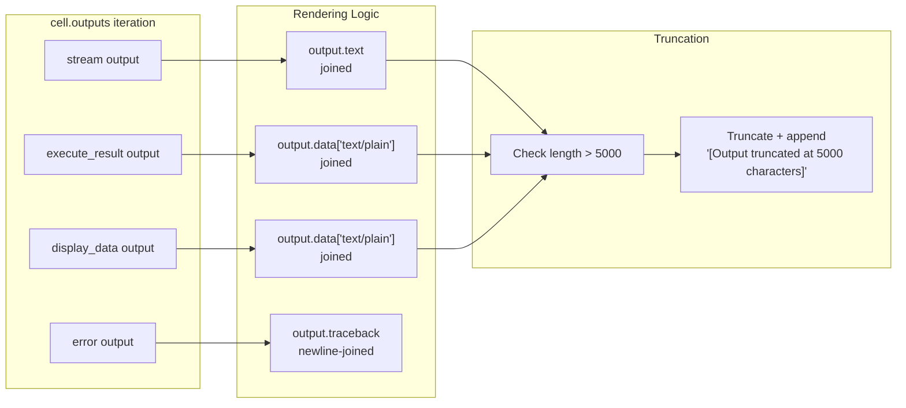
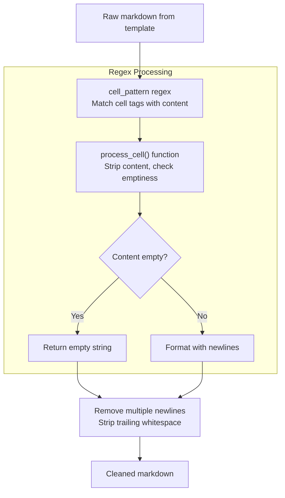
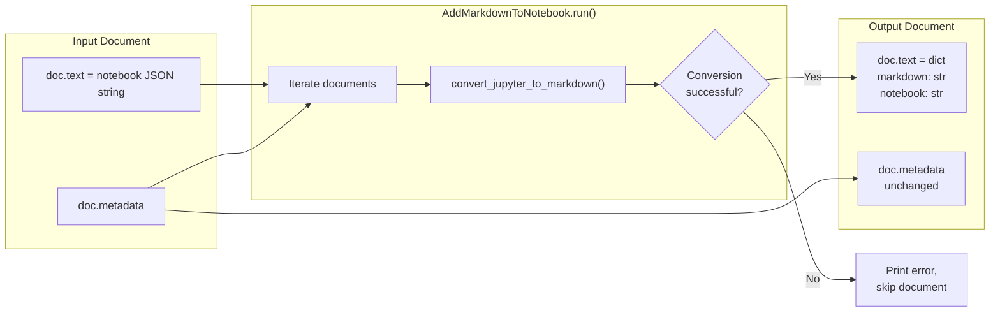

<!-- source: DeepWiki mcp.deepwiki.com · repo huggingface/jupyter-agent · extra page Markdown Conversion · fetched 2026-10-26 -->

# Markdown Conversion

<details>
<summary>Relevant source files</summary>

The following files were used as context for generating this wiki page:

- [data/pipelines/add_markdown_to_notebook/add_markdown_to_notebook.py](data/pipelines/add_markdown_to_notebook/add_markdown_to_notebook.py)
- [data/pipelines/add_markdown_to_notebook/jupyter_to_markdown_template.tpl](data/pipelines/add_markdown_to_notebook/jupyter_to_markdown_template.tpl)

</details>


## Purpose and Scope

This page documents the markdown conversion process in Stage 3 of the data generation pipeline. The `AddMarkdownToNotebook` pipeline step transforms raw Jupyter notebook JSON into a structured markdown format with custom cell tags and identifiers. This conversion enables subsequent LLM-based processing stages to work with a more readable text representation while preserving notebook structure.

For information about the quality scoring that follows this conversion, see [Educational Scoring](#2.3.2). For the overall quality assessment stage architecture, see [Stage 3-4: Quality Assessment](#2.3).

---

## Architecture Overview

The markdown conversion system uses the `nbconvert` library with a custom Jinja2 template to transform notebook JSON into structured markdown. The process adds semantic cell tags, assigns unique identifiers, and applies content normalization.

### Conversion Flow



**Diagram: Markdown Conversion Pipeline**

The conversion operates within the `convert_jupyter_to_markdown()` method, which orchestrates parsing, template application, and output cleaning.

**Sources:** [data/pipelines/add_markdown_to_notebook/add_markdown_to_notebook.py:21-75]()

---

## Component Mapping



**Diagram: Code Entity Relationships**

**Sources:** [data/pipelines/add_markdown_to_notebook/add_markdown_to_notebook.py:12-134]()

---

## Template Configuration

The `AddMarkdownToNotebook` class initializes the `TemplateExporter` with custom configuration to enable specialized markdown generation.

### Initialization

| Component | Configuration | Purpose |
|-----------|--------------|---------|
| Template File | `./pipelines/add_markdown_to_notebook/jupyter_to_markdown_template.tpl` | Custom Jinja2 template defining output format |
| Template Loader | `FileSystemLoader` | Loads template from file system |
| Preprocessor | `ExtractOutputPreprocessor` | Extracts output data from notebook cells |
| Custom Filter | `regex_replace` | Replaces image data URLs with placeholders |

The template loader is configured to find the template in the same directory as the pipeline step [data/pipelines/add_markdown_to_notebook/add_markdown_to_notebook.py:44-45](), and a custom regex filter enables image placeholder replacement [data/pipelines/add_markdown_to_notebook/add_markdown_to_notebook.py:48-52]().

**Sources:** [data/pipelines/add_markdown_to_notebook/add_markdown_to_notebook.py:15-62]()

---

## Custom Cell Tags and Structure

The Jinja2 template transforms notebook cells into a structured format with semantic tags and unique identifiers.

### Cell Type Mapping



**Diagram: Cell Type to Tag Mapping**

### Template Structure

The template iterates through notebook cells and generates tagged output based on cell type [data/pipelines/add_markdown_to_notebook/jupyter_to_markdown_template.tpl:2-52]():

| Cell Type | Tag Format | Content Source |
|-----------|-----------|----------------|
| Markdown | `<markdown_cell>` | `cell.source` joined, images replaced with `[IMAGE_PLACEHOLDER]` |
| Code | `<python_cell>` | `cell.source` joined |
| Output | `<output_cell>` | Extracted from `cell.outputs` |

Each cell receives a unique identifier in the format `<id:cell_N>` where N is the 1-based loop index [data/pipelines/add_markdown_to_notebook/jupyter_to_markdown_template.tpl:5]().

**Sources:** [data/pipelines/add_markdown_to_notebook/jupyter_to_markdown_template.tpl:1-53]()

---

## Output Processing

The template handles different output types with specific formatting rules:

### Output Type Handling



**Diagram: Output Processing Logic**

The template extracts `text/plain` representations from outputs and truncates them at 5000 characters if they exceed this limit [data/pipelines/add_markdown_to_notebook/jupyter_to_markdown_template.tpl:21-44](). Error outputs render the full traceback without truncation [data/pipelines/add_markdown_to_notebook/jupyter_to_markdown_template.tpl:45-46]().

**Sources:** [data/pipelines/add_markdown_to_notebook/jupyter_to_markdown_template.tpl:15-50]()

---

## Markdown Cleaning

After template rendering, the `clean_markdown_output()` method normalizes the output by removing empty cells and excess whitespace.

### Cleaning Process



**Diagram: Markdown Cleaning Flow**

The cleaning logic:

1. **Cell Pattern Matching**: Regex captures cell tags and content [data/pipelines/add_markdown_to_notebook/add_markdown_to_notebook.py:88-90]()
2. **Empty Cell Removal**: Empty cells return empty string, completely removing them [data/pipelines/add_markdown_to_notebook/add_markdown_to_notebook.py:102-103]()
3. **Whitespace Normalization**: Multiple newlines collapsed to single newlines [data/pipelines/add_markdown_to_notebook/add_markdown_to_notebook.py:114-118]()

**Sources:** [data/pipelines/add_markdown_to_notebook/add_markdown_to_notebook.py:77-120]()

---

## Pipeline Integration

The `AddMarkdownToNotebook` step extends `PipelineStep` and processes documents in the standard datatrove pipeline pattern.

### Document Transformation



**Diagram: Document Processing Flow**

The `run()` method transforms each document's text field from a JSON string to a dictionary containing both the markdown representation and the original notebook [data/pipelines/add_markdown_to_notebook/add_markdown_to_notebook.py:129](). Documents that fail conversion are skipped with an error message [data/pipelines/add_markdown_to_notebook/add_markdown_to_notebook.py:130-132]().

### Performance Tracking

Each conversion is wrapped in `self.track_time()` context manager [data/pipelines/add_markdown_to_notebook/add_markdown_to_notebook.py:126](), which records timing metrics for pipeline monitoring.

**Sources:** [data/pipelines/add_markdown_to_notebook/add_markdown_to_notebook.py:122-134]()

---

## Example Output Format

A typical converted notebook produces structured markdown like:

```
<markdown_cell>
<id:cell_1>
# Data Analysis Example
This notebook demonstrates basic data analysis.
</markdown_cell>

<python_cell>
<id:cell_2>
import pandas as pd
df = pd.read_csv('data.csv')
df.head()
</python_cell>

<output_cell>
<id:cell_2>
   col1  col2
0     1     2
1     3     4
</output_cell>

<markdown_cell>
<id:cell_3>
## Conclusion
The data shows interesting patterns.
</markdown_cell>
```

This format preserves notebook structure while providing a readable text representation suitable for LLM processing in subsequent pipeline stages.

**Sources:** [data/pipelines/add_markdown_to_notebook/jupyter_to_markdown_template.tpl:1-53](), [data/pipelines/add_markdown_to_notebook/add_markdown_to_notebook.py:21-134]()

---

