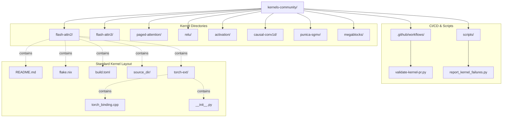
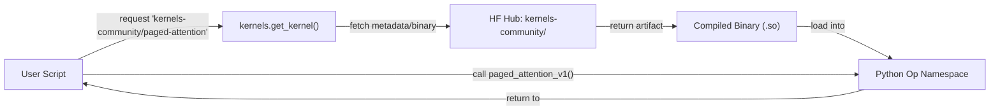

<!-- source: DeepWiki mcp.deepwiki.com · repo huggingface/kernels-community · page 1 Overview · fetched 2026-10-26 -->

# Overview

<details>
<summary>Relevant source files</summary>

The following files were used as context for generating this wiki page:

- [.github/workflows/nightly_kernel_check.yml](.github/workflows/nightly_kernel_check.yml)
- [.github/workflows/validate-kernel-pr.py](.github/workflows/validate-kernel-pr.py)
- [.gitignore](.gitignore)
- [CONTRIBUTING.md](CONTRIBUTING.md)
- [README.md](README.md)
- [activation/README.md](activation/README.md)
- [activation/scripts/readme_example.py](activation/scripts/readme_example.py)
- [causal-conv1d/README.md](causal-conv1d/README.md)
- [causal-conv1d/scripts/readme_example.py](causal-conv1d/scripts/readme_example.py)
- [flash-attn3/README.md](flash-attn3/README.md)
- [flash-attn3/scripts/readme_example.py](flash-attn3/scripts/readme_example.py)
- [megablocks/README.md](megablocks/README.md)
- [megablocks/scripts/readme_example.py](megablocks/scripts/readme_example.py)
- [paged-attention/README.md](paged-attention/README.md)
- [paged-attention/scripts/readme_example.py](paged-attention/scripts/readme_example.py)
- [punica-sgmv/README.md](punica-sgmv/README.md)
- [relu/README.md](relu/README.md)
- [relu/relu_cuda/relu.cu](relu/relu_cuda/relu.cu)
- [relu/relu_metal/common.h](relu/relu_metal/common.h)
- [relu/relu_metal/relu.metal](relu/relu_metal/relu.metal)
- [relu/relu_metal/relu.mm](relu/relu_metal/relu.mm)
- [relu/relu_xpu/relu.cpp](relu/relu_xpu/relu.cpp)
- [relu/tests/__init__.py](relu/tests/__init__.py)
- [scripts/report_kernel_failures.py](scripts/report_kernel_failures.py)
- [scripts/run_kernels_checks.py](scripts/run_kernels_checks.py)

</details>


The `kernels-community` repository is a centralized collection of optimized GPU kernels for deep learning operations, maintained by Hugging Face and the community. This repository provides pre-built, high-performance kernel implementations for attention mechanisms, activations, convolutions, and specialized operations used in large language models and other neural network architectures. All kernels are built using a reproducible Nix-based build system and published to the Hugging Face Hub under the [kernels-community](https://huggingface.co/kernels-community) namespace for easy distribution and consumption.

This document provides a high-level introduction to the repository's architecture, kernel ecosystem, and usage patterns. For detailed information on specific components, see:
- **[Repository Architecture](#1.1)**: High-level system design, build infrastructure, and CI/CD pipelines.
- **[Quick Start Guide](#1.2)**: Installation and basic usage examples for common kernels.

## Repository Purpose and Scope

The repository serves two primary functions:

1.  **Kernel Distribution**: Package and distribute high-impact GPU kernels that either (a) are developed by Hugging Face or (b) lack upstream kernel distribution support despite being widely used in the ecosystem [CONTRIBUTING.md:3-9]().
2.  **Build Infrastructure**: Provide a reproducible, multi-backend build system that ensures consistent kernel compilation across CUDA, Metal, XPU, and ROCm platforms [CONTRIBUTING.md:26-27]().

Kernels in this repository are **not** necessarily developed here. Instead, the repository often imports source code from upstream projects, packages them with standardized build configurations, and distributes pre-built binaries through the Hugging Face Hub [CONTRIBUTING.md:5-6]().

**Sources:** [CONTRIBUTING.md:1-20](), [README.md:8-13]()

## Repository Structure

The repository follows a standardized directory structure where each kernel resides in its own top-level directory containing all necessary build and source files [CONTRIBUTING.md:24-31]().



### Key Components per Kernel
*   **`build.toml`**: Specifies backends, dependencies, and source files [CONTRIBUTING.md:27]().
*   **`flake.nix`**: Defines the Nix environment for reproducible builds [CONTRIBUTING.md:26]().
*   **`torch-ext/`**: Contains the Python package structure and `torch_binding.cpp` for PyTorch integration [CONTRIBUTING.md:29-30]().
*   **`__init__.py`**: Exposes the kernel operations through the `._ops` namespace [CONTRIBUTING.md:31]().

**Sources:** [CONTRIBUTING.md:22-34](), [.github/workflows/validate-kernel-pr.py:68-71]()

## Kernel Ecosystem

The repository hosts a variety of optimized kernels. While some are reference implementations (like `relu`), others are state-of-the-art implementations for production LLM serving.

| Kernel | Purpose | Primary Backends | Source Inspiration |
| :--- | :--- | :--- | :--- |
| `flash-attn` | High-speed attention (v2, v3, v4, MLA) | CUDA, XPU | Dao-AILab |
| `paged-attention` | KV cache management for LLM inference | CUDA, Metal | vLLM, mistral.rs |
| `activation` | Fused SiLU/SwiGLU operations | CUDA | vLLM |
| `rmsnorm` | Multi-backend Root Mean Square Layer Norm | CPU, XPU, CUDA | - |
| `causal-conv1d` | Depthwise convolution for Mamba/SSMs | CUDA | Tri Dao |
| `punica-sgmv` | Sparse Grouped Matrix-Vector multiplication | CUDA | Punica, Lorax |
| `relu` | Reference implementation for testing | CUDA, Metal, XPU, ROCm | - |

For a complete catalog and detailed documentation of each, see **[Kernel Implementations](#4)**.

**Sources:** [paged-attention/README.md:9-11](), [activation/README.md:7-11](), [causal-conv1d/README.md:7-9](), [punica-sgmv/README.md:7-10](), [relu/README.md:5-6]()

## User Interaction Model

Users consume these kernels through the `kernels` Python library, which handles downloading and JIT-loading the appropriate binary for the user's hardware.



### Basic Usage Pattern
```python
from kernels import get_kernel
import torch

# Load the kernel from the Hub
causal_conv1d = get_kernel("kernels-community/causal-conv1d")

# Use the kernel function directly
out = causal_conv1d.causal_conv1d_fn(input_tensor, weight, bias)
```

**Sources:** [causal-conv1d/README.md:22-37](), [paged-attention/README.md:28-72](), [activation/README.md:28-41]()

## CI/CD and Quality Assurance

The repository maintains high standards through automated validation and nightly checks.

*   **PR Validation**: Every Pull Request is checked by `validate-kernel-pr.py` to ensure correct directory structure and presence of `build.toml`/`flake.nix` [.github/workflows/validate-kernel-pr.py:27-79]().
*   **Nightly Checks**: A scheduled workflow runs `scripts/run_kernels_checks.py` daily to verify all kernels remain functional [.github/workflows/nightly_kernel_check.yml:1-30]().
*   **Failure Reporting**: If a check fails, `scripts/report_kernel_failures.py` sends a notification to a Slack webhook with the specific failing kernels [scripts/report_kernel_failures.py:34-42]().

For details on the automation infrastructure, see **[CI/CD and Testing Infrastructure](#3)**.

**Sources:** [.github/workflows/nightly_kernel_check.yml:1-30](), [scripts/run_kernels_checks.py:96-116](), [scripts/report_kernel_failures.py:14-22]()

## Next Steps

*   To understand how kernels are built and how to configure `build.toml`, visit **[Repository Architecture](#1.1)**.
*   To start using kernels in your project immediately, see the **[Quick Start Guide](#1.2)**.
*   To contribute a new kernel or update an existing one, read the **[Contributing to Kernels Community](#6)**.

---

