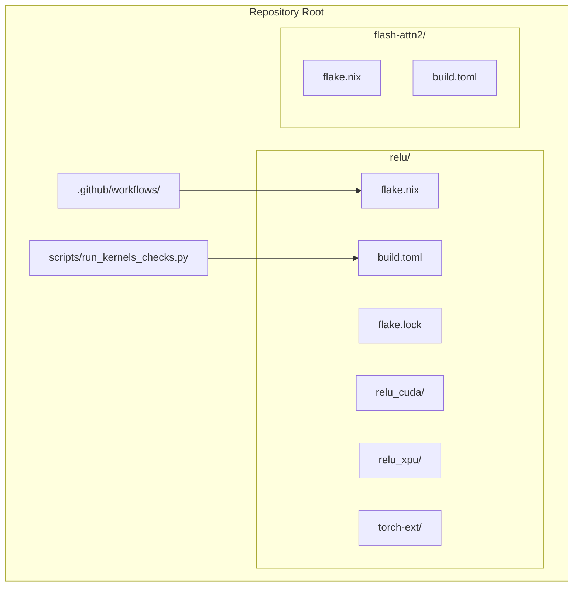
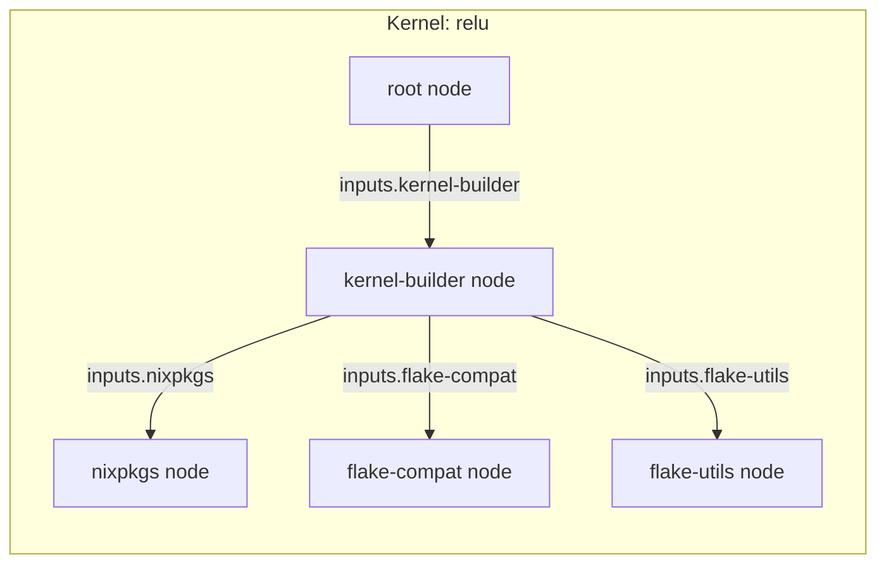
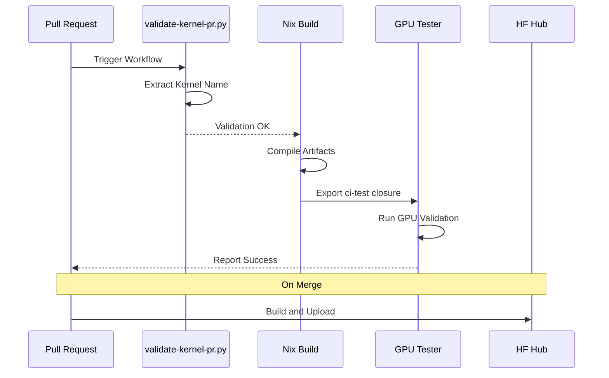

<!-- source: DeepWiki mcp.deepwiki.com · repo huggingface/kernels-community · page 1.1 Repository Architecture · fetched 2026-10-26 -->

# Repository Architecture

Relevant source files

The following files were used as context for generating this wiki page:

- [.github/scripts/windows/install-oneapi.ps1](.github/scripts/windows/install-oneapi.ps1)
- [.github/workflows/build-pr-mac.yaml](.github/workflows/build-pr-mac.yaml)
- [.github/workflows/build-pr-windows.yaml](.github/workflows/build-pr-windows.yaml)
- [.github/workflows/build-pr.yaml](.github/workflows/build-pr.yaml)
- [.github/workflows/build-release-mac.yaml](.github/workflows/build-release-mac.yaml)
- [.github/workflows/build-release-windows.yaml](.github/workflows/build-release-windows.yaml)
- [.github/workflows/build-release.yaml](.github/workflows/build-release.yaml)
- [.github/workflows/nightly_kernel_check.yml](.github/workflows/nightly_kernel_check.yml)
- [.github/workflows/nix_fmt.yaml](.github/workflows/nix_fmt.yaml)
- [.github/workflows/validate-kernel-pr.py](.github/workflows/validate-kernel-pr.py)
- [.gitignore](.gitignore)
- [README.md](README.md)
- [relu/build.toml](relu/build.toml)
- [relu/flake.lock](relu/flake.lock)
- [relu/flake.nix](relu/flake.nix)
- [relu/relu_cpu/relu_cpu.cpp](relu/relu_cpu/relu_cpu.cpp)
- [relu/tests/test_relu.py](relu/tests/test_relu.py)
- [relu/torch-ext/relu/__init__.py](relu/torch-ext/relu/__init__.py)
- [relu/torch-ext/relu/layers/__init__.py](relu/torch-ext/relu/layers/__init__.py)
- [relu/torch-ext/torch_binding.cpp](relu/torch-ext/torch_binding.cpp)
- [scripts/report_kernel_failures.py](scripts/report_kernel_failures.py)
- [scripts/run_kernels_checks.py](scripts/run_kernels_checks.py)

This document describes the high-level architecture of the `kernels-community` repository, including its directory organization, dependency management, build system integration, and CI/CD pipeline. This page provides an overview of how the major components fit together.

## Repository Structure

The kernels-community repository follows a flat directory structure where each kernel occupies its own top-level directory. Every kernel is a self-contained unit with standardized files that enable automated building, testing, and deployment.

### Standard Kernel Directory Layout

Each kernel directory must contain a set of configuration files that define its build process and dependencies. The `relu` kernel serves as the reference implementation for this structure [relu/build.toml:1-68]().

| File | Purpose |
|------|---------|
| `flake.nix` | Nix flake definition that declares the `kernel-builder` dependency [relu/flake.nix:1-17](). |
| `flake.lock` | Locked versions of all Nix dependencies for reproducible builds [relu/flake.lock:1-117](). |
| `build.toml` | Build configuration specifying backends, dependencies, and source files [relu/build.toml:1-68](). |
| `torch-ext/` | Python binding code that exposes kernels to PyTorch [relu/torch-ext/relu/__init__.py:1-2](). |

**Kernel Directory Structure**

The flat structure simplifies CI/CD automation because the PR title format `kernel-name: description` directly maps to a directory path. The validation script [.github/workflows/validate-kernel-pr.py:46-52]() extracts the kernel name from the PR title and verifies the corresponding directory exists.

Sources: [relu/build.toml:1-68](), [relu/flake.nix:1-17](), [.github/workflows/validate-kernel-pr.py:40-52]()

## Dependency Management Architecture

The repository uses a **hub-and-spoke dependency architecture** with `kernel-builder` as the central orchestrator. All kernels declare a dependency on `kernel-builder` in their `flake.nix` [relu/flake.nix:4-6]().

### Version Locking Through flake.lock

Each `flake.lock` file contains cryptographically locked versions of dependencies. The `kernel-builder` input is locked to a specific Git revision to ensure build reproducibility [relu/flake.lock:43-50]().

**flake.lock Dependency Resolution**

Each locked node includes:
- `narHash`: SHA256 hash for integrity verification [relu/flake.lock:45-45]().
- `rev`: Git commit hash of the dependency [relu/flake.lock:48-48]().
- `lastModified`: Unix timestamp of the commit [relu/flake.lock:44-44]().

Sources: [relu/flake.nix:1-17](), [relu/flake.lock:1-117]()

## Build System and Backend Support

The build system is driven by `build.toml`, which defines how the kernel should be compiled across different hardware backends.

### Backend Support Matrix

The repository supports multiple backends, with the `relu` kernel providing a reference for all of them [relu/build.toml:5-11]().

| Backend | Compiler/Toolchain | Source Extensions | Supported in `relu` |
|---------|-------------------|-------------------|-------------------|
| **CUDA** | `nvcc` | `.cu` | Yes [relu/build.toml:39-44]() |
| **Metal** | `xcrun metal` | `.mm`, `.metal` | Yes [relu/build.toml:30-37]() |
| **XPU** | `icpx` (SYCL) | `.cpp` | Yes [relu/build.toml:23-28]() |
| **ROCm** | `hipcc` | `.cu` | Yes [relu/build.toml:46-62]() |
| **CPU** | `gcc`/`clang` | `.cpp` | Yes [relu/build.toml:64-68]() |

### Windows-Specific Support
Windows builds are handled via GitHub Actions workflows. Certain kernels or backends are explicitly blocked on Windows if they are incompatible. For example, `megablocks` and `flash-attn2` are blocked for Windows XPU builds [.github/workflows/build-pr-windows.yaml:78-87]().

Sources: [relu/build.toml:1-68](), [.github/workflows/build-pr-windows.yaml:78-109]()

## CI/CD Pipeline

The repository implements a multi-stage validation and deployment pipeline.

### PR Validation and Building
When a PR is opened, the system:
1. **Validates the PR title**: Extracts the kernel name using `validate-kernel-pr.py` [.github/workflows/build-pr.yaml:40-50]().
2. **Checks `build.toml`**: Ensures mandatory fields like `repo-id` are present [.github/workflows/build-pr.yaml:51-58]().
3. **Builds the Kernel**: Runs `nix build -L .#ci` on Linux/macOS [.github/workflows/build-pr.yaml:59-63]() or `cargo build` for the `kernel-builder` followed by the kernel build on Windows [.github/workflows/build-pr-windows.yaml:164-171]().
4. **GPU Testing**: Imports the built closure and runs `ci-test` on a GPU-enabled runner [.github/workflows/build-pr.yaml:112-118]().

### Nightly Validation
A scheduled "Kernels Check" runs daily [.github/workflows/nightly_kernel_check.yml:3-5](). This workflow uses `scripts/report_kernel_failures.py` to:
1. Discover all directories containing a `build.toml` [scripts/run_kernels_checks.py:46-63]().
2. Run `kernels check kernels-community/<kernel>` for each [scripts/run_kernels_checks.py:96-116]().
3. Report failures to Slack and clear the local Hub cache [scripts/run_kernels_checks.py:113-114]().

### Release and Publication
Upon merging a PR, the kernel is published to the Hugging Face Hub.
- **Main Branch**: Kernels with `version = 1` in `build.toml` are uploaded to the `main` branch of their respective Hub repositories [.github/workflows/build-release.yaml:65-72]().
- **Build-and-Upload**: The `nix run .#build-and-upload` command automates the versioned release process [.github/workflows/build-release.yaml:50-56]().

**CI/CD Interaction Flow**

Sources: [.github/workflows/build-pr.yaml:1-119](), [.github/workflows/build-release.yaml:1-73](), [scripts/run_kernels_checks.py:1-156](), [.github/workflows/nightly_kernel_check.yml:1-30]()

---

