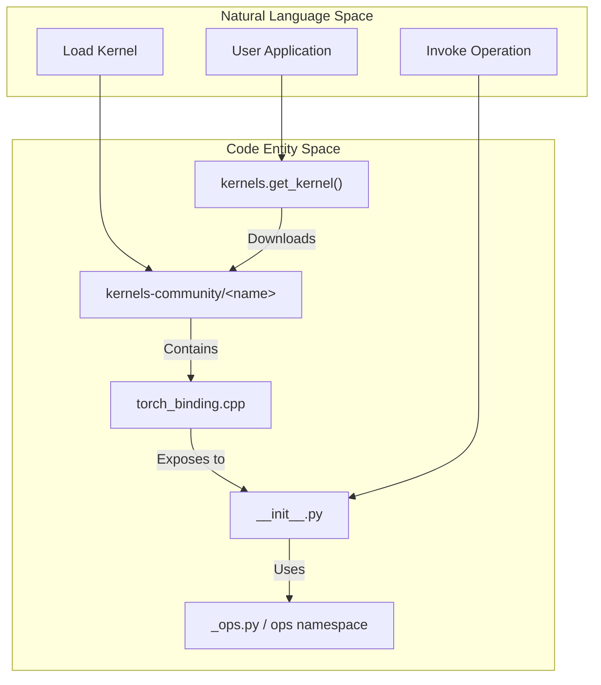
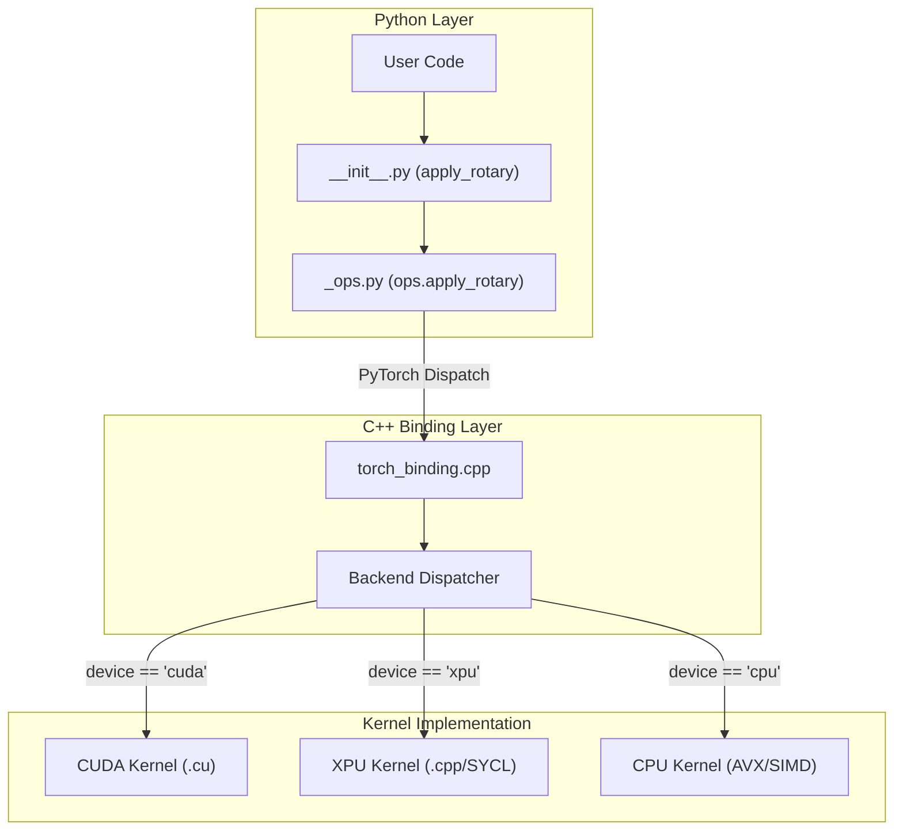

<!-- source: DeepWiki mcp.deepwiki.com · repo huggingface/kernels-community · page 1.2 Quick Start Guide · fetched 2026-10-26 -->

# Quick Start Guide

<details>
<summary>Relevant source files</summary>

The following files were used as context for generating this wiki page:

- [relu/build.toml](relu/build.toml)
- [relu/flake.lock](relu/flake.lock)
- [relu/flake.nix](relu/flake.nix)
- [relu/relu_cpu/relu_cpu.cpp](relu/relu_cpu/relu_cpu.cpp)
- [relu/tests/test_relu.py](relu/tests/test_relu.py)
- [relu/torch-ext/relu/__init__.py](relu/torch-ext/relu/__init__.py)
- [relu/torch-ext/relu/layers/__init__.py](relu/torch-ext/relu/layers/__init__.py)
- [relu/torch-ext/torch_binding.cpp](relu/torch-ext/torch_binding.cpp)
- [rmsnorm/build.toml](rmsnorm/build.toml)
- [rmsnorm/flake.lock](rmsnorm/flake.lock)
- [rmsnorm/flake.nix](rmsnorm/flake.nix)
- [rmsnorm/rmsnorm_cpu/rmsnorm_cpu_torch.cpp](rmsnorm/rmsnorm_cpu/rmsnorm_cpu_torch.cpp)
- [rmsnorm/rmsnorm_xpu/RMSNorm.cpp](rmsnorm/rmsnorm_xpu/RMSNorm.cpp)
- [rmsnorm/tests/test_rmsnorm.py](rmsnorm/tests/test_rmsnorm.py)
- [rmsnorm/torch-ext/rmsnorm/__init__.py](rmsnorm/torch-ext/rmsnorm/__init__.py)
- [rmsnorm/torch-ext/rmsnorm/layers.py](rmsnorm/torch-ext/rmsnorm/layers.py)
- [rmsnorm/torch-ext/torch_binding.cpp](rmsnorm/torch-ext/torch_binding.cpp)
- [rotary/build.toml](rotary/build.toml)
- [rotary/flake.lock](rotary/flake.lock)
- [rotary/flake.nix](rotary/flake.nix)
- [rotary/rotary-xpu/rotary_xpu.cpp](rotary/rotary-xpu/rotary_xpu.cpp)
- [rotary/rotary-xpu/rotary_xpu.hpp](rotary/rotary-xpu/rotary_xpu.hpp)
- [rotary/rotary/rotary_cuda.cu](rotary/rotary/rotary_cuda.cu)
- [rotary/tests/__init__.py](rotary/tests/__init__.py)
- [rotary/tests/test_rotary.py](rotary/tests/test_rotary.py)
- [rotary/tests/utils.py](rotary/tests/utils.py)
- [rotary/torch-ext/rotary/__init__.py](rotary/torch-ext/rotary/__init__.py)

</details>


This guide demonstrates how to install and use kernels from the `kernels-community` repository. It covers the basic workflow of obtaining pre-compiled kernels via the Hugging Face Hub and invoking their functions in PyTorch applications.

## Installation

The `kernels-community` repository provides pre-compiled kernels through the Hugging Face Hub. To access them, install the `kernels` Python package:

```bash
pip install kernels
```

The `kernels` package provides the `get_kernel()` function, which downloads and loads compiled kernel extensions on demand.

## Basic Usage Pattern

All kernels follow a consistent three-step pattern: import the `get_kernel()` function, load the desired kernel from the Hub, and invoke kernel functions. The underlying system uses **Nix Flakes** to ensure reproducible builds across different environments [relu/flake.nix:1-17](), [rmsnorm/flake.nix:1-21]().

### System Architecture to Code Mapping

The following diagram maps high-level usage concepts to the specific code entities and file structures found in the repository.


**Diagram: Mapping Usage to Code Entities**

Sources: [relu/build.toml:14-15](), [rmsnorm/build.toml:11-12](), [rotary/torch-ext/rotary/__init__.py:1-16](), [relu/torch-ext/torch_binding.cpp:1-20]()

### Core Components

| Component | Description | Code Entity / File |
|-----------|-------------|-------------|
| **Entry Point** | Function to fetch kernels | `from kernels import get_kernel` |
| **Hub Identifier** | Kernel location on HF Hub | `repo-id` in `build.toml` [relu/build.toml:15]() |
| **Binding** | C++/CUDA to Python bridge | `torch-ext/torch_binding.cpp` [rmsnorm/build.toml:15]() |
| **Python API** | User-facing function calls | `torch-ext/<kernel>/__init__.py` [rotary/torch-ext/rotary/__init__.py:7-15]() |

## Common Kernel Examples

The repository supports multiple backends including **CUDA**, **CPU (AVX2/AVX512)**, **XPU (Intel)**, **Metal (Apple Silicon)**, and **ROCm (AMD)** [relu/build.toml:5-11](), [rmsnorm/build.toml:5-8]().

### 1. ReLU (Multi-Backend)
The ReLU kernel serves as a reference implementation for multi-backend support.

```python
import torch
from kernels import get_kernel

# Load the ReLU kernel
relu_kernel = get_kernel("kernels-community/relu")

# Create input on any supported device (e.g., CUDA, XPU, MPS, or CPU)
x = torch.randn(1024, 1024, device="cuda")
output = relu_kernel.relu(x)
```
Sources: [relu/tests/test_relu.py:11-21](), [relu/build.toml:5-11]()

### 2. RMSNorm (Performance Optimized)
The RMSNorm implementation includes specialized paths for Intel CPUs (AVX512) and XPUs.

```python
from kernels import get_kernel
import torch

rmsnorm = get_kernel("kernels-community/rmsnorm")

# RMSNorm often uses a weight (gamma) parameter
hidden_size = 1024
x = torch.randn(16, hidden_size, device="cpu", dtype=torch.bfloat16)
weight = torch.ones(hidden_size, device="cpu", dtype=torch.bfloat16)

# The kernel is typically wrapped in a Layer class
from rmsnorm.layers import RMSNorm
layer = RMSNorm()
layer.weight = torch.nn.Parameter(weight)
output = layer(x)
```
Sources: [rmsnorm/tests/test_rmsnorm.py:7-16](), [rmsnorm/build.toml:60-103]()

### 3. Rotary Positional Embeddings (RoPE)
The rotary kernel is used to apply positional information to Query and Key tensors in Transformers.

```python
from kernels import get_kernel
import torch

rotary = get_kernel("kernels-community/rotary")

# q, k: (batch, seq_len, n_heads, head_dim)
# cos, sin: (seq_len, head_dim // 2)
q_rot, k_rot = rotary.apply_rotary_transformers(q, k, cos, sin)
```
Sources: [rotary/torch-ext/rotary/__init__.py:19-49](), [rotary/build.toml:1-8]()

## Data Flow and Dispatch

When a user calls a kernel function, the request flows through several layers of the system.


**Diagram: Data Flow from Python to Hardware Kernels**

Sources: [rotary/torch-ext/rotary/__init__.py:1-16](), [relu/build.toml:23-68](), [rmsnorm/build.toml:17-103]()

## Summary of Available Backends

The `build.toml` file in each kernel directory defines the supported hardware and source files.

| Kernel | Supported Backends | Key Implementation Files |
|--------|--------------------|--------------------------|
| **relu** | CPU, CUDA, Metal, ROCm, XPU | `relu_cuda/relu.cu`, `relu_metal/relu.mm`, `relu_xpu/relu.cpp` [relu/build.toml:23-68]() |
| **rmsnorm** | CPU (AVX2/512), XPU | `rmsnorm_cpu/rmsnorm_avx512.cpp`, `rmsnorm_xpu/RMSNorm.cpp` [rmsnorm/build.toml:17-103]() |
| **rotary** | CUDA, XPU | `rotary/rotary_cuda.cu`, `rotary-xpu/rotary_xpu.cpp` [rotary/build.toml:17-29]() |

## Next Steps

- **Development**: To add a new kernel, see [Adding a New Kernel](6.2).
- **Architecture**: To understand how Nix manages these dependencies, see [Repository Architecture](1.1).
- **Testing**: To run validation suites, use `pytest` as seen in [relu/tests/test_relu.py]().

Sources: [relu/build.toml:1-68](), [rmsnorm/build.toml:1-104](), [rotary/build.toml:1-29](), [relu/flake.nix:1-17](), [rmsnorm/flake.nix:1-21](), [rotary/torch-ext/rotary/__init__.py:1-53]()

---

