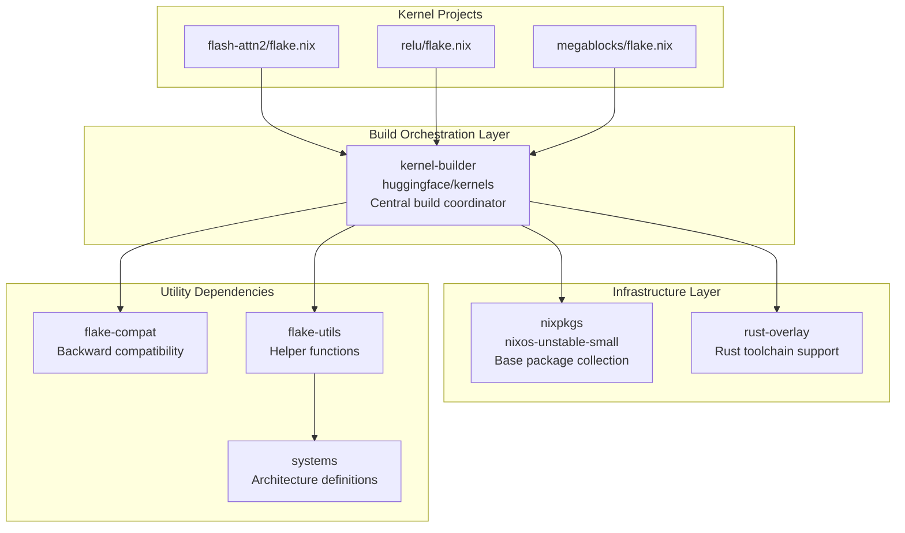
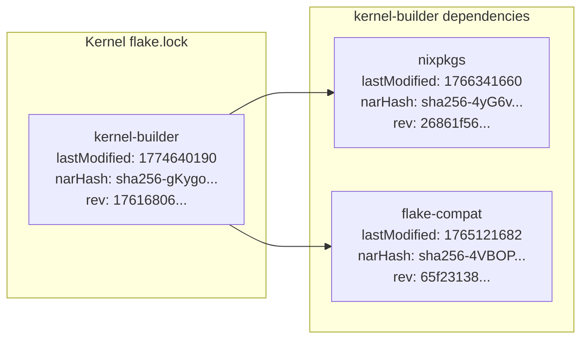
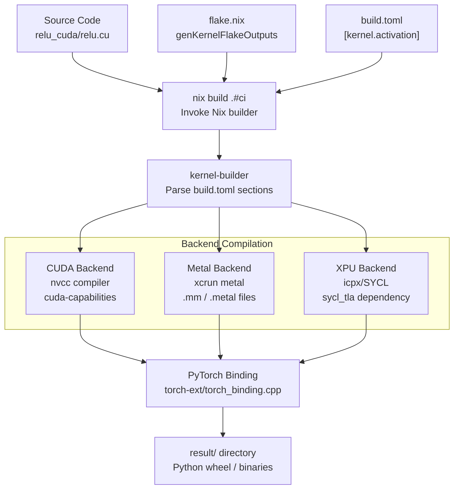

<!-- source: DeepWiki mcp.deepwiki.com · repo huggingface/kernels-community · page 2 Build System · fetched 2026-10-26 -->

# Build System

Relevant source files

The following files were used as context for generating this wiki page:

- [flash-attn2/build.toml](flash-attn2/build.toml)
- [flash-attn2/flake.lock](flash-attn2/flake.lock)
- [flash-attn2/flake.nix](flash-attn2/flake.nix)
- [flash-attn2/tests/conftest.py](flash-attn2/tests/conftest.py)
- [megablocks/build.toml](megablocks/build.toml)
- [megablocks/flake.lock](megablocks/flake.lock)
- [megablocks/flake.nix](megablocks/flake.nix)
- [relu/build.toml](relu/build.toml)
- [relu/flake.lock](relu/flake.lock)
- [relu/flake.nix](relu/flake.nix)
- [relu/relu_cpu/relu_cpu.cpp](relu/relu_cpu/relu_cpu.cpp)
- [relu/tests/test_relu.py](relu/tests/test_relu.py)
- [relu/torch-ext/relu/__init__.py](relu/torch-ext/relu/__init__.py)
- [relu/torch-ext/relu/layers/__init__.py](relu/torch-ext/relu/layers/__init__.py)
- [relu/torch-ext/torch_binding.cpp](relu/torch-ext/torch_binding.cpp)

## Purpose and Scope

The Build System provides reproducible, multi-backend kernel compilation for all kernels in the `kernels-community` repository. This page describes the overall build architecture, the role of Nix Flakes in ensuring reproducibility, and how the various build components interact. For detailed information on specific aspects:

- Dependency version locking and flake management: see [Nix Flakes and Dependency Management](#2.1)
- Kernel-specific build configuration: see [Build Configuration (build.toml)](#2.2)
- Compilation orchestration and backend handling: see [Kernel Builder System](#2.3)

The build system is designed to compile kernels for multiple backends (CUDA, Metal, XPU, ROCm) with guaranteed reproducibility across machines and over time through cryptographic hashing and exact version pinning.

## Build System Architecture

The build infrastructure follows a three-layer architecture where individual kernel projects depend on a central orchestrator, which in turn coordinates with the Nix package ecosystem.

**Sources:** [flash-attn2/flake.nix:4-6](), [relu/flake.nix:4-6](), [megablocks/flake.nix:4-6](), [relu/flake.lock:36-56]()

## Dependency Lock Structure

Each kernel maintains a `flake.lock` file that pins exact versions of all dependencies using cryptographic hashes. The lock files create a dependency chain that ensures bit-for-bit reproducible builds.

The lock structure contains critical information for each dependency:
- **lastModified**: Unix timestamp of the last modification [relu/flake.lock:44]()
- **narHash**: SHA-256 hash of the Nix Archive for content verification [relu/flake.lock:45]()
- **rev**: Exact Git commit SHA ensuring version immutability [relu/flake.lock:48]()

**Sources:** [relu/flake.lock:1-117](), [flash-attn2/flake.lock:1-117](), [megablocks/flake.lock:1-117]()

## Version Management and Filtering

The build system utilizes `genKernelFlakeOutputs` from the `kernel-builder` library to generate standard flake outputs. Kernels can provide a `torchVersions` function to filter which PyTorch and hardware combinations are supported.

| Kernel | kernel-builder rev | Backend Constraints |
|--------|-------------------|---------------------|
| flash-attn2 | `ba07ad3a60` | XPU requires Torch >= 2.9; CPU only on x86_64-linux [flash-attn2/flake.nix:25-34]() |
| megablocks | `ba07ad3a60` | CPU only on x86_64-linux [megablocks/flake.nix:27-33]() |
| relu | `17616806ff` | Standard multi-backend support [relu/flake.nix:13-16]() |

**Sources:** [flash-attn2/flake.nix:13-35](), [megablocks/flake.nix:13-34](), [relu/flake.nix:13-16]()

## Build Process Flow

The build process follows a multi-stage pipeline from developer source code to deployable kernel artifacts:

The build invocation triggers the following sequence:

1. **Dependency Resolution**: Nix reads `flake.lock` to fetch exact dependency versions.
2. **Build Configuration**: `kernel-builder` parses `build.toml` to determine enabled backends (e.g., `cpu`, `cuda`, `metal`, `rocm`, `xpu`) [relu/build.toml:5-11]().
3. **Backend Compilation**: Parallel compilation for each enabled backend using specified flags like `cxx-flags` [flash-attn2/build.toml:23-33]() or `cuda-capabilities` [flash-attn2/build.toml:63-68]().
4. **PyTorch Integration**: Source files in the `[torch]` section are compiled to create Python extension module bindings [relu/build.toml:17-21]().
5. **Artifact Generation**: Compiled binaries are placed in the `result/` directory.

**Sources:** [relu/build.toml:1-68](), [flash-attn2/build.toml:1-166](), [megablocks/build.toml:1-131]()

## Reproducibility Guarantees

### Content-Addressable Storage
Every dependency is identified by its SHA-256 hash (`narHash` in lock files). The Nix store path contains this hash, ensuring that if content changes, the hash changes, preventing undetected modifications [relu/flake.lock:45]().

### Hermetic Build Environment
Nix builds execute in isolated environments. All build inputs must be explicitly declared in the `flake.nix` or `build.toml`. For example, `megablocks` explicitly lists `tqdm` and `py-cpuinfo` for its check phase [megablocks/flake.nix:18-21]().

### Time-Invariant Builds
The `rev` fields in lock files ensure that running `nix build` today produces identical results to running it months later [relu/flake.lock:48]().

## Build System Components

### kernel-builder
The `kernel-builder` component (hosted at `huggingface/kernels`) serves as the central orchestrator. It provides:
- **Build Configuration Parsing**: Reads `build.toml` to determine backend targets.
- **Compiler Orchestration**: Invokes appropriate compilers (nvcc, metal, icpx) based on configuration.
- **PyTorch Extension Building**: Manages integration for Python bindings.

**Sources:** [relu/flake.lock:36-56](), [flash-attn2/flake.lock:36-56]()

### flake-utils
The `flake-utils` library provides helper functions for common flake patterns, particularly for iterating over supported systems [relu/flake.lock:18-35]().

### flake-compat
The `flake-compat` dependency enables compatibility with legacy Nix installations that do not support the experimental flakes feature [relu/flake.lock:3-17]().

## Testing and Validation

The build system integrates with `pytest` for validation. A `device` fixture is commonly used in `conftest.py` to automatically detect and select the available hardware backend (CUDA, XPU, or CPU) for tests [flash-attn2/tests/conftest.py:7-14](). Tests are marked with `@pytest.mark.kernels_ci` to be picked up by the CI pipeline [relu/tests/test_relu.py:10-11]().

**Sources:** [flash-attn2/tests/conftest.py:1-25](), [relu/tests/test_relu.py:1-36]()

---

