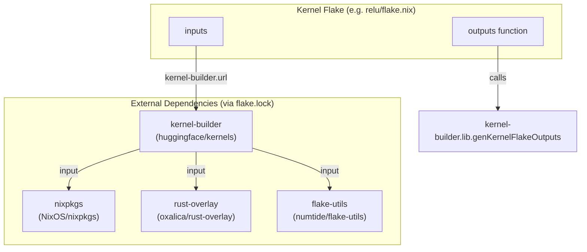
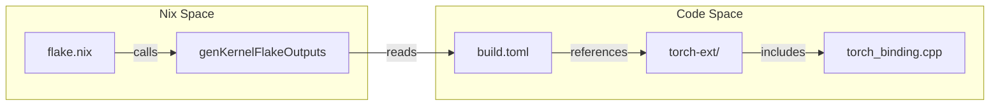

<!-- source: DeepWiki mcp.deepwiki.com · repo huggingface/kernels-community · page 2.1 Nix Flakes and Dependency Management · fetched 2026-10-26 -->

# Nix Flakes and Dependency Management

<details>
<summary>Relevant source files</summary>

The following files were used as context for generating this wiki page:

- [flake.lock](flake.lock)
- [flake.nix](flake.nix)
- [flash-attn3/build.toml](flash-attn3/build.toml)
- [flash-attn3/flake.lock](flash-attn3/flake.lock)
- [flash-attn3/flake.nix](flash-attn3/flake.nix)
- [flash-mla/build.toml](flash-mla/build.toml)
- [mamba-ssm/build.toml](mamba-ssm/build.toml)
- [mamba-ssm/flake.lock](mamba-ssm/flake.lock)
- [mamba-ssm/flake.nix](mamba-ssm/flake.nix)
- [mamba-ssm/torch-ext/mamba_ssm/__init__.py](mamba-ssm/torch-ext/mamba_ssm/__init__.py)
- [mamba-ssm/torch-ext/mamba_ssm/models/__init__.py](mamba-ssm/torch-ext/mamba_ssm/models/__init__.py)
- [mamba-ssm/torch-ext/mamba_ssm/modules/__init__.py](mamba-ssm/torch-ext/mamba_ssm/modules/__init__.py)
- [mamba-ssm/torch-ext/mamba_ssm/ops/__init__.py](mamba-ssm/torch-ext/mamba_ssm/ops/__init__.py)
- [mamba-ssm/torch-ext/mamba_ssm/ops/triton/__init__.py](mamba-ssm/torch-ext/mamba_ssm/ops/triton/__init__.py)
- [mamba-ssm/torch-ext/mamba_ssm/utils/generation.py](mamba-ssm/torch-ext/mamba_ssm/utils/generation.py)
- [megablocks/build.toml](megablocks/build.toml)
- [megablocks/flake.lock](megablocks/flake.lock)
- [megablocks/flake.nix](megablocks/flake.nix)
- [relu/build.toml](relu/build.toml)
- [relu/flake.lock](relu/flake.lock)
- [relu/flake.nix](relu/flake.nix)
- [relu/relu_cpu/relu_cpu.cpp](relu/relu_cpu/relu_cpu.cpp)
- [relu/tests/test_relu.py](relu/tests/test_relu.py)
- [relu/torch-ext/relu/__init__.py](relu/torch-ext/relu/__init__.py)
- [relu/torch-ext/relu/layers/__init__.py](relu/torch-ext/relu/layers/__init__.py)
- [relu/torch-ext/torch_binding.cpp](relu/torch-ext/torch_binding.cpp)

</details>


## Purpose and Scope

This document explains the Nix flake-based dependency management system used throughout the `kernels-community` repository. It covers the structure of `flake.lock` files, the role of the `kernel-builder` dependency, and the functional implementation of `genKernelFlakeOutputs`. It also details how platform-specific builds are restricted using `torchVersions` filtering.

For information about the build configuration files, see [Build Configuration (build.toml)](2.2). For details on the orchestration of compilation, see [Kernel Builder System](2.3).

## Overview of Nix Flakes

Each kernel project in the repository (e.g., `relu/`, `flash-attn3/`, `megablocks/`) contains a `flake.nix` file that declares its inputs and a corresponding `flake.lock` file that pins those inputs to specific cryptographic hashes and Git revisions. This ensures that every build is hermetic and reproducible across different environments.

The flake system provides:
- **Reproducible Environments**: Every developer and CI runner uses the exact same toolchain versions.
- **Transitive Locking**: Dependencies of dependencies (like `nixpkgs` or `rust-overlay`) are locked.
- **Unified Interface**: All kernels expose a standard set of outputs via the `kernel-builder` library.

## Flake Structure and Inputs

All kernels follow a consistent pattern where the primary input is the `kernel-builder` library hosted at `github:huggingface/kernels`.


Sources: [relu/flake.nix:4-16](), [megablocks/flake.nix:4-13](), [mamba-ssm/flake.lock:36-56]()

### The flake.lock System
The `flake.lock` file is a JSON manifest that records the exact state of the dependency graph. Each node in the graph specifies a `narHash` (content hash) and a `rev` (Git commit).

| Field | Description | Example (from relu) |
|-------|-------------|---------------------|
| `rev` | Git commit hash | `17616806ff345bca12872c75f3b5b6500fa78328` |
| `narHash` | Nix Archive Hash | `sha256-gKygoJRyuk8WxQQByZl8RoDwAMdaWkH4E0vWFubseZo=` |
| `lastModified` | Unix timestamp | `1774640190` |

Sources: [relu/flake.lock:43-50](), [megablocks/flake.lock:43-50]()

## genKernelFlakeOutputs

The `outputs` section of every kernel flake invokes `kernel-builder.lib.genKernelFlakeOutputs`. This function is the core of the kernel build system, transforming a kernel's source code and `build.toml` into a set of Nix packages, development shells, and apps.

### Configuration Parameters
The function accepts several key arguments to customize the build:

1.  **`path`**: The root directory of the kernel (usually `./.`). [relu/flake.nix:15-15]()
2.  **`pythonCheckInputs`**: A function taking `pkgs` and returning a list of Python packages required for testing. [megablocks/flake.nix:17-23]()
3.  **`doGetKernelCheck`**: A boolean (default `true`) that determines if the `kernels check` validation should run during the build. [mamba-ssm/flake.nix:19-19]()
4.  **`torchVersions`**: A filter function to restrict which PyTorch versions and hardware platforms are built. [megablocks/flake.nix:25-33]()

### Dependency Flow Diagram


Sources: [relu/flake.nix:13-16](), [relu/build.toml:17-21](), [mamba-ssm/build.toml:11-15]()

## Dependency Versioning and Variance

While most kernels share a common `kernel-builder` baseline, they are updated independently. This leads to slight variances in the locked revisions across the repository.

| Kernel | kernel-builder Revision | Last Modified (Unix) |
|--------|------------------------|-----------------------|
| `relu` | `17616806...` | `1774640190` |
| `megablocks` | `ba07ad3a...` | `1774628159` |
| `mamba-ssm` | `f3be105c...` | `1774518955` |
| `flash-attn3` | `826d5360...` | `1774453774` |

Sources: [relu/flake.lock:48-48](), [megablocks/flake.lock:48-48](), [mamba-ssm/flake.lock:48-48](), [flash-attn3/flake.lock:48-48]()

## Platform Filtering with torchVersions

The `torchVersions` argument in `genKernelFlakeOutputs` allows kernels to restrict their build matrix. This is particularly important for kernels with specific hardware requirements or those that only support a subset of PyTorch versions.

### Example: CPU Support Filtering
In `megablocks`, the `torchVersions` function is used to ensure that CPU-only builds are only attempted on `x86_64-linux` systems, as other architectures may lack the necessary SIMD instructions (like AVX-512).

```nix
torchVersions =
  let
    cpuSupported = version: system: !(version ? "cpu") || system == "x86_64-linux";
  in
  allVersions:
  builtins.map (
    version: version // { systems = builtins.filter (cpuSupported version) version.systems; }
  ) allVersions;
```
Sources: [megablocks/flake.nix:25-33]()

### Integration with build.toml
The filtering logic in `flake.nix` works in tandem with the `backends` list in `build.toml`. If a backend is listed in `build.toml` but filtered out in `flake.nix`, the build system will skip that combination.

- **`relu` backends**: `cpu`, `cuda`, `metal`, `rocm`, `xpu`. [relu/build.toml:5-11]()
- **`mamba-ssm` backends**: `cuda`. [mamba-ssm/build.toml:4-4]()
- **`megablocks` backends**: `cuda`, `xpu`, `cpu`. [megablocks/build.toml:5-9]()

## Python Dependency Management

Kernel-specific Python dependencies are handled via `pythonCheckInputs`. This ensures that when Nix enters a development shell or runs tests, the environment contains exactly what the kernel needs without polluting the global namespace.

For example, `mamba-ssm` requires `causal-conv1d`. The flake overrides the `causal-conv1d` package to ensure it uses the correct CUDA stdenv if CUDA support is enabled.

```nix
pythonCheckInputs =
  ps: with ps; [
    (causal-conv1d.overridePythonAttrs (_: {
      stdenv = if pkgs.config.cudaSupport then pkgs.cudaPackages.backendStdenv else pkgs.stdenv;
    }))
    einops
    huggingface-hub
    transformers
  ];
```
Sources: [mamba-ssm/flake.nix:21-30]()

---

