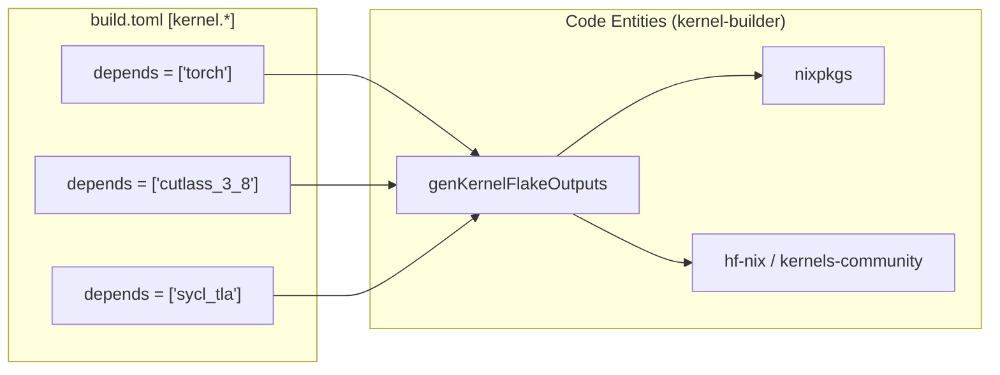

<!-- source: DeepWiki mcp.deepwiki.com · repo huggingface/kernels-community · page 2.2 Build Configuration (build.toml) · fetched 2026-10-26 -->

# Build Configuration (build.toml)

<details>
<summary>Relevant source files</summary>

The following files were used as context for generating this wiki page:

- [deep-gemm/build.toml](deep-gemm/build.toml)
- [flash-attn2/build.toml](flash-attn2/build.toml)
- [flash-attn2/flake.lock](flash-attn2/flake.lock)
- [flash-attn2/flake.nix](flash-attn2/flake.nix)
- [flash-attn2/tests/conftest.py](flash-attn2/tests/conftest.py)
- [megablocks/build.toml](megablocks/build.toml)
- [megablocks/flake.lock](megablocks/flake.lock)
- [megablocks/flake.nix](megablocks/flake.nix)
- [relu/build.toml](relu/build.toml)
- [relu/flake.lock](relu/flake.lock)
- [relu/flake.nix](relu/flake.nix)
- [relu/relu_cpu/relu_cpu.cpp](relu/relu_cpu/relu_cpu.cpp)
- [relu/tests/test_relu.py](relu/tests/test_relu.py)
- [relu/torch-ext/relu/__init__.py](relu/torch-ext/relu/__init__.py)
- [relu/torch-ext/relu/layers/__init__.py](relu/torch-ext/relu/layers/__init__.py)
- [relu/torch-ext/torch_binding.cpp](relu/torch-ext/torch_binding.cpp)

</details>


This page documents the `build.toml` configuration file format used to define kernel build specifications in the kernels-community repository. The `build.toml` file is the primary interface between kernel source code and the `kernel-builder` build system.

For information about managing build dependencies with Nix, see [Nix Flakes and Dependency Management (2.1)]().

## Purpose and Scope

The `build.toml` file specifies:
- Kernel metadata (name, license, version).
- Hub deployment information (`repo-id`).
- PyTorch extension binding files and Python extension patterns.
- Backend-specific kernel implementations (CPU, CUDA, Metal, XPU, ROCm).
- Source file listings and include directories for each backend.
- Hardware capability requirements (CUDA compute capabilities, ROCm architectures).
- Compilation flags (`cxx-flags`, `cuda-flags`) and version constraints (`minver`, `maxver`).
- Dependencies on external libraries (CUTLASS, SYCL TLA, etc.).

Each kernel directory in the repository must contain a `build.toml` file that declares all variants and their compilation requirements.

## File Structure Overview

The `build.toml` file follows TOML syntax and consists of three main section types:

Title: build.toml Section Hierarchy

```mermaid
graph TB
    BuildToml["build.toml"]
    
    subgraph "Section Types"
        General["[general]<br/>Kernel metadata & Hub config"]
        Torch["[torch]<br/>PyTorch bindings & PyExt patterns"]
        Kernel1["[kernel.name]<br/>Implementation 1 (e.g. CUDA)"]
        Kernel2["[kernel.name_cpu]<br/>Implementation 2 (e.g. CPU)"]
        KernelN["[kernel.*]<br/>Additional implementations"]
    end
    
    subgraph "General Fields"
        GName["name: string"]
        GLicense["license: string"]
        GBackends["backends: array"]
        GHub["[general.hub]<br/>repo-id: string"]
    end
    
    subgraph "Torch Fields"
        TSrc["src: array of files"]
        TPyext["pyext: array of extensions"]
    end
    
    subgraph "Kernel Fields"
        KBackend["backend: cpu|cuda|metal|xpu|rocm"]
        KSrc["src: array of source files"]
        KDepends["depends: array of dependencies"]
        KFlags["cuda-flags / cxx-flags: array"]
        KCaps["cuda-capabilities / rocm-archs: array"]
    end
    
    BuildToml --> General
    BuildToml --> Torch
    BuildToml --> Kernel1
    BuildToml --> Kernel2
    BuildToml --> KernelN
    
    General --> GName
    General --> GHub
    
    Torch --> TSrc
    Torch --> TPyext
    
    Kernel1 --> KBackend
    Kernel1 --> KSrc
    Kernel1 --> KDepends
    Kernel1 --> KFlags
    Kernel1 --> KCaps
```

Sources: [flash-attn2/build.toml:1-166](), [relu/build.toml:1-67](), [deep-gemm/build.toml:1-109]()

## General Section

The `[general]` section contains kernel-level metadata and supported backends.

| Field | Type | Required | Description |
|-------|------|----------|-------------|
| `name` | string | Yes | Kernel identifier, must match directory name. |
| `license` | string | Yes | SPDX license identifier (e.g., `"BSD-3-Clause"`, `"Apache-2.0"`). |
| `version` | integer | Yes | Kernel version number. |
| `backends` | array[string] | Yes | List of supported backends (e.g., `["cpu", "cuda", "xpu"]`). |

### Hub Configuration
The `[general.hub]` sub-section defines where the kernel is published on the Hugging Face Hub:
- `repo-id`: The target repository on the Hub (e.g., `"kernels-community/flash-attn2"`). [flash-attn2/build.toml:13-13]()

### Version Constraints
Global version constraints can be specified for specific toolkits:
- `[general.cuda].minver`: Minimum CUDA version required (e.g., `"12.3"`). [deep-gemm/build.toml:8-8]()

Sources: [flash-attn2/build.toml:1-13](), [relu/build.toml:1-15](), [deep-gemm/build.toml:1-9]()

## Torch Section

The `[torch]` section declares PyTorch C++ extension binding files and patterns for Python-side file inclusion.

| Field | Type | Required | Description |
|-------|------|----------|-------------|
| `src` | array[string] | Yes | List of binding source files (typically `torch_binding.cpp`). |
| `pyext` | array[string] | No | List of file extensions to include in the Python package (e.g., `["py", "cuh", "hpp"]`). |

**Example:**
```toml
[torch]
src = ["torch-ext/torch_binding.cpp", "torch-ext/torch_binding.h"]
pyext = ["py", "cuh", "hpp", "h"]
```
Sources: [flash-attn2/build.toml:15-19](), [deep-gemm/build.toml:10-15]()

## Kernel Sections

Each `[kernel.section_name]` section defines a specific implementation variant. A single `build.toml` can define multiple variants for the same backend (e.g., a generic CPU version and an AVX-512 specialized version).

### Common Kernel Fields

| Field | Type | Required | Description |
|-------|------|----------|-------------|
| `backend` | string | Yes | Target backend: `cpu`, `cuda`, `metal`, `xpu`, `rocm`. |
| `src` | array[string] | Yes | Source files (.cu, .cpp, .mm, .metal, .h, etc.). |
| `depends` | array[string] | Yes | Dependencies: `torch`, `cutlass_3_6`, `sycl_tla`, etc. |
| `include` | array[string] | No | Additional include directories relative to kernel root. |
| `cxx-flags` | array[string] | No | Compiler flags for C++ files. |
| `cuda-flags` | array[string] | No | Specific flags for `nvcc` compilation. |

Sources: [flash-attn2/build.toml:21-41](), [deep-gemm/build.toml:17-33]()

## Backend-Specific Configuration

### CUDA Backend
CUDA kernels utilize `cuda-capabilities` to specify target SM versions.
- **cuda-capabilities**: Array of strings like `"8.0"`, `"9.0"`, or `"9.0a"` (for specialized Hopper features). [deep-gemm/build.toml:20-20]()
- **cuda-minver**: Minimum CUDA toolkit version for this specific kernel. [deep-gemm/build.toml:19-19]()

### CPU Backend
CPU kernels often use `cxx-flags` for SIMD specialization (AVX-512, AMX).
```toml
[kernel.flash_attn_cpu_avx512]
backend = "cpu"
cxx-flags = ["-mavx512f", "-mamx-bf16"]
src = ["flash_attn_cpu/src/fmha_fwd_avx512.cpp"]
```
Sources: [flash-attn2/build.toml:21-33](), [megablocks/build.toml:102-118]()

### XPU Backend (Intel)
XPU kernels rely on SYCL and typically require the `sycl_tla` dependency.
```toml
[kernel.flash_attn_xpu]
backend = "xpu"
depends = ["torch", "sycl_tla"]
src = ["flash_attn_xpu/flash_api.cpp"]
```
Sources: [flash-attn2/build.toml:168-174](), [megablocks/build.toml:57-62]()

### Metal Backend (Apple)
Metal kernels include both host-side Objective-C++ (`.mm`) and shader code (`.metal`).
```toml
[kernel.activation_metal]
backend = "metal"
src = ["relu_metal/relu.mm", "relu_metal/relu.metal"]
```
Sources: [relu/build.toml:30-37]()

### ROCm Backend (AMD)
ROCm kernels specify target architectures via `rocm-archs`.
- **rocm-archs**: List of architectures like `"gfx906"`, `"gfx942"`, `"gfx1100"`. [relu/build.toml:49-59]()

## Dependency Management

Dependencies listed in `depends` are resolved by the `kernel-builder` through the Nix environment.

Title: build.toml Dependency Resolution

Sources: [megablocks/flake.nix:13-13](), [flash-attn2/build.toml:69-72](), [megablocks/build.toml:37-40]()

## Multi-Backend Implementation Example (ReLU)

The ReLU kernel provides a reference for supporting all major backends in a single `build.toml`:

| Backend | Section | Source Path |
|---------|---------|-------------|
| CUDA | `[kernel.activation]` | `relu_cuda/relu.cu` |
| Metal | `[kernel.activation_metal]` | `relu_metal/relu.mm` |
| ROCm | `[kernel.activation_rocm]` | `relu_cuda/relu.cu` (via HIP) |
| XPU | `[kernel.activation_xpu]` | `relu_xpu/relu.cpp` |
| CPU | `[kernel.relu_cpu]` | `relu_cpu/relu_cpu.cpp` |

Sources: [relu/build.toml:1-67]()

## Build Constraints (minver/maxver)

The system allows filtering builds based on version constraints to prevent compilation on incompatible toolkits.
- `cuda-minver`: Used in `deep-gemm` to require CUDA 12.3+ for SM90a/SM100 features. [deep-gemm/build.toml:19-19]()
- `torchVersions` (in `flake.nix`): While not in `build.toml`, this function in the flake often filters based on the `backend` specified in `build.toml` (e.g., requiring Torch 2.9+ for XPU). [flash-attn2/flake.nix:31-34]()

Sources: [deep-gemm/build.toml:19-20](), [flash-attn2/flake.nix:22-35]()

---

