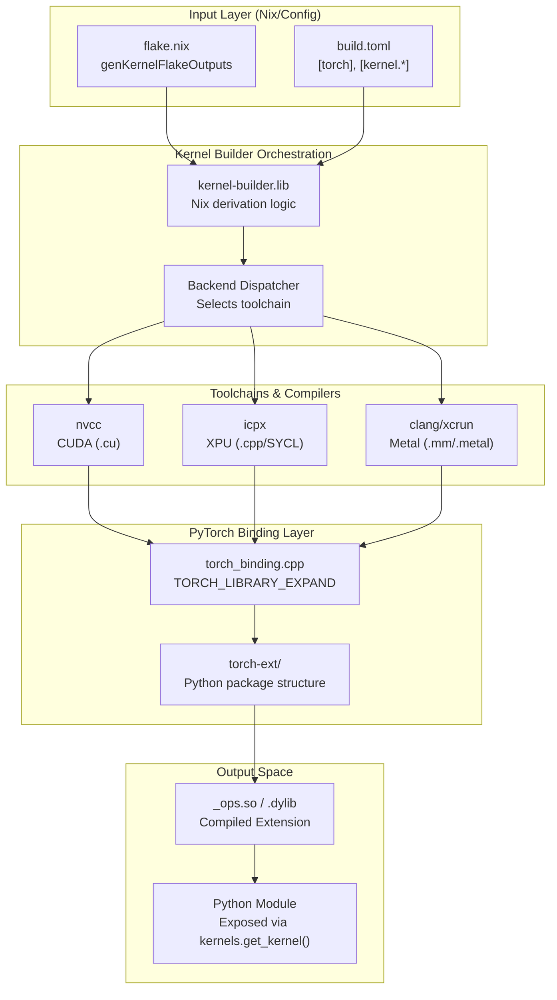
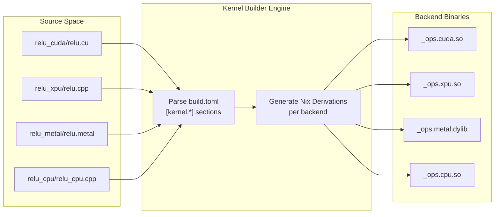

<!-- source: DeepWiki mcp.deepwiki.com · repo huggingface/kernels-community · page 2.3 Kernel Builder System · fetched 2026-10-26 -->

# Kernel Builder System

<details>
<summary>Relevant source files</summary>

The following files were used as context for generating this wiki page:

- [relu/build.toml](relu/build.toml)
- [relu/flake.lock](relu/flake.lock)
- [relu/flake.nix](relu/flake.nix)
- [relu/relu_cpu/relu_cpu.cpp](relu/relu_cpu/relu_cpu.cpp)
- [relu/tests/test_relu.py](relu/tests/test_relu.py)
- [relu/torch-ext/relu/__init__.py](relu/torch-ext/relu/__init__.py)
- [relu/torch-ext/relu/layers/__init__.py](relu/torch-ext/relu/layers/__init__.py)
- [relu/torch-ext/torch_binding.cpp](relu/torch-ext/torch_binding.cpp)
- [rmsnorm/build.toml](rmsnorm/build.toml)
- [rmsnorm/flake.lock](rmsnorm/flake.lock)
- [rmsnorm/flake.nix](rmsnorm/flake.nix)
- [rmsnorm/rmsnorm_cpu/rmsnorm_cpu_torch.cpp](rmsnorm/rmsnorm_cpu/rmsnorm_cpu_torch.cpp)
- [rmsnorm/rmsnorm_xpu/RMSNorm.cpp](rmsnorm/rmsnorm_xpu/RMSNorm.cpp)
- [rmsnorm/tests/test_rmsnorm.py](rmsnorm/tests/test_rmsnorm.py)
- [rmsnorm/torch-ext/rmsnorm/__init__.py](rmsnorm/torch-ext/rmsnorm/__init__.py)
- [rmsnorm/torch-ext/rmsnorm/layers.py](rmsnorm/torch-ext/rmsnorm/layers.py)
- [rmsnorm/torch-ext/torch_binding.cpp](rmsnorm/torch-ext/torch_binding.cpp)
- [rotary/build.toml](rotary/build.toml)
- [rotary/flake.lock](rotary/flake.lock)
- [rotary/flake.nix](rotary/flake.nix)
- [rotary/rotary-xpu/rotary_xpu.cpp](rotary/rotary-xpu/rotary_xpu.cpp)
- [rotary/rotary-xpu/rotary_xpu.hpp](rotary/rotary-xpu/rotary_xpu.hpp)
- [rotary/rotary/rotary_cuda.cu](rotary/rotary/rotary_cuda.cu)
- [rotary/tests/__init__.py](rotary/tests/__init__.py)
- [rotary/tests/test_rotary.py](rotary/tests/test_rotary.py)
- [rotary/tests/utils.py](rotary/tests/utils.py)
- [rotary/torch-ext/rotary/__init__.py](rotary/torch-ext/rotary/__init__.py)

</details>


The `kernel-builder` system is the central compilation orchestrator that transforms kernel source code and `build.toml` configurations into PyTorch-compatible Python extensions. It manages multi-backend compilation, dependency resolution, and integration with the Nix build environment.

## System Architecture

The `kernel-builder` acts as a hub between the Nix build system, backend compilers, and PyTorch extension infrastructure. It leverages `genKernelFlakeOutputs` to bridge the Nix flake definitions with the build logic.

### Architectural Flow: Source to Python Op

The following diagram maps the high-level system components to the specific code entities that handle the build orchestration.


**Sources:** [relu/flake.nix:8-16](), [relu/build.toml:1-11](), [rmsnorm/flake.nix:8-20]()

## The `torch-ext` Pattern

Every kernel in the community repository follows the `torch-ext` pattern. This directory contains the Python package structure and the C++ binding code that exposes compiled operations to the PyTorch ecosystem.

### Key Components of `torch-ext`
1.  **`torch_binding.cpp`**: The primary entry point for the C++ extension. It uses `TORCH_LIBRARY_EXPAND` to register operations into the PyTorch dispatcher.
2.  **`__init__.py`**: Defines the user-facing Python API, often wrapping the raw `_ops` with additional logic (like autograd or shape checking).
3.  **`_ops.py`**: Typically handles the dynamic loading of the compiled shared library.

### `TORCH_LIBRARY_EXPAND` and Dispatch
The system uses the `TORCH_LIBRARY_EXPAND` macro in `torch_binding.cpp` to register custom operators. This allows the kernels to be compatible with `torch.compile` and the standard PyTorch operator registry.

| File | Role | Code Reference |
| :--- | :--- | :--- |
| `relu/torch-ext/torch_binding.cpp` | C++ Op Registration | [relu/torch-ext/torch_binding.cpp:1-10]() |
| `rotary/torch-ext/rotary/__init__.py` | Python API Wrapper | [rotary/torch-ext/rotary/__init__.py:7-16]() |
| `rmsnorm/torch-ext/rmsnorm/layers.py` | High-level Module | [rmsnorm/torch-ext/rmsnorm/layers.py:1-10]() |

**Sources:** [relu/build.toml:17-21](), [rotary/torch-ext/rotary/__init__.py:1-16](), [rmsnorm/torch-ext/torch_binding.cpp:1-15]()

## Multi-Backend Orchestration

The `kernel-builder` reads the `backends` list in `build.toml` and invokes specific compilers for each target. It handles the complexity of different file extensions and compiler flags per backend.

### Compilation Data Flow

This diagram illustrates how a single kernel (e.g., `relu`) is processed into multiple backend-specific binaries.


**Sources:** [relu/build.toml:5-11](), [relu/build.toml:23-68](), [rmsnorm/build.toml:5-8]()

### Backend Specializations in `build.toml`
The `build.toml` file allows for backend-specific configuration, such as CPU instruction sets or ROCm architectures:
*   **CPU AVX/FMA**: Configured via `cxx-flags` in `[kernel.rmsnorm_cpu_avx512]`. [rmsnorm/build.toml:87-96]()
*   **ROCm Archs**: Specified in `rocm-archs` for AMD hardware. [relu/build.toml:49-59]()
*   **XPU Dependencies**: Often requires specific include paths for SYCL headers. [rmsnorm/build.toml:20-21]()

## Exposing Ops to Python

Once compiled, the shared libraries are exposed to Python. The repository standardizes on a namespace pattern where `ops` are imported from a private `_ops` module.

### Data Flow: Runtime Execution
1.  **Import**: User calls `import relu`. [relu/tests/test_relu.py:7-7]()
2.  **Dispatch**: The `__init__.py` or a dedicated `_ops.py` loads the backend-specific `.so`.
3.  **Execution**: The Python call `ops.apply_rotary(...)` invokes the C++ function bound in `torch_binding.cpp`. [rotary/torch-ext/rotary/__init__.py:16-16]()

### Integration Example: `rotary`
The `rotary` kernel demonstrates the wrapper pattern, where the raw C++ op is wrapped in a signature-compatible function for `transformers`.

```python
def apply_rotary_transformers(q, k, cos, sin, unsqueeze_dim=1):
    # ... logic to prepare tensors ...
    ops.apply_rotary(q1, q2, cos, sin, q1, q2, False)
    return q_rotated, k_rotated
```
**Sources:** [rotary/torch-ext/rotary/__init__.py:19-52](), [relu/tests/test_relu.py:11-21]()

## Testing and Validation
The build system is tightly integrated with `pytest`. Kernels include tests that detect the available hardware device and validate the custom op against a reference implementation (often `torch.nn.functional` or a pure Python equivalent).

| Test Component | Purpose | Source |
| :--- | :--- | :--- |
| `device` detection | Handles CUDA, XPU, MPS, or CPU | [relu/tests/test_relu.py:12-19]() |
| `torch.compile` test | Ensures compatibility with Inductor | [rmsnorm/tests/test_rmsnorm.py:48-60]() |
| `assert_close` | Numerical validation | [relu/tests/test_relu.py:21-21]() |

**Sources:** [relu/tests/test_relu.py:11-36](), [rmsnorm/tests/test_rmsnorm.py:7-22](), [rmsnorm/tests/test_rmsnorm.py:48-75]()

---

