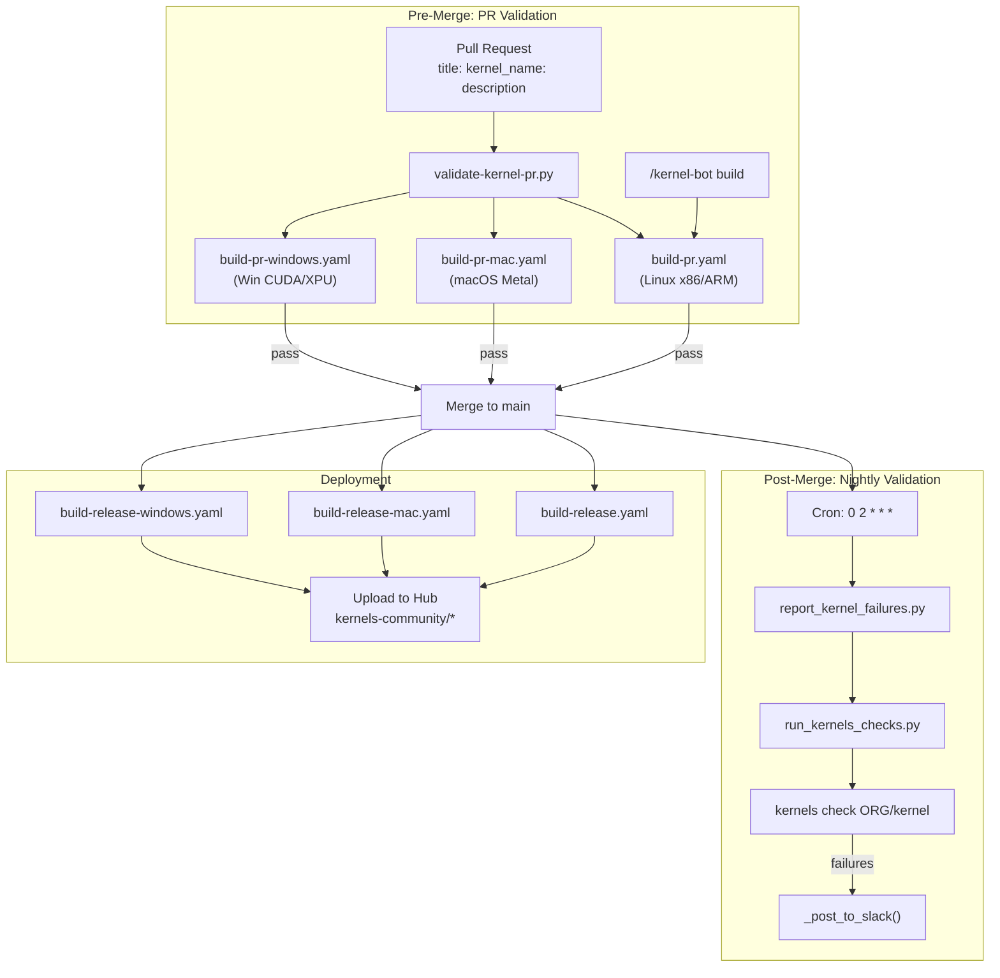
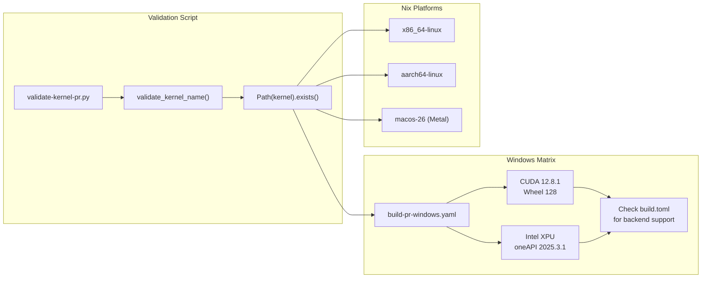
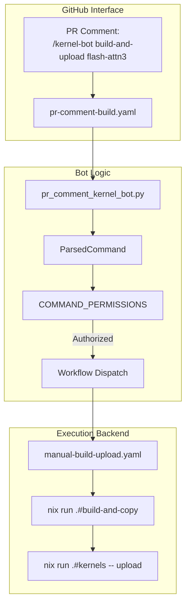

<!-- source: DeepWiki mcp.deepwiki.com · repo huggingface/kernels-community · page 3 CI/CD and Testing Infrastructure · fetched 2026-10-26 -->

# CI/CD and Testing Infrastructure

Relevant source files

The following files were used as context for generating this wiki page:

- [.github/scripts/pr_comment_kernel_bot.py](.github/scripts/pr_comment_kernel_bot.py)
- [.github/scripts/windows/install-oneapi.ps1](.github/scripts/windows/install-oneapi.ps1)
- [.github/workflows/build-pr-mac.yaml](.github/workflows/build-pr-mac.yaml)
- [.github/workflows/build-pr-windows.yaml](.github/workflows/build-pr-windows.yaml)
- [.github/workflows/build-pr.yaml](.github/workflows/build-pr.yaml)
- [.github/workflows/build-release-mac.yaml](.github/workflows/build-release-mac.yaml)
- [.github/workflows/build-release-windows.yaml](.github/workflows/build-release-windows.yaml)
- [.github/workflows/build-release.yaml](.github/workflows/build-release.yaml)
- [.github/workflows/manual-build-upload.yaml](.github/workflows/manual-build-upload.yaml)
- [.github/workflows/nightly_kernel_check.yml](.github/workflows/nightly_kernel_check.yml)
- [.github/workflows/nix_fmt.yaml](.github/workflows/nix_fmt.yaml)
- [.github/workflows/pr-comment-build.yaml](.github/workflows/pr-comment-build.yaml)
- [.github/workflows/validate-kernel-pr.py](.github/workflows/validate-kernel-pr.py)
- [.gitignore](.gitignore)
- [README.md](README.md)
- [scripts/report_kernel_failures.py](scripts/report_kernel_failures.py)
- [scripts/run_kernels_checks.py](scripts/run_kernels_checks.py)

## Purpose and Scope

This document provides an overview of the automated testing, validation, and deployment infrastructure that ensures quality and reproducibility across all kernels in the repository. The CI/CD system operates across multiple platforms (Linux, macOS, Windows) and backends (CUDA, XPU, Metal), managing the lifecycle from **Pull Request validation** to **Nightly validation** and **Release deployment**.

For detailed information about specific workflows, see:
- [Pull Request Workflow](#3.1) — Detailed explanation of PR validation, multi-platform matrix strategy, and the `validate-kernel-pr.py` script.
- [Nightly Validation System](#3.2) — Document the nightly check system, cache management, and Slack reporting.
- [Release and Deployment](#3.3) — Explain the release pipeline, Hub uploading logic, and versioning.
- [Chat-Ops Kernel Bot](#3.4) — Document the `/kernel-bot` comment-driven build and merge system.

---

## CI/CD Architecture Overview

The CI/CD infrastructure implements a multi-stage validation pipeline that enforces quality gates before and after code merges. The system is designed around **reproducible builds** (Nix-based for Linux/macOS) and **native toolchains** (Windows) to ensure broad hardware compatibility.

### CI/CD Pipeline Flow

**Sources:** [.github/workflows/build-pr.yaml:1-25](), [.github/workflows/build-pr-mac.yaml:1-12](), [.github/workflows/build-pr-windows.yaml:1-17](), [.github/workflows/nightly_kernel_check.yml:1-10](), [.github/workflows/build-release.yaml:1-12]()

---

## Validation Gates and Multi-Platform Matrix

The CI/CD system enforces validation gates to ensure structural integrity and correct hardware targeting. While Linux and macOS use Nix for hermeticity, Windows builds utilize a matrix strategy to test against specific CUDA and Intel oneAPI versions.

### Validation Logic and Platform Support

**Sources:** [.github/workflows/validate-kernel-pr.py:12-40](), [.github/workflows/build-pr-windows.yaml:14-37](), [.github/workflows/build-pr.yaml:12-19](), [.github/workflows/build-pr-mac.yaml:11-12]()

### Key Validation Components

| Component | Location | Role |
|-----------|----------|------|
| `validate-kernel-pr.py` | [.github/workflows/validate-kernel-pr.py:1-84]() | Extracts kernel name from PR title and verifies directory structure. |
| `check-backend` step | [.github/workflows/build-pr-windows.yaml:54-109]() | Parses `build.toml` to determine if the kernel supports CUDA or XPU on Windows. |
| `xpuBlockList` | [.github/workflows/build-pr-windows.yaml:79-87]() | Hardcoded list of kernels (e.g., `megablocks`, `flash-attn2`) incompatible with Windows XPU. |
| `repo-id` check | [.github/workflows/build-pr.yaml:51-58]() | Ensures `build.toml` contains a mandatory `repo-id` for Hub publishing. |

---

## Nightly Validation and Monitoring

The nightly system verifies that production artifacts on the Hugging Face Hub remain functional. It uses `kernels check` to validate the environment and `report_kernel_failures.py` to notify the team via Slack.

### Nightly System Implementation

| Component | Implementation | Key Logic |
|-----------|----------------|-----------|
| Discovery | [scripts/run_kernels_checks.py:46-63]() | `discover_kernel_dirs()` finds directories containing a `build.toml`. |
| Execution | [scripts/run_kernels_checks.py:96-116]() | `run_kernels_checks()` executes `kernels check kernels-community/<name>`. |
| Cache Management | [scripts/run_kernels_checks.py:66-93]() | `_delete_kernel_cache()` clears the Hub cache to ensure a fresh pull. |
| Reporting | [scripts/report_kernel_failures.py:34-50]() | `_format_failure_message()` and `_post_to_slack()` handle notifications. |

**Sources:** [scripts/run_kernels_checks.py:1-157](), [scripts/report_kernel_failures.py:1-108]()

---

## Chat-Ops and Manual Dispatch

The repository features a specialized Chat-Ops bot, `/kernel-bot`, which allows maintainers to trigger builds and uploads directly from PR comments. This system bridges the gap between manual testing and automated release.

### Bot Workflow and Command Parsing

**Sources:** [.github/workflows/pr-comment-build.yaml:1-50](), [.github/scripts/pr_comment_kernel_bot.py:17-31](), [.github/workflows/manual-build-upload.yaml:1-33]()

### Command and Permission Matrix

The bot enforces strict permissions for sensitive operations:

- **`build`**: Allowed for users with `admin` or `write` access [[.github/scripts/pr_comment_kernel_bot.py:18]]().
- **`build-and-upload`**: Restricted to `admin` [[.github/scripts/pr_comment_kernel_bot.py:19]]().
- **`merge-and-upload`**: Restricted to `admin` [[.github/scripts/pr_comment_kernel_bot.py:20]]().

The bot uses a unique `dispatch_key` [[.github/scripts/pr_comment_kernel_bot.py:185-186]]() to track the status of manual builds and report results back to the PR comment thread.

**Sources:** [.github/scripts/pr_comment_kernel_bot.py:1-230](), [.github/workflows/manual-build-upload.yaml:1-124]()

---

