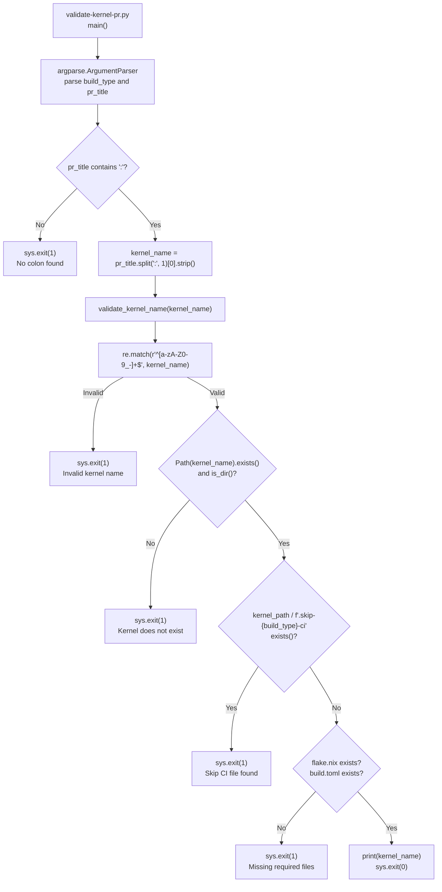
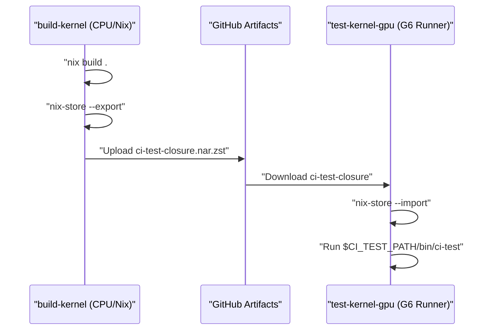

<!-- source: DeepWiki mcp.deepwiki.com · repo huggingface/kernels-community · page 3.1 Pull Request Workflow · fetched 2026-10-26 -->

# Pull Request Workflow

<details>
<summary>Relevant source files</summary>

The following files were used as context for generating this wiki page:

- [.github/scripts/windows/install-oneapi.ps1](.github/scripts/windows/install-oneapi.ps1)
- [.github/workflows/build-pr-mac.yaml](.github/workflows/build-pr-mac.yaml)
- [.github/workflows/build-pr-windows.yaml](.github/workflows/build-pr-windows.yaml)
- [.github/workflows/build-pr.yaml](.github/workflows/build-pr.yaml)
- [.github/workflows/build-release-mac.yaml](.github/workflows/build-release-mac.yaml)
- [.github/workflows/build-release-windows.yaml](.github/workflows/build-release-windows.yaml)
- [.github/workflows/build-release.yaml](.github/workflows/build-release.yaml)
- [.github/workflows/nightly_kernel_check.yml](.github/workflows/nightly_kernel_check.yml)
- [.github/workflows/nix_fmt.yaml](.github/workflows/nix_fmt.yaml)
- [.github/workflows/validate-kernel-pr.py](.github/workflows/validate-kernel-pr.py)
- [.gitignore](.gitignore)
- [README.md](README.md)
- [scripts/report_kernel_failures.py](scripts/report_kernel_failures.py)
- [scripts/run_kernels_checks.py](scripts/run_kernels_checks.py)

</details>


## Purpose and Scope

This document describes the automated pull request validation and build process for kernel contributions to the `kernels-community` repository. It covers the PR title format requirements, kernel validation logic, multi-platform build execution (Linux, Windows, macOS), and skip mechanisms that occur before code is merged.

The workflow ensures that every contribution is built against its target backends (CUDA, Metal, XPU, ROCm) and passes structural checks before integration.

## PR Title Format Requirements

The build system extracts the kernel name from the PR title to determine which kernel directory to build. The PR title must follow a specific format:

```text
kernel_name: short description of the change
```

The kernel name (the part before the colon) is extracted and validated by `validate-kernel-pr.py` [ .github/workflows/validate-kernel-pr.py:51 ]() using `pr_title.split(":", 1)[0].strip()`. If no colon is present in the title, the validation script exits with code 1 and the build is skipped [ .github/workflows/validate-kernel-pr.py:47-49 ]().

**Valid examples:**
- `flash-attn2: add support for SM 9.0`
- `paged-attention: optimize Metal backend`
- `relu: fix ROCm compilation issue`

**Invalid examples:**
- `Add flash attention support` (no colon)
- `flash-attn2 update kernel` (no colon)
- `flash@attn: add feature` (invalid character in kernel name)

The kernel name must pass validation by `validate_kernel_name()` [ .github/workflows/validate-kernel-pr.py:12-24 ](), which enforces that only alphanumeric characters, hyphens, and underscores are allowed using the regex pattern `^[a-zA-Z0-9_-]+$` [ .github/workflows/validate-kernel-pr.py:21 ]().

Sources: [ .github/workflows/validate-kernel-pr.py:47-51 ](), [ README.md:18-23 ]()

## Workflow Trigger and Concurrency

The PR build workflows are defined across several files:
- **Linux/Nix:** [ .github/workflows/build-pr.yaml ]()
- **Windows:** [ .github/workflows/build-pr-windows.yaml ]()
- **macOS:** [ .github/workflows/build-pr-mac.yaml ]()

These trigger on `pull_request` events [ .github/workflows/build-pr.yaml:2-3 ](). Workflows ignore changes that only affect README files using `paths-ignore` [ .github/workflows/build-pr.yaml:4-5 ]().

Concurrency control ensures that only one build runs per PR at a time to prevent resource waste [ .github/workflows/build-pr.yaml:6-8 ]():

```yaml
concurrency:
  group: ${{ github.workflow }}-${{ github.head_ref || github.run_id }}
  cancel-in-progress: true
```

Sources: [ .github/workflows/build-pr.yaml:2-8 ](), [ .github/workflows/build-pr-windows.yaml:2-10 ]()

## Kernel Validation Process

### Validation Script Architecture

The `validate-kernel-pr.py` script acts as the gatekeeper for all CI workflows.



### Validation Steps

The script performs five sequential checks [ .github/workflows/validate-kernel-pr.py:45-79 ]():

| Check | Location | Failure Reason |
|-------|----------|----------------|
| **Colon in title** | Line 47-49 | PR title format incorrect |
| **Name validation** | Line 53-55 | Kernel name contains invalid characters |
| **Directory exists** | Line 57-60 | Kernel directory not found in repository |
| **Skip file check** | Line 62-66 | `.skip-pr-ci` or `.skip-release-ci` file present |
| **Required files** | Line 68-76 | Missing `flake.nix` or `build.toml` |

The script accepts a `build_type` argument ("pr" or "release") [ .github/workflows/validate-kernel-pr.py:33-36 ]() to allow specific skip files like `.skip-pr-ci` [ .github/workflows/validate-kernel-pr.py:63 ]().

Sources: [ .github/workflows/validate-kernel-pr.py:12-79 ]()

## Multi-Platform Build Strategy

The repository employs a matrix strategy to validate kernels across different operating systems and hardware backends.

### Windows Matrix and Backend Support
Windows builds use a specific matrix for Python versions and hardware backends [ .github/workflows/build-pr-windows.yaml:14-35 ]().

A PowerShell step `check-backend` parses the kernel's `build.toml` to determine if the current matrix platform is supported [ .github/workflows/build-pr-windows.yaml:54-109 ](). It checks for:
1. `backend = "xpu"` in a `[kernel.*]` section [ .github/workflows/build-pr-windows.yaml:100 ]().
2. `backends = ["cuda", "xpu"]` in the `[general]` section [ .github/workflows/build-pr-windows.yaml:101 ]().

**Special Windows Constraints:**
- **CUDA Min Version:** The script checks `[general.cuda] minver` against the matrix CUDA version [ .github/workflows/build-pr-windows.yaml:66-75 ]().
- **XPU Block List:** Kernels like `megablocks` and `flash-attn2` are explicitly blocked on Windows XPU [ .github/workflows/build-pr-windows.yaml:78-87 ]().
- **OneAPI Requirement:** Specific kernels (`relu`, `rotary`, `rmsnorm`) trigger an Intel oneAPI installation step [ .github/workflows/build-pr-windows.yaml:89-95 ]().

### Linux and macOS (Nix-based)
Linux builds run on high-memory AWS runners [ .github/workflows/build-pr.yaml:12-23 ]() and use Nix to build the `ci` output [ .github/workflows/build-pr.yaml:63 ](). 

macOS builds run on `macos-26` runners [ .github/workflows/build-pr-mac.yaml:12 ]() and include a mandatory check for the `repo-id` in `build.toml` [ .github/workflows/build-pr-mac.yaml:39-46 ](). They also trigger the `MetalToolchain` installation [ .github/workflows/build-pr-mac.yaml:47-49 ]().

Sources: [ .github/workflows/build-pr-windows.yaml:14-109 ](), [ .github/workflows/build-pr.yaml:12-63 ](), [ .github/workflows/build-pr-mac.yaml:12-49 ]()

## GPU Testing Integration

For Linux PRs, the workflow includes a `test-kernel-gpu` job that runs after a successful build [ .github/workflows/build-pr.yaml:85-119 ]().

1. **Closure Export:** The build job exports the Nix closure of the `ci-test` output to a Zstd-compressed archive [ .github/workflows/build-pr.yaml:69-76 ]().
2. **Artifact Upload:** The closure is uploaded as a GitHub artifact [ .github/workflows/build-pr.yaml:77-83 ]().
3. **GPU Runner:** A specialized runner group `aws-g6-12xlarge-plus` downloads and imports the closure [ .github/workflows/build-pr.yaml:88-114 ]().
4. **Execution:** The `ci-test` binary is executed within the imported Nix environment [ .github/workflows/build-pr.yaml:118 ]().



Sources: [ .github/workflows/build-pr.yaml:64-119 ]()

## Release and Merge Workflow

When a PR is closed and merged, the `build-release.yaml` (Linux), `build-release-windows.yaml`, and `build-release-mac.yaml` workflows are triggered [ .github/workflows/build-release.yaml:3-4 ]() [ .github/workflows/build-release-windows.yaml:3-4 ]().

These workflows perform the final compilation and upload the artifacts to the Hugging Face Hub using the `build-and-upload` Nix app [ .github/workflows/build-release.yaml:56 ]().

**V1 Kernel Logic:**
If a kernel's `build.toml` specifies `version = 1`, it is additionally uploaded to the `main` branch of the Hub repository [ .github/workflows/build-release.yaml:65-72 ]():
```bash
if [ -n "$VERSION" ]; then
  nix build -L
  nix run -L .#kernels -- upload --repo-id kernels-community/$KERNEL --branch main result
fi
```

Sources: [ .github/workflows/build-release.yaml:11-72 ](), [ .github/workflows/build-release-windows.yaml:13-15 ]()

## Skip Mechanisms

Skip files allow maintainers to bypass CI without modifying workflow code.

| Skip File | Triggered By | Logic Location |
|-----------|--------------|----------------|
| `.skip-pr-ci` | PR Workflows | [ .github/workflows/validate-kernel-pr.py:63 ]() |
| `.skip-release-ci` | Release Workflows | [ .github/workflows/validate-kernel-pr.py:63 ]() |

The `validate-kernel-pr.py` script checks for these files and exits with code 1 if found [ .github/workflows/validate-kernel-pr.py:64-66 ]().

Sources: [ .github/workflows/validate-kernel-pr.py:62-66 ]()

---

