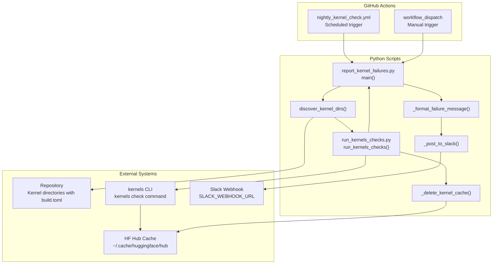
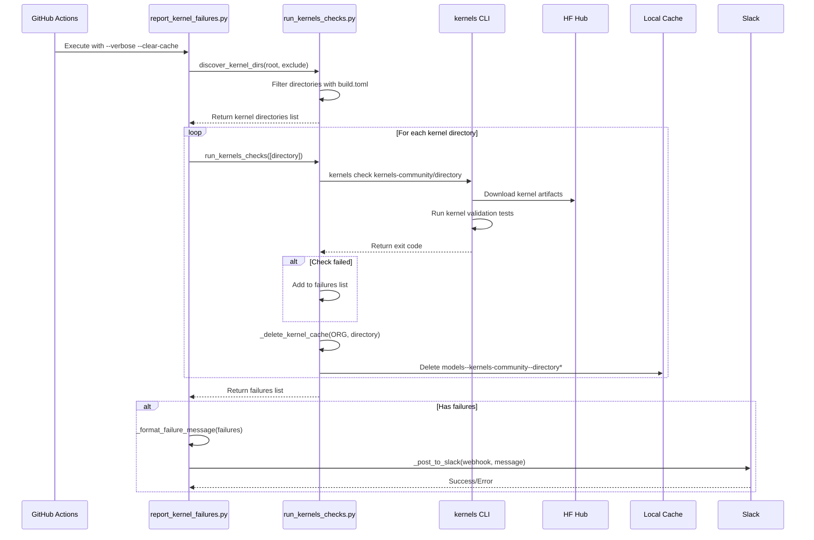

<!-- source: DeepWiki mcp.deepwiki.com · repo huggingface/kernels-community · page 3.2 Nightly Validation System · fetched 2026-10-26 -->

# Nightly Validation System

<details>
<summary>Relevant source files</summary>

The following files were used as context for generating this wiki page:

- [.github/workflows/biweekly_freshness_check.yml](.github/workflows/biweekly_freshness_check.yml)
- [.github/workflows/nightly_kernel_check.yml](.github/workflows/nightly_kernel_check.yml)
- [.github/workflows/test_kernel_freshness_lookup.yml](.github/workflows/test_kernel_freshness_lookup.yml)
- [.github/workflows/validate-kernel-pr.py](.github/workflows/validate-kernel-pr.py)
- [.gitignore](.gitignore)
- [README.md](README.md)
- [scripts/check_kernel_freshness.py](scripts/check_kernel_freshness.py)
- [scripts/report_kernel_failures.py](scripts/report_kernel_failures.py)
- [scripts/run_kernels_checks.py](scripts/run_kernels_checks.py)
- [scripts/test_kernel_freshness_lookup.py](scripts/test_kernel_freshness_lookup.py)

</details>


## Purpose and Scope

The Nightly Validation System is an automated testing infrastructure that validates all kernels in the repository on a daily schedule. It executes `kernels check` commands for each kernel published to the Hugging Face Hub under the `kernels-community` organization, manages local cache to ensure fresh runs, and reports failures to Slack. Additionally, a bi-weekly freshness check monitors upstream repositories to ensure the community kernels stay synchronized with their original sources.

**Sources:** [.github/workflows/nightly_kernel_check.yml:1-30](), [scripts/run_kernels_checks.py:1-20](), [scripts/report_kernel_failures.py:1-23](), [.github/workflows/biweekly_freshness_check.yml:1-28]()

## System Architecture

The nightly validation system consists of three primary components: a GitHub Actions workflow scheduler, a kernel check orchestrator, and a failure reporting module. It is supported by a secondary freshness monitoring system.

### Core Validation Components



**Sources:** [.github/workflows/nightly_kernel_check.yml:3-29](), [scripts/report_kernel_failures.py:53-107](), [scripts/run_kernels_checks.py:96-116]()

## Workflow Schedule and Triggers

The system utilizes two distinct scheduled workflows:

| Workflow | Schedule (`cron`) | Purpose |
|----------|-------------------|---------|
| **Nightly Check** | `0 2 * * *` | Daily validation of all kernel builds and functionality. |
| **Freshness Check** | `0 2 1,15 * *` | Bi-weekly check for upstream repository updates. |

Both workflows support `workflow_dispatch` for manual execution via the GitHub UI.

**Sources:** [.github/workflows/nightly_kernel_check.yml:3-6](), [.github/workflows/biweekly_freshness_check.yml:3-6]()

## Execution Flow

### Main Validation Pipeline

The `report_kernel_failures.py` script acts as the entry point for the nightly GHA runner, delegating the heavy lifting to `run_kernels_checks.py`.



**Sources:** [.github/workflows/nightly_kernel_check.yml:25-29](), [scripts/report_kernel_failures.py:53-107](), [scripts/run_kernels_checks.py:96-116]()

## Kernel Discovery

The `discover_kernel_dirs()` function identifies which directories in the repository represent kernels by examining their structure. It requires the presence of a `build.toml` file to consider a directory a valid kernel.

```python
# Logic from run_kernels_checks.py
for entry in entries:
    if entry.is_dir() and not (entry / "build.toml").exists():
        logging.debug(f"Skipping {name} because it doesn't contain a `build.toml`.")
        continue
    if entry.is_dir():
        directories.append(name)
```

By default, the system excludes `.github` and `scripts` directories from this search.

**Sources:** [scripts/run_kernels_checks.py:46-63]()

## Freshness Check System

The bi-weekly freshness check ensures that kernels in the `kernels-community` repository are not falling behind their upstream sources (e.g., `Dao-AILab/flash-attention`).

### Source Mapping and Logic

The system maintains a `KERNEL_SOURCE_MAPPING` dictionary in `scripts/check_kernel_freshness.py` that maps local kernel directories to their upstream GitHub repository URLs.

```python
# Example mapping entries
KERNEL_SOURCE_MAPPING = {
    "flash-attn2": "https://github.com/Dao-AILab/flash-attention",
    "mamba-ssm": "https://github.com/state-spaces/mamba",
    "rmsnorm": "https://github.com/intel/intel-extension-for-pytorch",
    # ...
}
```

The script `check_kernel_freshness.py` performs the following steps:
1. **Fetch Upstream Date**: Queries the GitHub API for the last commit date on `main` or `master` branches of the upstream repo.
2. **Fetch Local Date**: Uses `git log` to find the last commit date for the specific kernel directory in the `kernels-community` repo.
3. **Comparison**: Identifies kernels where the upstream has been updated more recently than the local version.

### Validation of Mappings
The `scripts/test_kernel_freshness_lookup.py` script is used in CI to ensure that every kernel directory in the repository (except for known exclusions like `relu`) has a corresponding entry in the `KERNEL_SOURCE_MAPPING`.

**Sources:** [scripts/check_kernel_freshness.py:14-54](), [scripts/check_kernel_freshness.py:117-156](), [scripts/test_kernel_freshness_lookup.py:1-82](), [.github/workflows/test_kernel_freshness_lookup.yml:1-28]()

## Cache Management

The cache management system prevents stale artifacts from masking regressions by clearing the Hugging Face Hub cache after each kernel check.

### Cache Location Resolution

The `_cache_root()` function determines the cache directory using this precedence:
1. **`HF_HUB_CACHE` environment variable** (if set)
2. **`HF_HOME/hub`** (if `HF_HOME` is set)
3. **`~/.cache/huggingface/hub`** (default fallback)

### Cache Deletion Process

The cache deletion uses glob pattern `models--{org}--{directory}*` to match all cache entries for a kernel. For example, checking `flash-attn2` will trigger a deletion of `models--kernels-community--flash-attn2*` in the resolved cache root.

**Sources:** [scripts/run_kernels_checks.py:66-94]()

## Failure Reporting

The failure reporting system formats validation failures and posts them to Slack for team notification.

### Message Formatting

The `_format_failure_message()` function constructs structured messages that include the GitHub Actions run URL for easy debugging:

```
❌ Nightly kernels check failed for N kernel(s).
Run: https://github.com/huggingface/kernels-community/actions/runs/{RUN_ID}
• `kernels-community/kernel-name-1`
• `kernels-community/kernel-name-2`
```

### Slack Integration

The `_post_to_slack()` function sends formatted messages via a JSON payload to the configured `SLACK_WEBHOOK_URL`. It uses a 10-second timeout to prevent the workflow from hanging on network issues.

**Sources:** [scripts/report_kernel_failures.py:25-51](), [scripts/report_kernel_failures.py:96-100]()

## Command Line Interface

### `run_kernels_checks.py` Arguments

| Argument | Type | Default | Description |
|----------|------|---------|-------------|
| `--root` | string | `.` | Local path whose subdirectories are checked |
| `--exclude` | list | `['.github', 'scripts']` | Directory names to skip (repeatable) |
| `--clear-cache` | flag | `False` | Clear HF Hub cache after each check |
| `--dry-run` | flag | `False` | Print commands without executing |
| `--verbose` | flag | `False` | Enable DEBUG-level logging |

### `report_kernel_failures.py` Additional Arguments

Inherits all arguments from `run_kernels_checks.py` plus:

| Argument | Type | Default | Description |
|----------|------|---------|-------------|
| `--slack-webhook` | string | `$SLACK_WEBHOOK_URL` | Slack incoming webhook URL |

**Sources:** [scripts/run_kernels_checks.py:11-39](), [scripts/report_kernel_failures.py:14-22]()

## Integration with CI/CD Pipeline

The nightly validation system complements the PR validation workflow:

| Validation Stage | When | Purpose | Covered in |
|-----------------|------|---------|------------|
| PR Build | Pre-merge | Verify kernel builds correctly via `validate-kernel-pr.py` | [Pull Request Workflow](#3.1) |
| Nightly Check | Post-merge | Verify deployed kernel functions via `kernels check` | This page |
| Freshness Check | Bi-weekly | Monitor upstream updates | This page |

**Sources:** [.github/workflows/nightly_kernel_check.yml:1-30](), [.github/workflows/validate-kernel-pr.py:1-80](), [.github/workflows/biweekly_freshness_check.yml:1-28]()

---

