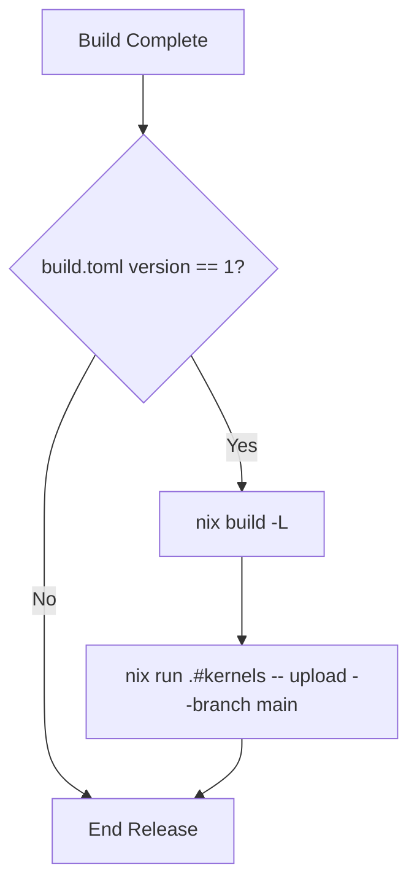
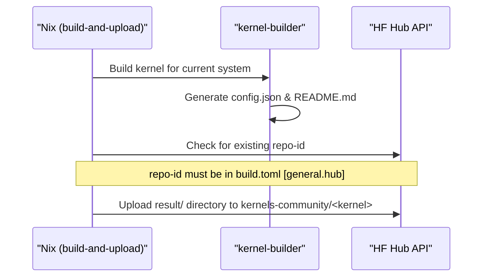

<!-- source: DeepWiki mcp.deepwiki.com · repo huggingface/kernels-community · page 3.3 Release and Deployment · fetched 2026-10-26 -->

# Release and Deployment

Relevant source files

The following files were used as context for generating this wiki page:

- [.github/scripts/pr_comment_kernel_bot.py](.github/scripts/pr_comment_kernel_bot.py)
- [.github/scripts/windows/install-oneapi.ps1](.github/scripts/windows/install-oneapi.ps1)
- [.github/workflows/build-pr-mac.yaml](.github/workflows/build-pr-mac.yaml)
- [.github/workflows/build-pr-windows.yaml](.github/workflows/build-pr-windows.yaml)
- [.github/workflows/build-pr.yaml](.github/workflows/build-pr.yaml)
- [.github/workflows/build-release-mac.yaml](.github/workflows/build-release-mac.yaml)
- [.github/workflows/build-release-windows.yaml](.github/workflows/build-release-windows.yaml)
- [.github/workflows/build-release.yaml](.github/workflows/build-release.yaml)
- [.github/workflows/manual-build-upload.yaml](.github/workflows/manual-build-upload.yaml)
- [.github/workflows/nix_fmt.yaml](.github/workflows/nix_fmt.yaml)
- [.github/workflows/pr-comment-build.yaml](.github/workflows/pr-comment-build.yaml)

This page documents the release and deployment pipeline for the `kernels-community` repository. It explains how kernels are built for multiple platforms (Linux, macOS, Windows), cached via Cachix, and published to the Hugging Face Hub.

## Overview

The release pipeline is triggered when a pull request is merged into the `main` branch. Unlike PR validation builds, release builds produce distributable artifacts and upload them to specific repositories under the `kernels-community` organization on the Hugging Face Hub.

**Release Pipeline Data Flow**

```mermaid
graph TD
    subgraph "GitHub Actions Trigger"
        Merge["PR Merged to main"] --> Validate["validate-kernel-pr.py 'release'"]
    end

    subgraph "Platform Build Matrix"
        Validate --> Linux["Linux (x86_64 / aarch64)"]
        Validate --> Mac["macOS (Apple Silicon)"]
        Validate --> Win["Windows (CUDA / XPU)"]
    end

    subgraph "Build Execution"
        Linux --> NixLinux["nix run .#build-and-upload"]
        Mac --> NixMac["nix run .#build-and-upload"]
        Win --> CargoWin["cargo build (kernel-builder)"]
    end

    subgraph "Distribution"
        NixLinux --> HFHub["HF Hub: kernels-community/kernel-name"]
        NixMac --> HFHub
        CargoWin --> HFHub
        NixLinux --> Cachix["Cachix: huggingface"]
    end

    HFHub --> MainBranch["Optional: Upload v1 to 'main' branch"]
```

Sources: [.github/workflows/build-release.yaml:1-12](), [.github/workflows/build-release-mac.yaml:1-12](), [.github/workflows/build-release-windows.yaml:1-15]()

## Platform Release Workflows

The repository maintains separate workflows for different operating systems to handle specific toolchain requirements, such as Metal for macOS or oneAPI for Windows XPU.

### Linux Release Build
Linux builds use high-memory AWS runners and leverage Nix for environment isolation.

- **Runners**: `aws-highmemory-32-plus-nix` (x86_64) and `aws-r8g-8xl-plus-nix` (aarch64) [[.github/workflows/build-release.yaml:17-20]]().
- **Tooling**: Uses `DeterminateSystems/nix-installer-action` [[.github/workflows/build-release.yaml:26]]().
- **Command**: Executes `nix run -L .#build-and-upload` [[.github/workflows/build-release.yaml:56]]().

### macOS Release Build
macOS builds focus on Apple Silicon (M-series) support and Metal shader compilation.

- **Runner**: `macos-26` [[.github/workflows/build-release-mac.yaml:13]]().
- **Toolchain**: Installs the Metal toolchain via `xcodebuild -downloadComponent MetalToolchain` [[.github/workflows/build-release-mac.yaml:49]]().
- **Sandboxing**: Uses `sandbox = relaxed` in Nix configuration to allow access to system frameworks required for Metal compilation [[.github/workflows/build-release-mac.yaml:21]]().

### Windows Release Build
Windows builds support CUDA and Intel XPU backends using a non-Nix native approach managed by `kernel-builder`.

- **Runner**: `windows-2022` [[.github/workflows/build-release-windows.yaml:39]]().
- **XPU Support**: Downloads and installs Intel oneAPI Base Toolkit via a custom PowerShell script [[.github/workflows/build-release-windows.yaml:127]](), [[.github/scripts/windows/install-oneapi.ps1:1-42]]().
- **Exclusion List**: Certain kernels (e.g., `megablocks`, `flash-attn2`) are explicitly blocked from Windows XPU builds due to compatibility issues [[.github/workflows/build-release-windows.yaml:67-75]]().

## Release Logic: Versioned vs. Main Branch

The pipeline implements a dual-upload strategy based on the kernel's `build.toml` configuration.

1.  **Versioned Upload**: The primary `nix run .#build-and-upload` command uploads artifacts to a branch named after the kernel version or git hash [[.github/workflows/build-release.yaml:56]]().
2.  **Main Branch Upload**: If `build.toml` contains `version = 1`, the workflow performs an additional upload to the `main` branch of the target repository [[.github/workflows/build-release.yaml:65-72]]().

Sources: [.github/workflows/build-release.yaml:57-72](), [.github/workflows/build-release-mac.yaml:57-72]()

## Manual Deployment and Chat-Ops

The repository provides a manual override mechanism via the `kernel-bot` and the `Manual Kernel Build` workflow.

### The /kernel-bot Interface
Maintainers can trigger builds and uploads directly from PR comments using commands like `/kernel-bot build-and-upload <kernel>`.

- **Command Parsing**: Handled by `pr_comment_kernel_bot.py` which validates permissions (e.g., `build-and-upload` requires `admin` status) [[.github/scripts/pr_comment_kernel_bot.py:17-21]]().
- **Dispatch Key**: Generates a unique `dispatch_key` (e.g., `pr123-relu-abcd`) to track the resulting workflow run [[.github/scripts/pr_comment_kernel_bot.py:185-186]]().

### Manual Build Workflow
The `manual-build-upload.yaml` workflow allows granular control over the build process, including selecting specific PR numbers or target branches on the Hub.

- **Inputs**: Supports `kernel_name`, `pr_number`, `target_branch`, and `upload` (boolean) [[.github/workflows/manual-build-upload.yaml:7-29]]().
- **Artifact Handling**: Can perform `build-and-copy` (local artifact generation) followed by an explicit `upload` using the `kernels` Nix app [[.github/workflows/manual-build-upload.yaml:113-123]]().

Sources: [.github/workflows/pr-comment-build.yaml:1-50](), [.github/workflows/manual-build-upload.yaml:1-124]()

## Cachix Caching Strategy

Cachix is used to share build artifacts across CI runs and platforms, significantly reducing build times.

- **Cache Name**: `huggingface` [[.github/workflows/build-release.yaml:36]]().
- **Scope**: Used in PR builds, release builds, and manual dispatches [[.github/workflows/build-pr.yaml:35]](), [[.github/workflows/manual-build-upload.yaml:84]]().
- **Mechanism**: The `cachix-action` automatically pushes new store paths to the cache after a successful Nix build [[.github/workflows/build-release.yaml:34-38]]().

## Implementation Detail: The Build-and-Upload Nix App

The `build-and-upload` target in a kernel's `flake.nix` orchestrates the final stages of the deployment.

Sources: [.github/workflows/build-pr.yaml:51-58](), [.github/workflows/build-release.yaml:50-56]()

### Validation and Security
- **PR Title Validation**: The `validate-kernel-pr.py` script ensures the PR title follows the `kernel: description` format and extracts the target kernel name [[.github/workflows/validate-kernel-pr.py:44-49]]().
- **Token Management**: The `HF_TOKEN` secret is injected into the build environment only for release and authorized manual workflows [[.github/workflows/build-release.yaml:53]](), [[.github/workflows/manual-build-upload.yaml:118]]().
- **Repo-ID Check**: The workflow strictly verifies that `repo-id` is present in `build.toml` before attempting an upload [[.github/workflows/build-pr.yaml:51-58]]().

Sources: [.github/workflows/validate-kernel-pr.py:1-84](), [.github/workflows/build-pr.yaml:51-58]()

---

