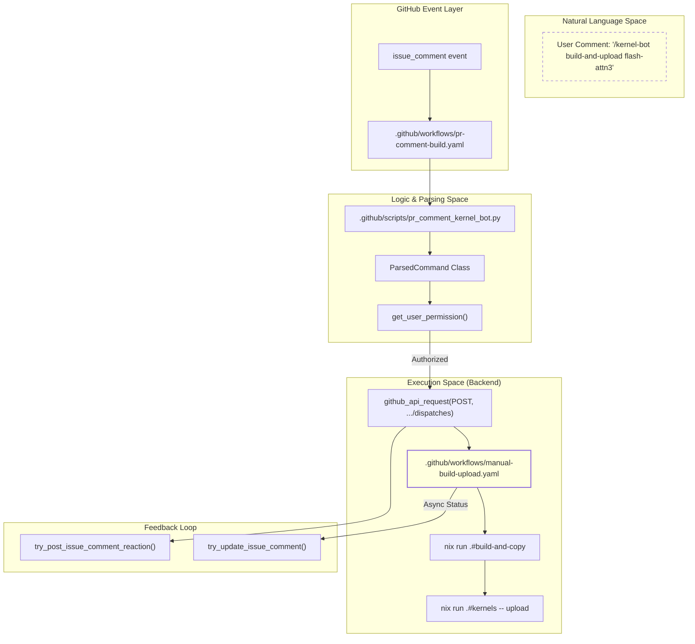

<!-- source: DeepWiki mcp.deepwiki.com · repo huggingface/kernels-community · page 3.4 Chat-Ops Kernel Bot · fetched 2026-10-26 -->

# Chat-Ops Kernel Bot

<details>
<summary>Relevant source files</summary>

The following files were used as context for generating this wiki page:

- [.github/scripts/pr_comment_kernel_bot.py](.github/scripts/pr_comment_kernel_bot.py)
- [.github/workflows/manual-build-upload.yaml](.github/workflows/manual-build-upload.yaml)
- [.github/workflows/pr-comment-build.yaml](.github/workflows/pr-comment-build.yaml)

</details>


The Chat-Ops Kernel Bot is a comment-driven automation system that allows maintainers and contributors to trigger kernel builds, uploads, and merges directly from GitHub Pull Request comments. It bridges the gap between the Pull Request workflow and the high-performance Nix-based build infrastructure.

### Overview and Purpose

The system provides a `/kernel-bot` command interface to automate repetitive tasks that require high-privilege access or significant compute resources. By commenting on a PR, authorized users can dispatch specialized build jobs to AWS high-memory runners, ensuring that kernels are compiled and optionally published to the Hugging Face Hub without manual local intervention.

### Architecture and Data Flow

The bot operates through a multi-stage workflow involving GitHub Actions events, a Python-based command parser, and a backend dispatch mechanism.

#### System Data Flow Diagram

The following diagram illustrates how a natural language comment is transformed into a concrete build execution.

**Title: /kernel-bot Command Execution Flow**

Sources: [.github/workflows/pr-comment-build.yaml:1-15](), [.github/scripts/pr_comment_kernel_bot.py:34-40](), [.github/scripts/pr_comment_kernel_bot.py:139-149](), [.github/workflows/manual-build-upload.yaml:1-30]()

### Command Parsing and Logic

The core logic resides in `pr_comment_kernel_bot.py`. It parses the comment body using regular expressions and maps them to internal `ParsedCommand` objects.

#### Supported Commands and Permissions
Permissions are strictly enforced based on the user's role in the repository.

| Command | Permission Required | Description |
| :--- | :--- | :--- |
| `build` | `admin`, `write` | Builds the specified kernel(s) to verify compilation. |
| `build-and-upload` | `admin` | Builds and uploads the kernel to the `kernels-community` Hub organization. |
| `merge-and-upload` | `admin` | Merges the PR and then triggers a build/upload for the target branch. |

Sources: [.github/scripts/pr_comment_kernel_bot.py:17-21](), [.github/scripts/pr_comment_kernel_bot.py:34-40]()

#### Validation Rules
1. **Comment Length**: Limited to 1024 characters to prevent payload injection [.github/workflows/pr-comment-build.yaml:34-37]().
2. **Character Filtering**: Only alphanumeric characters and a specific set of symbols (`A-Za-z0-9_./-`) are allowed to prevent shell injection [.github/workflows/pr-comment-build.yaml:45-48]().
3. **Fork Security**: Commands that involve building (`build`, `build-and-upload`) are blocked if the PR originates from a fork to prevent unauthorized use of runner secrets [.github/scripts/pr_comment_kernel_bot.py:22-22]().

### Dispatch Key Tracking

Because GitHub Actions `workflow_dispatch` events are asynchronous, the bot uses a unique `dispatch_key` to correlate the triggered backend run with the original PR comment.

1. **Generation**: A key is generated using the PR number, kernel name, and a random UUID fragment via `make_dispatch_key()` [[.github/scripts/pr_comment_kernel_bot.py:185-186]()].
2. **Injection**: This key is passed as an input to the `manual-build-upload.yaml` workflow [[.github/workflows/manual-build-upload.yaml:26-29]()].
3. **Lookup**: The bot polls the GitHub API using `list_workflow_runs()` and matches the key against the `display_title` or `name` of active runs [[.github/scripts/pr_comment_kernel_bot.py:163-182](), [.github/scripts/pr_comment_kernel_bot.py:189-195]()].
4. **Reporting**: Once found, the bot updates the PR comment with a direct link to the Action execution URL [[.github/scripts/pr_comment_kernel_bot.py:197-206]()].

### Backend: Manual Build and Upload

The `manual-build-upload.yaml` workflow acts as the heavy-lifter for the bot. It executes on `aws-highmemory-32-plus-nix` runners to handle intensive C++/CUDA compilation.

**Title: Backend Workflow Implementation Detail**
```mermaid
graph LR
    [".github/workflows/manual-build-upload.yaml"] --> Checkout["actions/checkout@v6"]
    Checkout --> Validate["validate-kernel-pr.py (release mode)"]
    Validate --> NixInstall["DeterminateSystems/nix-installer-action"]
    NixInstall --> Cachix["cachix/cachix-action (huggingface)"]
    Cachix --> Build["nix run .#build-and-copy"]
    Build --> UploadStep{{"upload == 'true'?"}}
    UploadStep -- Yes --> HfUpload["nix run .#kernels -- upload"]
```
Sources: [.github/workflows/manual-build-upload.yaml:37-38](), [.github/workflows/manual-build-upload.yaml:102-107](), [.github/workflows/manual-build-upload.yaml:113-113](), [.github/workflows/manual-build-upload.yaml:123-123]()

#### Key Steps in the Backend
- **PR Checkout**: If a `pr_number` is provided, the workflow checks out `refs/pull/<number>/head` instead of the default branch [.github/workflows/manual-build-upload.yaml:68-72]().
- **Kernel Validation**: Uses `validate-kernel-pr.py` in `release` mode to ensure the directory structure and `build.toml` are valid before starting the build [.github/workflows/manual-build-upload.yaml:102-107]().
- **Nix Execution**:
    - `build-and-copy`: Invokes the Nix flake output to compile the kernel for the current environment [.github/workflows/manual-build-upload.yaml:113-113]().
    - `upload`: Uses the `kernels` CLI tool (built via Nix) to push the resulting artifacts to the Hugging Face Hub under the specified `target_branch` [.github/workflows/manual-build-upload.yaml:123-123]().

### Summary of Source Entities

| Entity | Role | File Path |
| :--- | :--- | :--- |
| `pr-comment-build.yaml` | Entry point for GitHub `issue_comment` events. | [.github/workflows/pr-comment-build.yaml]() |
| `pr_comment_kernel_bot.py` | Command parser and API orchestrator. | [.github/scripts/pr_comment_kernel_bot.py]() |
| `ParsedCommand` | Data class representing a validated bot command. | [.github/scripts/pr_comment_kernel_bot.py:34-40]() |
| `manual-build-upload.yaml` | High-memory workflow for kernel compilation. | [.github/workflows/manual-build-upload.yaml]() |
| `github_api_request` | Helper for authenticated GitHub REST API calls. | [.github/scripts/pr_comment_kernel_bot.py:49-68]() |

Sources: [.github/workflows/pr-comment-build.yaml](), [.github/scripts/pr_comment_kernel_bot.py](), [.github/workflows/manual-build-upload.yaml]()

---

