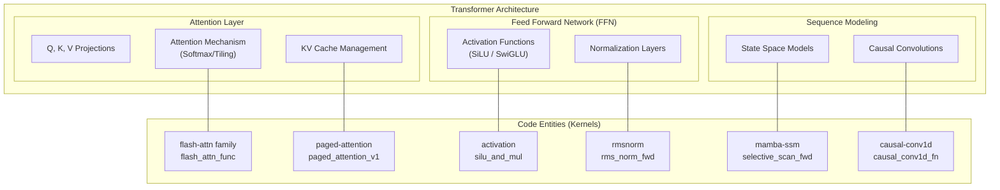
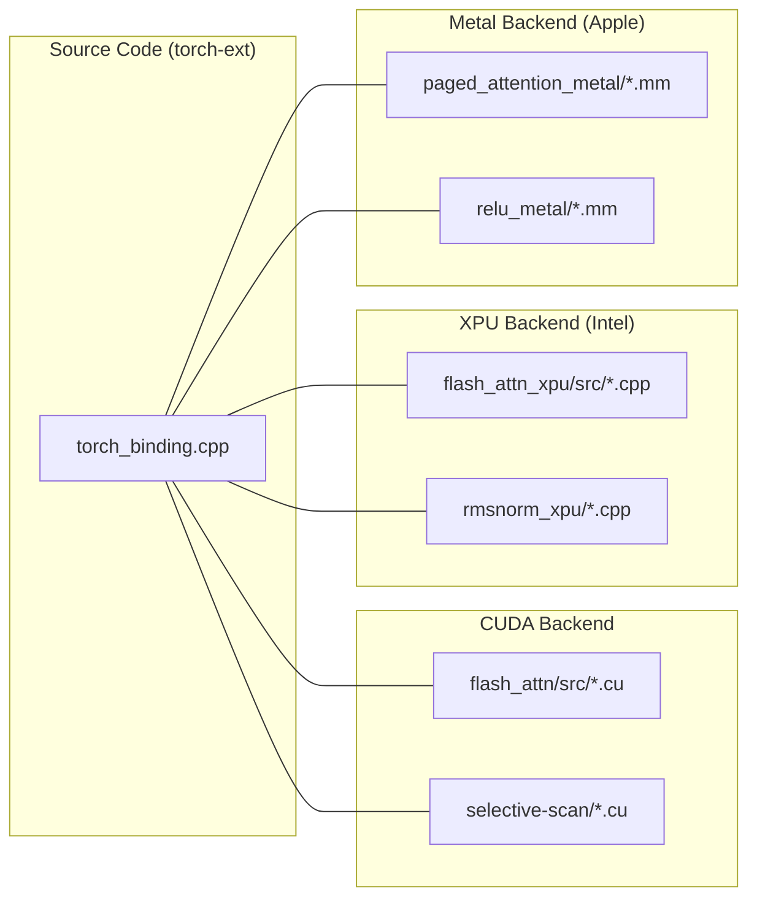

<!-- source: DeepWiki mcp.deepwiki.com · repo huggingface/kernels-community · page 4 Kernel Implementations · fetched 2026-10-26 -->

# Kernel Implementations

Relevant source files

The following files were used as context for generating this wiki page:

- [flake.lock](flake.lock)
- [flake.nix](flake.nix)
- [flash-attn2/build.toml](flash-attn2/build.toml)
- [flash-attn2/flake.lock](flash-attn2/flake.lock)
- [flash-attn2/flake.nix](flash-attn2/flake.nix)
- [flash-attn2/tests/conftest.py](flash-attn2/tests/conftest.py)
- [flash-attn3/build.toml](flash-attn3/build.toml)
- [flash-attn3/flake.lock](flash-attn3/flake.lock)
- [flash-attn3/flake.nix](flash-attn3/flake.nix)
- [flash-mla/build.toml](flash-mla/build.toml)
- [mamba-ssm/build.toml](mamba-ssm/build.toml)
- [mamba-ssm/flake.lock](mamba-ssm/flake.lock)
- [mamba-ssm/flake.nix](mamba-ssm/flake.nix)
- [mamba-ssm/torch-ext/mamba_ssm/__init__.py](mamba-ssm/torch-ext/mamba_ssm/__init__.py)
- [mamba-ssm/torch-ext/mamba_ssm/models/__init__.py](mamba-ssm/torch-ext/mamba_ssm/models/__init__.py)
- [mamba-ssm/torch-ext/mamba_ssm/modules/__init__.py](mamba-ssm/torch-ext/mamba_ssm/modules/__init__.py)
- [mamba-ssm/torch-ext/mamba_ssm/ops/__init__.py](mamba-ssm/torch-ext/mamba_ssm/ops/__init__.py)
- [mamba-ssm/torch-ext/mamba_ssm/ops/triton/__init__.py](mamba-ssm/torch-ext/mamba_ssm/ops/triton/__init__.py)
- [mamba-ssm/torch-ext/mamba_ssm/utils/generation.py](mamba-ssm/torch-ext/mamba_ssm/utils/generation.py)
- [megablocks/build.toml](megablocks/build.toml)
- [megablocks/flake.lock](megablocks/flake.lock)
- [megablocks/flake.nix](megablocks/flake.nix)
- [relu/build.toml](relu/build.toml)
- [relu/flake.lock](relu/flake.lock)
- [relu/flake.nix](relu/flake.nix)
- [relu/relu_cpu/relu_cpu.cpp](relu/relu_cpu/relu_cpu.cpp)
- [relu/tests/test_relu.py](relu/tests/test_relu.py)
- [relu/torch-ext/relu/__init__.py](relu/torch-ext/relu/__init__.py)
- [relu/torch-ext/relu/layers/__init__.py](relu/torch-ext/relu/layers/__init__.py)
- [relu/torch-ext/torch_binding.cpp](relu/torch-ext/torch_binding.cpp)

This page provides a high-level catalog of all optimized GPU kernels available in the `kernels-community` repository. Each kernel is a specialized implementation targeting computational bottlenecks in deep learning, particularly for Large Language Models (LLMs) and Transformers.

For technical details on the build infrastructure, see [Build System](#2). For hardware-specific details, see [Backend Support](#5).

## Kernel Ecosystem Overview

The repository organizes kernels by functional category. Each kernel follows a standard directory layout including a `flake.nix` for environment reproducibility and a `build.toml` for compilation metadata.

### Kernel-to-Architecture Mapping
The following diagram associates natural language architectural components with specific code entities and kernel implementations.

Sources: [flash-attn2/build.toml:1-5]() [paged-attention/build.toml:1-5]() [activation/build.toml:1-5]() [mamba-ssm/build.toml:1-5]()

## Kernel Categories

### Flash Attention
The most critical family of kernels in the repository, providing memory-efficient attention through tiling and online softmax.
- **Implementations**: `flash-attn2`, `flash-attn3`, `flash-attn4`, and `flash-mla`.
- **Backends**: CUDA (SM80-SM120), XPU (Intel), and CPU (AVX-512/AMX).
- **Key Files**: [flash-attn2/build.toml:1-166](), [flash-attn3/build.toml:1-50]().
- For details, see [Flash Attention](#4.1).

### Paged Attention
Optimizes KV cache management for LLM inference by using non-contiguous memory blocks, similar to OS paging.
- **Backends**: CUDA and Metal (Apple Silicon).
- **Key Files**: [paged-attention/build.toml:1-40]().
- For details, see [Paged Attention](#4.2).

### Normalization Kernels
Highly optimized implementations of `RMSNorm` and `LayerNorm`, often used as fused operations to reduce memory bandwidth bottlenecks.
- **Backends**: CUDA, CPU (AVX2/512), XPU, and Metal.
- **Key Files**: [rmsnorm/build.toml:1-30](), [layer-norm/build.toml:1-25]().
- For details, see [Normalization Kernels](#4.3).

### Activation Kernels
Fused activation functions like `SiLU` and `SwiGLU` that combine element-wise operations with multiplications to save memory passes.
- **Key Function**: `silu_and_mul`.
- **Key Files**: [activation/build.toml:1-20](), [relu/build.toml:1-45]().
- For details, see [Activation Kernels](#4.4).

### Attention Variants
Specialized attention mechanisms including `SageAttention` (quantized), `MRA` (Multi-Resolution), and `Rotary Positional Embeddings` (RoPE).
- **Key Files**: [sageattention/build.toml:1-35](), [rotary/build.toml:1-20]().
- For details, see [Attention Variants](#4.5).

### Mixture of Experts (MoE) Kernels
Kernels designed for sparse routing and expert computation, including `MegaBlocks` and `ScatterMoE`.
- **Backends**: CUDA, XPU.
- **Key Files**: [megablocks/build.toml:1-50](), [scattermoe/build.toml:1-30]().
- For details, see [Mixture of Experts (MoE) Kernels](#4.6).

### GEMM and Linear Algebra
General Matrix Multiplication (GEMM) optimizations, including JIT-compiled kernels for FP8 and BF16.
- **Implementations**: `DeepGEMM`, `Triton Kernels`.
- **Key Files**: [deep-gemm/build.toml:1-40]().
- For details, see [GEMM and Linear Algebra Kernels](#4.7).

### Sequence Model Kernels
Specialized kernels for non-transformer sequence models like Mamba and RWKV.
- **Key Function**: `selective_scan` for State Space Models.
- **Key Files**: [mamba-ssm/build.toml:1-38](), [causal-conv1d/build.toml:1-25]().
- For details, see [Sequence Model Kernels](#4.8).

### Quantization Kernels
Accelerated dequantization and quantized matrix multiplication for low-precision inference (GPTQ, BitsAndBytes, FP8).
- **Backends**: CUDA, CPU, Metal (MPS).
- **Key Files**: [quantization-gptq/build.toml:1-30](), [bitsandbytes/build.toml:1-40]().
- For details, see [Quantization Kernels](#4.9).

### Miscellaneous and Vision Kernels
Specialized kernels for computer vision (Deformable DETR) and general utilities (NMS).
- For details, see [Miscellaneous and Vision Kernels](#4.10).

## Backend Implementation Map

The following diagram maps kernel source locations to their respective hardware backends as defined in the build system.

Sources: [flash-attn2/build.toml:5-166]() [relu/build.toml:11-44]() [mamba-ssm/build.toml:12-38]() [megablocks/build.toml:1-10]()

---

