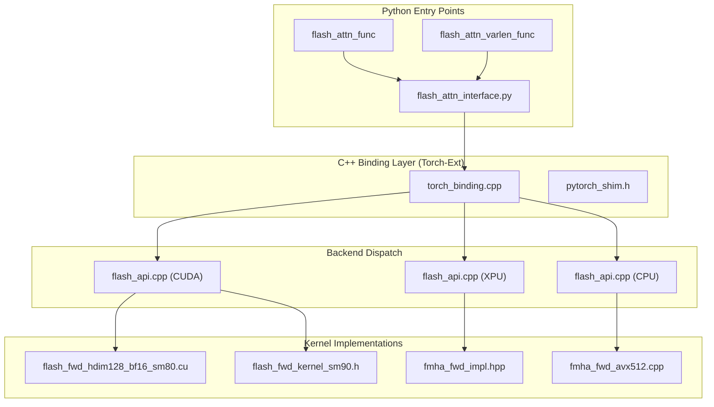
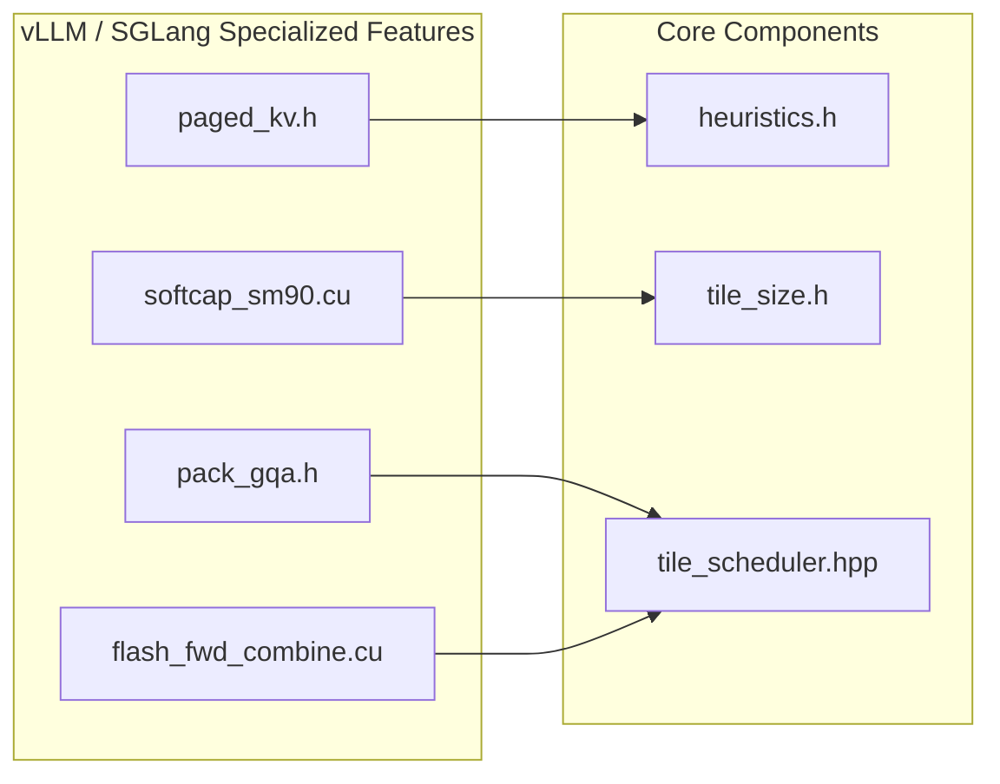

<!-- source: DeepWiki mcp.deepwiki.com · repo huggingface/kernels-community · page 4.1 Flash Attention · fetched 2026-10-26 -->

# Flash Attention

Relevant source files

The following files were used as context for generating this wiki page:

- [.github/CODEOWNERS](.github/CODEOWNERS)
- [flash-attn2/build.toml](flash-attn2/build.toml)
- [flash-attn2/flake.lock](flash-attn2/flake.lock)
- [flash-attn2/flake.nix](flash-attn2/flake.nix)
- [flash-attn2/tests/conftest.py](flash-attn2/tests/conftest.py)
- [flash-attn3/build.toml](flash-attn3/build.toml)
- [flash-attn3/flake.lock](flash-attn3/flake.lock)
- [flash-attn3/flake.nix](flash-attn3/flake.nix)
- [flash-attn4/build.toml](flash-attn4/build.toml)
- [flash-attn4/flake.lock](flash-attn4/flake.lock)
- [flash-attn4/flake.nix](flash-attn4/flake.nix)
- [flash-attn4/tests/cute/benchmark_block_sparsity.py](flash-attn4/tests/cute/benchmark_block_sparsity.py)
- [flash-attn4/tests/cute/benchmark_mask_mod.py](flash-attn4/tests/cute/benchmark_mask_mod.py)
- [flash-attn4/tests/cute/conftest.py](flash-attn4/tests/cute/conftest.py)
- [flash-attn4/tests/cute/mask_mod_definitions.py](flash-attn4/tests/cute/mask_mod_definitions.py)
- [flash-attn4/tests/cute/score_mod_definitions.py](flash-attn4/tests/cute/score_mod_definitions.py)
- [flash-attn4/tests/cute/test_block_sparsity.py](flash-attn4/tests/cute/test_block_sparsity.py)
- [flash-attn4/tests/cute/test_flash_attn.py](flash-attn4/tests/cute/test_flash_attn.py)
- [flash-mla/build.toml](flash-mla/build.toml)
- [flash-mla/flake.lock](flash-mla/flake.lock)
- [flash-mla/flake.nix](flash-mla/flake.nix)
- [flash-mla/tests/test_flash_mla_dense_decoding.py](flash-mla/tests/test_flash_mla_dense_decoding.py)
- [flash-mla/tests/test_flash_mla_sparse_decoding.py](flash-mla/tests/test_flash_mla_sparse_decoding.py)
- [sgl-flash-attn3/flake.lock](sgl-flash-attn3/flake.lock)
- [sgl-flash-attn3/torch-ext/sgl_flash_attn3/__init__.py](sgl-flash-attn3/torch-ext/sgl_flash_attn3/__init__.py)
- [vllm-flash-attn3/build.toml](vllm-flash-attn3/build.toml)
- [vllm-flash-attn3/flake.lock](vllm-flash-attn3/flake.lock)
- [vllm-flash-attn3/flake.nix](vllm-flash-attn3/flake.nix)
- [vllm-flash-attn3/flash-attn/flash_api.cpp](vllm-flash-attn3/flash-attn/flash_api.cpp)

## Purpose and Scope

This document provides a high-level overview of the Flash Attention family of implementations within the `kernels-community` repository. Flash Attention is the repository's most critical kernel suite, providing memory-efficient attention computation through tiling and online softmax techniques. The repository hosts multiple generations and specialized variants of Flash Attention to support a wide range of hardware (NVIDIA SM80-SM120, Intel XPU, CPU) and specific model architectures (e.g., DeepSeek MLA).

This is a **PARENT** page. For detailed technical documentation, refer to the child pages:
*   **[Flash Attention 2: CUDA and CPU Implementations](#4.1.1)**: Deep dive into the `flash-attn2` CUDA kernels, specialized head dimensions, and the CPU AVX-512/AMX and XPU SYCL paths.
*   **[Flash Attention 2: Python API and Layers](#4.1.2)**: Documentation for the Python interface, including `flash_attn_func`, and fused utilities like rotary embeddings and layer normalization.
*   **[Flash Attention 3 and Flash MLA](#4.1.3)**: Coverage of `flash-attn3` (Hopper optimized), `flash-mla` (Multi-Head Latent Attention), and specialized variants like `vllm-flash-attn3` and `sgl-flash-attn3`.

## The Flash Attention Ecosystem

The repository organizes Flash Attention into several distinct packages based on the underlying algorithm version and target hardware optimizations.

| Package | Primary Target | Key Technologies |
| :--- | :--- | :--- |
| `flash-attn2` | Ampere/Hopper/XPU/CPU | CUDA, SYCL, AVX-512, AMX |
| `flash-attn3` | Hopper (SM90) | TMA, GMMA, CuTe, WGMMA |
| `flash-attn4` | Next-Gen Research | CuTe DSL-based |
| `flash-mla` | DeepSeek-V3/R1 | Multi-Head Latent Attention (SM90+) |
| `vllm-flash-attn3` | vLLM Optimized | Paged KV, FP8, Split-K |
| `sgl-flash-attn3` | SGLang Optimized | SGLang-specific KV Cache integration |

Sources: [flash-attn2/build.toml:1-9](), [flash-attn3/build.toml:1-5](), [vllm-flash-attn3/build.toml:1-5](), [flash-mla/build.toml:1-5]()

## Architecture Overview

The implementations follow a consistent pattern: a Python frontend dispatches to a C++ binding layer, which then selects highly specialized hardware kernels.

### System Mapping: API to Code Entities

The following diagram bridges the natural language concepts of "Flash Attention" to the specific code entities found in the repository.

Sources: [flash-attn2/build.toml:15-166](), [vllm-flash-attn3/build.toml:14-57](), [flash-attn2/flash_attn_cpu/flash_api.cpp:49-58]()

## Implementation Variants

### Flash Attention 2 (Legacy & Multi-Backend)
`flash-attn2` is the most portable version, supporting CUDA (SM80+), Intel XPU (via SYCL), and x86 CPUs (via AVX-512/AMX). It utilizes a large collection of pre-instantiated `.cu` files specialized by head dimension (32 to 256), data type (FP16/BF16), and causality.
*   **For details, see [Flash Attention 2: CUDA and CPU Implementations](#4.1.1).**

### Flash Attention 3 & 4 (Hopper Optimized)
`flash-attn3` introduces optimizations specifically for the NVIDIA Hopper architecture (SM90), leveraging Tensor Memory Accelerator (TMA) and GMMA instructions. It significantly improves throughput for FP8 and BF16. `flash-attn4` further evolves this using the CuTe DSL for more flexible kernel composition.
*   **For details, see [Flash Attention 3 and Flash MLA](#4.1.3).**

### Specialized Inference Variants
Variants like `vllm-flash-attn3` and `sgl-flash-attn3` are tailored for high-throughput inference engines. They include support for:
*   **Paged KV Cache**: Handling non-contiguous memory for KV tensors.
*   **FP8 Support**: Optimized kernels for `e4m3` and `e5m2` formats.
*   **Split-K Workholding**: Efficiently parallelizing across the sequence length dimension during the prefill phase.

Sources: [vllm-flash-attn3/build.toml:103-148](), [vllm-flash-attn3/flash-attn/flash_fwd_combine.cu:1-10](), [vllm-flash-attn3/flash-attn/tile_scheduler.hpp:1-20]()

## Hardware Support Matrix

| Feature | CUDA (SM80) | CUDA (SM90/100) | Intel XPU | CPU (x86) |
| :--- | :---: | :---: | :---: | :---: |
| Forward Pass | ✓ | ✓ | ✓ | ✓ |
| Backward Pass | ✓ | ✓ | - | - |
| BF16/FP16 | ✓ | ✓ | ✓ | ✓ |
| FP8 (e4m3/e5m2) | - | ✓ | - | - |
| Paged KV | ✓ | ✓ | - | - |
| AVX-512/AMX | - | - | - | ✓ |

Sources: [flash-attn2/build.toml:5-9](), [flash-attn2/flake.nix:25-34](), [vllm-flash-attn3/build.toml:23-26](), [flash-attn3/build.toml:19-21]()

## Build and Dependency Management

The Flash Attention kernels rely on the Nix-based `kernel-builder` for reproducible builds. Each variant specifies its own `build.toml` and `flake.nix` to manage specific versions of CUTLASS (ranging from 3.6 to 4.0) and compiler flags.

*   **CUDA Flags**: Optimized with `-O3`, `--use_fast_math`, and architecture-specific flags like `-DCUTE_SM90_EXTENDED_MMA_SHAPES_ENABLED`.
*   **CPU Flags**: Specifically targets `-mavx512*` and `-mamx-*` instruction sets for the `flash_attn_cpu_avx512` kernel.

Sources: [flash-attn2/build.toml:23-33](), [vllm-flash-attn3/build.toml:27-38](), [flash-attn3/build.toml:22-31]()

---

