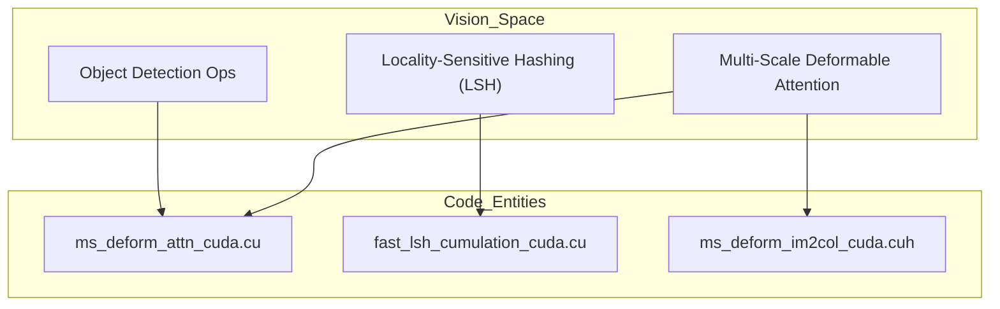
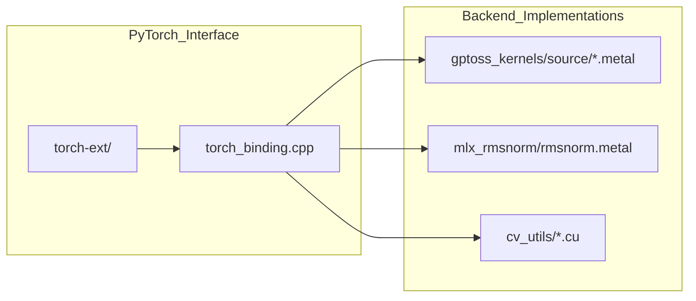

<!-- source: DeepWiki mcp.deepwiki.com · repo huggingface/kernels-community · page 4.10 Miscellaneous and Vision Kernels · fetched 2026-10-26 -->

# Miscellaneous and Vision Kernels

Relevant source files

The following files were used as context for generating this wiki page:

- [cv-utils/README.md](cv-utils/README.md)
- [cv-utils/build.toml](cv-utils/build.toml)
- [cv-utils/cv_utils/connected_components.cu](cv-utils/cv_utils/connected_components.cu)
- [cv-utils/cv_utils/generic_nms.cu](cv-utils/cv_utils/generic_nms.cu)
- [cv-utils/flake.lock](cv-utils/flake.lock)
- [cv-utils/flake.nix](cv-utils/flake.nix)
- [cv-utils/torch-ext/cv_utils/__init__.py](cv-utils/torch-ext/cv_utils/__init__.py)
- [cv-utils/torch-ext/torch_binding.cpp](cv-utils/torch-ext/torch_binding.cpp)
- [cv-utils/torch-ext/torch_binding.h](cv-utils/torch-ext/torch_binding.h)
- [deformable-detr/README.md](deformable-detr/README.md)
- [deformable-detr/build.toml](deformable-detr/build.toml)
- [deformable-detr/deformable_detr/ms_deform_attn_cuda.cu](deformable-detr/deformable_detr/ms_deform_attn_cuda.cu)
- [deformable-detr/deformable_detr/ms_deform_attn_cuda.cuh](deformable-detr/deformable_detr/ms_deform_attn_cuda.cuh)
- [deformable-detr/deformable_detr/ms_deform_attn_cuda.h](deformable-detr/deformable_detr/ms_deform_attn_cuda.h)
- [deformable-detr/deformable_detr/ms_deform_im2col_cuda.cuh](deformable-detr/deformable_detr/ms_deform_im2col_cuda.cuh)
- [deformable-detr/flake.nix](deformable-detr/flake.nix)
- [deformable-detr/torch-ext/deformable_detr/__init__.py](deformable-detr/torch-ext/deformable_detr/__init__.py)
- [deformable-detr/torch-ext/deformable_detr/layers.py](deformable-detr/torch-ext/deformable_detr/layers.py)
- [deformable-detr/torch-ext/ms_deform_attn_cpu.cpp](deformable-detr/torch-ext/ms_deform_attn_cpu.cpp)
- [gpt-oss-metal-kernels/build.toml](gpt-oss-metal-kernels/build.toml)
- [gpt-oss-metal-kernels/flake.lock](gpt-oss-metal-kernels/flake.lock)
- [gpt-oss-metal-kernels/flake.nix](gpt-oss-metal-kernels/flake.nix)
- [mlx-rmsnorm/README](mlx-rmsnorm/README)
- [mlx-rmsnorm/build.toml](mlx-rmsnorm/build.toml)
- [mlx-rmsnorm/flake.lock](mlx-rmsnorm/flake.lock)
- [mlx-rmsnorm/flake.nix](mlx-rmsnorm/flake.nix)
- [mlx-rmsnorm/mlx_rmsnorm/bf16.h](mlx-rmsnorm/mlx_rmsnorm/bf16.h)
- [mlx-rmsnorm/mlx_rmsnorm/bf16_math.h](mlx-rmsnorm/mlx_rmsnorm/bf16_math.h)
- [mlx-rmsnorm/mlx_rmsnorm/complex.h](mlx-rmsnorm/mlx_rmsnorm/complex.h)
- [mlx-rmsnorm/mlx_rmsnorm/defines.h](mlx-rmsnorm/mlx_rmsnorm/defines.h)
- [mlx-rmsnorm/mlx_rmsnorm/metal_rmsnorm.h](mlx-rmsnorm/mlx_rmsnorm/metal_rmsnorm.h)
- [mlx-rmsnorm/mlx_rmsnorm/metal_rmsnorm.mm](mlx-rmsnorm/mlx_rmsnorm/metal_rmsnorm.mm)
- [mlx-rmsnorm/mlx_rmsnorm/rmsnorm.metal](mlx-rmsnorm/mlx_rmsnorm/rmsnorm.metal)
- [yoso/README.md](yoso/README.md)
- [yoso/build.toml](yoso/build.toml)
- [yoso/flake.lock](yoso/flake.lock)
- [yoso/flake.nix](yoso/flake.nix)
- [yoso/torch-ext/torch_binding.cpp](yoso/torch-ext/torch_binding.cpp)
- [yoso/torch-ext/torch_binding.h](yoso/torch-ext/torch_binding.h)
- [yoso/torch-ext/yoso/__init__.py](yoso/torch-ext/yoso/__init__.py)
- [yoso/yoso/common.h](yoso/yoso/common.h)
- [yoso/yoso/common_cuda.h](yoso/yoso/common_cuda.h)
- [yoso/yoso/common_cuda_device.h](yoso/yoso/common_cuda_device.h)

This section documents specialized kernels within the `kernels-community` repository that serve specific architectural needs in computer vision, efficient attention mechanisms, and comprehensive suites for Apple Silicon (Metal). These kernels range from locality-sensitive hashing for attention to optimized utilities for object detection and connected components.

### Overview of Specialized Kernels

The kernels in this category are organized into two primary groups:
1.  **Vision and Hashing-based Attention**: Focuses on `deformable-detr` for multi-scale spatial attention and `yoso` for efficient LSH-based attention.
2.  **Metal Suites and CV Utilities**: Provides a broad collection of Metal kernels for Apple Silicon (via `gpt-oss-metal-kernels` and `mlx-rmsnorm`) and standard computer vision operations like NMS.

---

### YOSO and Deformable DETR

These kernels provide optimized implementations for non-standard attention mechanisms used in efficient Transformers and object detection.

*   **YOSO (You Only Sample Once)**: Implements locality-sensitive hashing (LSH) to approximate the attention matrix. It uses fast LSH cumulation kernels to achieve linear complexity relative to sequence length.
*   **Deformable DETR**: Implements Multi-Scale Deformable Attention (`ms_deform_attn`), which allows the model to focus on a small set of sampling points around a reference point across multiple feature map scales.

For technical details on LSH cumulation and multi-scale sampling, see [YOSO and Deformable DETR](#4.10.1).

#### Vision Kernel Mapping
The following diagram maps the vision-specific operations to their implementation files.

**Sources:** [deformable-detr/build.toml:17-26](), [yoso/build.toml:16-36]()

---

### Metal Kernels Suite and CV Utilities

This group contains comprehensive support for Apple Silicon hardware and generic CUDA-based vision utilities.

*   **GPT-OSS Metal Kernels**: A full-featured suite of Metal Shading Language (MSL) kernels. It includes implementations for `matmul`, `rmsnorm`, `rope`, `sdpa`, and Mixture of Experts (`moematmul`).
*   **MLX RMSNorm**: A standalone port of the RMSNorm implementation from the Apple MLX framework, optimized for Metal backends.
*   **CV-Utils**: A collection of fundamental vision kernels, including Generic Non-Maximum Suppression (NMS) and Connected Components labeling.

For details on the Metal implementation architecture and CV utility usage, see [Metal Kernels Suite and CV Utilities](#4.10.2).

#### Metal Suite Architecture
This diagram illustrates the relationship between the PyTorch bindings and the underlying Metal/CUDA source files for miscellaneous utilities.

**Sources:** [gpt-oss-metal-kernels/build.toml:16-61](), [mlx-rmsnorm/build.toml:16-29](), [cv-utils/build.toml:15-27]()

---

### Summary of Implementations

| Kernel | Primary Backend | Key Files | Purpose |
| :--- | :--- | :--- | :--- |
| **YOSO** | CUDA | `yoso/fast_lsh_cumulation_cuda.cu` | Linear attention via LSH [yoso/build.toml:28-32]() |
| **Deformable DETR** | CUDA | `deformable_detr/ms_deform_attn_cuda.cu` | Multi-scale spatial attention [deformable-detr/build.toml:22-25]() |
| **CV-Utils** | CUDA | `cv_utils/generic_nms.cu` | NMS and Connected Components [cv-utils/build.toml:24-27]() |
| **GPT-OSS** | Metal | `gptoss_kernels/source/sdpa.metal` | Comprehensive Apple Silicon suite [gpt-oss-metal-kernels/build.toml:32-45]() |
| **MLX RMSNorm** | Metal | `mlx_rmsnorm/rmsnorm.metal` | Ported MLX normalization [mlx-rmsnorm/build.toml:21-22]() |

### Build Configuration
All kernels in this section utilize the Nix-based build system. Each directory contains a `flake.nix` that invokes `genKernelFlakeOutputs` [yoso/flake.nix:13-16]() and a `build.toml` defining the specific source files and backend requirements [cv-utils/build.toml:1-5]().

**Sources:** [yoso/flake.nix:1-17](), [deformable-detr/flake.nix:1-17](), [gpt-oss-metal-kernels/flake.nix:1-15](), [cv-utils/build.toml:1-28]()

---

