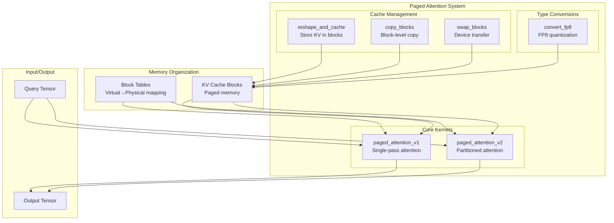
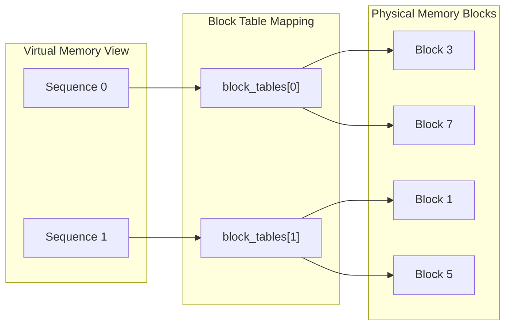

<!-- source: DeepWiki mcp.deepwiki.com · repo huggingface/kernels-community · page 4.2 Paged Attention · fetched 2026-10-26 -->

# Paged Attention

Relevant source files

The following files were used as context for generating this wiki page:

- [paged-attention/build.toml](paged-attention/build.toml)
- [paged-attention/cuda-utils/cuda_utils.h](paged-attention/cuda-utils/cuda_utils.h)
- [paged-attention/cuda-utils/cuda_utils_kernels.cu](paged-attention/cuda-utils/cuda_utils_kernels.cu)
- [paged-attention/flake.lock](paged-attention/flake.lock)
- [paged-attention/flake.nix](paged-attention/flake.nix)
- [paged-attention/paged-attention-metal/attention/paged_attention.metal](paged-attention/paged-attention-metal/attention/paged_attention.metal)
- [paged-attention/paged-attention-metal/cache.mm](paged-attention/paged-attention-metal/cache.mm)
- [paged-attention/paged-attention-metal/cache/copy_blocks.metal](paged-attention/paged-attention-metal/cache/copy_blocks.metal)
- [paged-attention/paged-attention-metal/cache/reshape_and_cache.metal](paged-attention/paged-attention-metal/cache/reshape_and_cache.metal)
- [paged-attention/paged-attention-metal/convert_fp8.metal](paged-attention/paged-attention-metal/convert_fp8.metal)
- [paged-attention/paged-attention-metal/convert_fp8.mm](paged-attention/paged-attention-metal/convert_fp8.mm)
- [paged-attention/paged-attention-metal/paged_attention.mm](paged-attention/paged-attention-metal/paged_attention.mm)

## Purpose and Scope

Paged Attention is a memory-efficient attention kernel designed for LLM inference that organizes the Key-Value (KV) cache in fixed-size memory blocks. This kernel addresses the memory fragmentation and inefficiency problems inherent in variable-length sequence processing by implementing a virtual memory-style paging system for attention computation.

The implementation provides:
- Block-based KV cache management with dynamic allocation [paged-attention/paged-attention/attention/paged_attention_v1.cu:1-50]().
- Two attention variants: single-pass (v1) and partitioned (v2) for long sequences [paged-attention/paged-attention-metal/paged_attention.mm:101-687]().
- Cache manipulation operations (copy, swap, reshape) [paged-attention/paged-attention-metal/cache.mm:20-547]().
- Support for multiple data types including FP8 quantization [paged-attention/paged-attention-metal/convert_fp8.mm:23-46]().
- Cross-device memory operations [paged-attention/paged-attention-metal/cache.mm:64-73]().

For detailed implementation specifics, see:
- [Paged Attention: CUDA Implementation](#4.2.1)
- [Paged Attention: Metal Implementation](#4.2.2)

**Sources:** [paged-attention/build.toml:1-126](), [paged-attention/paged-attention-metal/paged_attention.mm:101-687]()

---

## Architecture Overview

**Architecture: Paged Attention Components**

The system consists of three main subsystems:
1. **Core Kernels**: Attention computation using `paged_attention_v1` and `paged_attention_v2` [paged-attention/build.toml:64-88]().
2. **Cache Management**: Operations for storing (`reshape_and_cache`) and manipulating (`copy_blocks`, `swap_blocks`) KV cache blocks [paged-attention/paged-attention-metal/cache.mm:20-547]().
3. **Type Conversions**: FP8 quantization for reduced memory footprint via `convert_fp8` [paged-attention/paged-attention-metal/convert_fp8.mm:48-145]().

**Sources:** [paged-attention/build.toml:1-126](), [paged-attention/paged-attention-metal/paged_attention.mm:1-100]()

---

## Memory Organization and Block Tables

Paged Attention organizes the KV cache using a block-based virtual memory system. Each sequence is divided into blocks of fixed size (typically 8, 16, or 32 tokens) [paged-attention/paged-attention-metal/paged_attention.mm:88-99]().

**Memory Organization: Block-Based KV Cache**

| Component | Shape | Description |
|-----------|-------|-------------|
| `block_tables` | `[num_seqs, max_num_blocks_per_seq]` | Maps sequence positions to physical blocks [paged-attention/paged-attention-metal/paged_attention.mm:110-112](). |
| `key_cache` | `[num_blocks, num_heads, head_size/x, block_size, x]` | Physical key cache blocks [paged-attention/paged-attention-metal/paged_attention.mm:104-105](). |
| `value_cache` | `[num_blocks, num_heads, head_size, block_size]` | Physical value cache blocks [paged-attention/paged-attention-metal/paged_attention.mm:106-107](). |
| `seq_lens` | `[num_seqs]` | Actual length of each sequence [paged-attention/paged-attention-metal/paged_attention.mm:111-112](). |

**Sources:** [paged-attention/paged-attention-metal/paged_attention.mm:101-140](), [paged-attention/paged-attention-metal/cache/reshape_and_cache.metal:32-56]()

---

## Core Attention Kernels

The implementation supports multiple backends and sequence length optimizations.

### Paged Attention v1: Single-Pass
The v1 kernel processes a sequence in a single pass without partitioning. It is optimized for sequences that fit within the hardware's shared memory limits [paged-attention/paged-attention-metal/paged_attention.mm:158-176]().

### Paged Attention v2: Partitioned
For long sequences, v2 partitions the context into chunks (e.g., 512 tokens), processes them in parallel, and then performs a final reduction phase to combine results [paged-attention/paged-attention-metal/paged_attention.mm:337-350]().

For details on the CUDA implementation of these kernels, see [Paged Attention: CUDA Implementation](#4.2.1).

**Sources:** [paged-attention/paged-attention-metal/paged_attention.mm:101-687](), [paged-attention/build.toml:64-88]()

---

## Cache Management Operations

### Reshape and Cache
The `reshape_and_cache` kernel is responsible for taking new KV tensors and storing them into the paged block structure. It supports optional FP8 quantization during the store operation [paged-attention/paged-attention-metal/cache/reshape_and_cache.metal:32-96]().

### Block Copy and Swap
- **`copy_blocks`**: Performs block-level duplication within the same device, used for operations like beam search [paged-attention/paged-attention-metal/cache.mm:76-102]().
- **`swap_blocks`**: Facilitates moving blocks between different devices (e.g., MPS to CPU) using `MTLBlitCommandEncoder` for same-device transfers or PyTorch's `copy_` for cross-device moves [paged-attention/paged-attention-metal/cache.mm:20-74]().

For details on the Metal implementation of these operations, see [Paged Attention: Metal Implementation](#4.2.2).

**Sources:** [paged-attention/paged-attention-metal/cache.mm:20-547](), [paged-attention/paged-attention-metal/cache/copy_blocks.metal:6-36]()

---

## FP8 Quantization Support

The system provides specialized kernels for converting KV caches to and from FP8 (E4M3) format to reduce memory usage.

- **`convert_fp8`**: A C++ entry point that selects the appropriate Metal kernel based on source and destination dtypes [paged-attention/paged-attention-metal/convert_fp8.mm:48-69]().
- **`convert_fp8_kernel`**: The Metal shader implementation that handles quantization, dequantization, and rescaling using provided scales [paged-attention/paged-attention-metal/convert_fp8.metal:10-43]().

**Sources:** [paged-attention/paged-attention-metal/convert_fp8.mm:23-46](), [paged-attention/paged-attention-metal/convert_fp8.metal:1-77]()

---

## Backend Support and Utilities

The paged attention system is built to be cross-platform:
- **CUDA**: Full support for NVIDIA GPUs with optimized `v1` and `v2` kernels [paged-attention/build.toml:64-88]().
- **Metal**: Native Apple Silicon support via Metal Shading Language (MSL) [paged-attention/build.toml:20-35]().
- **ROCm**: Support for AMD GPUs using the same kernel logic as CUDA [paged-attention/build.toml:90-125]().

Common utilities for GPU management are provided in `cuda-utils`, including device attribute retrieval and shared memory limit checks [paged-attention/cuda-utils/cuda_utils.h:19-35](), [paged-attention/cuda-utils/cuda_utils_kernels.cu:7-35]().

**Sources:** [paged-attention/build.toml:1-126](), [paged-attention/cuda-utils/cuda_utils.h:1-41]()

---

