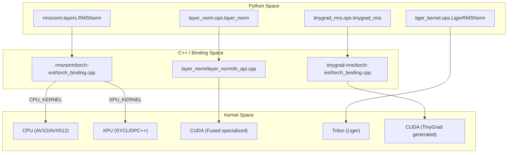

<!-- source: DeepWiki mcp.deepwiki.com · repo huggingface/kernels-community · page 4.3 Normalization Kernels · fetched 2026-10-26 -->

# Normalization Kernels

<details>
<summary>Relevant source files</summary>

The following files were used as context for generating this wiki page:

- [layer-norm/README.md](layer-norm/README.md)
- [layer-norm/benchmarks/benchmark.py](layer-norm/benchmarks/benchmark.py)
- [layer-norm/build.toml](layer-norm/build.toml)
- [layer-norm/flake.lock](layer-norm/flake.lock)
- [layer-norm/flake.nix](layer-norm/flake.nix)
- [layer-norm/layer_norm/ln.h](layer-norm/layer_norm/ln.h)
- [layer-norm/layer_norm/ln_api.cpp](layer-norm/layer_norm/ln_api.cpp)
- [layer-norm/layer_norm/ln_bwd_1024.cu](layer-norm/layer_norm/ln_bwd_1024.cu)
- [layer-norm/layer_norm/ln_bwd_1280.cu](layer-norm/layer_norm/ln_bwd_1280.cu)
- [layer-norm/layer_norm/ln_bwd_1536.cu](layer-norm/layer_norm/ln_bwd_1536.cu)
- [layer-norm/layer_norm/ln_bwd_2048.cu](layer-norm/layer_norm/ln_bwd_2048.cu)
- [liger-kernels/build.toml](liger-kernels/build.toml)
- [liger-kernels/flake.lock](liger-kernels/flake.lock)
- [liger-kernels/flake.nix](liger-kernels/flake.nix)
- [rmsnorm/build.toml](rmsnorm/build.toml)
- [rmsnorm/flake.lock](rmsnorm/flake.lock)
- [rmsnorm/flake.nix](rmsnorm/flake.nix)
- [rmsnorm/rmsnorm_cpu/rmsnorm_cpu_torch.cpp](rmsnorm/rmsnorm_cpu/rmsnorm_cpu_torch.cpp)
- [rmsnorm/rmsnorm_xpu/RMSNorm.cpp](rmsnorm/rmsnorm_xpu/RMSNorm.cpp)
- [rmsnorm/tests/test_rmsnorm.py](rmsnorm/tests/test_rmsnorm.py)
- [rmsnorm/torch-ext/rmsnorm/__init__.py](rmsnorm/torch-ext/rmsnorm/__init__.py)
- [rmsnorm/torch-ext/rmsnorm/layers.py](rmsnorm/torch-ext/rmsnorm/layers.py)
- [rmsnorm/torch-ext/torch_binding.cpp](rmsnorm/torch-ext/torch_binding.cpp)
- [tinygrad-rms/README.md](tinygrad-rms/README.md)
- [tinygrad-rms/build.toml](tinygrad-rms/build.toml)
- [tinygrad-rms/flake.lock](tinygrad-rms/flake.lock)
- [tinygrad-rms/flake.nix](tinygrad-rms/flake.nix)
- [tinygrad-rms/scripts/generate_kernel.py](tinygrad-rms/scripts/generate_kernel.py)
- [tinygrad-rms/scripts/readme_example.py](tinygrad-rms/scripts/readme_example.py)
- [tinygrad-rms/tests/test_tinygrad_rms.py](tinygrad-rms/tests/test_tinygrad_rms.py)
- [tinygrad-rms/tinygrad_rms_cuda/tinygrad_rms.cu](tinygrad-rms/tinygrad_rms_cuda/tinygrad_rms.cu)
- [tinygrad-rms/torch-ext/tinygrad_rms/__init__.py](tinygrad-rms/torch-ext/tinygrad_rms/__init__.py)
- [tinygrad-rms/torch-ext/torch_binding.cpp](tinygrad-rms/torch-ext/torch_binding.cpp)
- [tinygrad-rms/torch-ext/torch_binding.h](tinygrad-rms/torch-ext/torch_binding.h)

</details>


Normalization kernels are fundamental components of modern transformer architectures, used to stabilize training and improve convergence. The `kernels-community` repository provides several highly optimized implementations of normalization layers, ranging from standard LayerNorm to more efficient variants like RMSNorm (Root Mean Square Layer Normalization). These implementations span multiple backends, including NVIDIA CUDA, Intel XPU, and standard CPU (with SIMD optimizations).

## Architecture Overview

The normalization suite is organized into distinct kernel packages based on their implementation strategy and hardware targets. The following diagram illustrates the relationship between the high-level Python APIs and the underlying C++/CUDA/SYCL implementations.

### Normalization Dispatch Flow

Sources: [rmsnorm/torch-ext/torch_binding.cpp:20-84](), [layer_norm/build.toml:17-110](), [tinygrad-rms/build.toml:17-21](), [rmsnorm/layers.py:5-16]()

## Kernel Implementations

### RMSNorm: Multi-Backend Implementation
The primary RMSNorm implementation in the repository supports CPU and Intel XPU backends. It features specialized paths for different CPU instruction sets to ensure high performance on x86 architectures.

*   **CPU Backend**: Includes optimized kernels for `AVX2` and `AVX512` (including `BF16` support).
*   **XPU Backend**: Implemented using SYCL/DPC++ for Intel GPUs, utilizing `at::AtenTypeXPU` for forward and backward passes.
*   **Autograd**: Integrated with PyTorch's autograd system via `CompositeExplicitAutograd` bindings.

For details, see [RMSNorm: Multi-Backend Implementation](#4.3.1).

Sources: [rmsnorm/build.toml:1-104](), [rmsnorm/torch-ext/torch_binding.cpp:78-84]()

### LayerNorm: CUDA Fused Implementation
This implementation is derived from upstream flash-attention and focuses on maximum performance for NVIDIA GPUs. It uses a "fused" approach where the entire normalization operation (and optionally residual additions) is performed in a single GPU kernel.

*   **Specialization**: The system uses template metaprogramming to generate specialized kernels for specific hidden sizes (e.g., 1024, 2048, 4096, 8192) to optimize register usage and memory access patterns.
*   **Backends**: Specifically targets CUDA with compute capabilities from 8.0 up to 12.0.

For details, see [LayerNorm: CUDA Fused Implementation](#4.3.2).

Sources: [layer_norm/build.toml:17-110](), [layer_norm/layer_norm/ln_api.cpp:1-20]()

### Liger and TinyGrad RMSNorm
These variants provide alternative implementation strategies for specific use cases.

*   **Liger Kernels**: Triton-based implementations designed for memory efficiency, often used in Llama-style models. They support in-place backward passes to reduce memory overhead during training.
*   **TinyGrad RMS**: A CUDA kernel generated via the TinyGrad framework, demonstrating how high-level IR compilers can produce competitive normalization kernels.

For details, see [Liger Kernels and TinyGrad RMS](#4.3.3).

Sources: [liger-kernels/build.toml:1-15](), [tinygrad-rms/build.toml:1-21]()

## Comparison of Implementations

| Feature | RMSNorm (Standard) | LayerNorm (Fused) | Liger RMSNorm | TinyGrad RMS |
| :--- | :--- | :--- | :--- | :--- |
| **Backends** | CPU, XPU | CUDA | CUDA, ROCm, XPU | CUDA |
| **Implementation** | C++/SYCL | CUDA/C++ | Triton | Generated CUDA |
| **Optimization** | AVX2/AVX512 | Per-Size Specialized | Memory Efficient | JIT-style |
| **Forward/Backward** | Both | Both | Both | Forward |

## Usage Example

The following demonstrates the typical usage of the `rmsnorm` package, which automatically dispatches to the correct backend based on the input tensor's device.

```python
import torch
from rmsnorm.layers import RMSNorm

# Device will be automatically detected (CPU or XPU)
device = "xpu" if torch.xpu.is_available() else "cpu"
x = torch.randn(1024, 1024, dtype=torch.bfloat16, device=device)

# Initialize layer
rmsnorm_layer = RMSNorm()
rmsnorm_layer.weight = torch.randn(1024, device=device, dtype=torch.bfloat16)
rmsnorm_layer.variance_epsilon = 1e-6

# Forward pass
output = rmsnorm_layer(x)
```
Sources: [rmsnorm/tests/test_rmsnorm.py:7-22]()

---

