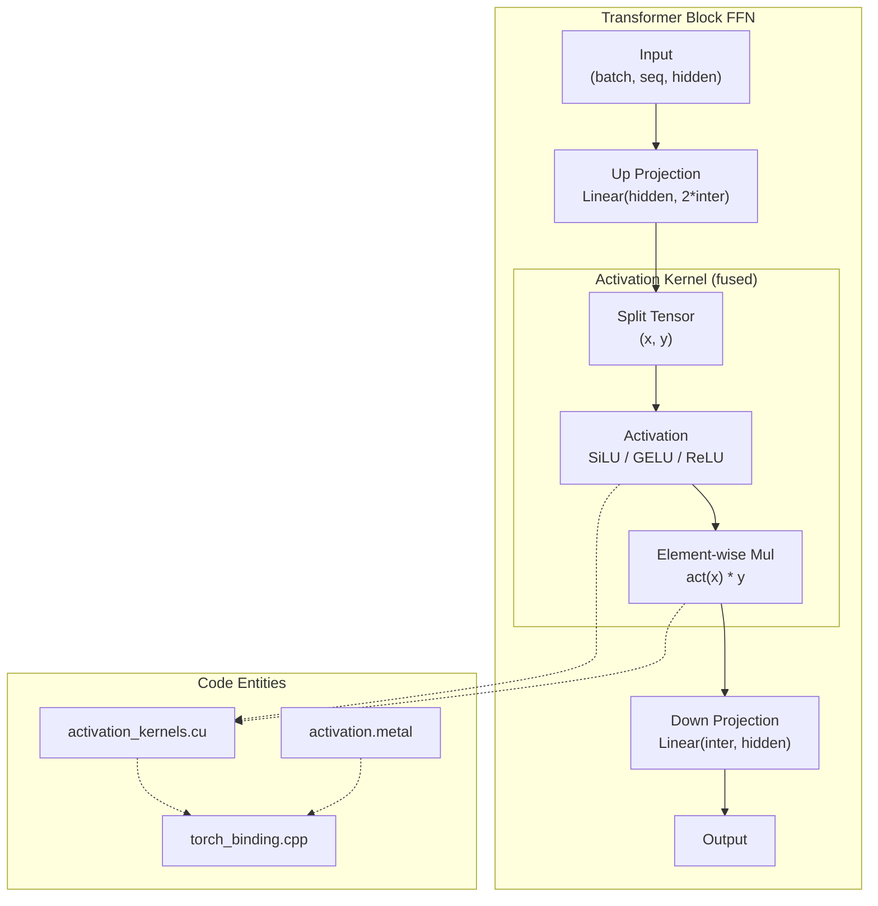
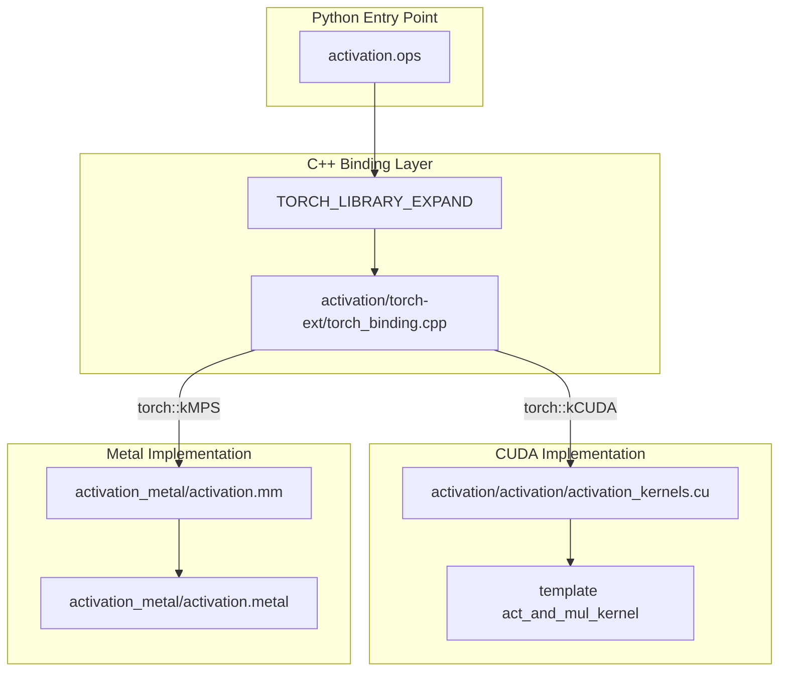

<!-- source: DeepWiki mcp.deepwiki.com · repo huggingface/kernels-community · page 4.4 Activation Kernels · fetched 2026-10-26 -->

# Activation Kernels

<details>
<summary>Relevant source files</summary>

The following files were used as context for generating this wiki page:

- [activation/activation/activation_kernels.cu](activation/activation/activation_kernels.cu)
- [activation/activation/cuda_compat.h](activation/activation/cuda_compat.h)
- [activation/activation/dispatch_utils.h](activation/activation/dispatch_utils.h)
- [activation/activation_metal/activation.metal](activation/activation_metal/activation.metal)
- [activation/activation_metal/activation.mm](activation/activation_metal/activation.mm)
- [activation/build.toml](activation/build.toml)
- [activation/flake.lock](activation/flake.lock)
- [activation/flake.nix](activation/flake.nix)
- [activation/tests/__init__.py](activation/tests/__init__.py)
- [activation/tests/kernels/__init__.py](activation/tests/kernels/__init__.py)
- [activation/tests/kernels/allclose_default.py](activation/tests/kernels/allclose_default.py)
- [activation/torch-ext/torch_binding.cpp](activation/torch-ext/torch_binding.cpp)
- [deformable-detr/flake.lock](deformable-detr/flake.lock)
- [relu/build.toml](relu/build.toml)
- [relu/flake.lock](relu/flake.lock)
- [relu/flake.nix](relu/flake.nix)
- [relu/relu_cpu/relu_cpu.cpp](relu/relu_cpu/relu_cpu.cpp)
- [relu/tests/test_relu.py](relu/tests/test_relu.py)
- [relu/torch-ext/relu/__init__.py](relu/torch-ext/relu/__init__.py)
- [relu/torch-ext/relu/layers/__init__.py](relu/torch-ext/relu/layers/__init__.py)
- [relu/torch-ext/torch_binding.cpp](relu/torch-ext/torch_binding.cpp)

</details>


## Purpose and Scope

This document provides an overview of activation function kernels available in the `kernels-community` repository. Activation kernels implement non-linear transformation functions applied to intermediate tensor values in neural network layers. The repository provides two distinct kernel implementations:

1.  **ReLU Kernel** - A multi-backend reference implementation primarily used for testing build infrastructure and demonstrating cross-platform support.
2.  **Activation Kernel Collection** - A production-grade collection of fused activation operations (primarily from vLLM), including **SiLU**, **GELU**, and **SwiGLU** (SiLU + multiplication) variants.

For detailed implementation specifics of the ReLU kernel across different backends, see [ReLU: Multi-Backend Reference Implementation](#4.4.1). For the fused activation implementations and Metal-specific shaders, see [Activation Kernel: SiLU, SwiGLU, and Fused Activations](#4.4.2).

**Sources:** [relu/build.toml:1-11](), [activation/build.toml:1-5](), [activation/torch-ext/torch_binding.cpp:6-94]()

## Activation Functions in Transformer Architectures

Activation functions introduce non-linearity between linear transformations. In transformer architectures, these are primarily utilized in the Feed-Forward Network (FFN) layer. Modern LLMs (like Llama or Mistral) typically use Gated Linear Units (GLU) which fuse an activation function with an element-wise multiplication.



**Sources:** [activation/activation/activation_kernels.cu:12-32](), [activation/torch-ext/torch_binding.cpp:8-14]()

## Available Kernels Overview

### ReLU Kernel (Reference)
The ReLU kernel serves as the repository's primary **reference implementation** for multi-backend support. It implements `f(x) = max(0, x)`.

*   **Backends:** CPU (SIMD), CUDA, Metal, XPU, and ROCm [relu/build.toml:5-11]().
*   **Purpose:** Validates that the `kernel-builder` infrastructure correctly handles different hardware toolchains (nvcc, xcrun metal, icpx, hipcc).
*   **API:** Exposed via `relu.relu(input)` and a `torch.nn.Module` wrapper `relu.layers.ReLU()` [relu/tests/test_relu.py:7-35]().

### Activation Collection (Production)
The `activation` directory contains high-performance fused kernels optimized for LLM inference, supporting both **CUDA** and **Metal** [activation/build.toml:5]().

*   **Fused Gated Activations:** `silu_and_mul` (SwiGLU), `gelu_and_mul`, `gelu_tanh_and_mul`, and `fatrelu_and_mul` [activation/torch-ext/torch_binding.cpp:8-45]().
*   **Stand-alone Activations:** `silu`, `gelu`, `gelu_fast`, `gelu_new`, and `gelu_quick` [activation/torch-ext/torch_binding.cpp:48-93]().
*   **Precision:** Supports `float32` and `float16` across backends [activation/activation_metal/activation.mm:36-39]().

**Sources:** [activation/torch-ext/torch_binding.cpp:6-94](), [relu/build.toml:1-11]()

## Kernel Architecture and Code Mapping

The following diagram bridges the high-level activation concepts to the specific code entities implementing them across backends.



**Sources:** [activation/torch-ext/torch_binding.cpp:6-94](), [activation/activation/activation_kernels.cu:20-32](), [activation/activation_metal/activation.mm:17-77]()

## Kernel Comparison Matrix

| Feature | ReLU Kernel | Activation Collection |
| :--- | :--- | :--- |
| **Primary Use Case** | CI/CD & Build Testing | LLM Inference (FFN Layers) |
| **CUDA Support** | Yes [relu/build.toml:7]() | Yes [activation/build.toml:5]() |
| **Metal Support** | Yes [relu/build.toml:8]() | Yes [activation/build.toml:5]() |
| **XPU Support** | Yes [relu/build.toml:10]() | No |
| **ROCm Support** | Yes [relu/build.toml:9]() | No |
| **Fused Ops** | No | Yes (e.g., `silu_and_mul`) |
| **Reference File** | `relu_cuda/relu.cu` | `activation_kernels.cu` |

**Sources:** [relu/build.toml:1-11](), [activation/build.toml:1-5](), [activation/torch-ext/torch_binding.cpp:8-14]()

## Usage Summary

### ReLU Usage
The ReLU kernel is typically accessed via the standard `kernels` loader. It supports both functional and layer-based usage.

```python
import torch
import relu # Loaded via kernels.get_kernel("relu")

x = torch.randn(1024, device="cuda")
# Functional
out = relu.relu(x) 
# Layer
layer = relu.layers.ReLU()
out = layer(x)
```
**Sources:** [relu/tests/test_relu.py:7-35]()

### SwiGLU Usage
The SwiGLU activation (`silu_and_mul`) expects an input tensor where the gating and up-projection values are concatenated along the last dimension.

```python
import torch
import activation # Loaded via kernels.get_kernel("activation")

# input: [..., 2 * d], output: [..., d]
d = 4096
input_tensor = torch.randn(1, 128, 2 * d, device="cuda")
output_tensor = torch.empty(1, 128, d, device="cuda")

activation.ops.silu_and_mul(output_tensor, input_tensor)
```
**Sources:** [activation/torch-ext/torch_binding.cpp:8-11](), [activation/activation/activation_kernels.cu:85-91]()

## Backend Implementation Details

### CUDA
The CUDA implementation uses a highly vectorized approach via the `VLLM_LDG` macro for efficient global memory loads [activation/activation/activation_kernels.cu:28-29](). It employs a template-based dispatch system (`LAUNCH_ACTIVATION_GATE_KERNEL`) to generate specialized kernels for different activation functions without code duplication [activation/activation/activation_kernels.cu:68-83]().

### Metal
The Metal implementation utilizes **Embedded Metallib** technology. The `.metal` shaders are compiled into a header and linked into the `.mm` objective-C++ dispatch code [activation/activation_metal/activation.mm:7-11](). Shaders include manual implementations of functions like `erf_approx` to match CUDA's numerical behavior on Apple Silicon [activation/activation_metal/activation.metal:5-26]().

**Sources:** [activation/activation/activation_kernels.cu:68-83](), [activation/activation_metal/activation.mm:7-15](), [activation/activation_metal/activation.metal:4-26]()

---

