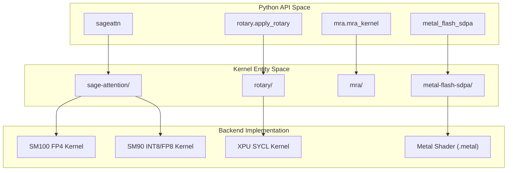
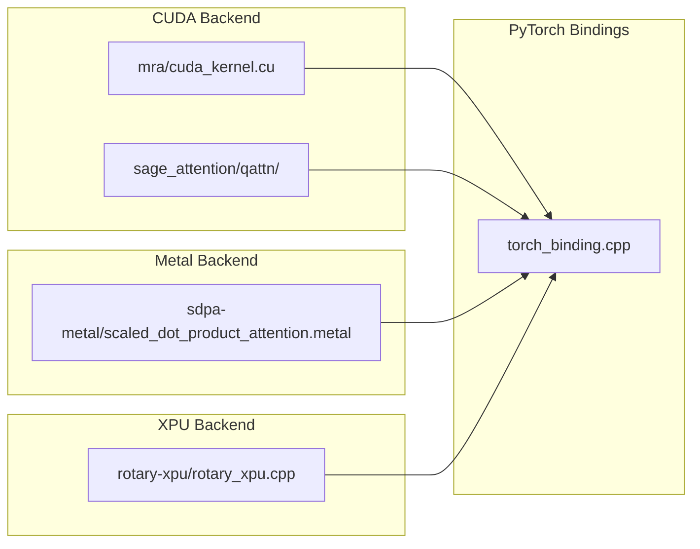

<!-- source: DeepWiki mcp.deepwiki.com · repo huggingface/kernels-community · page 4.5 Attention Variants · fetched 2026-10-26 -->

# Attention Variants

Relevant source files

The following files were used as context for generating this wiki page:

- [metal-flash-sdpa/README.md](metal-flash-sdpa/README.md)
- [metal-flash-sdpa/benchmark.py](metal-flash-sdpa/benchmark.py)
- [metal-flash-sdpa/build.toml](metal-flash-sdpa/build.toml)
- [metal-flash-sdpa/flake.lock](metal-flash-sdpa/flake.lock)
- [metal-flash-sdpa/flake.nix](metal-flash-sdpa/flake.nix)
- [metal-flash-sdpa/sdpa-metal/common.h](metal-flash-sdpa/sdpa-metal/common.h)
- [metal-flash-sdpa/sdpa-metal/scaled_dot_product_attention.metal](metal-flash-sdpa/sdpa-metal/scaled_dot_product_attention.metal)
- [metal-flash-sdpa/sdpa-metal/scaled_dot_product_attention.mm](metal-flash-sdpa/sdpa-metal/scaled_dot_product_attention.mm)
- [metal-flash-sdpa/tests/__init__.py](metal-flash-sdpa/tests/__init__.py)
- [metal-flash-sdpa/tests/test_flash_attention.py](metal-flash-sdpa/tests/test_flash_attention.py)
- [metal-flash-sdpa/torch-ext/metal_flash_sdpa/__init__.py](metal-flash-sdpa/torch-ext/metal_flash_sdpa/__init__.py)
- [mra/README.md](mra/README.md)
- [mra/build.toml](mra/build.toml)
- [mra/flake.lock](mra/flake.lock)
- [mra/flake.nix](mra/flake.nix)
- [mra/mra/cuda_kernel.cu](mra/mra/cuda_kernel.cu)
- [mra/mra/cuda_kernel.h](mra/mra/cuda_kernel.h)
- [mra/mra/cuda_launch.cu](mra/mra/cuda_launch.cu)
- [mra/mra/cuda_launch.h](mra/mra/cuda_launch.h)
- [mra/scripts/readme_example.py](mra/scripts/readme_example.py)
- [mra/torch-ext/cuda_launch.h](mra/torch-ext/cuda_launch.h)
- [mra/torch-ext/mra/__init__.py](mra/torch-ext/mra/__init__.py)
- [rotary/build.toml](rotary/build.toml)
- [rotary/flake.lock](rotary/flake.lock)
- [rotary/flake.nix](rotary/flake.nix)
- [rotary/rotary-xpu/rotary_xpu.cpp](rotary/rotary-xpu/rotary_xpu.cpp)
- [rotary/rotary-xpu/rotary_xpu.hpp](rotary/rotary-xpu/rotary_xpu.hpp)
- [rotary/rotary/rotary_cuda.cu](rotary/rotary/rotary_cuda.cu)
- [rotary/tests/__init__.py](rotary/tests/__init__.py)
- [rotary/tests/test_rotary.py](rotary/tests/test_rotary.py)
- [rotary/tests/utils.py](rotary/tests/utils.py)
- [rotary/torch-ext/rotary/__init__.py](rotary/torch-ext/rotary/__init__.py)
- [sage-attention/build.toml](sage-attention/build.toml)
- [sage-attention/flake.lock](sage-attention/flake.lock)
- [sage-attention/flake.nix](sage-attention/flake.nix)
- [sage-attention/tests/test_quant.py](sage-attention/tests/test_quant.py)
- [sage-attention/torch-ext/sage_attention/__init__.py](sage-attention/torch-ext/sage_attention/__init__.py)
- [sage-attention/torch-ext/torch_binding.cpp](sage-attention/torch-ext/torch_binding.cpp)
- [sage-attention/torch-ext/torch_binding.h](sage-attention/torch-ext/torch_binding.h)

The `kernels-community` repository provides several specialized attention implementations beyond the standard Flash Attention family. These variants address specific architectural needs, such as low-precision quantization for inference, multi-resolution sparse patterns, rotary positional encoding, and hardware-specific optimizations for Apple Silicon.

## Overview of Variants

The following table summarizes the specialized attention kernels available in the repository:

| Kernel | Primary Purpose | Supported Backends | Key Features |
| :--- | :--- | :--- | :--- |
| **SageAttention** | Quantized Attention | CUDA | INT8/FP8/FP4 quantization, SM80-SM100 support |
| **RoPE** | Positional Encoding | CUDA, XPU | Rotary Positional Embeddings, Transformers-compatible API |
| **MRA** | Block-Sparse Attention | CUDA | Multi-Resolution Attention for sparse patterns |
| **Metal Flash SDPA** | Apple Silicon SDPA | Metal | Scaled Dot-Product Attention for Mac/iPad |

### Relationship between Variants and Code Entities

The following diagram maps the high-level attention variants to their specific implementation directories and entry points within the codebase.

**Attention Variant Code Mapping**

Sources: [sage-attention/build.toml:1-5](), [rotary/build.toml:1-8](), [mra/build.toml:1-4](), [metal-flash-sdpa/build.toml:1-5]()

---

## SageAttention: Quantized Attention

SageAttention is an optimized attention library that utilizes per-block quantization to accelerate inference. It supports various precision formats, including INT8 and FP8 for SM80/SM89/SM90 architectures, and introduces specialized FP4 support for SM100 (Blackwell) GPUs.

*   **Quantization Strategies**: Implements `per_block_int8`, `per_warp_int8`, and `per_channel_fp8` to balance accuracy and speed.
*   **Architecture Specialization**: Features dedicated kernels for different NVIDIA generations, such as `_qattn_sm80`, `_qattn_sm89`, and `_qattn_sm90` [sage-attention/build.toml:19-150]().
*   **Blackwell Support**: Includes `_fp4attn_sm100` and `_fp4quant_sm100` for next-generation hardware [sage-attention/build.toml:185-269]().

For details, see [SageAttention: Quantized Attention](#4.5.1).

## Rotary Positional Embeddings (RoPE)

The `rotary` kernel provides a high-performance implementation of Rotary Positional Embeddings, a common requirement for modern LLMs like Llama and Mistral.

*   **Multi-Backend**: Supports both CUDA and Intel XPU (via SYCL) [rotary/build.toml:5-8]().
*   **Transformers Compatibility**: The `apply_rotary_transformers` wrapper matches the signature used in the Hugging Face `transformers` library, facilitating easy integration [rotary/torch-ext/rotary/__init__.py:19-52]().
*   **Implementation**: Utilizes `TensorIterator` for dispatch and an `OffsetCalculator` for XPU backend efficiency [rotary/build.toml:17-28]().

For details, see [Rotary Positional Embeddings (RoPE)](#4.5.2).

## MRA and Metal Flash SDPA

These kernels provide specialized attention mechanisms for sparse patterns and Apple-specific hardware.

### Multi-Resolution Attention (MRA)
The `mra` kernel implements block-sparse attention patterns. It is designed for CUDA backends and provides a `mra` kernel for efficient sparse matrix-based attention operations [mra/build.toml:16-24]().

### Metal Flash SDPA
`metal-flash-sdpa` is a specialized implementation of Scaled Dot-Product Attention for Apple Silicon. It leverages Metal Shading Language (`.metal`) and Objective-C++ (`.mm`) to provide a high-performance alternative to standard PyTorch SDPA on Mac devices [metal-flash-sdpa/build.toml:17-24]().

**Backend and Binding Mapping**

Sources: [mra/build.toml:11-14](), [metal-flash-sdpa/build.toml:12-15](), [rotary/build.toml:14-15](), [sage-attention/build.toml:13-17]()

For details, see [MRA: Multi-Resolution Attention and Metal Flash SDPA](#4.5.3).

---

