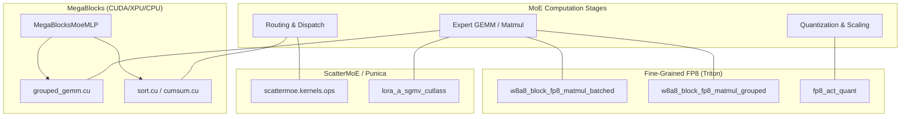
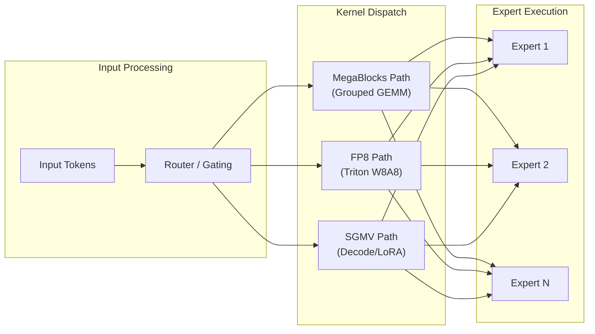

<!-- source: DeepWiki mcp.deepwiki.com · repo huggingface/kernels-community · page 4.6 Mixture of Experts (MoE) Kernels · fetched 2026-10-26 -->

# Mixture of Experts (MoE) Kernels

Relevant source files

The following files were used as context for generating this wiki page:

- [finegrained-fp8/README.md](finegrained-fp8/README.md)
- [finegrained-fp8/build.toml](finegrained-fp8/build.toml)
- [finegrained-fp8/flake.lock](finegrained-fp8/flake.lock)
- [finegrained-fp8/flake.nix](finegrained-fp8/flake.nix)
- [finegrained-fp8/pytest.ini](finegrained-fp8/pytest.ini)
- [finegrained-fp8/tests/test_matmul.py](finegrained-fp8/tests/test_matmul.py)
- [finegrained-fp8/tests/test_moe.py](finegrained-fp8/tests/test_moe.py)
- [finegrained-fp8/torch-ext/finegrained_fp8/__init__.py](finegrained-fp8/torch-ext/finegrained_fp8/__init__.py)
- [finegrained-fp8/torch-ext/finegrained_fp8/act_quant.py](finegrained-fp8/torch-ext/finegrained_fp8/act_quant.py)
- [finegrained-fp8/torch-ext/finegrained_fp8/batched.py](finegrained-fp8/torch-ext/finegrained_fp8/batched.py)
- [finegrained-fp8/torch-ext/finegrained_fp8/grouped.py](finegrained-fp8/torch-ext/finegrained_fp8/grouped.py)
- [finegrained-fp8/torch-ext/finegrained_fp8/matmul.py](finegrained-fp8/torch-ext/finegrained_fp8/matmul.py)
- [finegrained-fp8/torch-ext/finegrained_fp8/utils.py](finegrained-fp8/torch-ext/finegrained_fp8/utils.py)
- [megablocks/build.toml](megablocks/build.toml)
- [megablocks/flake.lock](megablocks/flake.lock)
- [megablocks/flake.nix](megablocks/flake.nix)
- [punica-sgmv/build.toml](punica-sgmv/build.toml)
- [punica-sgmv/flake.lock](punica-sgmv/flake.lock)
- [punica-sgmv/flake.nix](punica-sgmv/flake.nix)
- [scattermoe/README.md](scattermoe/README.md)
- [scattermoe/build.toml](scattermoe/build.toml)
- [scattermoe/flake.lock](scattermoe/flake.lock)
- [scattermoe/flake.nix](scattermoe/flake.nix)
- [scattermoe/torch-ext/scattermoe/__init__.py](scattermoe/torch-ext/scattermoe/__init__.py)
- [scattermoe/torch-ext/scattermoe/kernels/__init__.py](scattermoe/torch-ext/scattermoe/kernels/__init__.py)
- [scattermoe/torch-ext/scattermoe/kernels/ops.py](scattermoe/torch-ext/scattermoe/kernels/ops.py)
- [scattermoe/torch-ext/scattermoe/kernels/single.py](scattermoe/torch-ext/scattermoe/kernels/single.py)
- [scattermoe/torch-ext/scattermoe/layers.py](scattermoe/torch-ext/scattermoe/layers.py)
- [scattermoe/torch-ext/scattermoe/parallel_experts.py](scattermoe/torch-ext/scattermoe/parallel_experts.py)

This page provides a high-level overview of the Mixture of Experts (MoE) kernel implementations within the `kernels-community` repository. These kernels optimize the sparse computation patterns inherent in MoE architectures, where tokens are routed to a subset of specialized "expert" networks.

For detailed technical specifications, implementation details, and API references, please refer to the specific child pages linked below.

## Purpose and Scope

MoE kernels address the unique computational challenges of sparse gating and expert execution. Unlike dense layers, MoE layers require efficient routing (mapping tokens to experts), grouping (collecting tokens for the same expert), and specialized GEMM operations that can handle variable-sized batches across different experts.

The repository provides several specialized implementations targeting different performance trade-offs, quantization levels, and hardware backends:

*   **MegaBlocks**: Optimized for large-scale MoE training and inference with block-sparse operations and grouped GEMMs.
*   **ScatterMoE**: Focuses on scatter/gather-based routing for flexible expert execution.
*   **Punica SGMV**: Optimized for multi-LoRA serving, treating LoRA adapters as a form of expert selection.
*   **Fine-Grained FP8**: High-performance Triton kernels for W8A8 quantized MoE with block-level scaling.

Sources: [megablocks/build.toml:1-9](), [finegrained-fp8/README.md:1-15](), [scattermoe/README.md:1-10]()

## Kernel Taxonomy

The following diagram maps the MoE kernels to their primary architectural roles and the code entities that implement them:

Sources: [megablocks/build.toml:41-55](), [finegrained-fp8/torch-ext/finegrained_fp8/grouped.py:33-61](), [finegrained-fp8/torch-ext/finegrained_fp8/batched.py:33-57](), [scattermoe/torch-ext/scattermoe/kernels/ops.py:1-20]()

## Implementation Overview

### 4.6.1 MegaBlocks: Mixture of Experts GEMM
MegaBlocks provides a robust MoE implementation supporting **CUDA**, **XPU**, and **CPU** backends [megablocks/build.toml:5-9](). It utilizes grouped GEMM operations to process multiple experts in a single kernel launch, significantly reducing overhead for sparse routing. It integrates with **CUTLASS 3.8** for high-performance CUDA execution [megablocks/build.toml:39]().

For details, see [MegaBlocks: Mixture of Experts GEMM](#4.6.1).

### 4.6.2 ScatterMoE and Punica SGMV
This section covers two distinct but related approaches to sparse expert computation:
*   **ScatterMoE**: Implements MoE via scatter/gather operations, allowing for flexible token-to-expert mapping without requiring contiguous memory layouts for grouped tokens.
*   **Punica SGMV**: A specialized kernel for **Sparse Grouped Matrix-Vector** multiplication. While originally designed for LoRA adapters, its architecture is highly effective for MoE "decode" phases where each token in a batch might route to a different expert.

For details, see [ScatterMoE and Punica SGMV](#4.6.2).

### 4.6.3 Fine-Grained FP8 MoE Kernels
The `finegrained-fp8` suite provides Triton-based kernels for **W8A8 FP8** quantized MoE. These kernels support block-scale quantization (e.g., 128x128 blocks) rather than just per-tensor scaling, offering better numerical accuracy for large models [finegrained-fp8/torch-ext/finegrained_fp8/grouped.py:62-66](). It includes specialized variants for both **prefill** (grouped GEMM) and **decode** (batched GEMM) phases.

For details, see [Fine-Grained FP8 MoE Kernels](#4.6.3).

## Comparative Summary

| Feature | MegaBlocks | Fine-Grained FP8 | Punica SGMV |
| :--- | :--- | :--- | :--- |
| **Primary Backend** | CUDA / XPU / CPU | CUDA (Triton) | CUDA (CUTLASS) |
| **Quantization** | FP16 / BF16 | W8A8 FP8 (Block-scale) | FP16 / BF16 |
| **GEMM Strategy** | Grouped GEMM | Batched & Grouped | SGMV |
| **Optimization Target** | General MoE Layers | Quantized Inference | LoRA / Decode MoE |
| **Key Code Entry** | `MegaBlocksMoeMLP` | `w8a8_block_fp8_matmul` | `lora_a_sgmv_cutlass` |

Sources: [megablocks/build.toml:5-9](), [finegrained-fp8/torch-ext/finegrained_fp8/grouped.py:187-194](), [finegrained-fp8/torch-ext/finegrained_fp8/batched.py:187-194](), [punica-sgmv/build.toml:1-10]()

## Architecture Integration

The following diagram illustrates how these kernels fit into a standard MoE layer execution flow:

Sources: [finegrained-fp8/tests/test_moe.py:236-245](), [megablocks/build.toml:41-55]()

---

