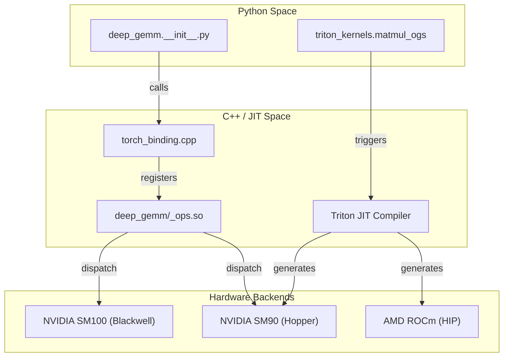

<!-- source: DeepWiki mcp.deepwiki.com · repo huggingface/kernels-community · page 4.7 GEMM and Linear Algebra Kernels · fetched 2026-10-26 -->

# GEMM and Linear Algebra Kernels

Relevant source files

The following files were used as context for generating this wiki page:

- [deep-gemm/flake.lock](deep-gemm/flake.lock)
- [deep-gemm/torch-ext/deep_gemm/__init__.py](deep-gemm/torch-ext/deep_gemm/__init__.py)
- [deep-gemm/torch-ext/torch_binding.cpp](deep-gemm/torch-ext/torch_binding.cpp)
- [gpt-oss-triton-kernels/build.toml](gpt-oss-triton-kernels/build.toml)
- [gpt-oss-triton-kernels/flake.lock](gpt-oss-triton-kernels/flake.lock)
- [gpt-oss-triton-kernels/flake.nix](gpt-oss-triton-kernels/flake.nix)
- [gpt-oss-triton-kernels/torch-ext/gpt_oss_triton_kernels/__init__.py](gpt-oss-triton-kernels/torch-ext/gpt_oss_triton_kernels/__init__.py)
- [triton-kernels/README.md](triton-kernels/README.md)
- [triton-kernels/build.toml](triton-kernels/build.toml)
- [triton-kernels/flake.lock](triton-kernels/flake.lock)
- [triton-kernels/flake.nix](triton-kernels/flake.nix)
- [triton-kernels/readme_example.py](triton-kernels/readme_example.py)
- [triton-kernels/tests/__init__.py](triton-kernels/tests/__init__.py)
- [triton-kernels/tests/conftest.py](triton-kernels/tests/conftest.py)
- [triton-kernels/tests/test_compaction.py](triton-kernels/tests/test_compaction.py)
- [triton-kernels/tests/test_matmul.py](triton-kernels/tests/test_matmul.py)
- [triton-kernels/tests/test_mxfp.py](triton-kernels/tests/test_mxfp.py)

This section provides an overview of the General Matrix Multiplication (GEMM) and linear algebra kernels available in the `kernels-community` repository. These implementations range from JIT-compiled specialized FP8 kernels for NVIDIA Blackwell and Hopper architectures to versatile Triton-based kernels supporting Mixture of Experts (MoE) and Microscaling Formats (MXFP4).

The kernels in this category focus on high-performance matrix operations, often integrating advanced features like block-scaling, grouped layouts, and specialized numerics for modern LLM inference and training workloads.

## DeepGEMM: JIT FP8/BF16 GEMM

DeepGEMM is a high-performance library designed for NVIDIA Hopper (SM90) and Blackwell (SM100) architectures. It utilizes a Just-In-Time (JIT) compilation system to generate optimized kernels for specific matrix dimensions and data types, including FP8, FP4, and BF16.

The library is exposed via a PyTorch extension [deep-gemm/torch-ext/torch_binding.cpp:7-250]() and provides specialized support for:
*   **Grouped GEMMs**: Support for M-grouped and K-grouped variants [deep-gemm/torch-ext/torch_binding.cpp:110-169]().
*   **Quantization**: Integration with FP8 and FP4 formats, including layout transformation utilities for TMA (Tensor Memory Accelerator) alignment [deep-gemm/torch-ext/deep_gemm/__init__.py:68-118]().
*   **Heuristics**: A JIT system that manages SM utilization and Tensor Core utility [deep-gemm/torch-ext/deep_gemm/__init__.py:45-58]().

For details, see [DeepGEMM: JIT FP8/BF16 GEMM](#4.7.1).

## Triton and GPT-OSS Kernels

The repository includes a suite of Triton-based kernels derived from the upstream Triton project and specialized "GPT-OSS" variants. These kernels are designed for flexibility across different GPU backends (CUDA, ROCm, XPU) as specified in their build configurations [gpt-oss-triton-kernels/build.toml:5-10]().

Key features include:
*   **MoE Support**: Optimized routing and `matmul_ogs` (grouped GEMM) operations for Mixture of Experts [triton-kernels/tests/test_matmul.py:47-53]().
*   **Specialized Numerics**: Support for Microscaling formats like MXFP4 and MXFP8, including upcasting/downcasting functions [triton-kernels/tests/test_matmul.py:19-19]().
*   **Fused Operations**: Implementation of fused SwiGLU activations and precision-configurable epilogues [triton-kernels/tests/test_matmul.py:11-14]().

For details, see [Triton Kernels: MoE and MXFP4](#4.7.2).

## System Architecture

The following diagram illustrates the relationship between the Python API, the compiled extensions, and the underlying hardware dispatching for GEMM operations.

### GEMM Dispatch Flow

Sources: [deep-gemm/torch-ext/torch_binding.cpp:7-107](), [deep-gemm/torch-ext/deep_gemm/__init__.py:142-292](), [triton-kernels/tests/test_matmul.py:9-15]().

### Code Entity Association
This table associates high-level kernel features with their primary code entry points.

| Feature | Code Entity | File Path |
| :--- | :--- | :--- |
| **FP8 GEMM (NT)** | `fp8_fp4_gemm_nt` | [deep-gemm/torch-ext/torch_binding.cpp:66-74]() |
| **M-Grouped GEMM** | `m_grouped_fp8_fp4_gemm_nt_contiguous` | [deep-gemm/torch-ext/deep_gemm/__init__.py:304-338]() |
| **MoE Routing** | `routing` | [triton-kernels/tests/test_matmul.py:47-53]() |
| **SwiGLU Activation** | `swiglu` | [triton-kernels/tests/test_matmul.py:14-14]() |
| **MXFP4 Support** | `downcast_to_mxfp` | [triton-kernels/tests/test_matmul.py:19-19]() |

## Implementation Matrix

| Kernel | Primary Backend | Precision Support | Key Utility |
| :--- | :--- | :--- | :--- |
| **DeepGEMM** | CUDA (SM90+) | FP8, FP4, BF16 | JIT Heuristics [deep-gemm/torch-ext/deep_gemm/__init__.py:45-50]() |
| **Triton Kernels** | CUDA, ROCm, XPU | BF16, MXFP4, MXFP8 | `FlexCtx` Precision [triton-kernels/tests/test_matmul.py:96-102]() |
| **GPT-OSS Triton** | Multi-Backend | FP16, BF16 | Routing Modules [gpt-oss-triton-kernels/torch-ext/gpt_oss_triton_kernels/__init__.py:3-3]() |

Sources: [deep-gemm/torch-ext/torch_binding.cpp:7-107](), [triton-kernels/tests/test_matmul.py:83-102](), [gpt-oss-triton-kernels/build.toml:5-10]().

***

**Child Pages:**
*   [DeepGEMM: JIT FP8/BF16 GEMM](#4.7.1)
*   [Triton Kernels: MoE and MXFP4](#4.7.2)

---

