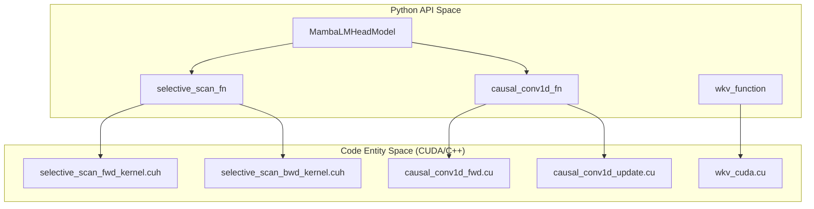
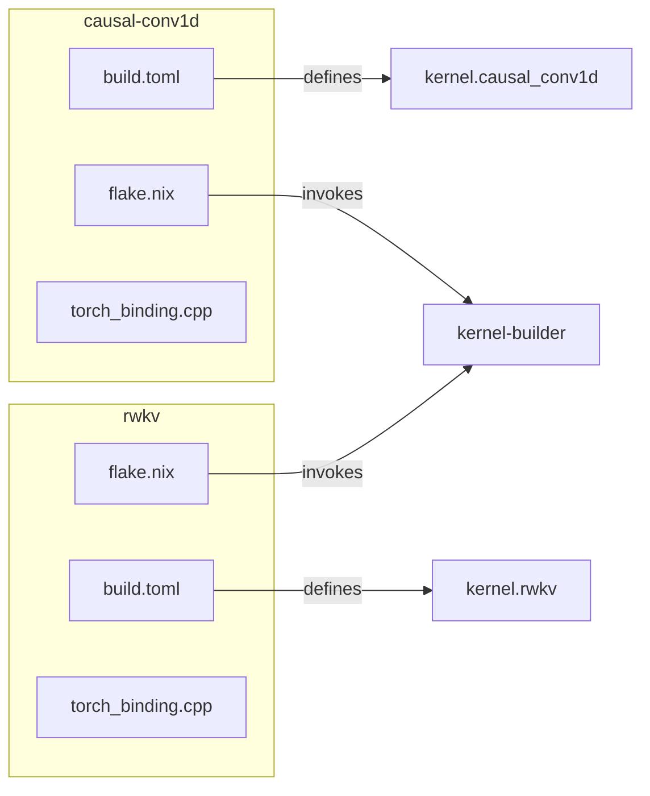

<!-- source: DeepWiki mcp.deepwiki.com · repo huggingface/kernels-community · page 4.8 Sequence Model Kernels · fetched 2026-10-26 -->

# Sequence Model Kernels

Relevant source files

The following files were used as context for generating this wiki page:

- [causal-conv1d/build.toml](causal-conv1d/build.toml)
- [causal-conv1d/causal-conv1d/causal_conv1d.cpp](causal-conv1d/causal-conv1d/causal_conv1d.cpp)
- [causal-conv1d/causal-conv1d/causal_conv1d.h](causal-conv1d/causal-conv1d/causal_conv1d.h)
- [causal-conv1d/causal-conv1d/causal_conv1d_bwd.cu](causal-conv1d/causal-conv1d/causal_conv1d_bwd.cu)
- [causal-conv1d/causal-conv1d/causal_conv1d_common.h](causal-conv1d/causal-conv1d/causal_conv1d_common.h)
- [causal-conv1d/causal-conv1d/causal_conv1d_fwd.cu](causal-conv1d/causal-conv1d/causal_conv1d_fwd.cu)
- [causal-conv1d/causal-conv1d/causal_conv1d_update.cu](causal-conv1d/causal-conv1d/causal_conv1d_update.cu)
- [causal-conv1d/causal-conv1d/static_switch.h](causal-conv1d/causal-conv1d/static_switch.h)
- [causal-conv1d/flake.lock](causal-conv1d/flake.lock)
- [causal-conv1d/flake.nix](causal-conv1d/flake.nix)
- [flake.lock](flake.lock)
- [flake.nix](flake.nix)
- [mamba-ssm/build.toml](mamba-ssm/build.toml)
- [mamba-ssm/flake.lock](mamba-ssm/flake.lock)
- [mamba-ssm/flake.nix](mamba-ssm/flake.nix)
- [mamba-ssm/torch-ext/mamba_ssm/__init__.py](mamba-ssm/torch-ext/mamba_ssm/__init__.py)
- [mamba-ssm/torch-ext/mamba_ssm/models/__init__.py](mamba-ssm/torch-ext/mamba_ssm/models/__init__.py)
- [mamba-ssm/torch-ext/mamba_ssm/modules/__init__.py](mamba-ssm/torch-ext/mamba_ssm/modules/__init__.py)
- [mamba-ssm/torch-ext/mamba_ssm/ops/__init__.py](mamba-ssm/torch-ext/mamba_ssm/ops/__init__.py)
- [mamba-ssm/torch-ext/mamba_ssm/ops/triton/__init__.py](mamba-ssm/torch-ext/mamba_ssm/ops/triton/__init__.py)
- [mamba-ssm/torch-ext/mamba_ssm/utils/generation.py](mamba-ssm/torch-ext/mamba_ssm/utils/generation.py)
- [rwkv/README.md](rwkv/README.md)
- [rwkv/build.toml](rwkv/build.toml)
- [rwkv/flake.lock](rwkv/flake.lock)
- [rwkv/flake.nix](rwkv/flake.nix)
- [rwkv/rwkv/wkv_cuda.cu](rwkv/rwkv/wkv_cuda.cu)
- [rwkv/rwkv/wkv_cuda_bf16.cu](rwkv/rwkv/wkv_cuda_bf16.cu)
- [rwkv/torch-ext/rwkv/__init__.py](rwkv/torch-ext/rwkv/__init__.py)
- [rwkv/torch-ext/torch_binding.cpp](rwkv/torch-ext/torch_binding.cpp)

This section provides an overview of optimized kernels for sequence models, specifically focusing on State Space Models (SSMs) like Mamba, causal 1D convolutions, and the RWKV architecture. These kernels are designed to replace standard attention mechanisms with linear-time alternatives that offer high efficiency for long-sequence modeling.

### Architecture Overview

The sequence model kernels in this repository are structured into three primary sub-projects, each with its own build configuration and specialized CUDA implementations. These kernels are often used in conjunction; for example, Mamba models typically require both the `mamba-ssm` kernels and `causal-conv1d` for their block architecture.

#### Sequence Model Kernel Ecosystem
The following diagram illustrates the relationship between the high-level Python model entities and the underlying kernel implementations.

Sources: [mamba-ssm/torch-ext/mamba_ssm/models/mixer_seq_simple.py:1](), [mamba-ssm/build.toml:17-38](), [causal-conv1d/build.toml:18-30](), [rwkv/build.toml:14-35]()

---

### Mamba SSM: State Space Model Kernels

The `mamba-ssm` package provides the core kernels for the Mamba architecture, primarily centered around the selective scan operation. Unlike standard convolutions or attention, selective scan allows the model to propagate state across time steps with a content-dependent gating mechanism.

Key components include:
*   **Selective Scan Kernels**: Highly optimized CUDA implementations for forward and backward passes, supporting `fp16`, `bf16`, and `fp32` precision, as well as complex-valued states [mamba-ssm/build.toml:24-34]().
*   **Inference Utilities**: Support for `MambaLMHeadModel` [mamba-ssm/torch-ext/mamba_ssm/models/__init__.py:1-4](), which utilizes specialized generation logic including CUDA graph decoding and advanced sampling strategies.

For technical details on selective scan implementation and inference parameters, see **[Mamba SSM: State Space Model Kernels](#4.8.1)**.

Sources: [mamba-ssm/build.toml:1-38](), [mamba-ssm/torch-ext/mamba_ssm/models/__init__.py:1-4]()

---

### Causal Conv1D and RWKV

Beyond the core SSM logic, sequence models frequently employ specialized 1D convolutions and recurrent attention mechanisms.

#### Causal Conv1D
The `causal-conv1d` kernel implements a depthwise 1D convolution with a causal constraint, ensuring that the output at a specific time step only depends on current and past inputs. It includes specialized "update" kernels for fast incremental inference [causal-conv1d/build.toml:28]().

#### RWKV (Receptance Weighted Key Value)
The `rwkv` kernel implements the "WKV" (Weighted Key Value) operation, which is the heart of the RWKV architecture. This kernel manages the time-decaying summation of values, providing a recurrent alternative to self-attention that scales linearly with sequence length. The implementation includes specialized `bf16` support [rwkv/build.toml:34]().

The following diagram maps the build-system components for these auxiliary kernels:

Sources: [causal-conv1d/build.toml:1-30](), [causal-conv1d/flake.nix:1-18](), [rwkv/build.toml:1-36](), [rwkv/flake.nix:1-17]()

For details on the convolution update kernels and RWKV WKV logic, see **[Causal Conv1D and RWKV](#4.8.2)**.

Sources: [causal-conv1d/build.toml:1-30](), [rwkv/build.toml:1-36]()

---

