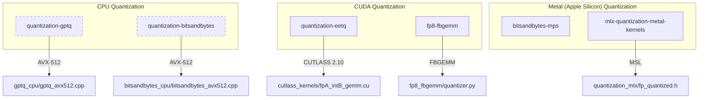
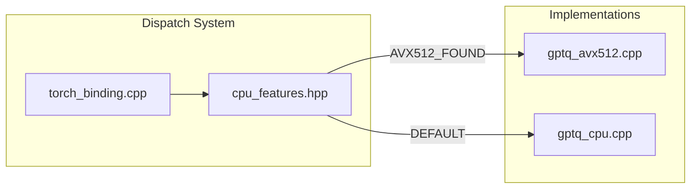

<!-- source: DeepWiki mcp.deepwiki.com · repo huggingface/kernels-community · page 4.9 Quantization Kernels · fetched 2026-10-26 -->

# Quantization Kernels

Relevant source files

The following files were used as context for generating this wiki page:

- [bitsandbytes-mps/build.toml](bitsandbytes-mps/build.toml)
- [bitsandbytes-mps/flake.lock](bitsandbytes-mps/flake.lock)
- [bitsandbytes-mps/flake.nix](bitsandbytes-mps/flake.nix)
- [fp8-fbgemm/build.toml](fp8-fbgemm/build.toml)
- [fp8-fbgemm/flake.lock](fp8-fbgemm/flake.lock)
- [fp8-fbgemm/flake.nix](fp8-fbgemm/flake.nix)
- [fp8-fbgemm/torch-ext/fp8_fbgemm/__init__.py](fp8-fbgemm/torch-ext/fp8_fbgemm/__init__.py)
- [fp8-fbgemm/torch-ext/fp8_fbgemm/quantizer.py](fp8-fbgemm/torch-ext/fp8_fbgemm/quantizer.py)
- [mlx-quantization-metal-kernels/README.md](mlx-quantization-metal-kernels/README.md)
- [mlx-quantization-metal-kernels/build.toml](mlx-quantization-metal-kernels/build.toml)
- [mlx-quantization-metal-kernels/flake.lock](mlx-quantization-metal-kernels/flake.lock)
- [mlx-quantization-metal-kernels/flake.nix](mlx-quantization-metal-kernels/flake.nix)
- [mlx-quantization-metal-kernels/quantization_mlx/bf16.h](mlx-quantization-metal-kernels/quantization_mlx/bf16.h)
- [mlx-quantization-metal-kernels/quantization_mlx/bf16_math.h](mlx-quantization-metal-kernels/quantization_mlx/bf16_math.h)
- [mlx-quantization-metal-kernels/quantization_mlx/complex.h](mlx-quantization-metal-kernels/quantization_mlx/complex.h)
- [mlx-quantization-metal-kernels/quantization_mlx/defines.h](mlx-quantization-metal-kernels/quantization_mlx/defines.h)
- [mlx-quantization-metal-kernels/quantization_mlx/fp4.h](mlx-quantization-metal-kernels/quantization_mlx/fp4.h)
- [mlx-quantization-metal-kernels/quantization_mlx/fp8.h](mlx-quantization-metal-kernels/quantization_mlx/fp8.h)
- [mlx-quantization-metal-kernels/quantization_mlx/fp_quantized.h](mlx-quantization-metal-kernels/quantization_mlx/fp_quantized.h)
- [quantization-bitsandbytes/bitsandbytes_cpu/bitsandbytes_avx512.cpp](quantization-bitsandbytes/bitsandbytes_cpu/bitsandbytes_avx512.cpp)
- [quantization-bitsandbytes/bitsandbytes_cpu/bitsandbytes_avx512.hpp](quantization-bitsandbytes/bitsandbytes_cpu/bitsandbytes_avx512.hpp)
- [quantization-bitsandbytes/bitsandbytes_cpu/bitsandbytes_cpu.cpp](quantization-bitsandbytes/bitsandbytes_cpu/bitsandbytes_cpu.cpp)
- [quantization-bitsandbytes/bitsandbytes_cpu/bitsandbytes_cpu.hpp](quantization-bitsandbytes/bitsandbytes_cpu/bitsandbytes_cpu.hpp)
- [quantization-bitsandbytes/bitsandbytes_cpu/bitsandbytes_cpu_torch.cpp](quantization-bitsandbytes/bitsandbytes_cpu/bitsandbytes_cpu_torch.cpp)
- [quantization-bitsandbytes/bitsandbytes_cpu/cpu_features.hpp](quantization-bitsandbytes/bitsandbytes_cpu/cpu_features.hpp)
- [quantization-bitsandbytes/build.toml](quantization-bitsandbytes/build.toml)
- [quantization-bitsandbytes/flake.lock](quantization-bitsandbytes/flake.lock)
- [quantization-bitsandbytes/flake.nix](quantization-bitsandbytes/flake.nix)
- [quantization-bitsandbytes/tests/__init__.py](quantization-bitsandbytes/tests/__init__.py)
- [quantization-bitsandbytes/tests/test_bitsandbytes.py](quantization-bitsandbytes/tests/test_bitsandbytes.py)
- [quantization-eetq/build.toml](quantization-eetq/build.toml)
- [quantization-eetq/flake.lock](quantization-eetq/flake.lock)
- [quantization-eetq/flake.nix](quantization-eetq/flake.nix)
- [quantization-gptq/build.toml](quantization-gptq/build.toml)
- [quantization-gptq/flake.lock](quantization-gptq/flake.lock)
- [quantization-gptq/flake.nix](quantization-gptq/flake.nix)
- [quantization-gptq/gptq_cpu/cpu_features.hpp](quantization-gptq/gptq_cpu/cpu_features.hpp)
- [quantization-gptq/gptq_cpu/gptq_avx512.cpp](quantization-gptq/gptq_cpu/gptq_avx512.cpp)
- [quantization-gptq/gptq_cpu/gptq_avx512.hpp](quantization-gptq/gptq_cpu/gptq_avx512.hpp)
- [quantization-gptq/gptq_cpu/gptq_cpu.cpp](quantization-gptq/gptq_cpu/gptq_cpu.cpp)
- [quantization-gptq/gptq_cpu/gptq_cpu.hpp](quantization-gptq/gptq_cpu/gptq_cpu.hpp)
- [quantization-gptq/gptq_cpu/gptq_cpu_torch.cpp](quantization-gptq/gptq_cpu/gptq_cpu_torch.cpp)
- [quantization-gptq/tests/__init__.py](quantization-gptq/tests/__init__.py)
- [quantization-gptq/tests/test_gptq.py](quantization-gptq/tests/test_gptq.py)

The `kernels-community` repository provides a suite of optimized quantization kernels designed to reduce model size and increase inference throughput across multiple hardware backends, including CPU (AVX-512), NVIDIA GPU (CUDA), and Apple Silicon (Metal). These kernels implement various quantization schemes such as GPTQ, BitsAndBytes, EETQ, and FP8.

## System Overview

The quantization ecosystem is partitioned by hardware target and quantization method. The following diagram maps the high-level quantization types to their respective code entities and hardware backends.

### Quantization Architecture Mapping

Sources: [quantization-gptq/build.toml:14-23](), [quantization-bitsandbytes/build.toml:14-23](), [quantization-eetq/build.toml:20-66](), [mlx-quantization-metal-kernels/build.toml:1-10]()

---

## CPU Quantization

The repository includes specialized implementations for running quantized models on CPUs, leveraging modern SIMD instructions.

### GPTQ and BitsAndBytes CPU
These kernels focus on high-performance dequantization and inference on x86_64 architectures. They utilize a dispatch system that detects CPU features at runtime to select the most efficient path, specifically targeting **AVX-512** for significant speedups.

*   **GPTQ CPU**: Implements GPTQ dequantization for CPU. The build configuration enables flags such as `-mavx512f`, `-mavx512bf16`, and `-mavx512vl` [quantization-gptq/build.toml:27-37]().
*   **BitsAndBytes CPU**: Provides CPU-based 8-bit quantization support. Like GPTQ, it features an AVX-512 specialized kernel [quantization-bitsandbytes/build.toml:25-43]().

For implementation details on CPU feature detection and AVX-512 dispatch, see **[GPTQ and BitsAndBytes CPU Quantization](#4.9.1)**.

---

## GPU and Metal Quantization

High-performance quantization for accelerators is handled via CUDA for NVIDIA GPUs and Metal for Apple Silicon.

### CUDA Kernels (EETQ and FP8)
CUDA implementations often rely on templated libraries like CUTLASS to achieve near-peak hardware performance.
*   **EETQ**: A CUTLASS-based implementation for `fp16 x int8` GEMM. It includes a sophisticated heuristic system for selecting optimal tile sizes [quantization-eetq/build.toml:57-58]().
*   **FP8-FBGEMM**: Provides FP8 quantization utilities utilizing the FBGEMM library for efficient 8-bit floating point operations [fp8-fbgemm/build.toml:1-10]().

### Metal Kernels (Apple Silicon)
The Metal backend provides first-class support for quantization on Mac hardware.
*   **BitsAndBytes MPS**: A port of BitsAndBytes functionality to Apple's Metal Performance Shaders [bitsandbytes-mps/build.toml:1-5]().
*   **MLX Quantization**: Ported from the MLX framework, these kernels support advanced formats like **MXFP4** and **MXFP8**, along with affine quantization [mlx-quantization-metal-kernels/build.toml:1-10]().

For details on CUTLASS integration, Metal shader implementations, and FP8 scaling, see **[EETQ, FP8-FBGEMM, and Metal Quantization](#4.9.2)**.

---

## Backend Support Matrix

The quantization kernels are strictly constrained by hardware capability, managed via `flake.nix` and `build.toml` configurations.

| Kernel | Primary Backend | Architecture Requirements | Key Dependencies |
| :--- | :--- | :--- | :--- |
| `quantization-gptq` | CPU | `x86_64-linux` (AVX-512) | libtorch [quantization-gptq/build.toml:16]() |
| `quantization-bitsandbytes` | CPU | `x86_64-linux` (AVX-512) | libtorch [quantization-bitsandbytes/build.toml:16]() |
| `quantization-eetq` | CUDA | SM70, SM80, SM90 | CUTLASS 2.10 [quantization-eetq/build.toml:23]() |
| `bitsandbytes-mps` | Metal | Apple Silicon | Metal [bitsandbytes-mps/build.toml:5]() |
| `mlx-quantization` | Metal | Apple Silicon | Metal [mlx-quantization-metal-kernels/build.toml:5]() |

### Code-to-Hardware Dispatch Logic

Sources: [quantization-gptq/gptq_cpu/cpu_features.hpp:1-20](), [quantization-gptq/gptq_cpu/gptq_cpu_torch.cpp:1-15]()

---

## Child Pages
- **[GPTQ and BitsAndBytes CPU Quantization](#4.9.1)**: Deep dive into AVX-512 optimizations and CPU-side dequantization logic.
- **[EETQ, FP8-FBGEMM, and Metal Quantization](#4.9.2)**: Detailed coverage of CUTLASS GEMM kernels, FP8 scaling, and Apple Silicon Metal shaders.

---

