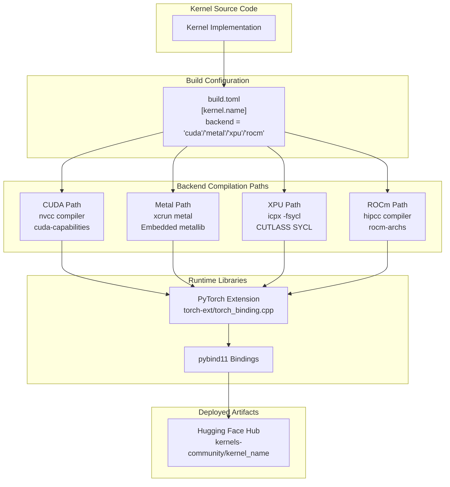
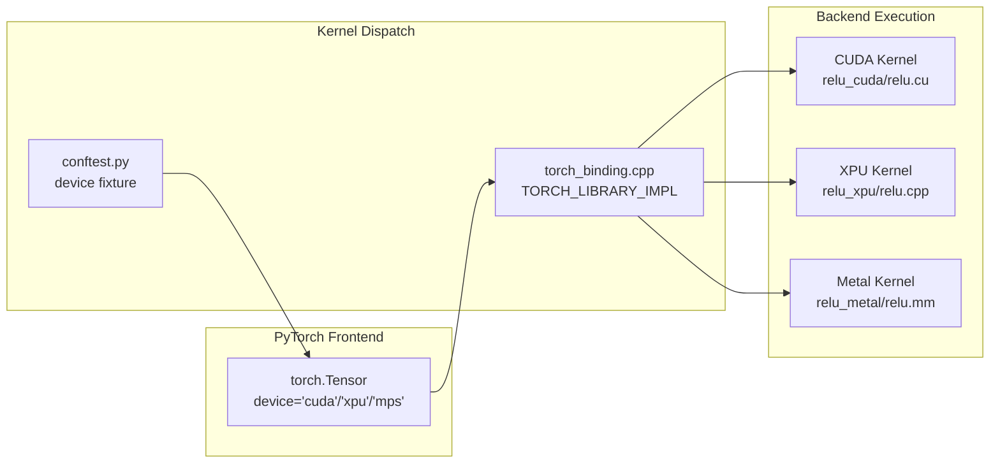

<!-- source: DeepWiki mcp.deepwiki.com · repo huggingface/kernels-community · page 5 Backend Support · fetched 2026-10-26 -->

# Backend Support

<details>
<summary>Relevant source files</summary>

The following files were used as context for generating this wiki page:

- [flash-attn2/build.toml](flash-attn2/build.toml)
- [flash-attn2/flake.lock](flash-attn2/flake.lock)
- [flash-attn2/flake.nix](flash-attn2/flake.nix)
- [flash-attn2/tests/conftest.py](flash-attn2/tests/conftest.py)
- [relu/build.toml](relu/build.toml)
- [relu/flake.lock](relu/flake.lock)
- [relu/flake.nix](relu/flake.nix)
- [relu/relu_cpu/relu_cpu.cpp](relu/relu_cpu/relu_cpu.cpp)
- [relu/tests/test_relu.py](relu/tests/test_relu.py)
- [relu/torch-ext/relu/__init__.py](relu/torch-ext/relu/__init__.py)
- [relu/torch-ext/relu/layers/__init__.py](relu/torch-ext/relu/layers/__init__.py)
- [relu/torch-ext/torch_binding.cpp](relu/torch-ext/torch_binding.cpp)
- [rmsnorm/build.toml](rmsnorm/build.toml)
- [rmsnorm/flake.lock](rmsnorm/flake.lock)
- [rmsnorm/flake.nix](rmsnorm/flake.nix)
- [rmsnorm/rmsnorm_cpu/rmsnorm_cpu_torch.cpp](rmsnorm/rmsnorm_cpu/rmsnorm_cpu_torch.cpp)
- [rmsnorm/rmsnorm_xpu/RMSNorm.cpp](rmsnorm/rmsnorm_xpu/RMSNorm.cpp)
- [rmsnorm/tests/test_rmsnorm.py](rmsnorm/tests/test_rmsnorm.py)
- [rmsnorm/torch-ext/rmsnorm/__init__.py](rmsnorm/torch-ext/rmsnorm/__init__.py)
- [rmsnorm/torch-ext/rmsnorm/layers.py](rmsnorm/torch-ext/rmsnorm/layers.py)
- [rmsnorm/torch-ext/torch_binding.cpp](rmsnorm/torch-ext/torch_binding.cpp)

</details>


This document describes the hardware backend support in the kernels-community repository. It covers the four supported GPU backends (CUDA, Metal, XPU, ROCm), their configuration through `build.toml`, backend-specific implementation patterns, and compilation requirements. For detailed information about specific kernel implementations using these backends, see [Flash Attention](#4.1), [Paged Attention](#4.2), and [Normalization Kernels](#4.3). For build system integration details, see [Build Configuration (build.toml)](#2.2).

## Backend Support Overview

The kernels-community repository implements a tiered backend support strategy that reflects hardware market realities and kernel complexity. CUDA receives full support across all kernel types, Metal targets high-value kernels for Apple Silicon, XPU (Intel) focuses on compute-intensive operations, and ROCm (AMD) has experimental coverage.

### Backend Support Matrix

The following table summarizes which kernels support which backends:

| Kernel | CUDA | Metal | XPU | ROCm | Notes |
|--------|------|-------|-----|------|-------|
| Flash Attention 2 | ✓ | ✗ | ✓ | ✗ | CUDA: SM 8.0-12.0; XPU: CUTLASS SYCL |
| Flash Attention 3 | ✓ | ✗ | ✗ | ✗ | CUDA-only |
| Paged Attention | ✓ | ✓ | ✗ | ✗ | Metal: Apple Silicon optimized |
| ReLU | ✓ | ✓ | ✓ | ✓ | Multi-backend reference implementation |
| RMSNorm | ✗ | ✗ | ✓ | ✗ | XPU: SYCL implementation |
| Rotary | ✓ | ✗ | ✓ | ✗ | XPU: OffsetCalculator support |
| MegaBlocks | ✓ | ✗ | ✓ | ✗ | XPU: CUTLASS SYCL integration |

**Sources:** [flash-attn2/build.toml:5-9](), [relu/build.toml:5-11](), [rmsnorm/build.toml:5-8]()

### Backend Architecture Diagram



**Sources:** [flash-attn2/build.toml:1-166](), [relu/build.toml:1-68](), [rmsnorm/build.toml:1-104]()

## CUDA Backend

The CUDA backend provides comprehensive support for all kernels in the repository and targets NVIDIA GPUs. It is the primary backend with the most mature implementations and broadest feature coverage. For details, see [CUDA Backend](#5.1).

### CUDA Configuration

CUDA kernels are configured in `build.toml` with the `backend = "cuda"` directive. The configuration specifies CUDA compute capabilities, source files, and dependencies:

```toml
[kernel.flash_attn]
backend = "cuda"
cuda-capabilities = [
    "8.0",
    "9.0",
    "10.0",
    "12.0",
]
depends = [
    "torch",
    "cutlass_3_6",
]
src = [
    "flash_attn/flash_api.cpp",
    "flash_attn/src/flash_fwd_hdim128_fp16_sm80.cu",
    # ... additional CUDA source files
]
```

**Sources:** [flash-attn2/build.toml:61-166]()

### CUDA Compute Capabilities
The repository supports a wide range of architectures:
- **SM 7.0-7.5 (Volta/Turing)**: Supported via specific kernel specializations.
- **SM 8.0 (Ampere)**: A100, RTX 3090 - primary development target.
- **SM 9.0 (Hopper)**: H100, H200 - utilizes TMA and GMMA instructions.
- **SM 10.0/12.0 (Blackwell/Next)**: Forward compatibility targets.

**Sources:** [flash-attn2/build.toml:63-68]()

## Metal Backend

The Metal backend targets Apple Silicon (M-series chips) and provides support for strategic kernels where Mac deployment is valuable. The implementation uses Metal Shading Language (MSL). For details, see [Metal Backend](#5.2).

### Metal Configuration

Metal kernels include both `.mm` (Objective-C++) host code and `.metal` shader files:

```toml
[kernel.activation_metal]
backend = "metal"
depends = ["torch"]
src = [
    "relu_metal/relu.mm",
    "relu_metal/relu.metal",
    "relu_metal/common.h",
]
```

**Sources:** [relu/build.toml:30-37]()

### Metal Runtime Integration
Metal kernels are dispatched using the MPS (Metal Performance Shaders) integration with PyTorch. The build system embeds the compiled `metallib` directly into the binary to simplify distribution.

**Sources:** [relu/build.toml:34-35]()

## XPU Backend (Intel GPUs)

The XPU backend targets Intel discrete GPUs (Arc, Flex, Max series) using SYCL and DPC++. It leverages Intel-specific libraries like oneDNN for optimized operations. For details, see [XPU Backend (Intel GPUs)](#5.3).

### XPU Configuration

XPU kernels often require complex source trees to handle SYCL-specific boilerplate and compatibility wrappers:

```toml
[kernel.rmsnorm_xpu]
backend = "xpu"
depends = ["torch"]
include = ["rmsnorm_xpu/dpcpp"]
src = [
    "rmsnorm_xpu/RMSNorm.hpp",
    "rmsnorm_xpu/RMSNorm.cpp",
    "rmsnorm_xpu/dpcpp/Device.cpp",
    # ... SYCL utility files
]
```

**Sources:** [rmsnorm/build.toml:17-58]()

### XPU Architecture Support
The XPU implementation includes specialized components for memory management (`CachingDeviceAllocator`), tensor indexing (`IndexUtils`), and oneDNN runtime integration.

**Sources:** [rmsnorm/build.toml:41-57]()

## ROCm Backend (AMD GPUs)

The ROCm backend targets AMD GPUs and currently has experimental support. It uses HIP (Heterogeneous-compute Interface for Portability), which provides a CUDA-compatible API. For details, see [ROCm Backend (AMD GPUs)](#5.4).

### ROCm Configuration

ROCm kernels specify target GPU architectures using `rocm-archs`:

```toml
[kernel.activation_rocm]
backend = "rocm"
depends = ["torch"]
rocm-archs = [
    "gfx906",
    "gfx1100",
    # ... other AMD architectures
]
src = [
    "relu_cuda/relu.cu",
]
```

**Sources:** [relu/build.toml:46-62]()

### ROCm Architecture Targets
- **gfx906/gfx908/gfx90a/gfx940-942**: CDNA architectures (MI50, MI100, MI200, MI300 series).
- **gfx1030/gfx1100-1101**: RDNA architectures (Navi 21, Navi 31).

**Sources:** [relu/build.toml:49-59]()

## Backend Selection and Runtime Behavior

At runtime, PyTorch automatically selects the appropriate backend based on the device type of input tensors.

### Runtime Dispatch Logic



**Sources:** [flash-attn2/tests/conftest.py:7-14](), [relu/tests/test_relu.py:11-19](), [rmsnorm/tests/test_rmsnorm.py:7-11]()

### Device Availability Checks
The test suite dynamically detects available hardware to route tests to the correct backend:

- **CUDA**: `torch.cuda.is_available()` [flash-attn2/tests/conftest.py:9]()
- **XPU**: `torch.xpu.is_available()` [flash-attn2/tests/conftest.py:11]()
- **Metal (MPS)**: `platform.system() == "Darwin"` [relu/tests/test_relu.py:12]()

**Sources:** [flash-attn2/tests/conftest.py:7-14](), [relu/tests/test_relu.py:11-19]()

---

