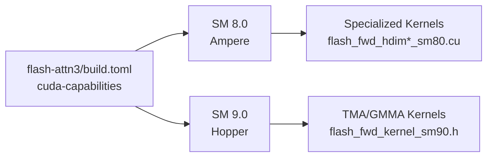
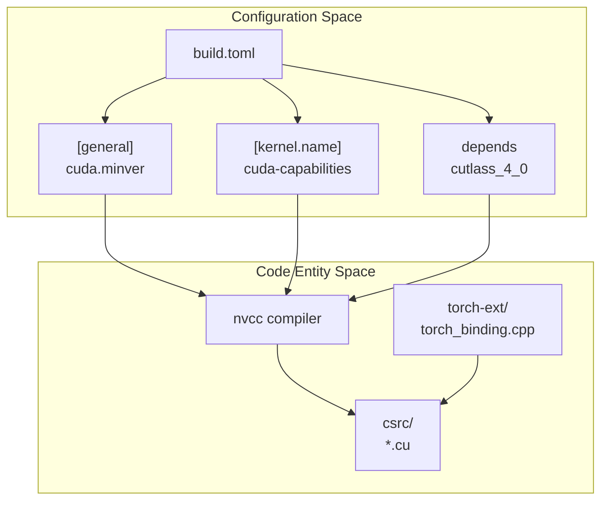
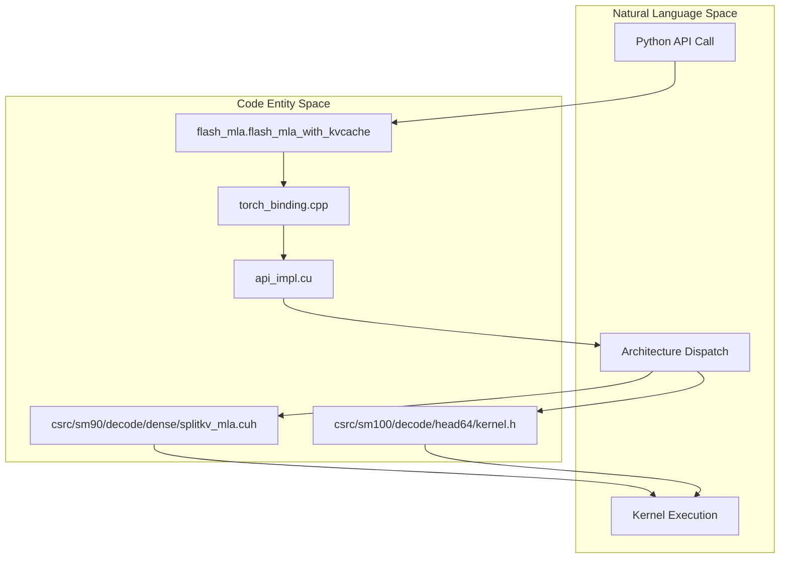

<!-- source: DeepWiki mcp.deepwiki.com · repo huggingface/kernels-community · page 5.1 CUDA Backend · fetched 2026-10-26 -->

# CUDA Backend

Relevant source files

The following files were used as context for generating this wiki page:

- [deep-gemm/build.toml](deep-gemm/build.toml)
- [flash-attn3/build.toml](flash-attn3/build.toml)
- [flash-attn3/flake.lock](flash-attn3/flake.lock)
- [flash-attn3/flake.nix](flash-attn3/flake.nix)
- [flash-mla/build.toml](flash-mla/build.toml)
- [megablocks/build.toml](megablocks/build.toml)
- [megablocks/flake.lock](megablocks/flake.lock)
- [megablocks/flake.nix](megablocks/flake.nix)

This document describes the CUDA backend support in the `kernels-community` repository. It covers CUDA compute capabilities (SM70–SM120), kernel configuration through `build.toml`, kernel specialization strategies, CUTLASS integration (versions 2.10 through 4.0), and JIT compilation via DeepGEMM.

## Supported Compute Capabilities

The CUDA backend targets multiple NVIDIA GPU architectures through compute capability specifications. The repository supports a wide range of architectures, from Volta (SM70) to Blackwell (SM100) and beyond.

| Compute Capability | Architecture | Example GPUs | Kernels |
|-------------------|--------------|--------------|---------|
| 7.0 / 7.2 / 7.5 | Volta / Turing | V100, T4, RTX 2080 | megablocks |
| 8.0 / 8.6 / 8.9 | Ampere / Ada | A100, RTX 3090, L40 | flash-attn2, flash-attn3, megablocks |
| 9.0 / 9.0a | Hopper | H100, H800 | flash-attn3, flash-mla, deep-gemm |
| 10.0 / 10.0f | Blackwell | B100, B200 | flash-mla, deep-gemm |
| 11.8 / 12.0 | Future / Experimental| TBD | megablocks, flash-attn3 |

These compute capabilities are declared in the `build.toml` file for each kernel, allowing the build system to generate optimized code for each target architecture.

**Supported Compute Capabilities in Flash Attention 3**

Sources: [flash-attn3/build.toml:21-50]()

## Kernel Configuration in build.toml

CUDA kernels are configured using a declarative format in `build.toml`. This file defines backends, compiler flags, and library dependencies like CUTLASS.

### Multi-Version CUTLASS Integration
The repository supports multiple versions of CUTLASS, often pinned to specific kernels for stability or to leverage new architecture features (e.g., SM90 TMA in CUTLASS 3.x/4.x).

*   **CUTLASS 3.8**: Used by `megablocks` for grouped GEMM operations. [megablocks/build.toml:39-40]()
*   **CUTLASS 4.0**: Used by `flash-attn3`, `flash-mla`, and `deep-gemm` for Hopper (SM90) and Blackwell (SM100) optimizations. [flash-attn3/build.toml:34-35](), [flash-mla/build.toml:42-43](), [deep-gemm/build.toml:21-22]()

### Compiler Flags and Versions
Kernels can specify minimum CUDA versions and specific `nvcc` flags. For example, `flash-attn3` requires CUDA 12.8+ and uses `-DCUTE_SM90_EXTENDED_MMA_SHAPES_ENABLED`. [flash-attn3/build.toml:8-27]()

**CUDA Kernel Build Configuration Flow**

Sources: [flash-attn3/build.toml:1-35](), [deep-gemm/build.toml:1-25]()

## Kernel Specialization Patterns

CUDA kernels are heavily specialized to maximize performance across head dimensions, data types, and architectures.

### Static Specialization (Flash Attention)
Flash Attention uses template instantiation to generate dozens of `.cu` files, each specialized for a specific `hdim` (64, 96, 128, 160, 192, 224, 256) and data type (FP16, BF16). [flash-attn3/build.toml:65-142]()

### JIT Specialization (DeepGEMM)
Unlike static specialization, `deep-gemm` utilizes a Just-In-Time (JIT) compilation system. It provides a C++ JIT infrastructure to compile kernels at runtime based on specific shape heuristics for SM90 and SM100.

Key JIT components:
*   **Heuristics**: Logic to select optimal tile sizes for SM90 and SM100. [deep-gemm/build.toml:51-53]()
*   **Runtime**: JIT compiler and cache management for compiled kernel handles. [deep-gemm/build.toml:45-49]()
*   **Templates**: Header-only implementations (e.g., `sm100_fp8_gemm_1d1d.hpp`) that the JIT engine fills with parameters. [deep-gemm/build.toml:59-65]()

## Implementation Architecture

### Flash MLA Implementation
`flash-mla` demonstrates a complex CUDA backend structure supporting both SM90 (Hopper) and SM100 (Blackwell). It separates logic into:
1.  **API Layer**: `api_impl.cu` handles the entry point and parameter validation. [flash-mla/build.toml:53-54]()
2.  **Kernel Utilities**: `kerutils` provides device-side intrinsics for different SM versions. [flash-mla/build.toml:66-78]()
3.  **Architecture-Specific Logic**: Separate directories for `sm90` and `sm100` implementations. [flash-mla/build.toml:91-187]()

**Flash MLA Dispatch Flow**

Sources: [flash-mla/build.toml:12-187](), [flash-mla/megablocks/build.toml:15-19]()

### Megablocks (Grouped GEMM)
The `megablocks` kernel utilizes CUTLASS 3.8 to implement grouped GEMMs for Mixture of Experts (MoE). It includes specialized CUDA sources for:
*   **Sorting and Indices**: `sort.cu`, `indices.cu` for routing tokens to experts. [megablocks/build.toml:46-51]()
*   **Grouped GEMM**: `grouped_gemm.cu` which leverages CUTLASS to execute multiple independent matrix multiplications in a single kernel call. [megablocks/build.toml:52-55]()

## Build and Dependency Management
The CUDA backend relies on Nix Flakes to manage the complex toolchain requirements (NVCC versions, specific PyTorch versions).

*   **genKernelFlakeOutputs**: A function from `kernel-builder` that generates the build outputs for the flake. [megablocks/flake.nix:13-15]()
*   **torchVersions**: Filters supported systems; for instance, restricted CUDA builds to specific Linux architectures. [megablocks/flake.nix:25-33]()

Sources: [megablocks/flake.nix:1-36](), [flash-attn3/flake.nix:1-22]()

---

