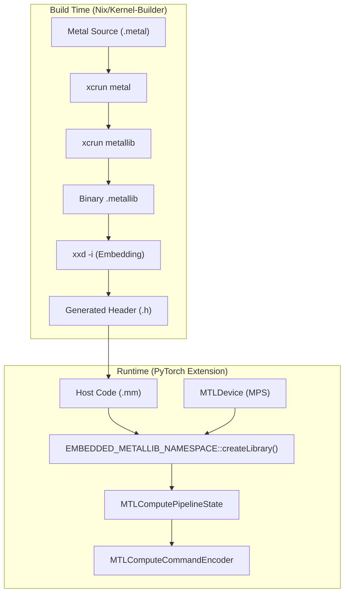
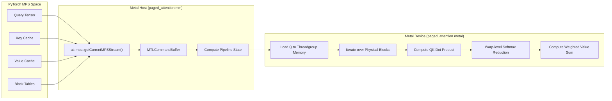

<!-- source: DeepWiki mcp.deepwiki.com · repo huggingface/kernels-community · page 5.2 Metal Backend · fetched 2026-10-26 -->

# Metal Backend

<details>
<summary>Relevant source files</summary>

The following files were used as context for generating this wiki page:

- [bitsandbytes-mps/build.toml](bitsandbytes-mps/build.toml)
- [bitsandbytes-mps/flake.lock](bitsandbytes-mps/flake.lock)
- [bitsandbytes-mps/flake.nix](bitsandbytes-mps/flake.nix)
- [gpt-oss-metal-kernels/build.toml](gpt-oss-metal-kernels/build.toml)
- [gpt-oss-metal-kernels/flake.lock](gpt-oss-metal-kernels/flake.lock)
- [gpt-oss-metal-kernels/flake.nix](gpt-oss-metal-kernels/flake.nix)
- [metal-flash-sdpa/README.md](metal-flash-sdpa/README.md)
- [metal-flash-sdpa/benchmark.py](metal-flash-sdpa/benchmark.py)
- [metal-flash-sdpa/build.toml](metal-flash-sdpa/build.toml)
- [metal-flash-sdpa/flake.lock](metal-flash-sdpa/flake.lock)
- [metal-flash-sdpa/flake.nix](metal-flash-sdpa/flake.nix)
- [metal-flash-sdpa/sdpa-metal/common.h](metal-flash-sdpa/sdpa-metal/common.h)
- [metal-flash-sdpa/sdpa-metal/scaled_dot_product_attention.metal](metal-flash-sdpa/sdpa-metal/scaled_dot_product_attention.metal)
- [metal-flash-sdpa/sdpa-metal/scaled_dot_product_attention.mm](metal-flash-sdpa/sdpa-metal/scaled_dot_product_attention.mm)
- [metal-flash-sdpa/tests/__init__.py](metal-flash-sdpa/tests/__init__.py)
- [metal-flash-sdpa/tests/test_flash_attention.py](metal-flash-sdpa/tests/test_flash_attention.py)
- [metal-flash-sdpa/torch-ext/metal_flash_sdpa/__init__.py](metal-flash-sdpa/torch-ext/metal_flash_sdpa/__init__.py)
- [paged-attention/cuda-utils/cuda_utils.h](paged-attention/cuda-utils/cuda_utils.h)
- [paged-attention/cuda-utils/cuda_utils_kernels.cu](paged-attention/cuda-utils/cuda_utils_kernels.cu)
- [paged-attention/paged-attention-metal/attention/paged_attention.metal](paged-attention/paged-attention-metal/attention/paged_attention.metal)
- [paged-attention/paged-attention-metal/cache.mm](paged-attention/paged-attention-metal/cache.mm)
- [paged-attention/paged-attention-metal/cache/copy_blocks.metal](paged-attention/paged-attention-metal/cache/copy_blocks.metal)
- [paged-attention/paged-attention-metal/cache/reshape_and_cache.metal](paged-attention/paged-attention-metal/cache/reshape_and_cache.metal)
- [paged-attention/paged-attention-metal/convert_fp8.metal](paged-attention/paged-attention-metal/convert_fp8.metal)
- [paged-attention/paged-attention-metal/convert_fp8.mm](paged-attention/paged-attention-metal/convert_fp8.mm)
- [paged-attention/paged-attention-metal/paged_attention.mm](paged-attention/paged-attention-metal/paged_attention.mm)

</details>


## Purpose and Scope

This document describes the Metal backend implementation for Apple Silicon devices in the `kernels-community` repository. The Metal backend provides GPU-accelerated kernel implementations using Apple's Metal Shading Language (MSL) and Metal Performance Shaders framework, targeting macOS devices with Apple Silicon (M1/M2/M3/M4 families).

The Metal backend is essential for providing high-performance inference capabilities on Mac hardware, supporting specialized operations like Paged Attention, Flash SDPA, and quantized matrix multiplication.

Sources: [gpt-oss-metal-kernels/build.toml:1-5](), [metal-flash-sdpa/build.toml:1-5](), [bitsandbytes-mps/build.toml:1-5]()

## Metal Backend Architecture

The Metal backend follows a consistent pattern across all implementations in the repository, utilizing Objective-C++ (`.mm`) for host-side dispatch and Metal Shading Language (`.metal`) for GPU execution.

### Embedded Metallib System

To ensure portability and eliminate runtime compilation overhead, the repository uses an **embedded Metal library system**. Compiled Metal kernels are converted into byte arrays and embedded directly into the PyTorch extension binaries.



**Implementation Pattern**:
Host code files (e.g., `paged_attention.mm`, `convert_fp8.mm`) include an auto-generated header containing the embedded library.

[paged-attention/paged-attention-metal/paged_attention.mm:11-16]()
```cpp
// Include the auto-generated header with embedded metallib
#ifdef EMBEDDED_METALLIB_HEADER
#include EMBEDDED_METALLIB_HEADER
#else
#error "EMBEDDED_METALLIB_HEADER not defined"
#endif
```

At runtime, the library is instantiated using the MPS device:
[paged-attention/paged-attention-metal/convert_fp8.mm:80-83]()
```cpp
id<MTLLibrary> lib = EMBEDDED_METALLIB_NAMESPACE::createLibrary(device, &error);
```

Sources: [paged-attention/paged-attention-metal/paged_attention.mm:11-16](), [paged-attention/paged-attention-metal/convert_fp8.mm:11-16](), [paged-attention/paged-attention-metal/convert_fp8.mm:80-83]()

## Metal Kernel Suite

The repository contains several high-performance Metal kernel collections, each serving different model architectures and quantization schemes.

### 1. GPT-OSS Metal Kernels
A comprehensive suite of kernels designed for Open Source Software (OSS) GPT models. This collection includes low-level primitives required for transformer inference.

| Kernel Category | Source Files | Purpose |
| :--- | :--- | :--- |
| **Attention** | `sdpa.metal` | Scaled Dot-Product Attention |
| **Linear Algebra** | `matmul.metal`, `moematmul.metal` | Standard and MoE Matrix Multiplications |
| **Normalization** | `rmsnorm.metal` | Root Mean Square Layer Normalization |
| **Positional** | `rope.metal` | Rotary Positional Embeddings |
| **Sampling** | `topk.metal`, `sample.metal` | Decoding heuristics |
| **MoE** | `expert_routing_metadata.metal`, `scatter.metal` | Mixture of Experts routing logic |

Sources: [gpt-oss-metal-kernels/build.toml:24-61]()

### 2. Metal Flash SDPA
A specialized implementation of Scaled Dot-Product Attention (SDPA) optimized for Apple Silicon.

- **Host Code**: `scaled_dot_product_attention.mm`
- **MSL Kernel**: `scaled_dot_product_attention.metal`
- **Common Utilities**: `common.h`

Sources: [metal-flash-sdpa/build.toml:20-24]()

### 3. BitsAndBytes MPS
Port of the BitsAndBytes quantization library to Metal Performance Shaders, enabling 4-bit and 8-bit inference on Mac.

- **Infrastructure**: Uses "MLX Steel" GEMM infrastructure (`gemm/mma.h`, `gemm/loader.h`).
- **Quantization**: Supports BnB-specific codebooks and quantized matmul utilities.
- **Source**: `bnb_quantized.metal`, `bnb_quantized.mm`.

Sources: [bitsandbytes-mps/build.toml:22-49]()

## Paged Attention: Metal Implementation

The Paged Attention implementation for Metal manages memory-efficient KV caches for LLM inference on Apple Silicon.

### Kernel Dispatch and Configuration
The host code in `paged_attention.mm` dynamically selects kernels based on the head size and block size.

[paged-attention/paged-attention-metal/paged_attention.mm:89-99]()
```cpp
static bool isValidConfiguration(int head_size, int block_size) {
  std::vector<int> supported_head_sizes = {32, 64, 80, 96, 112, 120, 128, 192, 256};
  std::vector<int> supported_block_sizes = {8, 16, 32};
  // ...
}
```

### Data Flow: Paged Attention Metal



### Cache Operations
The Metal backend provides specialized kernels for managing the paged cache:
- **`reshape_and_cache`**: Transforms incoming K/V tensors into the blocked cache layout.
- **`copy_blocks`**: Handles block-level transfers within the cache.
- **`convert_fp8`**: Specialized kernel for converting caches between high-precision and FP8 formats.

[paged-attention/paged-attention-metal/convert_fp8.mm:22-46]()
```cpp
static std::string getConvertKernelName(torch::ScalarType src_dtype, torch::ScalarType dst_dtype) {
  // Generates names like convert_fp8_half_to_uchar
}
```

Sources: [paged-attention/paged-attention-metal/paged_attention.mm:89-118](), [paged-attention/paged-attention-metal/convert_fp8.mm:22-46](), [paged-attention/paged-attention-metal/attention/paged_attention.metal:1-25]()

## Build and Dependency Management

Metal kernels are built using a Nix-based infrastructure that handles the Apple-specific toolchain (`xcrun`).

### Flake Configuration
Each Metal kernel package uses `kernel-builder` to generate build outputs.

[gpt-oss-metal-kernels/flake.nix:8-14]()
```nix
  outputs =
    { self, kernel-builder }:
    kernel-builder.lib.genKernelFlakeOutputs {
      inherit self;
      path = ./.;
    };
```

### Build Requirements
- **Backend**: Specified as `metal` in `build.toml`.
- **Torch Version**: Some kernels require specific minimum versions (e.g., `bitsandbytes-mps` requires Torch 2.9+).
- **Frameworks**: Builds link against the `Metal` and `Foundation` frameworks.

Sources: [gpt-oss-metal-kernels/build.toml:1-5](), [bitsandbytes-mps/build.toml:11-15](), [gpt-oss-metal-kernels/flake.nix:8-14]()

---

