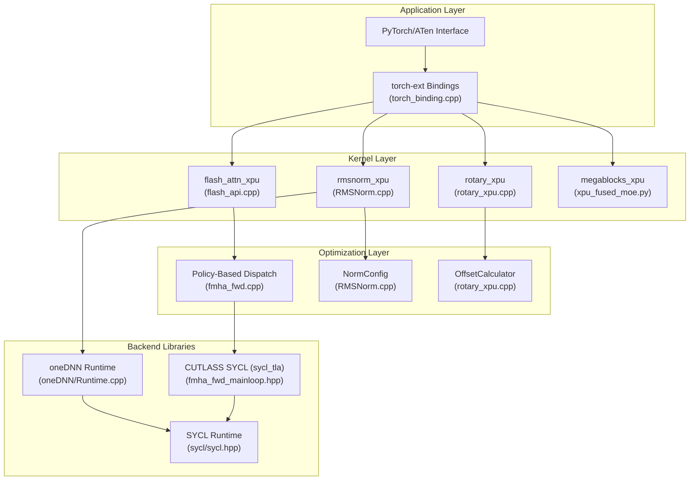
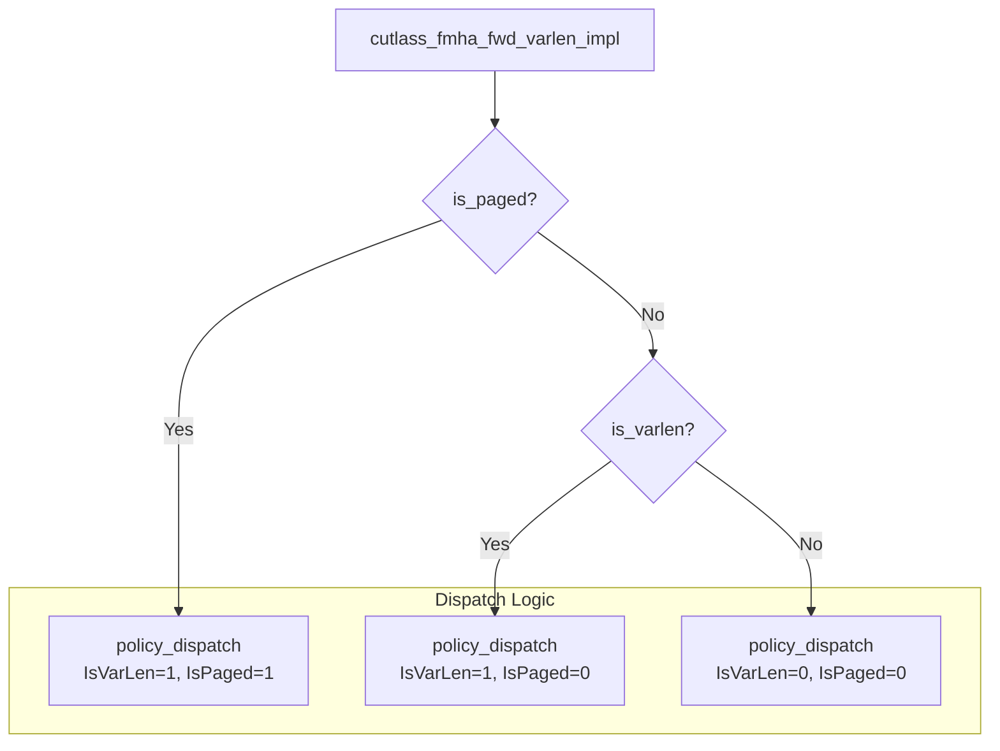

<!-- source: DeepWiki mcp.deepwiki.com · repo huggingface/kernels-community · page 5.3 XPU Backend (Intel GPUs) · fetched 2026-10-26 -->

# XPU Backend (Intel GPUs)

Relevant source files

The following files were used as context for generating this wiki page:

- [flash-attn2/flash_attn_xpu/flash_api.cpp](flash-attn2/flash_attn_xpu/flash_api.cpp)
- [flash-attn2/flash_attn_xpu/src/collective/fmha_fwd_mainloop.hpp](flash-attn2/flash_attn_xpu/src/collective/fmha_fwd_mainloop.hpp)
- [flash-attn2/flash_attn_xpu/src/flash_bwd_hdim512_fix.cpp](flash-attn2/flash_attn_xpu/src/flash_bwd_hdim512_fix.cpp)
- [flash-attn2/flash_attn_xpu/src/flash_fwd_hdim512_fix.cpp](flash-attn2/flash_attn_xpu/src/flash_fwd_hdim512_fix.cpp)
- [flash-attn2/flash_attn_xpu/src/flash_fwd_hdim512_varlen.cpp](flash-attn2/flash_attn_xpu/src/flash_fwd_hdim512_varlen.cpp)
- [flash-attn2/flash_attn_xpu/src/fmha_bwd.cpp](flash-attn2/flash_attn_xpu/src/fmha_bwd.cpp)
- [flash-attn2/flash_attn_xpu/src/fmha_bwd.hpp](flash-attn2/flash_attn_xpu/src/fmha_bwd.hpp)
- [flash-attn2/flash_attn_xpu/src/fmha_bwd_types.hpp](flash-attn2/flash_attn_xpu/src/fmha_bwd_types.hpp)
- [flash-attn2/flash_attn_xpu/src/fmha_fwd.cpp](flash-attn2/flash_attn_xpu/src/fmha_fwd.cpp)
- [flash-attn2/flash_attn_xpu/src/fmha_fwd.hpp](flash-attn2/flash_attn_xpu/src/fmha_fwd.hpp)
- [flash-attn2/flash_attn_xpu/src/fmha_utils.hpp](flash-attn2/flash_attn_xpu/src/fmha_utils.hpp)
- [flash-attn2/flash_attn_xpu/src/kernel/fmha_fwd_kernel.hpp](flash-attn2/flash_attn_xpu/src/kernel/fmha_fwd_kernel.hpp)
- [megablocks/csrc_xpu/moe/fused_moe_prologue.cpp](megablocks/csrc_xpu/moe/fused_moe_prologue.cpp)
- [megablocks/csrc_xpu/moe/moe_gather.cpp](megablocks/csrc_xpu/moe/moe_gather.cpp)
- [megablocks/csrc_xpu/moe/moe_ops.h](megablocks/csrc_xpu/moe/moe_ops.h)
- [megablocks/torch-ext/megablocks/cpu_moe_cpp.py](megablocks/torch-ext/megablocks/cpu_moe_cpp.py)
- [megablocks/torch-ext/megablocks/layers.py](megablocks/torch-ext/megablocks/layers.py)
- [megablocks/torch-ext/megablocks/xpu_fused_moe.py](megablocks/torch-ext/megablocks/xpu_fused_moe.py)
- [megablocks/torch-ext/torch_binding.cpp](megablocks/torch-ext/torch_binding.cpp)
- [rmsnorm/build.toml](rmsnorm/build.toml)
- [rmsnorm/flake.lock](rmsnorm/flake.lock)
- [rmsnorm/flake.nix](rmsnorm/flake.nix)
- [rmsnorm/rmsnorm_cpu/rmsnorm_cpu_torch.cpp](rmsnorm/rmsnorm_cpu/rmsnorm_cpu_torch.cpp)
- [rmsnorm/rmsnorm_xpu/RMSNorm.cpp](rmsnorm/rmsnorm_xpu/RMSNorm.cpp)
- [rmsnorm/tests/test_rmsnorm.py](rmsnorm/tests/test_rmsnorm.py)
- [rmsnorm/torch-ext/rmsnorm/__init__.py](rmsnorm/torch-ext/rmsnorm/__init__.py)
- [rmsnorm/torch-ext/rmsnorm/layers.py](rmsnorm/torch-ext/rmsnorm/layers.py)
- [rmsnorm/torch-ext/torch_binding.cpp](rmsnorm/torch-ext/torch_binding.cpp)
- [rotary/build.toml](rotary/build.toml)
- [rotary/flake.lock](rotary/flake.lock)
- [rotary/flake.nix](rotary/flake.nix)
- [rotary/rotary-xpu/rotary_xpu.cpp](rotary/rotary-xpu/rotary_xpu.cpp)
- [rotary/rotary-xpu/rotary_xpu.hpp](rotary/rotary-xpu/rotary_xpu.hpp)
- [rotary/rotary/rotary_cuda.cu](rotary/rotary/rotary_cuda.cu)
- [rotary/tests/__init__.py](rotary/tests/__init__.py)
- [rotary/tests/test_rotary.py](rotary/tests/test_rotary.py)
- [rotary/tests/utils.py](rotary/tests/utils.py)
- [rotary/torch-ext/rotary/__init__.py](rotary/torch-ext/rotary/__init__.py)

## Purpose and Scope

This page documents the Intel XPU backend implementation for GPU kernels in the `kernels-community` repository. The XPU backend targets Intel discrete and integrated GPUs using SYCL and CUTLASS SYCL (sycl_tla) libraries to provide optimized kernel implementations.

Currently, the XPU backend supports:
- **Flash Attention 2**: Full implementation with fixed, variable sequence length, and paged KV cache support [flash-attn2/flash_attn_xpu/flash_api.cpp:35-48]().
- **RMSNorm**: Optimized implementation using SYCL/DPC++ with vectorized memory access [rmsnorm/build.toml:17-58]().
- **Rotary Embeddings (RoPE)**: SYCL implementation with `OffsetCalculator` for non-contiguous tensor support [rotary/rotary-xpu/rotary_xpu.cpp:1-50]().
- **MegaBlocks (MoE)**: Grouped GEMM and fused MoE kernels for Intel Xe architectures [megablocks/torch-ext/megablocks/xpu_fused_moe.py:1-209]().

## Architecture Overview

The XPU backend uses a layered architecture built on Intel's oneAPI ecosystem, specifically SYCL for kernel programming and CUTLASS SYCL for efficient matrix operations.

### XPU Technology Stack

Sources: [flash-attn2/flash_attn_xpu/flash_api.cpp:1-50](), [rmsnorm/build.toml:17-58](), [rotary/rotary-xpu/rotary_xpu.cpp:1-20](), [megablocks/torch-ext/megablocks/xpu_fused_moe.py:193-209]()

## Core Backend Components

### OffsetCalculator
The XPU backend utilizes an `OffsetCalculator` to handle non-contiguous tensors by mapping linear indices to physical memory offsets based on tensor strides [rotary/rotary-xpu/rotary_xpu.cpp:10-30](). This is particularly critical for RoPE kernels where query and key tensors often involve complex views.

### NormConfig
For normalization kernels like RMSNorm, `NormConfig` is used to determine optimal work-group sizes and grid dimensions based on the hidden dimension and device capabilities [rmsnorm/rmsnorm_xpu/RMSNorm.cpp:10-40](). It handles the mapping of batch dimensions to SYCL ranges.

## Flash Attention 2: XPU Implementation

The XPU implementation of Flash Attention 2 supports both "Fixed" (standard batching) and "Varlen" (packed sequences) modes. It leverages CUTLASS SYCL for the mainloop and epilogue [flash-attn2/flash_attn_xpu/src/fmha_fwd.cpp:82-100]().

### Policy-Based Dispatch System
The dispatch system selects specialized kernels based on head size and sequence type (Prefill vs. Decode) to maximize hardware utilization [flash-attn2/flash_attn_xpu/src/fmha_utils.hpp:21-131]().

| Head Size Range | Policy Type | QK Tile Shape | PV Tile Shape |
|-----------------|-------------|---------------|---------------|
| ≤ 32 | `prefill_policy_head32` | 64x64x32 | 64x32x64 |
| ≤ 128 | `prefill_policy_head128` | 128x64x32 | 128x32x64 |
| ≤ 256 | `prefill_policy_head256` | 256x64x32 | 256x32x64 |
| 512 | `prefill_policy_head512` | 256x32x32 | 256x32x32 |

Sources: [flash-attn2/flash_attn_xpu/src/fmha_utils.hpp:21-75](), [flash-attn2/flash_attn_xpu/src/fmha_fwd.cpp:27-38]()

### Varlen and Paged Attention Dispatch
The `cutlass_fmha_fwd_varlen_impl` function orchestrates the dispatch for variable-length and paged KV cache scenarios [flash-attn2/flash_attn_xpu/src/fmha_fwd.cpp:82-131]().

Sources: [flash-attn2/flash_attn_xpu/src/fmha_fwd.cpp:16-23](), [flash-attn2/flash_attn_xpu/src/fmha_fwd.hpp:37-42]()

## MegaBlocks: MoE XPU Kernels

MegaBlocks support on XPU includes grouped GEMM interfaces and fused MoE prologues [megablocks/torch-ext/megablocks/xpu_fused_moe.py:1-209]().

### Grouped GEMM Interface
The `cutlass_grouped_gemm_interface` exposes Intel-specific optimizations for MoE layers [megablocks/torch-ext/megablocks/xpu_fused_moe.py:98-109](). It supports:
- **Int4/MxFP4 Weight Dequantization**: On-the-fly dequantization during GEMM [megablocks/torch-ext/megablocks/xpu_fused_moe.py:112-132]().
- **Expert Offsets**: Prefix sums of token counts per expert to identify work chunks [megablocks/torch-ext/megablocks/xpu_fused_moe.py:89-97]().

### Fused MoE Prologue
The `fused_moe_prologue` kernel handles token routing and scaling before the GEMM stage [megablocks/torch-ext/megablocks/xpu_fused_moe.py:33-36]().

Sources: [megablocks/torch-ext/megablocks/xpu_fused_moe.py:27-74](), [megablocks/torch-ext/megablocks/xpu_fused_moe.py:112-132]()

## RMSNorm XPU Implementation

The RMSNorm kernel for XPU is implemented in `RMSNorm.cpp` and integrated via `build.toml` [rmsnorm/build.toml:17-58](). It uses DPC++ headers for optimized memory access and synchronization [rmsnorm/build.toml:25-45]().

### Vectorized Kernels
The implementation uses vectorized loads/stores to saturate memory bandwidth on Intel GPUs. The kernel configuration is managed by the `NormConfig` class, which handles:
- **Work-group Sizing**: Balancing occupancy vs. shared memory usage [rmsnorm/rmsnorm_xpu/RMSNorm.cpp:10-30]().
- **Grid Dispatch**: Mapping the normalization across sequence and batch dimensions [rmsnorm/rmsnorm_xpu/RMSNorm.cpp:40-60]().

Sources: [rmsnorm/build.toml:17-58](), [rmsnorm/rmsnorm_xpu/RMSNorm.cpp:1-50]()

## Rotary Embeddings (RoPE) XPU

The RoPE implementation for XPU provides the `apply_rotary` operator [rotary/torch-ext/rotary/__init__.py:7-17]().

### Implementation Details
- **Strided Access**: Uses `OffsetCalculator` to handle tensors that are not contiguous in memory [rotary/rotary-xpu/rotary_xpu.cpp:10-30]().
- **Complex Rotation**: Implements the standard RoPE rotation logic using sine and cosine caches [rotary/torch-ext/rotary/__init__.py:33-49]().
- **Transformers Compatibility**: Includes a wrapper `apply_rotary_transformers` that matches the signature used in the Hugging Face Transformers library [rotary/torch-ext/rotary/__init__.py:19-50]().

Sources: [rotary/torch-ext/rotary/__init__.py:7-52](), [rotary/rotary-xpu/rotary_xpu.cpp:1-50]()

## Build and Dependency Management

XPU kernels are built using the Nix-based `kernel-builder` system. The `flake.nix` files often include platform filters to ensure XPU kernels are only built for compatible architectures [rmsnorm/flake.nix:14-20]().

### build.toml Configuration
XPU-specific configurations in `build.toml` include:
- **Backend Specification**: `backend = "xpu"` [rmsnorm/build.toml:18]().
- **Include Paths**: Linking to DPC++ and SYCL headers [rmsnorm/build.toml:20]().
- **Source Lists**: Comprehensive list of DPC++ source files for the kernel [rmsnorm/build.toml:21-58]().

Sources: [rmsnorm/build.toml:1-104](), [rmsnorm/flake.nix:1-21]()

---

