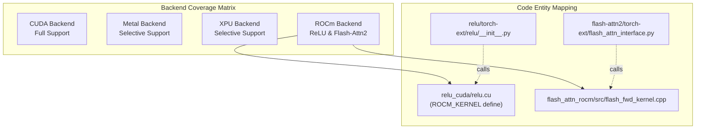
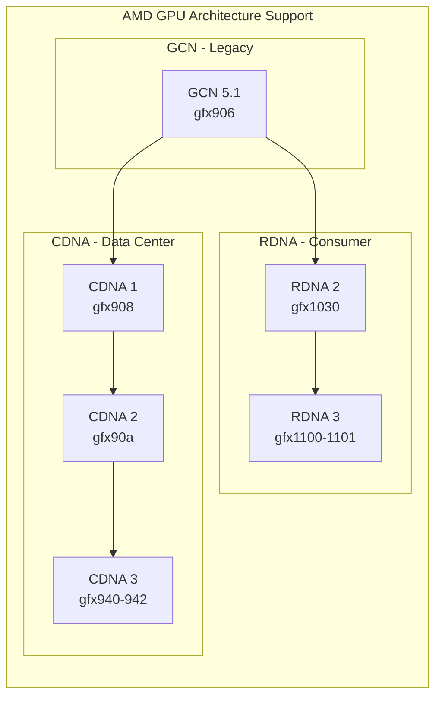
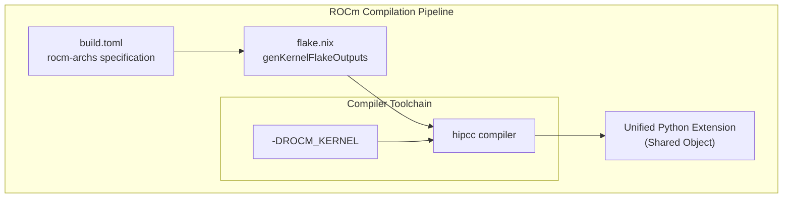

<!-- source: DeepWiki mcp.deepwiki.com · repo huggingface/kernels-community · page 5.4 ROCm Backend (AMD GPUs) · fetched 2026-10-26 -->

# ROCm Backend (AMD GPUs)

<details>
<summary>Relevant source files</summary>

The following files were used as context for generating this wiki page:

- [flash-attn2/build.toml](flash-attn2/build.toml)
- [flash-attn2/flake.lock](flash-attn2/flake.lock)
- [flash-attn2/flake.nix](flash-attn2/flake.nix)
- [flash-attn2/tests/conftest.py](flash-attn2/tests/conftest.py)
- [relu/build.toml](relu/build.toml)
- [relu/flake.lock](relu/flake.lock)
- [relu/flake.nix](relu/flake.nix)
- [relu/relu_cpu/relu_cpu.cpp](relu/relu_cpu/relu_cpu.cpp)
- [relu/tests/test_relu.py](relu/tests/test_relu.py)
- [relu/torch-ext/relu/__init__.py](relu/torch-ext/relu/__init__.py)
- [relu/torch-ext/relu/layers/__init__.py](relu/torch-ext/relu/layers/__init__.py)
- [relu/torch-ext/torch_binding.cpp](relu/torch-ext/torch_binding.cpp)

</details>


## Purpose and Scope

This document describes the ROCm backend support in the `kernels-community` repository, which enables kernel execution on AMD GPUs. ROCm (Radeon Open Compute) is AMD's open-source software platform for GPU computing. The ROCm backend currently has experimental support with growing kernel coverage.

For information about other hardware backends, see [CUDA Backend](5.1), [Metal Backend](5.2), and [XPU Backend (Intel GPUs)](5.3). For details on specific kernel implementations, see [Kernel Implementations](4).

**Current Status**: The ROCm backend supports reference implementations like ReLU and high-performance kernels like Flash Attention 2. It utilizes the HIP (Heterogeneous-compute Interface for Portability) layer to maintain source compatibility with CUDA implementations where possible.

---

## Supported Kernels

The ROCm backend supports the following kernels:

| Kernel | Purpose | Source Implementation | Status |
|--------|---------|----------------------|---------|
| **ReLU** | Basic activation function | Reuses CUDA source code | Reference |
| **Flash Attention 2** | Optimized attention mechanism | Specialized ROCm implementation | Supported |

The ReLU kernel serves as a reference implementation for testing multi-backend build infrastructure [relu/build.toml:5-11](), while Flash Attention 2 provides production-grade performance for AMD hardware.



**Diagram: ROCm Backend Code Entities**

Sources: [relu/build.toml:5-11](), [relu/torch-ext/torch_binding.cpp:10-11](), [flash-attn2/build.toml:5-9]()

---

## Supported GPU Architectures

The ROCm backend specifies support for multiple AMD GPU architectures through the `rocm-archs` configuration in `build.toml` [relu/build.toml:49-59](). These architectures span consumer (RDNA) and data center (CDNA) GPUs:

| Architecture | Code Name | Product Line | Generation |
|--------------|-----------|--------------|------------|
| **gfx906** | Vega 20 | Radeon VII, MI50/MI60 | GCN 5.1 |
| **gfx908** | Arcturus | MI100 | CDNA 1 |
| **gfx90a** | Aldebaran | MI200 series | CDNA 2 |
| **gfx940/941/942** | Aqua Vanjaram | MI300 series | CDNA 3 |
| **gfx1030** | Navi 21 | RX 6800/6900 | RDNA 2 |
| **gfx1100/1101** | Navi 31/32 | RX 7900/7800 | RDNA 3 |



**Diagram: AMD GPU Architecture Hierarchy**

Sources: [relu/build.toml:49-59]()

---

## Build Configuration

The ROCm backend is configured in `build.toml` using the `backend = "rocm"` declaration and the `rocm-archs` list.

### Configuration Structure

The ReLU kernel demonstrates a multi-backend configuration where the ROCm variant reuses CUDA source files [relu/build.toml:60-62]():

```toml
[kernel.activation_rocm]
backend = "rocm"
depends = ["torch"]
rocm-archs = [
    "gfx906",
    "gfx908",
    "gfx90a",
    "gfx940",
    "gfx941",
    "gfx942",
    "gfx1030",
    "gfx1100",
    "gfx1101",
]
src = [
    "relu_cuda/relu.cu",
]
```

Key configuration elements:

| Field | Purpose |
|-------|---------|
| `backend` | Identifies the kernel variant as ROCm-specific [relu/build.toml:47](). |
| `rocm-archs` | Specifies target GPU architectures for the `hipcc` compiler [relu/build.toml:49-59](). |
| `src` | Lists source files. Note that `.cu` files are valid for ROCm via HIP [relu/build.toml:61](). |

Sources: [relu/build.toml:46-62]()

---

## Implementation Details

### Source Code Reuse and Dispatch

The ROCm backend utilizes the `ROCM_KERNEL` macro during compilation to distinguish it from standard CUDA builds. In the PyTorch binding layer, this allows for unified dispatching [relu/torch-ext/torch_binding.cpp:10-11]():

```cpp
#if defined(CUDA_KERNEL) || defined(ROCM_KERNEL)
  ops.impl("relu", torch::kCUDA, &relu);
#endif
```

Even though the backend is ROCm, it registers against `torch::kCUDA` because PyTorch's ROCm support maps the CUDA device type to HIP devices [relu/torch-ext/torch_binding.cpp:11]().

### Build Process Flow

The Nix-based build system orchestrates the compilation using `hipcc`.



**Diagram: ROCm Build Pipeline**

Sources: [relu/build.toml:46-62](), [relu/flake.nix:13-16](), [relu/torch-ext/torch_binding.cpp:10-11]()

---

## Testing and Validation

Testing for ROCm is integrated into the standard `pytest` workflow. The test suite uses a dynamic device fixture to detect the environment.

### Device Detection

Tests detect the hardware environment to select the appropriate device [relu/tests/test_relu.py:14-19]():

```python
    elif hasattr(torch, "xpu") and torch.xpu.is_available():
        device = torch.device("xpu")
    elif torch.cuda.is_available():
        device = torch.device("cuda")
    else:
        device = torch.device("cpu")
```

On a ROCm-enabled system, `torch.cuda.is_available()` returns `True`, and `torch.device("cuda")` targets the AMD GPU via the HIP compatibility layer [relu/tests/test_relu.py:16-17]().

### Validation Logic

The `test_relu` function compares the custom kernel output against the standard PyTorch functional implementation [relu/tests/test_relu.py:20-21]():

```python
    x = torch.randn(1024, 1024, dtype=torch.float32, device=device)
    torch.testing.assert_close(F.relu(x), relu.relu(x))
```

Sources: [relu/tests/test_relu.py:11-21](), [flash-attn2/tests/conftest.py:7-14]()

---

## Architecture Specifications

The `rocm-archs` list in `build.toml` ensures that the compiled binary contains the necessary machine code (ISA) for various AMD hardware generations. 

- **Data Center (CDNA)**: Targeted via `gfx908` (MI100), `gfx90a` (MI200), and `gfx94x` (MI300) [relu/build.toml:51-55]().
- **Consumer (RDNA)**: Targeted via `gfx1030` (Navi 21) and `gfx1100/1101` (Navi 31/32) [relu/build.toml:56-58]().

This multi-architecture targeting allows a single kernel package to be portable across a wide range of AMD GPU hardware.

Sources: [relu/build.toml:49-59]()

---

