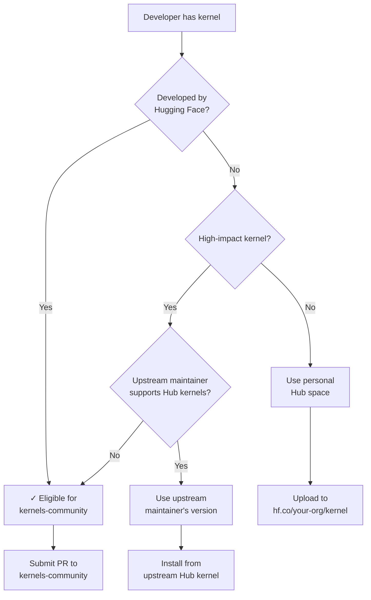
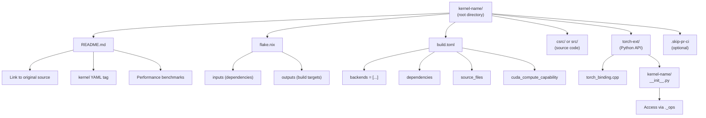
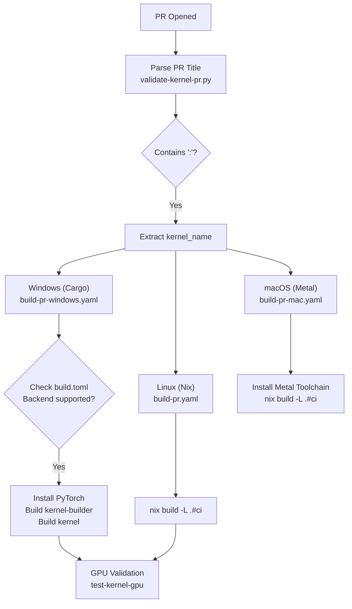

<!-- source: DeepWiki mcp.deepwiki.com · repo huggingface/kernels-community · page 6 Contributing to Kernels Community · fetched 2026-10-26 -->

# Contributing to Kernels Community

Relevant source files

The following files were used as context for generating this wiki page:

- [.github/scripts/windows/install-oneapi.ps1](.github/scripts/windows/install-oneapi.ps1)
- [.github/workflows/build-pr-mac.yaml](.github/workflows/build-pr-mac.yaml)
- [.github/workflows/build-pr-windows.yaml](.github/workflows/build-pr-windows.yaml)
- [.github/workflows/build-pr.yaml](.github/workflows/build-pr.yaml)
- [.github/workflows/build-release-mac.yaml](.github/workflows/build-release-mac.yaml)
- [.github/workflows/build-release-windows.yaml](.github/workflows/build-release-windows.yaml)
- [.github/workflows/build-release.yaml](.github/workflows/build-release.yaml)
- [.github/workflows/nix_fmt.yaml](.github/workflows/nix_fmt.yaml)
- [CONTRIBUTING.md](CONTRIBUTING.md)

This document provides comprehensive guidance for contributors who want to add new kernels to the `kernels-community` repository. It covers eligibility criteria, required file structures, the pull request workflow, and validation processes across multiple hardware backends.

**Scope**: This page focuses on the contribution mechanics—how to structure, test, and submit kernel code. For details on the build system itself, see [Build System](#2). For information on individual kernel implementations, see [Kernel Implementations](#4).

## Overview

The `kernels-community` repository hosts optimized GPU kernels that are built and deployed to [huggingface.co/kernels-community](https://huggingface.co/kernels-community) automatically. The contribution process involves multiple validation stages to ensure kernel quality, reproducibility, and compatibility with the build infrastructure across Linux, Windows, and macOS.

Sources: [CONTRIBUTING.md:1-42](), [README.md:1-24]()

---

## Contribution Eligibility

Not all kernels belong in `kernels-community`. The repository accepts kernels that meet specific criteria to maintain quality and relevance.

### Eligibility Decision Tree

**Contribution Decision Tree**: Shows when kernels should be contributed to `kernels-community` versus maintained in personal Hub namespaces.

### Acceptance Criteria

| Criterion | Description | Example |
|-----------|-------------|---------|
| **HF-Developed** | Kernels developed by Hugging Face team | `yamoe` |
| **High-Impact Without Upstream** | Widely-used kernels where upstream doesn't support Hub kernels yet | `flash-attn2`, `paged-attention` |
| **Used by HF Projects** | Kernels required by `transformers`, `diffusers`, or other HF libraries | Most attention kernels |

**Not accepted**: Personal kernels, experimental implementations, or kernels with active upstream Hub support. For details, see [Contribution Guidelines](#6.1).

Sources: [CONTRIBUTING.md:3-14]()

---

## Required Kernel Structure

Each kernel must follow a standardized directory structure to integrate with the build system and CI/CD pipeline.

### File Structure Overview

**Kernel Directory Structure**: Maps required files and directories to their purposes in the build system.

### Required Files Table

| File/Directory | Required | Purpose | Validation |
|----------------|----------|---------|------------|
| `README.md` | Yes | Documentation, source links, benchmarks | Manual review |
| `flake.nix` | Yes | Nix build configuration, dependency locks | Checked by [validate-kernel-pr.py:68-76]() |
| `build.toml` | Yes | Backend specification, dependencies, source files | Checked by [validate-kernel-pr.py:69-76]() |
| `csrc/` or `src/` | Conditional | Kernel source code (not needed for Triton kernels) | Build-time validation |
| `torch-ext/` | Yes | Python API and PyTorch bindings | Build-time validation |
| `torch-ext/torch_binding.cpp` | Conditional | C++ PyTorch op registration (not for Triton) | Build-time compilation |
| `torch-ext/kernel-name/__init__.py` | Yes | Python package entry point | Import-time validation |
| `.skip-pr-ci` | No | Skip PR build validation | Checked by [validate-kernel-pr.py:63-66]() |

For a step-by-step walkthrough, see [Adding a New Kernel](#6.2).

Sources: [CONTRIBUTING.md:20-31](), [validate-kernel-pr.py:57-76]()

---

## Pull Request Workflow

The PR workflow enforces quality gates through automated validation and manual review.

### PR Title Format

Pull requests **must** follow this exact format: `kernel_name: short description of the change`. The kernel name before the colon determines which kernel directory is validated and built across the matrix.

Sources: [CONTRIBUTING.md:36](), [README.md:18-23]()

### Multi-Platform Validation Flow

**PR Validation Pipeline**: Shows the cross-platform validation process. Structure validation is handled by `validate-kernel-pr.py` while builds are dispatched to platform-specific workflows.

### Platform-Specific Logic

*   **Linux**: Uses Nix-based runners with `nix build -L .#ci` [.github/workflows/build-pr.yaml:59-63]().
*   **Windows**: Validates CUDA and XPU backends via PowerShell. It checks for minimum CUDA versions specified in `build.toml` [.github/workflows/build-pr-windows.yaml:63-76]() and handles Intel oneAPI setup for XPU [.github/workflows/build-pr-windows.yaml:135-140]().
*   **macOS**: Requires the Metal toolchain via `xcodebuild -downloadComponent MetalToolchain` [.github/workflows/build-pr-mac.yaml:47-49]().

Sources: [.github/workflows/build-pr.yaml:1-119](), [.github/workflows/build-pr-windows.yaml:1-154](), [.github/workflows/build-pr-mac.yaml:1-55]()

---

## Testing and Validation

Contributors must ensure kernels pass functional and performance checks before submission. For details, see [Testing and Validation](#6.3).

### Local Testing with kernel-builder

The `kernel-builder` tool orchestrates the compilation process locally. For Windows contributors, this involves building the Rust-based `kernel-builder` from source using `cargo build` [.github/workflows/build-pr-windows.yaml:164-168]().

### Pre-Submission Checklist

- [ ] **Directory Structure**: Kernel directory named with lowercase, hyphens/underscores only.
- [ ] **Build Configuration**: `build.toml` specifies correct backends (e.g., `cuda`, `metal`, `xpu`, `rocm`).
- [ ] **Formatting**: Nix files must pass `nix fmt -- --ci` [.github/workflows/nix_fmt.yaml:20]().
- [ ] **Local Build**: `nix build -L .#ci` (Linux/macOS) or `kernel-builder` (Windows) completes successfully.
- [ ] **Mandatory Repo ID**: `build.toml` must contain a `repo-id` under `[general.hub]` [.github/workflows/build-pr.yaml:51-58]().

### Skipping CI Builds

For documentation-only changes, create a `.skip-pr-ci` file in the kernel directory [.github/workflows/validate-kernel-pr.py:63-66](). Note that top-level `README.md` changes are ignored by default [.github/workflows/build-pr.yaml:4-5]().

Sources: [.github/workflows/validate-kernel-pr.py:1-84](), [.github/workflows/build-pr.yaml:1-119](), [.github/workflows/nix_fmt.yaml:1-21]()

---

## Post-Merge and Release

After a PR is merged, the release pipeline triggers to upload artifacts to the Hugging Face Hub.

### Release Pipeline

1.  **Merged PR Check**: Workflows like `build-release.yaml` and `build-release-windows.yaml` only run if `github.event.pull_request.merged == true` [.github/workflows/build-release.yaml:12]().
2.  **Build and Upload**: Executes `nix run -L .#build-and-upload` [.github/workflows/build-release.yaml:50-56]().
3.  **V1 Versioning**: If `build.toml` specifies `version = 1`, the kernel is also uploaded to the `main` branch of the Hub repository [.github/workflows/build-release.yaml:57-72]().

### Transferring Ownership

If a contributor wishes to maintain a kernel independently, ownership can be transferred from `kernels-community` to a personal or organizational namespace on the Hub. Contact the team via Slack or GitHub issues to initiate this process.

Sources: [CONTRIBUTING.md:16-18](), [.github/workflows/build-release.yaml:1-73](), [.github/workflows/build-release-windows.yaml:1-171]()

---

