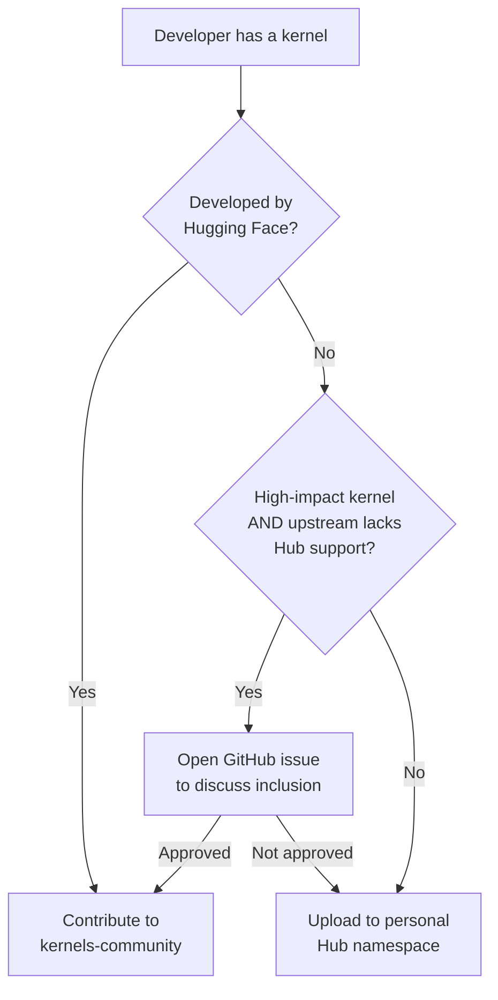
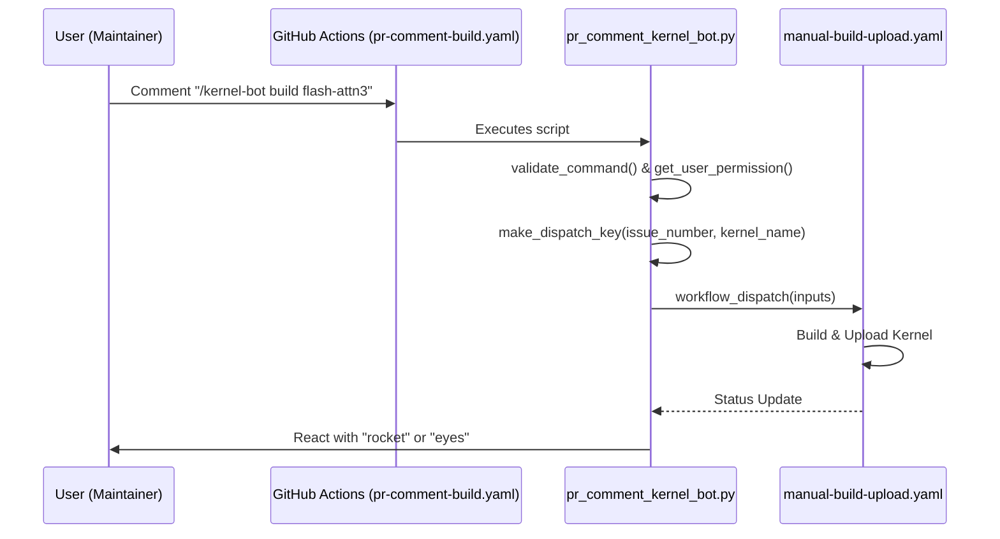
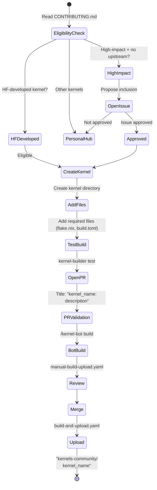

<!-- source: DeepWiki mcp.deepwiki.com · repo huggingface/kernels-community · page 6.1 Contribution Guidelines · fetched 2026-10-26 -->

# Contribution Guidelines

<details>
<summary>Relevant source files</summary>

The following files were used as context for generating this wiki page:

- [.github/scripts/pr_comment_kernel_bot.py](.github/scripts/pr_comment_kernel_bot.py)
- [.github/workflows/manual-build-upload.yaml](.github/workflows/manual-build-upload.yaml)
- [.github/workflows/pr-comment-build.yaml](.github/workflows/pr-comment-build.yaml)
- [CONTRIBUTING.md](CONTRIBUTING.md)

</details>


## Purpose and Scope

This document defines the eligibility criteria for kernels in the `kernels-community` repository and explains when to contribute to this repository versus maintaining kernels in a personal Hugging Face Hub namespace. It also documents the technical interface for interacting with the repository via the **Kernel Bot** chat-ops system and the strict PR formatting requirements enforced by CI.

Sources: [CONTRIBUTING.md:1-42]()

## Kernel Acceptance Criteria

The `kernels-community` repository accepts two categories of kernels:

| Category | Description | Example |
|----------|-------------|---------|
| **HF-Developed Kernels** | Kernels developed internally by Hugging Face teams | `yamoe` |
| **High-Impact Community Kernels** | Kernels that are impactful for the community (e.g., used by `transformers`) but whose upstream maintainers do not provide Hub kernel packages | `flash-attn2`, `paged-attention` |

All accepted kernels are automatically built via the CI/CD pipeline and uploaded to the [kernels-community](https://hf.co/kernels-community) organization on the Hugging Face Hub.

Sources: [CONTRIBUTING.md:3-10]()

### When to Contribute to kernels-community



**Decision Tree for Kernel Contribution**

Sources: [CONTRIBUTING.md:3-14]()

### Recommended Contribution Path for Personal Kernels

For kernels that do not meet the acceptance criteria, the recommended workflow is to develop them under your own GitHub organization and upload them to the Hugging Face Hub under your own namespace. The kernels ecosystem is designed to empower the community to share their own kernels independently.

Sources: [CONTRIBUTING.md:12-14]()

## Kernel Bot Chat-Ops Interface

The repository uses a specialized bot, `pr_comment_kernel_bot.py`, to manage builds and uploads directly from GitHub PR comments. This allows maintainers to trigger resource-intensive GPU builds without manual workflow dispatch.

### Bot Command Syntax
Commands must start with `/kernel-bot` and follow this structure:
```bash
/kernel-bot <command> <kernel1> [kernel2 ...] [--branch <target_branch>]
```

| Command | Permission | Description |
|---------|------------|-------------|
| `build` | `admin`, `write` | Builds the kernel to verify compilation on CI runners. |
| `build-and-upload` | `admin` | Builds and uploads the resulting binary to the Hub. |
| `merge-and-upload` | `admin` | Merges the PR and then triggers a build/upload to the Hub. |

### Implementation and Data Flow
The bot logic is implemented in `.github/scripts/pr_comment_kernel_bot.py` and triggered by the `issue_comment` event in `.github/workflows/pr-comment-build.yaml`.



**Kernel Bot Dispatch Logic**

The bot tracks requests using a `dispatch_key` (formatted as `pr{issue_number}-{kernel_name}-{uuid}`) to correlate specific workflow runs with the PR comment that triggered them.

Sources: [.github/scripts/pr_comment_kernel_bot.py:17-31](), [.github/scripts/pr_comment_kernel_bot.py:185-187](), [.github/workflows/pr-comment-build.yaml:1-50]()

## Pull Request Naming Convention

When submitting a kernel contribution, the PR title must follow a strict format. This is not just for organization; it is used by CI scripts like `validate-kernel-pr.py` to identify which kernel directory to target for builds.

**Required Format:**
```
<kernel_name>: <short_description>
```

**Examples:**
- `relu: add initial implementation`
- `flash-attn3: fix sm90 specialized kernels`

**Technical Constraints:**
- The `kernel_name` must match the directory name in the repository root.
- The `kernel_name` must only contain alphanumeric characters, underscores, or hyphens `[A-Za-z0-9_-]`.
- Do not include build outputs (like `result/` symlinks) in the PR.

Sources: [CONTRIBUTING.md:36](), [.github/workflows/manual-build-upload.yaml:96-101](), [.github/scripts/pr_comment_kernel_bot.py:14-16]()

## Contribution Process Overview



**Full Contribution Workflow**

Sources: [CONTRIBUTING.md:20-36](), [.github/workflows/manual-build-upload.yaml:1-30]()

## Summary of Responsibilities

| Aspect | kernels-community | Personal Hub Namespace |
|--------|-------------------|------------------------|
| **Eligibility** | HF-developed OR high-impact with no upstream Hub support | Any kernel |
| **Approval Required** | GitHub issue for non-HF kernels | No approval needed |
| **Build System** | Automated via Bot/CI | Manual or personal workflows |
| **Hub Namespace** | `kernels-community/<kernel-name>` | `username/<kernel-name>` |
| **Maintenance** | Hugging Face (or transferred to author) | Author |

Sources: [CONTRIBUTING.md:1-18]()

---

