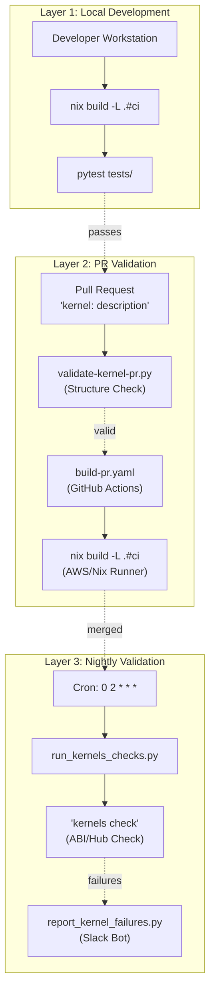
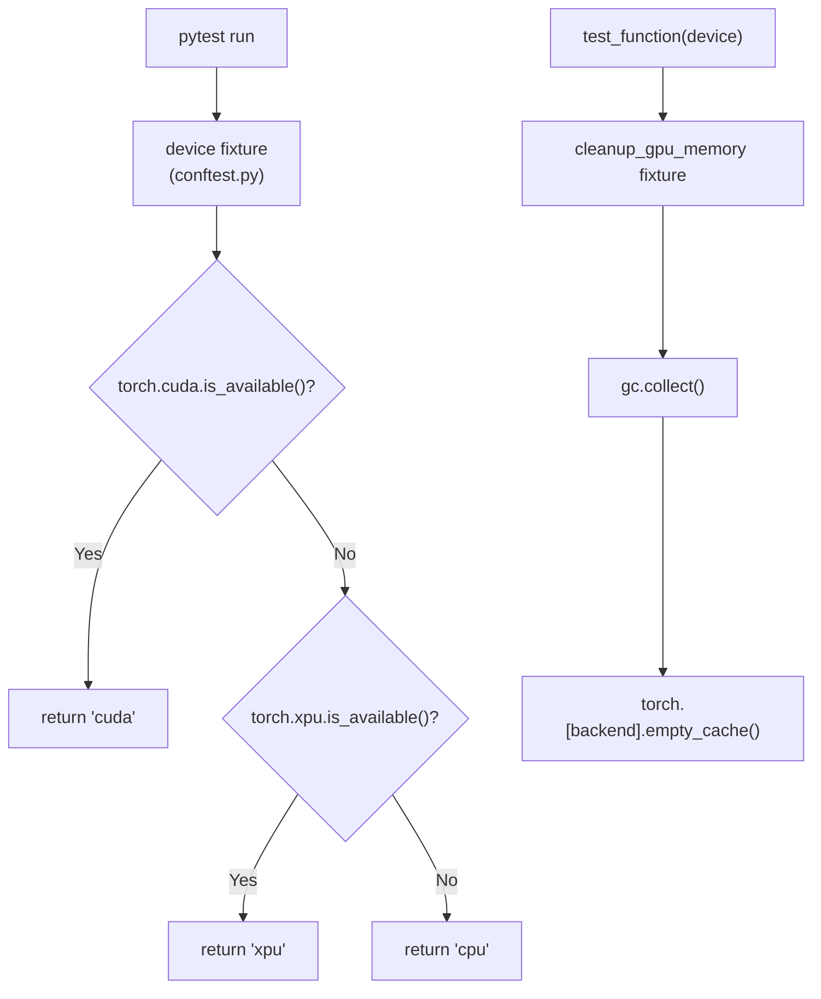

<!-- source: DeepWiki mcp.deepwiki.com · repo huggingface/kernels-community · page 6.3 Testing and Validation · fetched 2026-10-26 -->

# Testing and Validation

<details>
<summary>Relevant source files</summary>

The following files were used as context for generating this wiki page:

- [.github/workflows/nightly_kernel_check.yml](.github/workflows/nightly_kernel_check.yml)
- [.github/workflows/validate-kernel-pr.py](.github/workflows/validate-kernel-pr.py)
- [.gitignore](.gitignore)
- [README.md](README.md)
- [activation/benchmarks/benchmark.py](activation/benchmarks/benchmark.py)
- [causal-conv1d/benchmarks/benchmark.py](causal-conv1d/benchmarks/benchmark.py)
- [deformable-detr/benchmarks/benchmark.py](deformable-detr/benchmarks/benchmark.py)
- [flash-attn2/benchmarks/benchmark.py](flash-attn2/benchmarks/benchmark.py)
- [flash-attn2/build.toml](flash-attn2/build.toml)
- [flash-attn2/flake.lock](flash-attn2/flake.lock)
- [flash-attn2/flake.nix](flash-attn2/flake.nix)
- [flash-attn2/tests/conftest.py](flash-attn2/tests/conftest.py)
- [flash-attn3/benchmarks/benchmark.py](flash-attn3/benchmarks/benchmark.py)
- [fp8-fbgemm/benchmarks/benchmark.py](fp8-fbgemm/benchmarks/benchmark.py)
- [megablocks/benchmarks/benchmark.py](megablocks/benchmarks/benchmark.py)
- [mra/benchmarks/benchmark.py](mra/benchmarks/benchmark.py)
- [paged-attention/benchmarks/benchmark.py](paged-attention/benchmarks/benchmark.py)
- [punica-sgmv/benchmarks/benchmark.py](punica-sgmv/benchmarks/benchmark.py)
- [relu/build.toml](relu/build.toml)
- [relu/flake.lock](relu/flake.lock)
- [relu/flake.nix](relu/flake.nix)
- [relu/relu_cpu/relu_cpu.cpp](relu/relu_cpu/relu_cpu.cpp)
- [relu/tests/test_relu.py](relu/tests/test_relu.py)
- [relu/torch-ext/relu/__init__.py](relu/torch-ext/relu/__init__.py)
- [relu/torch-ext/relu/layers/__init__.py](relu/torch-ext/relu/layers/__init__.py)
- [relu/torch-ext/torch_binding.cpp](relu/torch-ext/torch_binding.cpp)
- [scripts/report_kernel_failures.py](scripts/report_kernel_failures.py)
- [scripts/run_kernels_checks.py](scripts/run_kernels_checks.py)

</details>


This document explains the testing and validation systems used to ensure kernel quality in the `kernels-community` repository. It covers local testing procedures with `kernel-builder`, the `conftest.py` device fixture pattern, automated PR validation, and the nightly kernel check system.

## Testing Architecture

The testing system implements three validation layers that progressively verify kernel quality from development through deployment.

### Validation Flow Diagram
Title: Kernel Validation Pipeline

Sources: [.github/workflows/nightly_kernel_check.yml:1-30](), [scripts/run_kernels_checks.py:96-116](), [README.md:18-24]()

## Local Testing with kernel-builder

Before submitting a PR, contributors must test kernels locally using the Nix-based `kernel-builder`.

### Building for CI
To simulate the CI environment locally, navigate to a kernel directory (e.g., `relu/`) and run:
```bash
nix build -L .#ci
```
This command invokes `genKernelFlakeOutputs` [relu/flake.nix:13-16]() which orchestrates the build for the current system. The `-L` flag shows live build logs, which is critical for debugging C++/CUDA compilation errors.

### Build Artifacts
Successful builds create a `result` symlink [.gitignore:1-3]().
- **Libraries**: Compiled `.so` (Linux) or `.dylib` (macOS) files are generated but ignored by git [.gitignore:11-13]().
- **Python Package**: The `torch-ext` directory is structured to be importable as a Python module [relu/build.toml:17-21]().

Sources: [relu/flake.nix:1-17](), [relu/build.toml:1-68](), [.gitignore:1-23]()

## Testing Patterns

### The conftest.py Device Fixture
Most kernels utilize a standardized `pytest` fixture pattern to handle multi-backend execution (CUDA, XPU, CPU).

Title: Device Dispatch Fixture Logic


The `device` fixture [flash-attn2/tests/conftest.py:7-14]() allows tests to remain hardware-agnostic. Additionally, the `cleanup_gpu_memory` fixture [flash-attn2/tests/conftest.py:17-25]() ensures that VRAM is cleared between test cases to prevent OOM errors during large-batch validation.

### Functional Validation
Kernels typically include a `tests/` directory with `pytest` scripts. For example, `relu/tests/test_relu.py` [relu/tests/test_relu.py:10-21]() compares the custom kernel output against the reference `torch.nn.functional.relu` implementation using `torch.testing.assert_close`.

Sources: [flash-attn2/tests/conftest.py:1-25](), [relu/tests/test_relu.py:1-36]()

## PR Validation Process

PRs are validated by the `validate-kernel-pr.py` script. The process is strictly tied to the PR title.

### Title Format Requirement
The CI only triggers if the PR title follows the pattern `kernel_name: description` [README.md:18-23](). The script parses the string before the colon to identify which kernel directory to build.

### Structure Checks
The validation script performs several checks:
1. **Name Validation**: Ensures the kernel name contains only alphanumeric characters, hyphens, or underscores [.github/workflows/validate-kernel-pr.py:12-24]().
2. **Directory Existence**: Confirms a directory matching the name exists in the repository root [.github/workflows/validate-kernel-pr.py:57-61]().
3. **Configuration Check**: Verifies that both `flake.nix` and `build.toml` are present in the target directory [.github/workflows/validate-kernel-pr.py:68-76]().
4. **Skip Logic**: Checks for a `.skip-pr-ci` file which allows contributors to bypass CI for documentation-only changes [.github/workflows/validate-kernel-pr.py:63-66]().

Sources: [.github/workflows/validate-kernel-pr.py:1-84](), [README.md:18-24]()

## Nightly Validation System

The nightly system ensures that kernels already published to the Hugging Face Hub remain compatible with new PyTorch releases and environment changes.

### run_kernels_checks.py
This script [scripts/run_kernels_checks.py:1-157]() iterates through the repository to find all valid kernels.
- **Discovery**: `discover_kernel_dirs` [scripts/run_kernels_checks.py:46-63]() searches for directories containing a `build.toml`.
- **Execution**: It runs the command `kernels check kernels-community/{name}` [scripts/run_kernels_checks.py:100-101](). This command (from the `kernels` CLI tool) downloads the kernel from the Hub and attempts to load it into the current environment.
- **Cache Management**: The `--clear-cache` flag triggers `_delete_kernel_cache` [scripts/run_kernels_checks.py:75-93](), which identifies the Hugging Face Hub cache directory and removes entries matching `models--kernels-community--{name}*`. This ensures every nightly run tests a fresh download from the Hub.

### Failure Reporting
The `report_kernel_failures.py` script [scripts/report_kernel_failures.py:1-103]() collects results from the checks. If failures occur, it formats a Slack notification [scripts/report_kernel_failures.py:34-41]() and posts it to a designated channel using a webhook [scripts/report_kernel_failures.py:44-50]().

Sources: [.github/workflows/nightly_kernel_check.yml:1-30](), [scripts/run_kernels_checks.py:46-116](), [scripts/report_kernel_failures.py:1-103]()

## Benchmarking Pattern

Most high-performance kernels (e.g., `flash-attn2`, `paged-attention`, `megablocks`) include a `benchmarks/benchmark.py` file.

### benchmark.py Structure
While implementations vary, they follow a common pattern:
1. **Reference Implementation**: Use a standard PyTorch op or a known-good baseline (e.g., `torch.nn.functional.scaled_dot_product_attention`).
2. **Warmup**: Execute the kernel several times to trigger JIT compilation or CUDA graph capture.
3. **Timing**: Use `torch.cuda.Event` for accurate GPU timing or `time.perf_counter` for CPU/Metal.
4. **Sweeps**: Iterate over dimensions (Sequence Length, Head Dim, Batch Size) to generate performance curves.

Sources: [flash-attn2/benchmarks/benchmark.py](), [paged-attention/benchmarks/benchmark.py](), [megablocks/benchmarks/benchmark.py]() (File paths referenced as per repository structure).

---

