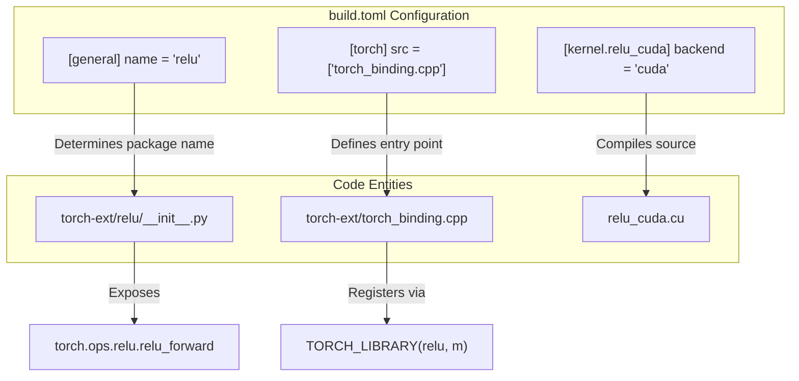
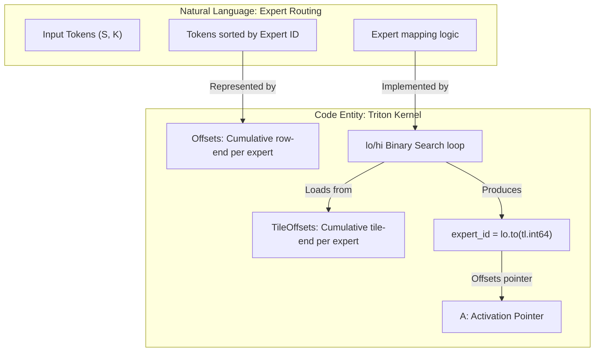

<!-- source: DeepWiki mcp.deepwiki.com · repo huggingface/kernels-community · page 7 Glossary · fetched 2026-10-26 -->

# Glossary

Relevant source files

The following files were used as context for generating this wiki page:

- [deep-gemm/torch-ext/deep_gemm/__init__.py](deep-gemm/torch-ext/deep_gemm/__init__.py)
- [deep-gemm/torch-ext/torch_binding.cpp](deep-gemm/torch-ext/torch_binding.cpp)
- [finegrained-fp8/README.md](finegrained-fp8/README.md)
- [finegrained-fp8/build.toml](finegrained-fp8/build.toml)
- [finegrained-fp8/flake.lock](finegrained-fp8/flake.lock)
- [finegrained-fp8/flake.nix](finegrained-fp8/flake.nix)
- [finegrained-fp8/pytest.ini](finegrained-fp8/pytest.ini)
- [finegrained-fp8/tests/test_matmul.py](finegrained-fp8/tests/test_matmul.py)
- [finegrained-fp8/tests/test_moe.py](finegrained-fp8/tests/test_moe.py)
- [finegrained-fp8/torch-ext/finegrained_fp8/__init__.py](finegrained-fp8/torch-ext/finegrained_fp8/__init__.py)
- [finegrained-fp8/torch-ext/finegrained_fp8/act_quant.py](finegrained-fp8/torch-ext/finegrained_fp8/act_quant.py)
- [finegrained-fp8/torch-ext/finegrained_fp8/batched.py](finegrained-fp8/torch-ext/finegrained_fp8/batched.py)
- [finegrained-fp8/torch-ext/finegrained_fp8/grouped.py](finegrained-fp8/torch-ext/finegrained_fp8/grouped.py)
- [finegrained-fp8/torch-ext/finegrained_fp8/matmul.py](finegrained-fp8/torch-ext/finegrained_fp8/matmul.py)
- [finegrained-fp8/torch-ext/finegrained_fp8/utils.py](finegrained-fp8/torch-ext/finegrained_fp8/utils.py)
- [flake.lock](flake.lock)
- [flake.nix](flake.nix)
- [flash-attn2/build.toml](flash-attn2/build.toml)
- [flash-attn2/flake.lock](flash-attn2/flake.lock)
- [flash-attn2/flake.nix](flash-attn2/flake.nix)
- [flash-attn2/tests/conftest.py](flash-attn2/tests/conftest.py)
- [flash-attn3/build.toml](flash-attn3/build.toml)
- [flash-attn3/flake.lock](flash-attn3/flake.lock)
- [flash-attn3/flake.nix](flash-attn3/flake.nix)
- [flash-mla/build.toml](flash-mla/build.toml)
- [mamba-ssm/build.toml](mamba-ssm/build.toml)
- [mamba-ssm/flake.lock](mamba-ssm/flake.lock)
- [mamba-ssm/flake.nix](mamba-ssm/flake.nix)
- [mamba-ssm/torch-ext/mamba_ssm/__init__.py](mamba-ssm/torch-ext/mamba_ssm/__init__.py)
- [mamba-ssm/torch-ext/mamba_ssm/models/__init__.py](mamba-ssm/torch-ext/mamba_ssm/models/__init__.py)
- [mamba-ssm/torch-ext/mamba_ssm/modules/__init__.py](mamba-ssm/torch-ext/mamba_ssm/modules/__init__.py)
- [mamba-ssm/torch-ext/mamba_ssm/ops/__init__.py](mamba-ssm/torch-ext/mamba_ssm/ops/__init__.py)
- [mamba-ssm/torch-ext/mamba_ssm/ops/triton/__init__.py](mamba-ssm/torch-ext/mamba_ssm/ops/triton/__init__.py)
- [mamba-ssm/torch-ext/mamba_ssm/utils/generation.py](mamba-ssm/torch-ext/mamba_ssm/utils/generation.py)
- [megablocks/build.toml](megablocks/build.toml)
- [megablocks/flake.lock](megablocks/flake.lock)
- [megablocks/flake.nix](megablocks/flake.nix)
- [relu/build.toml](relu/build.toml)
- [relu/flake.lock](relu/flake.lock)
- [relu/flake.nix](relu/flake.nix)
- [relu/relu_cpu/relu_cpu.cpp](relu/relu_cpu/relu_cpu.cpp)
- [relu/tests/test_relu.py](relu/tests/test_relu.py)
- [relu/torch-ext/relu/__init__.py](relu/torch-ext/relu/__init__.py)
- [relu/torch-ext/relu/layers/__init__.py](relu/torch-ext/relu/layers/__init__.py)
- [relu/torch-ext/torch_binding.cpp](relu/torch-ext/torch_binding.cpp)
- [rmsnorm/build.toml](rmsnorm/build.toml)
- [rmsnorm/flake.lock](rmsnorm/flake.lock)
- [rmsnorm/flake.nix](rmsnorm/flake.nix)
- [rmsnorm/rmsnorm_cpu/rmsnorm_cpu_torch.cpp](rmsnorm/rmsnorm_cpu/rmsnorm_cpu_torch.cpp)
- [rmsnorm/rmsnorm_xpu/RMSNorm.cpp](rmsnorm/rmsnorm_xpu/RMSNorm.cpp)
- [rmsnorm/tests/test_rmsnorm.py](rmsnorm/tests/test_rmsnorm.py)
- [rmsnorm/torch-ext/rmsnorm/__init__.py](rmsnorm/torch-ext/rmsnorm/__init__.py)
- [rmsnorm/torch-ext/rmsnorm/layers.py](rmsnorm/torch-ext/rmsnorm/layers.py)
- [rmsnorm/torch-ext/torch_binding.cpp](rmsnorm/torch-ext/torch_binding.cpp)

This glossary defines codebase-specific terms, hardware-specific jargon, and domain concepts used throughout the `kernels-community` repository. It provides technical context for onboarding engineers regarding the build system, kernel dispatch, and specialized deep learning operations.

## Core Infrastructure Terms

### Kernel Builder
The `kernel-builder` is a centralized Nix-based infrastructure used by all kernels in this repository to ensure reproducible builds across different CUDA, PyTorch, and hardware versions. It is consumed as a Nix flake input.
*   **Implementation**: Each kernel's `flake.nix` calls `kernel-builder.lib.genKernelFlakeOutputs` to generate the build matrix [relu/flake.nix:13-13](), [flash-attn2/flake.nix:13-13]().
*   **Source Pointer**: Referred to in `flake.lock` files as the `huggingface/kernels` repository [relu/flake.lock:43-55]().

### build.toml
The declarative configuration file located in each kernel's root directory. It defines metadata, supported backends, compiler flags, and source file groupings.
*   **Sections**: 
    *   `[general]`: Metadata like name and version [flash-attn2/build.toml:1-5]().
    *   `[torch]`: C++ binding files that interface with PyTorch [flash-attn2/build.toml:15-19]().
    *   `[kernel.<name>]`: Specific source files and flags for a backend (e.g., `cpu`, `cuda`, `xpu`) [flash-attn2/build.toml:21-33]().
*   **Source Pointer**: [relu/build.toml:1-25](), [flash-attn2/build.toml:1-166]().

### Torch Extension (torch-ext)
The directory within each kernel folder containing the Python API and C++/CUDA bindings. This follows a standard layout to expose compiled kernels as PyTorch operations.
*   **Structure**: Usually contains a `torch_binding.cpp` for `TORCH_LIBRARY` registration and a Python package (e.g., `relu/torch-ext/relu/`) for the user-facing API [relu/torch-ext/torch_binding.cpp:1-15](), [relu/torch-ext/relu/__init__.py:1-10]().

---

## Hardware & Backend Jargon

### Compute Capability (SM)
Refers to the architecture version of NVIDIA GPUs. Kernels often specialize based on these versions (e.g., SM80 for Ampere, SM90 for Hopper).
*   **Usage**: Specified in `build.toml` under `cuda-capabilities` [flash-attn2/build.toml:63-68]().
*   **Code Reference**: Specialized source files often include the SM version in their filename [flash-attn2/build.toml:89-92]().

### XPU / SYCL
XPU is Intel's abstraction for data-parallel accelerators (GPUs). The repository uses SYCL (often via `sycl_tla`) to implement kernels for Intel hardware.
*   **Usage**: Flash Attention 2 and RMSNorm include XPU support [flash-attn2/build.toml:168-173]().
*   **Source Pointer**: [flash-attn2/build.toml:168-188]().

### AVX-512 / AMX
CPU instruction set extensions for vectorized math (AVX-512) and matrix multiplication acceleration (AMX).
*   **Usage**: Flash Attention 2 uses these for high-performance CPU inference [flash-attn2/build.toml:21-33]().
*   **Source Pointer**: `fmha_fwd_avx512.cpp` [flash-attn2/build.toml:37-41]().

---

## Domain & Algorithm Concepts

### Grouped GEMM (MoE)
A specialized Matrix Multiplication where multiple "experts" (different weight matrices) are applied to different subsets of tokens in a single kernel call.
*   **Implementation**: Used in Mixture of Experts (MoE) implementations like `finegrained-fp8`.
*   **Key Logic**: Uses `TileOffsets` and `Offsets` to map thread blocks (tiles) to specific experts via binary search [finegrained-fp8/torch-ext/finegrained_fp8/grouped.py:75-90]().
*   **Source Pointer**: `w8a8_block_fp8_matmul_grouped_kernel` [finegrained-fp8/torch-ext/finegrained_fp8/grouped.py:33-61]().

### Block-Scale Quantization
A quantization strategy where scaling factors are applied to small sub-blocks of a matrix rather than the entire tensor or a single row/column.
*   **Implementation**: `finegrained-fp8` implements this for FP8 weights [finegrained-fp8/torch-ext/finegrained_fp8/grouped.py:62-66]().
*   **Code Reference**: `Bs` (Weight Scales) tensor with dimensions corresponding to block indices [finegrained-fp8/torch-ext/finegrained_fp8/grouped.py:37-37]().

### Selective Scan
The core operation of the Mamba architecture, implementing a time-varying state-space model.
*   **Source Pointer**: Located in the `mamba-ssm` kernel [mamba-ssm/torch-ext/mamba_ssm/ops/__init__.py:1-10]().

---

## System Mapping Diagrams

### Build Configuration to Code Entity Mapping
This diagram shows how the `build.toml` configuration maps to specific C++ and Python entities during the build process.

**Sources**: [relu/build.toml:1-25](), [relu/torch-ext/torch_binding.cpp:1-15](), [relu/torch-ext/relu/__init__.py:1-10]().

### MoE Dispatch Data Flow
This diagram associates the logical concept of "Grouped Expert Dispatch" with the specific Triton variables and logic used in the MoE kernels.

**Sources**: [finegrained-fp8/torch-ext/finegrained_fp8/grouped.py:33-100]().

---

## Abbreviations Table

| Abbreviation | Full Term | Context |
| :--- | :--- | :--- |
| **BF16** | Bfloat16 | 16-bit floating point format optimized for deep learning. |
| **FP8** | 8-bit Floating Point | Used for low-precision inference/training (e4m3 or e5m2). |
| **GEMM** | General Matrix Multiply | The fundamental operation for linear layers. |
| **MoE** | Mixture of Experts | Model architecture using sparse conditional computation. |
| **MSL** | Metal Shading Language | The language used for Apple Silicon GPU kernels. |
| **TMA** | Tensor Memory Accelerator | Hardware unit in NVIDIA Hopper (SM90) for efficient data movement. |
| **Varlen** | Variable Length | Sequences of different lengths packed into a single tensor without padding. |

**Sources**: [flash-attn2/build.toml:89-110](), [finegrained-fp8/torch-ext/finegrained_fp8/grouped.py:33-66](), [flash-attn2/build.toml:181-187]().