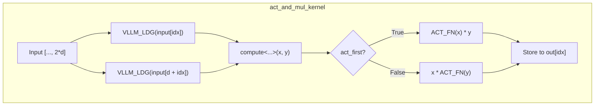
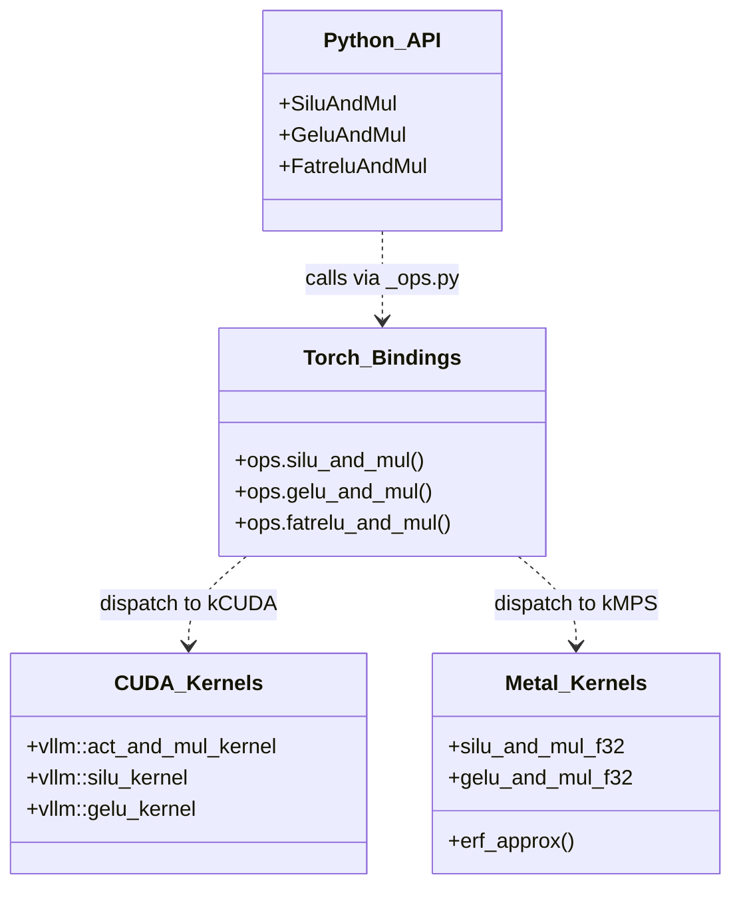

<!-- source: DeepWiki mcp.deepwiki.com · repo huggingface/kernels-community · extra page Activation Kernel: SiLU, SwiGLU, and Fused Activations · fetched 2026-10-26 -->

# Activation Kernel: SiLU, SwiGLU, and Fused Activations

<details>
<summary>Relevant source files</summary>

The following files were used as context for generating this wiki page:

- [activation/activation/activation_kernels.cu](activation/activation/activation_kernels.cu)
- [activation/activation/cuda_compat.h](activation/activation/cuda_compat.h)
- [activation/activation/dispatch_utils.h](activation/activation/dispatch_utils.h)
- [activation/activation_metal/activation.metal](activation/activation_metal/activation.metal)
- [activation/activation_metal/activation.mm](activation/activation_metal/activation.mm)
- [activation/build.toml](activation/build.toml)
- [activation/flake.nix](activation/flake.nix)
- [activation/tests/__init__.py](activation/tests/__init__.py)
- [activation/tests/kernels/__init__.py](activation/tests/kernels/__init__.py)
- [activation/tests/kernels/allclose_default.py](activation/tests/kernels/allclose_default.py)
- [activation/torch-ext/activation/layers.py](activation/torch-ext/activation/layers.py)
- [activation/torch-ext/torch_binding.cpp](activation/torch-ext/torch_binding.cpp)

</details>


This document describes the activation kernel collection, which implements optimized activation functions for Transformer models, including SwiGLU (Swish-Gated Linear Unit), GeGLU, and specialized variants like FatReLU. These kernels are designed for high-performance feed-forward network (FFN) layers across CUDA and Metal backends.

## Overview

The activation kernel suite provides fused implementations of activation functions commonly used in Large Language Models (LLMs). By fusing the activation function (e.g., SiLU, GELU) with the gating multiplication, these kernels reduce memory bandwidth overhead and improve execution speed.

**Key characteristics:**
- **Backend support**: CUDA and Metal (MPS) [activation/build.toml:5-5]()
- **Primary operations**: `silu_and_mul`, `gelu_and_mul`, `fatrelu_and_mul`, and element-wise activations [activation/torch-ext/torch_binding.cpp:6-94]()
- **Optimization**: Fused gating logic to minimize intermediate tensor allocations [activation/activation/activation_kernels.cu:20-32]()
- **Integration**: Exposed via `torch.nn.Module` wrappers with `torch.compile` support [activation/torch-ext/activation/layers.py:7-202]()

Sources: [activation/build.toml:1-33](), [activation/torch-ext/torch_binding.cpp:1-97](), [activation/torch-ext/activation/layers.py:1-202]()

## Supported Activation Functions

The collection supports a wide variety of fused and element-wise activations used in models like LLaMA, Mistral, GPT-2, and MiniCPM.

### Fused Gating Activations (GLU Variants)
These kernels compute $Activation(x_{gate}) \cdot x_{up}$ where the input is split into two halves.

| Function | Operation | Typical Model |
| :--- | :--- | :--- |
| `silu_and_mul` | $SiLU(x[:d]) \cdot x[d:]$ | LLaMA, Mistral |
| `mul_and_silu` | $x[:d] \cdot SiLU(x[d:])$ | Variant SwiGLU |
| `gelu_and_mul` | $GELU(x[:d]) \cdot x[d:]$ | PaLM, GeGLU models |
| `gelu_tanh_and_mul` | $GELU_{tanh}(x[:d]) \cdot x[d:]$ | GeGLU (approx) |
| `fatrelu_and_mul` | $FatReLU(x[:d], \tau) \cdot x[d:]$ | MiniCPM-S |

### Element-wise Activations
| Function | Operation | Description |
| :--- | :--- | :--- |
| `silu` | $x \cdot \sigma(x)$ | Standard Swish/SiLU |
| `gelu` | $GELU(x)$ | Standard Gaussian Error Linear Unit |
| `gelu_new` | $GELU_{new}(x)$ | GPT-2 style GELU |
| `gelu_fast` | $GELU_{fast}(x)$ | High-performance approximation |
| `gelu_quick` | $x \cdot \sigma(1.702x)$ | CLIP-style GELU |

Sources: [activation/torch-ext/torch_binding.cpp:6-94](), [activation/torch-ext/activation/layers.py:7-202](), [activation/activation/activation_kernels.cu:85-118]()

## Implementation Details

### CUDA Backend
The CUDA implementation uses a template-based approach to generate specific kernels for different activation functions. The `act_and_mul_kernel` template handles the memory indexing for the gating operation.


**Diagram: CUDA Gated Activation Logic**

Sources: [activation/activation/activation_kernels.cu:20-32](), [activation/activation/activation_kernels.cu:10-17]()

### Metal Backend
The Metal implementation utilizes Metal Shading Language (MSL) and provides optimized shaders for Apple Silicon. It includes a custom polynomial approximation for `erf` (`erf_approx`) to match CUDA's `erf` behavior exactly [activation/activation_metal/activation.metal:5-26]().

The Metal host code (`activation.mm`) manages the `MTLComputeCommandEncoder` and dispatches threads in 2D grids (tokens x chunks) [activation/activation_metal/activation.mm:17-77]().

Sources: [activation/activation_metal/activation.metal:147-189](), [activation/activation_metal/activation.mm:17-77]()

## Python API and Layers

The kernels are wrapped in `torch.nn.Module` classes located in `activation/torch-ext/activation/layers.py`. Each layer handles contiguous checks and output tensor allocation.

### Example: SwiGLU (SiluAndMul)
```python
class SiluAndMul(nn.Module):
    def forward(self, x: torch.Tensor):
        if not x.is_contiguous():
            x = x.contiguous()
        d = x.shape[-1] // 2
        output_shape = x.shape[:-1] + (d,)
        out = torch.empty(output_shape, dtype=x.dtype, device=x.device)
        ops.silu_and_mul(out, x)
        return out
```

Sources: [activation/torch-ext/activation/layers.py:7-27]()

## Code Entity Map

The following diagram maps the high-level activation concepts to the specific implementation files and functions in the codebase.


**Diagram: Activation Kernel Entity Mapping**

Sources: [activation/torch-ext/activation/layers.py:7-202](), [activation/torch-ext/torch_binding.cpp:6-94](), [activation/activation/activation_kernels.cu:20-118](), [activation/activation_metal/activation.metal:147-189]()

## Testing and Precision

Tests for these kernels use a set of default tolerances for `torch.allclose` to ensure parity across backends and against reference PyTorch implementations.

| Dtype | atol | rtol |
| :--- | :--- | :--- |
| `torch.float16` | 1e-3 | 1e-3 |
| `torch.bfloat16` | 1e-3 | 1.6e-2 |
| `torch.float32` | 1e-5 | 1.3e-6 |

Sources: [activation/tests/kernels/allclose_default.py:5-6]()

## Build Configuration

The activation kernel is defined as a multi-backend package in `build.toml`.

```toml
[general]
name = "activation"
backends = ["cuda", "metal"]

[kernel.activation]
backend = "cuda"
src = ["activation/activation_kernels.cu", ...]

[kernel.activation_metal]
backend = "metal"
src = ["activation_metal/activation.mm", "activation_metal/activation.metal"]
```

Sources: [activation/build.toml:1-33](), [activation/flake.nix:1-17]()

---

