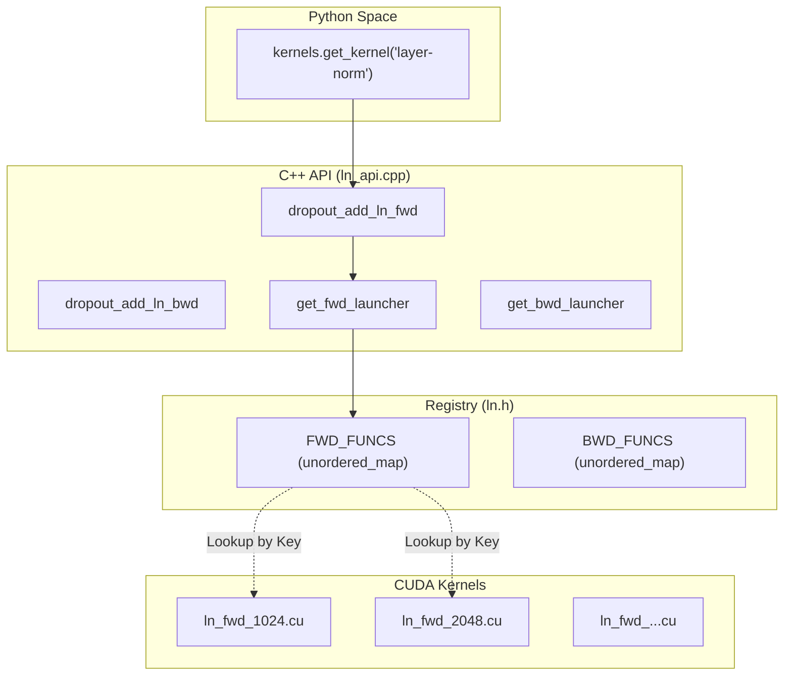
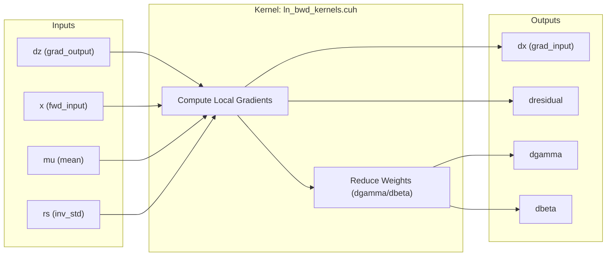

<!-- source: DeepWiki mcp.deepwiki.com · repo huggingface/kernels-community · extra page LayerNorm: CUDA Fused Implementation · fetched 2026-10-26 -->

# LayerNorm: CUDA Fused Implementation

<details>
<summary>Relevant source files</summary>

The following files were used as context for generating this wiki page:

- [layer-norm/README.md](layer-norm/README.md)
- [layer-norm/benchmarks/benchmark.py](layer-norm/benchmarks/benchmark.py)
- [layer-norm/build.toml](layer-norm/build.toml)
- [layer-norm/flake.lock](layer-norm/flake.lock)
- [layer-norm/flake.nix](layer-norm/flake.nix)
- [layer-norm/layer_norm/ln.h](layer-norm/layer_norm/ln.h)
- [layer-norm/layer_norm/ln_api.cpp](layer-norm/layer_norm/ln_api.cpp)
- [layer-norm/layer_norm/ln_bwd_1024.cu](layer-norm/layer_norm/ln_bwd_1024.cu)
- [layer-norm/layer_norm/ln_bwd_1280.cu](layer-norm/layer_norm/ln_bwd_1280.cu)
- [layer-norm/layer_norm/ln_bwd_1536.cu](layer-norm/layer_norm/ln_bwd_1536.cu)
- [layer-norm/layer_norm/ln_bwd_2048.cu](layer-norm/layer_norm/ln_bwd_2048.cu)

</details>


The `layer-norm` kernel is a high-performance CUDA implementation of fused dropout, residual addition, and LayerNorm (or RMSNorm). Ported from the upstream `flash-attention` repository, it provides specialized kernels for specific hidden sizes to maximize memory throughput and compute efficiency.

## Overview

The implementation supports various combinations of input, residual, and weight data types (FP32, FP16, BF16), while performing internal computations in FP32 for numerical stability [layer_norm/ln_api.cpp:9-25](). It handles both standard LayerNorm and Root Mean Square Layer Normalization (RMSNorm) via a runtime flag [layer_norm/ln.h:48]().

### Key Features
*   **Specialized Kernels**: Hand-tuned kernels for hidden sizes ranging from 256 to 8192 [layer-norm/build.toml:47-75]().
*   **Fused Operations**: Combines dropout, residual addition, and normalization into a single CUDA kernel to reduce global memory roundtrips.
*   **Multi-CTA Support**: For large hidden sizes, the implementation can distribute a single row across multiple Cooperative Thread Arrays (CTAs) [layer_norm/ln.h:55]().
*   **Autograd Integration**: Provides both forward and backward passes registered via PyTorch's C++ API [torch-ext/torch_binding.cpp]().

## System Architecture

The following diagram illustrates the relationship between the C++ dispatch layer, the kernel registries, and the specialized CUDA implementations.

### Entity Mapping: Dispatch to Kernels

**Sources:** [layer_norm/ln_api.cpp:105-120](), [layer_norm/ln.h:172-176](), [layer_norm/ln_api.cpp:61-68]()

## Implementation Details

### Kernel Dispatch and Registration
The implementation uses a 64-bit key to identify the correct kernel at runtime. This key encodes the data types of weights, inputs, residuals, and outputs, along with the hidden size [layer_norm/ln.h:231-237]().

```cpp
// Key generation logic
uint64_t type_key = get_type_id(wtype) | (get_type_id(itype) << 2) | ...;
uint64_t launcher_key = (type_key << 32) | hidden_size;
```
**Sources:** [layer_norm/ln_api.cpp:50-55]()

Specialized files (e.g., `ln_fwd_1024.cu`) use the `REGISTER_FWD_LAUNCHER` and `REGISTER_BWD_LAUNCHER` macros to instantiate and add kernel functions to the global registries (`FWD_FUNCS` and `BWD_FUNCS`) during library loading [layer_norm/ln_bwd_1024.cu:6-15]().

### Data Flow: Forward Pass
The forward pass consumes an input tensor `x0` and an optional `residual`. It applies dropout to `x0`, adds it to the `residual`, and then performs LayerNorm using `gamma` (weight) and `beta` (bias).

| Parameter | Role | File Reference |
| :--- | :--- | :--- |
| `x0` | Primary input tensor | [layer_norm/ln_api.cpp:105]() |
| `residual` | Optional residual connection | [layer_norm/ln_api.cpp:106]() |
| `gamma` | Scaling weight | [layer_norm/ln_api.cpp:107]() |
| `beta` | Shifting bias | [layer_norm/ln_api.cpp:108]() |
| `is_rms_norm` | Toggle between LayerNorm and RMSNorm | [layer_norm/ln_api.cpp:119]() |

**Sources:** [layer_norm/ln_api.cpp:105-120](), [layer_norm/ln.h:95-115]()

### Data Flow: Backward Pass
The backward pass computes gradients for the input (`dx0`), residual (`dresidual`), and weights (`dgamma`, `dbeta`). Because weight gradients require reduction across all rows, the kernel often uses a two-pass approach or a "parallel" version for large hidden sizes [layer_norm/ln.h:119-165]().


**Sources:** [layer_norm/ln.h:119-165](), [layer_norm/ln_bwd_1024.cu:1-15]()

## Supported Hidden Sizes

The implementation provides explicit specializations for the following hidden dimensions to ensure optimal vectorization and register usage:

| Hidden Sizes | Implementation Files |
| :--- | :--- |
| **Small** | 256, 512, 768 |
| **Medium** | 1024, 1280, 1536, 2048 |
| **Large** | 2560, 3072, 4096, 5120, 6144, 7168, 8192 |

**Sources:** [layer-norm/build.toml:47-75]()

## Build Configuration

The kernel is built with specific CUDA flags to enable fast math and relaxed constexpr handling, ensuring compatibility with the complex template structures used for hidden size specialization.

*   **Target Backends**: CUDA [layer-norm/build.toml:5]()
*   **Compute Capabilities**: 8.0, 8.9, 9.0, 10.0, 12.0 [layer-norm/build.toml:19-25]()
*   **Compiler Flags**: `-O3`, `--use_fast_math`, `-U__CUDA_NO_HALF_OPERATORS__` [layer-norm/build.toml:26-37]()

**Sources:** [layer-norm/build.toml:1-42]()

---

