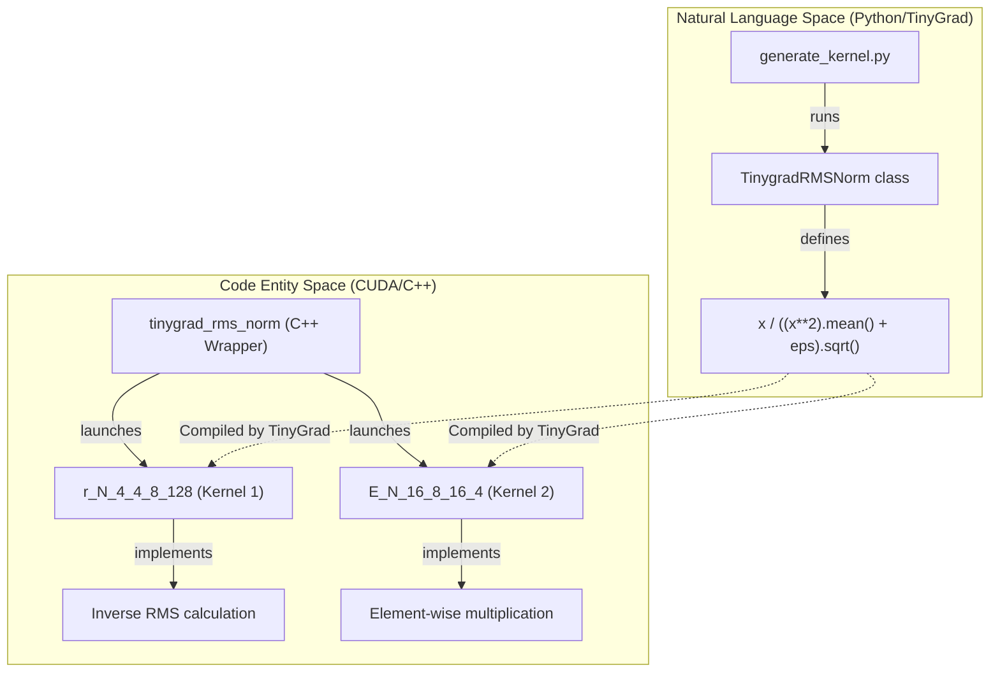
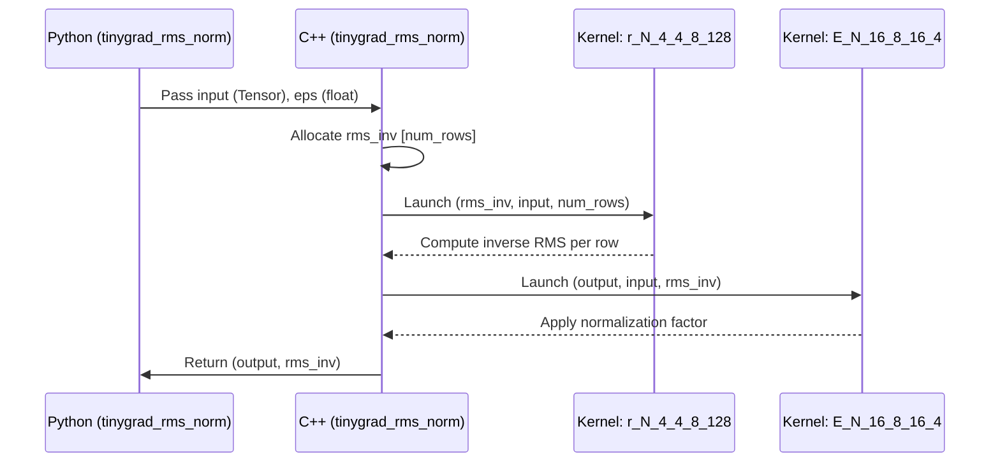

<!-- source: DeepWiki mcp.deepwiki.com · repo huggingface/kernels-community · extra page Liger Kernels and TinyGrad RMS · fetched 2026-10-26 -->

# Liger Kernels and TinyGrad RMS

<details>
<summary>Relevant source files</summary>

The following files were used as context for generating this wiki page:

- [liger-kernels/build.toml](liger-kernels/build.toml)
- [liger-kernels/flake.lock](liger-kernels/flake.lock)
- [liger-kernels/flake.nix](liger-kernels/flake.nix)
- [tinygrad-rms/README.md](tinygrad-rms/README.md)
- [tinygrad-rms/build.toml](tinygrad-rms/build.toml)
- [tinygrad-rms/flake.lock](tinygrad-rms/flake.lock)
- [tinygrad-rms/flake.nix](tinygrad-rms/flake.nix)
- [tinygrad-rms/scripts/generate_kernel.py](tinygrad-rms/scripts/generate_kernel.py)
- [tinygrad-rms/scripts/readme_example.py](tinygrad-rms/scripts/readme_example.py)
- [tinygrad-rms/tests/test_tinygrad_rms.py](tinygrad-rms/tests/test_tinygrad_rms.py)
- [tinygrad-rms/tinygrad_rms_cuda/tinygrad_rms.cu](tinygrad-rms/tinygrad_rms_cuda/tinygrad_rms.cu)
- [tinygrad-rms/torch-ext/tinygrad_rms/__init__.py](tinygrad-rms/torch-ext/tinygrad_rms/__init__.py)
- [tinygrad-rms/torch-ext/torch_binding.cpp](tinygrad-rms/torch-ext/torch_binding.cpp)
- [tinygrad-rms/torch-ext/torch_binding.h](tinygrad-rms/torch-ext/torch_binding.h)

</details>


This page documents two specialized RMSNorm implementations within the `kernels-community` repository: the **Liger Kernels** (Triton-based) and the **TinyGrad RMS** (CUDA-based, compiler-generated). While both provide Root Mean Square Layer Normalization, they differ significantly in their implementation philosophy, supported backends, and optimization targets.

## 1. Liger Kernels

The `liger-kernels` package provides high-performance Triton-based kernels designed for efficiency in Large Language Model (LLM) training. It supports multiple hardware backends including CUDA, ROCm, and XPU [liger-kernels/build.toml:4-8]().

### Implementation and Features
Liger's RMSNorm is characterized by:
*   **Triton-based:** Leverages the Triton programming language for high-level GPU programming.
*   **Multi-Backend:** Broad compatibility across NVIDIA, AMD, and Intel GPUs [liger-kernels/build.toml:4-8]().
*   **In-place Backward:** Optimized memory usage during training by performing backward passes in-place where possible.
*   **Llama Casting Mode:** Specific optimizations for Llama-style architectures, handling precision casting (e.g., FP32 accumulation for BF16 inputs) to maintain numerical stability.

### Architecture Overview
The Liger kernel suite is integrated into the `kernels-community` infrastructure using a standard Nix flake and build configuration [liger-kernels/flake.nix:1-17]().

**Sources:** [liger-kernels/build.toml:1-15](), [liger-kernels/flake.nix:1-17]()

---

## 2. TinyGrad RMS

The `tinygrad-rms` kernel is a specialized implementation of RMSNorm where the CUDA source code is generated using the **TinyGrad** compiler [tinygrad-rms/README.md:8-12](). This approach allows for highly specialized assembly-like CUDA code that is mathematically optimized for specific shapes.

### Kernel Generation Flow
The kernel source in `tinygrad_rms_cuda/tinygrad_rms.cu` is not written by hand. Instead, it is generated by `scripts/generate_kernel.py` [tinygrad-rms/scripts/generate_kernel.py:7-18]().

1.  **Define Logic:** The RMSNorm logic is defined using the `tinygrad.Tensor` API [tinygrad-rms/scripts/generate_kernel.py:26-35]().
2.  **Lowering:** The TinyGrad engine lowers the high-level tensor operations into a schedule [tinygrad-rms/scripts/generate_kernel.py:50-55]().
3.  **Source Extraction:** The `CompiledRunner` extracts the optimized CUDA C++ string from the compiled schedule [tinygrad-rms/scripts/generate_kernel.py:56-59]().

### Two-Kernel Execution Model
The implementation splits the RMSNorm operation into two distinct CUDA kernels to maximize throughput for its target shape [tinygrad-rms/tinygrad_rms_cuda/tinygrad_rms.cu:9-77]():

| Kernel Name | Function | Grid/Block Configuration |
| :--- | :--- | :--- |
| `r_N_4_4_8_128` | Computes $1/\sqrt{mean(x^2) + \epsilon}$ (the inverse RMS) for every row. | Grid: `num_rows/16`, Block: `(4, 8)` [tinygrad-rms/tinygrad_rms_cuda/tinygrad_rms.cu:10-12]() |
| `E_N_16_8_16_4` | Multiplies the original input by the computed inverse RMS factor. | Grid: `(16, num_rows/8)`, Block: `(8, 16)` [tinygrad-rms/tinygrad_rms_cuda/tinygrad_rms.cu:61-64]() |

### Code Entity Map: Generation to Execution
This diagram shows how the TinyGrad Python definition translates into the final CUDA entities.


**Sources:** [tinygrad-rms/scripts/generate_kernel.py:26-60](), [tinygrad-rms/tinygrad_rms_cuda/tinygrad_rms.cu:9-77]()

---

## 3. Python API and Usage

Both kernels are exposed via the `kernels` library. The `tinygrad-rms` implementation provides two primary interfaces.

### API Reference
*   `tinygrad_rms_norm(x, epsilon, out=None)`: Returns a tuple of `(output, rms_inv)`. The `rms_inv` tensor is useful if the normalization factor is needed for backward passes or further fusion [tinygrad-rms/torch-ext/tinygrad_rms/__init__.py:8-38]().
*   `tinygrad_rms_norm_simple(x, epsilon, out=None)`: Returns only the normalized output tensor [tinygrad-rms/torch-ext/tinygrad_rms/__init__.py:41-63]().

### Constraints
Because the TinyGrad kernels are JIT-optimized for specific hardware behaviors, they have strict input requirements [tinygrad-rms/README.md:19-24]():
*   **Hidden Size:** Must be exactly `1024`.
*   **Row Alignment:** Number of rows must be divisible by `16`.
*   **Dtype:** Only `float32` is supported.
*   **Device:** CUDA only [tinygrad-rms/build.toml:5]().

### Usage Example
```python
import torch
from kernels import get_kernel

# Load the kernel from the Hub
tinygrad_rms = get_kernel("kernels-community/tinygrad-rms")

# Input must meet constraints: hidden_size=1024, float32, CUDA
x = torch.randn(32, 512, 1024, dtype=torch.float32, device="cuda")

# Simple usage
output = tinygrad_rms.tinygrad_rms_norm_simple(x, epsilon=1e-6)
```
**Sources:** [tinygrad-rms/README.md:28-54](), [tinygrad-rms/torch-ext/tinygrad_rms/__init__.py:8-63]()

---

## 4. Technical Implementation Details

### Data Flow in TinyGrad RMS
The C++ binding handles the transition from PyTorch Tensors to raw CUDA pointers, ensuring the device guard is active and the input is contiguous [tinygrad-rms/tinygrad_rms_cuda/tinygrad_rms.cu:79-103]().



### Registration and Binding
The kernels are registered into the PyTorch dispatcher using `TORCH_LIBRARY_EXPAND` [tinygrad-rms/torch-ext/torch_binding.cpp:6-12]().
*   **Library:** `ops`
*   **Functions:** `tinygrad_rms_norm` and `tinygrad_rms_norm_inplace` [tinygrad-rms/torch-ext/torch_binding.cpp:7-8]().
*   **Dispatch:** `torch::kCUDA` [tinygrad-rms/torch-ext/torch_binding.cpp:10-11]().

**Sources:** [tinygrad-rms/tinygrad_rms_cuda/tinygrad_rms.cu:79-131](), [tinygrad-rms/torch-ext/torch_binding.cpp:1-15](), [tinygrad-rms/torch-ext/torch_binding.h:1-15]()

---

