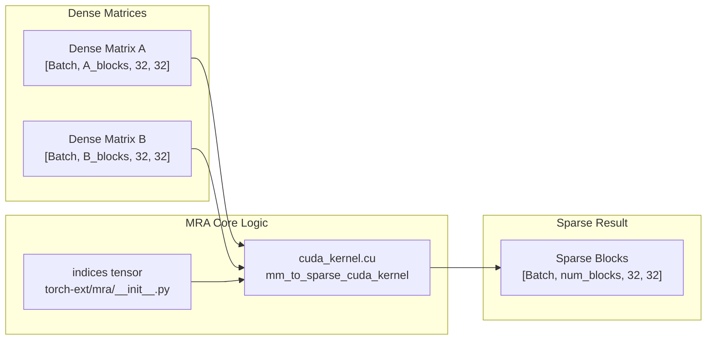
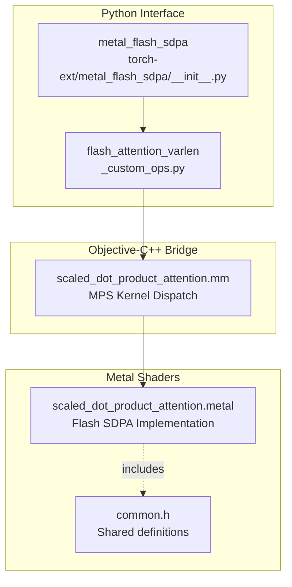

<!-- source: DeepWiki mcp.deepwiki.com · repo huggingface/kernels-community · extra page MRA: Multi-Resolution Attention and Metal Flash SDPA · fetched 2026-10-26 -->

# MRA: Multi-Resolution Attention and Metal Flash SDPA

<details>
<summary>Relevant source files</summary>

The following files were used as context for generating this wiki page:

- [metal-flash-sdpa/README.md](metal-flash-sdpa/README.md)
- [metal-flash-sdpa/benchmark.py](metal-flash-sdpa/benchmark.py)
- [metal-flash-sdpa/build.toml](metal-flash-sdpa/build.toml)
- [metal-flash-sdpa/flake.lock](metal-flash-sdpa/flake.lock)
- [metal-flash-sdpa/flake.nix](metal-flash-sdpa/flake.nix)
- [metal-flash-sdpa/sdpa-metal/common.h](metal-flash-sdpa/sdpa-metal/common.h)
- [metal-flash-sdpa/sdpa-metal/scaled_dot_product_attention.metal](metal-flash-sdpa/sdpa-metal/scaled_dot_product_attention.metal)
- [metal-flash-sdpa/sdpa-metal/scaled_dot_product_attention.mm](metal-flash-sdpa/sdpa-metal/scaled_dot_product_attention.mm)
- [metal-flash-sdpa/tests/__init__.py](metal-flash-sdpa/tests/__init__.py)
- [metal-flash-sdpa/tests/test_flash_attention.py](metal-flash-sdpa/tests/test_flash_attention.py)
- [metal-flash-sdpa/torch-ext/metal_flash_sdpa/__init__.py](metal-flash-sdpa/torch-ext/metal_flash_sdpa/__init__.py)
- [metal-flash-sdpa/torch-ext/metal_flash_sdpa/_custom_ops.py](metal-flash-sdpa/torch-ext/metal_flash_sdpa/_custom_ops.py)
- [mra/README.md](mra/README.md)
- [mra/build.toml](mra/build.toml)
- [mra/flake.lock](mra/flake.lock)
- [mra/flake.nix](mra/flake.nix)
- [mra/mra/cuda_kernel.cu](mra/mra/cuda_kernel.cu)
- [mra/mra/cuda_kernel.h](mra/mra/cuda_kernel.h)
- [mra/mra/cuda_launch.cu](mra/mra/cuda_launch.cu)
- [mra/mra/cuda_launch.h](mra/mra/cuda_launch.h)
- [mra/scripts/readme_example.py](mra/scripts/readme_example.py)
- [mra/torch-ext/cuda_launch.h](mra/torch-ext/cuda_launch.h)
- [mra/torch-ext/mra/__init__.py](mra/torch-ext/mra/__init__.py)

</details>


## Purpose and Scope

This page documents two distinct but related attention optimization kernels:
1.  **MRA (Multi-Resolution Attention)**: A CUDA-based suite of operations for block-sparse attention patterns, enabling memory-efficient mechanisms that scale beyond standard dense attention by restricting computation to 32×32 blocks.
2.  **Metal Flash SDPA**: A high-performance Scaled Dot-Product Attention implementation for Apple Silicon (Metal/MPS). It supports variable-length sequences, Grouped Query Attention (GQA), and causal masking, optimized for the Unified Memory Architecture of Mac hardware.

**Sources**: [mra/README.md:1-68](), [metal-flash-sdpa/README.md:1-20]()

---

## 1. MRA: Multi-Resolution Attention (CUDA)

MRA provides specialized CUDA operations for block-sparse attention where computation is restricted to a subset of 32×32 blocks. It supports five core sparse operations: dense-to-sparse matrix multiplication, sparse-to-dense matrix multiplication, block indexing with max reduction, row-wise sum reduction, and scatter operations.

### Kernel Architecture

The MRA kernel suite consists of five fundamental operations that work with a fixed 32×32 block granularity. Blocks are indexed through an indirection table mapping logical positions to dense matrix locations.

| Operation | Purpose | Input Types | Output Type |
|-----------|---------|-------------|-------------|
| `index_max` | Find maximum values per block with scatter | sparse indices + values | dense max values + scattered max |
| `mm_to_sparse` | Dense×Dense → Sparse multiplication | 2 dense matrices + indices | sparse blocks |
| `sparse_dense_mm` | Sparse×Dense multiplication | sparse blocks + indices + dense | dense matrix |
| `reduce_sum` | Row-wise sum of sparse blocks | sparse blocks + indices | dense vector |
| `scatter` | Broadcast dense to sparse blocks | dense vector + indices | sparse blocks |

**Sources**: [mra/torch-ext/mra/__init__.py:1-25](), [mra/mra/cuda_kernel.h:1-60]()

### MRA Block-Sparse Mapping



**Sources**: [mra/mra/cuda_kernel.cu:60-70](), [mra/mra/cuda_launch.cu:40-69](), [mra/scripts/readme_example.py:30-43]()

### Implementation Details

*   **Index Encoding**: Indices use a linearized encoding: `AB_block_idx = A_block_idx * B_num_block + B_block_idx`. This allows recovery via integer division and modulo [mra/mra/cuda_kernel.cu:38-39]().
*   **Optimization**: Kernels use register blocking (4×4 tiles per thread) and double buffering to overlap memory loads with computation [mra/mra/cuda_kernel.cu:95-148]().
*   **Atomic Ops**: Uses `atomicMax` (integer-mapped) for stability and `atomicAdd` for accumulation [mra/mra/cuda_kernel.cu:38-40](), [mra/mra/cuda_kernel.cu:297]().

**Sources**: [mra/mra/cuda_kernel.cu:1-384](), [mra/mra/cuda_launch.cu:1-155]()

---

## 2. Metal Flash SDPA (Apple Silicon)

Metal Flash SDPA is an optimized attention kernel for Apple Silicon (M1/M2/M3/M4) that implements the FlashAttention algorithm principles in Metal Shading Language (MSL). It is designed to handle the `scaled_dot_product_attention` workload efficiently on MPS backends.

### Key Features
*   **Variable Length Support**: Uses cumulative sequence length tensors (`cu_seqlens_q`, `cu_seqlens_k`) to handle batches with different sequence lengths without padding [metal-flash-sdpa/torch-ext/metal_flash_sdpa/_custom_ops.py:8-15]().
*   **GQA Support**: Efficiently handles Grouped Query Attention by broadcasting KV heads to multiple Q heads [metal-flash-sdpa/tests/test_flash_attention.py:147-152]().
*   **Dtype Support**: Supports `float32`, `float16`, and `bfloat16`. Note that `bfloat16` is implemented via a custom struct and bit manipulation for hardware that lacks native BF16 support [metal-flash-sdpa/sdpa-metal/scaled_dot_product_attention.metal:57-130]().

### Code Entity Mapping



**Sources**: [metal-flash-sdpa/torch-ext/metal_flash_sdpa/__init__.py:1-12](), [metal-flash-sdpa/sdpa-metal/scaled_dot_product_attention.mm:1-10](), [metal-flash-sdpa/sdpa-metal/scaled_dot_product_attention.metal:1-10]()

### Python API

The kernel is exposed via the `metal_flash_sdpa` package:

```python
import metal_flash_sdpa

metal_flash_sdpa.flash_attention_varlen(
    out=out_tensor,
    query=q,               # [total_q, num_heads, head_dim]
    key=k,                 # [total_k, num_kv_heads, head_dim]
    value=v,               # [total_k, num_kv_heads, head_dim]
    cu_seqlens_q=cu_q,     # Cumulative sequence lengths for Q
    cu_seqlens_k=cu_k,     # Cumulative sequence lengths for K
    max_seqlen_q=max_q,
    max_seqlen_k=max_k,
    do_causal=True,
    scale=1.0 / (head_dim**0.5),
    softcapping=1.0
)
```

**Sources**: [metal-flash-sdpa/torch-ext/metal_flash_sdpa/_custom_ops.py:1-35](), [metal-flash-sdpa/tests/test_flash_attention.py:102-114]()

### Performance and Benchmarking

The Metal implementation shows significant speedups over naive MPS SDPA (e.g., `torch.nn.functional.scaled_dot_product_attention`) as sequence length increases. The benchmark script compares execution time for causal masking across various sequence lengths (512 to 4096) [metal-flash-sdpa/benchmark.py:145-170]().

**Sources**: [metal-flash-sdpa/benchmark.py:130-172]()

---

## Build and Infrastructure

Both kernels utilize the Nix-based build system provided by `kernel-builder`.

### MRA Build Config
*   **Backend**: CUDA [mra/build.toml:4]()
*   **Hub ID**: `kernels-community/mra` [mra/build.toml:8]()
*   **Sources**: Includes `cuda_kernel.cu` and `cuda_launch.cu` [mra/build.toml:19-24]().

### Metal Flash SDPA Build Config
*   **Backend**: Metal [metal-flash-sdpa/build.toml:5]()
*   **Hub ID**: `kernels-community/metal-flash-sdpa` [metal-flash-sdpa/build.toml:9]()
*   **Sources**: Includes `.mm` (Objective-C++) and `.metal` (MSL) files [metal-flash-sdpa/build.toml:20-24]().

**Sources**: [mra/build.toml:1-25](), [metal-flash-sdpa/build.toml:1-25](), [mra/flake.nix:1-17](), [metal-flash-sdpa/flake.nix:1-17]()

---

