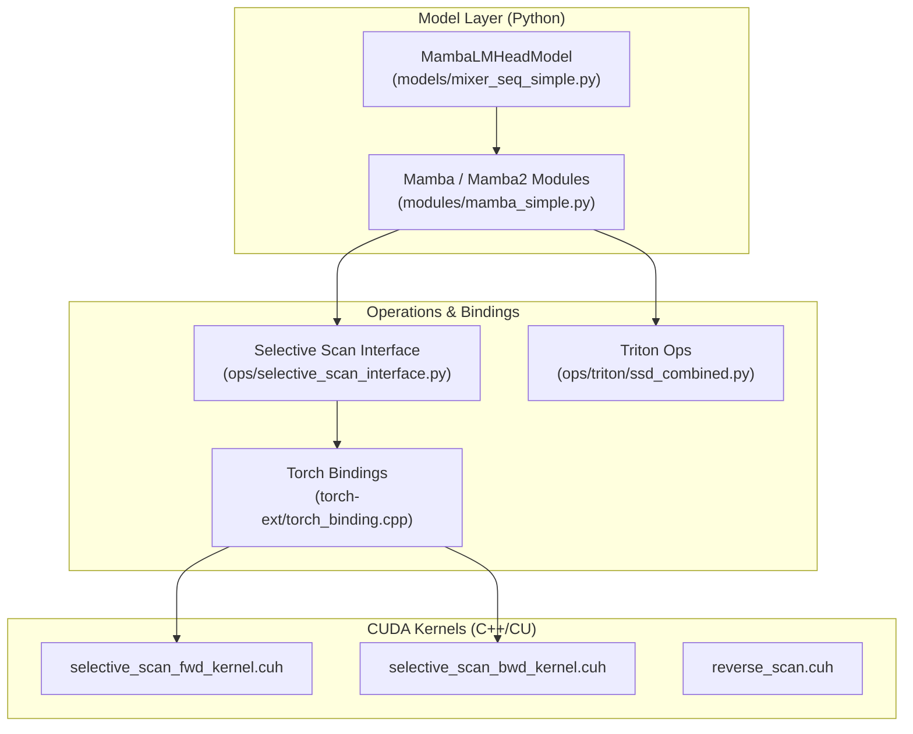
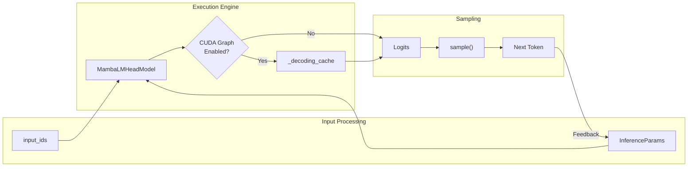

<!-- source: DeepWiki mcp.deepwiki.com · repo huggingface/kernels-community · extra page Mamba SSM: State Space Model Kernels · fetched 2026-10-26 -->

# Mamba SSM: State Space Model Kernels

Relevant source files

The following files were used as context for generating this wiki page:

- [flake.lock](flake.lock)
- [flake.nix](flake.nix)
- [mamba-ssm/build.toml](mamba-ssm/build.toml)
- [mamba-ssm/flake.lock](mamba-ssm/flake.lock)
- [mamba-ssm/flake.nix](mamba-ssm/flake.nix)
- [mamba-ssm/torch-ext/mamba_ssm/__init__.py](mamba-ssm/torch-ext/mamba_ssm/__init__.py)
- [mamba-ssm/torch-ext/mamba_ssm/models/__init__.py](mamba-ssm/torch-ext/mamba_ssm/models/__init__.py)
- [mamba-ssm/torch-ext/mamba_ssm/modules/__init__.py](mamba-ssm/torch-ext/mamba_ssm/modules/__init__.py)
- [mamba-ssm/torch-ext/mamba_ssm/ops/__init__.py](mamba-ssm/torch-ext/mamba_ssm/ops/__init__.py)
- [mamba-ssm/torch-ext/mamba_ssm/ops/triton/__init__.py](mamba-ssm/torch-ext/mamba_ssm/ops/triton/__init__.py)
- [mamba-ssm/torch-ext/mamba_ssm/utils/generation.py](mamba-ssm/torch-ext/mamba_ssm/utils/generation.py)

## Purpose and Scope

This page documents the `mamba-ssm` kernel collection, providing high-performance CUDA implementations for State Space Models (SSMs). The package includes the core `selective_scan` kernels, the `MambaLMHeadModel` architecture for inference, and advanced decoding features such as CUDA graph support and specialized sampling strategies (top-k, top-p, min-p). These kernels are designed to enable linear-time sequence modeling with hardware-aware optimizations.

Sources: [mamba-ssm/build.toml:1-5](), [mamba-ssm/torch-ext/mamba_ssm/__init__.py:3-12]()

## Overview and Architecture

The Mamba implementation bridges the gap between theoretical State Space Models and efficient GPU execution through fused kernels. The architecture is centered around the Selective Scan operation, which allows the model to filter or remember information based on the input sequence.

### Code Entity Space Mapping

The following diagram maps the high-level Mamba components to their specific implementation files and classes within the repository:

Sources: [mamba-ssm/torch-ext/mamba_ssm/models/__init__.py:1-4](), [mamba-ssm/torch-ext/mamba_ssm/modules/__init__.py:1-7](), [mamba-ssm/torch-ext/mamba_ssm/ops/__init__.py:1-1](), [mamba-ssm/build.toml:17-38]()

## Selective Scan Kernels

The core of Mamba is the `selective_scan` operation. Unlike standard convolutions or self-attention, selective scan requires a recurrent-style computation that is traditionally difficult to parallelize. The `mamba-ssm` implementation uses a "parallel scan" approach fused into CUDA kernels to maintain $O(L)$ complexity while utilizing GPU parallelism.

### Kernel Variants and Dispatch

The build system compiles multiple variants of the scan kernel to handle different data types and numerical requirements:

| Kernel Type | Source Files | Data Types Supported |
| :--- | :--- | :--- |
| **Forward Scan** | `selective_scan_fwd_*.cu` | BF16, FP16, FP32 |
| **Backward Scan (Real)** | `selective_scan_bwd_*_real.cu` | BF16, FP16, FP32 |
| **Backward Scan (Complex)** | `selective_scan_bwd_*_complex.cu` | BF16, FP16, FP32 |

The implementation uses `static_switch.h` to dispatch to the correct kernel specialization at runtime based on input types and dimensions.

Sources: [mamba-ssm/build.toml:21-36](), [mamba-ssm/selective-scan/selective_scan.cpp:20-30]()

## Inference and Decoding

Mamba's recurrent nature allows for extremely efficient inference. The repository provides a specialized `decode` function and `InferenceParams` class to manage the hidden state (KV-equivalent) during generation.

### Inference Data Flow

### InferenceParams
The `InferenceParams` dataclass tracks the state of the sequence during step-by-step generation:
- `max_seqlen`: The total length of the generation window. [mamba-ssm/torch-ext/mamba_ssm/utils/generation.py:21]()
- `seqlen_offset`: Tracks the current position in the sequence. [mamba-ssm/torch-ext/mamba_ssm/utils/generation.py:23]()
- `key_value_memory_dict`: Stores the recurrent states for each layer. [mamba-ssm/torch-ext/mamba_ssm/utils/generation.py:25]()

### CUDA Graph Decoding
For small batch sizes, CPU overhead can become a bottleneck. The `decode` function supports CUDA Graphs (`cg=True`) to capture the entire decoding step into a single executable graph on the GPU.
- The model maintains a `_decoding_cache` to store the captured graph. [mamba-ssm/torch-ext/mamba_ssm/utils/generation.py:158-160]()
- `update_graph_cache` is called to initialize or update the graph when batch sizes or sequence lengths change. [mamba-ssm/torch-ext/mamba_ssm/utils/generation.py:160-166]()

Sources: [mamba-ssm/torch-ext/mamba_ssm/utils/generation.py:17-35](), [mamba-ssm/torch-ext/mamba_ssm/utils/generation.py:120-170]()

## Sampling Strategies

The `sample` function in `mamba_ssm.utils.generation` implements several filtering techniques to improve generation quality:

1.  **Top-K**: Limits sampling to the $K$ most likely tokens. [mamba-ssm/torch-ext/mamba_ssm/utils/generation.py:44-47]()
2.  **Top-P (Nucleus)**: Limits sampling to the smallest set of tokens whose cumulative probability exceeds $P$. [mamba-ssm/torch-ext/mamba_ssm/utils/generation.py:52-65]()
3.  **Min-P**: Filters tokens based on a minimum probability relative to the most likely token. [mamba-ssm/torch-ext/mamba_ssm/utils/generation.py:36-41]()
4.  **Repetition Penalty**: Scales logits of previously seen tokens to discourage loops. [mamba-ssm/torch-ext/mamba_ssm/utils/generation.py:68-79]()

Sources: [mamba-ssm/torch-ext/mamba_ssm/utils/generation.py:82-116]()

## Build and Dependencies

The `mamba-ssm` kernel is built using the Nix-based `kernel-builder` system.

- **Backend**: Exclusively supports CUDA. [mamba-ssm/build.toml:4]()
- **Python Dependencies**: Requires `einops`. [mamba-ssm/build.toml:6]()
- **Build Inputs**: Includes `causal-conv1d` for the full Mamba block functionality. [mamba-ssm/flake.nix:21-29]()

The `selective_scan` kernel depends on the `torch` extension for tensor management and binding. [mamba-ssm/build.toml:19]()

Sources: [mamba-ssm/build.toml:1-10](), [mamba-ssm/flake.nix:1-30]()

---

