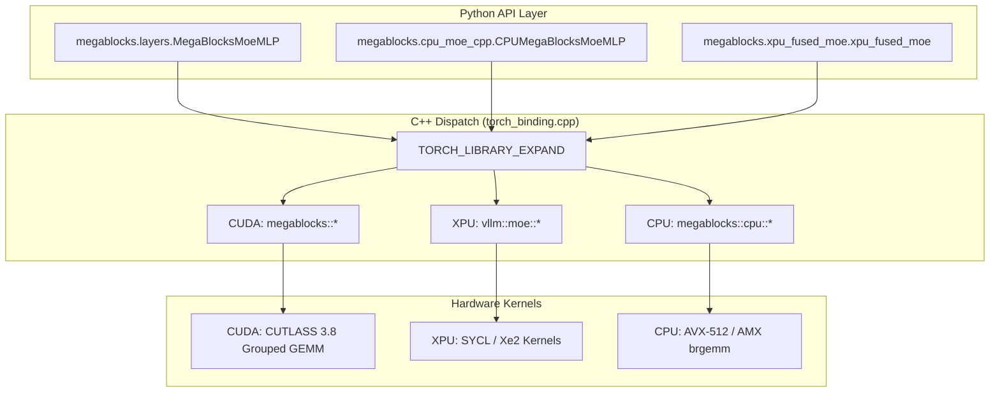
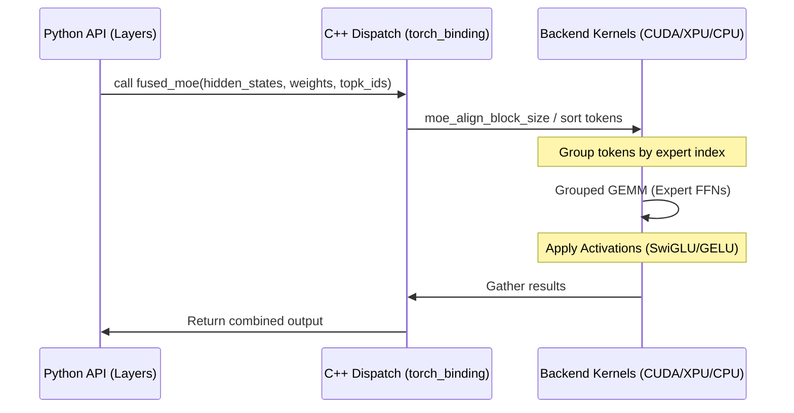

<!-- source: DeepWiki mcp.deepwiki.com · repo huggingface/kernels-community · extra page MegaBlocks: Mixture of Experts GEMM · fetched 2026-10-26 -->

# MegaBlocks: Mixture of Experts GEMM

Relevant source files

The following files were used as context for generating this wiki page:

- [megablocks/build.toml](megablocks/build.toml)
- [megablocks/csrc_cpu/common.h](megablocks/csrc_cpu/common.h)
- [megablocks/csrc_cpu/cpu_features.hpp](megablocks/csrc_cpu/cpu_features.hpp)
- [megablocks/csrc_cpu/cpu_moe_fp.cpp](megablocks/csrc_cpu/cpu_moe_fp.cpp)
- [megablocks/csrc_cpu/cpu_moe_int8.cpp](megablocks/csrc_cpu/cpu_moe_int8.cpp)
- [megablocks/csrc_cpu/cpu_moe_kernel.cpp](megablocks/csrc_cpu/cpu_moe_kernel.cpp)
- [megablocks/csrc_cpu/moe_dispatcher.cpp](megablocks/csrc_cpu/moe_dispatcher.cpp)
- [megablocks/csrc_cpu/moe_dispatcher.h](megablocks/csrc_cpu/moe_dispatcher.h)
- [megablocks/csrc_cpu/moe_fallback.cpp](megablocks/csrc_cpu/moe_fallback.cpp)
- [megablocks/csrc_cpu/moe_fallback.h](megablocks/csrc_cpu/moe_fallback.h)
- [megablocks/csrc_cpu/moe_ops.h](megablocks/csrc_cpu/moe_ops.h)
- [megablocks/csrc_xpu/moe/fused_moe_prologue.cpp](megablocks/csrc_xpu/moe/fused_moe_prologue.cpp)
- [megablocks/csrc_xpu/moe/moe_gather.cpp](megablocks/csrc_xpu/moe/moe_gather.cpp)
- [megablocks/csrc_xpu/moe/moe_ops.h](megablocks/csrc_xpu/moe/moe_ops.h)
- [megablocks/flake.lock](megablocks/flake.lock)
- [megablocks/flake.nix](megablocks/flake.nix)
- [megablocks/torch-ext/megablocks/cpu_fused_moe.py](megablocks/torch-ext/megablocks/cpu_fused_moe.py)
- [megablocks/torch-ext/megablocks/cpu_moe_cpp.py](megablocks/torch-ext/megablocks/cpu_moe_cpp.py)
- [megablocks/torch-ext/megablocks/layers.py](megablocks/torch-ext/megablocks/layers.py)
- [megablocks/torch-ext/megablocks/xpu_fused_moe.py](megablocks/torch-ext/megablocks/xpu_fused_moe.py)
- [megablocks/torch-ext/torch_binding.cpp](megablocks/torch-ext/torch_binding.cpp)

## Purpose and Scope

The MegaBlocks kernel provides high-performance implementations for Mixture of Experts (MoE) layers. It specializes in efficient sparse expert routing and grouped GEMM operations, allowing models to scale parameters significantly without a proportional increase in compute cost. MegaBlocks supports **CUDA**, **XPU** (Intel GPU), and **CPU** (AVX-512/AMX) backends, integrating with libraries like **CUTLASS 3.8** and **sycl_tla** for hardware-specific optimizations.

Sources: [megablocks/build.toml:1-9](), [megablocks/build.toml:37-40](), [megablocks/build.toml:57-62]()

## System Architecture

MegaBlocks is structured as a multi-backend kernel library exposed via a unified Python API. It utilizes the `kernel-builder` infrastructure to dispatch operations to the appropriate hardware backend.

**Diagram: MegaBlocks Multi-Backend Architecture**

Sources: [megablocks/torch-ext/torch_binding.cpp:1-25](), [megablocks/torch-ext/megablocks/layers.py:6-7](), [megablocks/torch-ext/megablocks/cpu_moe_cpp.py:12](), [megablocks/torch-ext/megablocks/xpu_fused_moe.py:6]()

## Backend Implementations

### CUDA Backend
The CUDA implementation leverages **CUTLASS 3.8** for Grouped GEMM operations. It includes specialized kernels for data preparation such as histogram calculation, sorting, and prefix sums to organize tokens for expert processing.

*   **Grouped GEMM**: Executes multiple independent GEMMs (one per expert) in a single kernel launch [megablocks/torch-ext/torch_binding.cpp:92-95]().
*   **Routing Utilities**: Includes `sort`, `histogram`, `inclusive_cumsum`, and `exclusive_cumsum` for token-to-expert mapping [megablocks/torch-ext/torch_binding.cpp:27-50]().
*   **Replication**: `replicate_forward` and `replicate_backward` handle dynamic vector replication for routing [megablocks/torch-ext/torch_binding.cpp:63-79]().

Sources: [megablocks/build.toml:21-55](), [megablocks/torch-ext/torch_binding.cpp:107-132]()

### XPU (Intel GPU) Backend
The XPU backend uses SYCL and the `sycl_tla` library. It features a fused prologue and specialized "Xe2" GEMM interfaces.

*   **Fused Moe Prologue**: Combines token selection, scaling, and workspace preparation [megablocks/csrc_xpu/moe/fused_moe_prologue.cpp:7-16]().
*   **Moe Gather**: A SYCL kernel that gathers expert outputs back to the original token order [megablocks/csrc_xpu/moe/moe_gather.cpp:182-192]().
*   **Grouped Top-K**: Implements `grouped_topk` and `fused_grouped_topk` for sophisticated expert selection strategies [megablocks/csrc_xpu/moe/moe_ops.h:37-55]().

Sources: [megablocks/build.toml:57-86](), [megablocks/torch-ext/megablocks/xpu_fused_moe.py:20-77]()

### CPU Backend
The CPU implementation is optimized for Intel architectures with **AVX-512** and **AMX** (Advanced Matrix Extensions) support.

*   **brgemm Optimization**: Uses `at::native::cpublas::brgemm` for efficient batch GEMM on Intel CPUs [megablocks/torch-ext/megablocks/cpu_moe_cpp.py:49]().
*   **Quantization Support**: Includes kernels for **INT8 (W8A8)**, **FP8 (W8A16)**, and **MXFP4** [megablocks/csrc_cpu/moe_ops.h:144-162]().
*   **VNNI Packing**: Weights are converted to VNNI (Vector Neural Network Instructions) packed format during model loading for optimal throughput [megablocks/csrc_cpu/moe_ops.h:133-137]().

Sources: [megablocks/build.toml:88-130](), [megablocks/csrc_cpu/cpu_moe_fp.cpp:1-22]()

## Data Flow and Expert Routing

The following diagram illustrates the token routing and computation flow within the MegaBlocks system.

**Diagram: MegaBlocks Data Flow**

Sources: [megablocks/torch-ext/megablocks/xpu_fused_moe.py:193-209](), [megablocks/torch-ext/megablocks/cpu_moe_cpp.py:25-45](), [megablocks/csrc_xpu/moe/moe_ops.h:7-13]()

## Python Layers API

### MegaBlocksMoeMLP
The standard MoE MLP layer. It patches internal operations like `sort`, `histogram`, and `gather` with meta-kernels to support `torch.compile` [megablocks/torch-ext/megablocks/layers.py:31-48]().

### CPUMegaBlocksMoeMLP
A drop-in replacement for CPU-based inference. It automatically handles weight conversion to VNNI format and manages quantization scales for MXFP4/FP8 [megablocks/torch-ext/megablocks/cpu_moe_cpp.py:108-172]().

### XPU Fused MoE
Provides `xpu_fused_moe`, which supports advanced quantization (Int4, MXFP4, FP8) and Expert Parallelism (EP) via `ep_rank` and `ep_size` parameters [megablocks/torch-ext/megablocks/xpu_fused_moe.py:193-209]().

Sources: [megablocks/torch-ext/megablocks/layers.py:1-100](), [megablocks/torch-ext/megablocks/cpu_moe_cpp.py:1-100](), [megablocks/torch-ext/megablocks/xpu_fused_moe.py:1-210]()

## Build and Dependency Management

MegaBlocks uses a Nix-based build system defined in `flake.nix` and `build.toml`.

*   **Nix Flake**: Filters supported systems for CPU builds (currently `x86_64-linux`) and defines Python check inputs like `torchmetrics` and `py-cpuinfo` [megablocks/flake.nix:17-33]().
*   **Build Configuration**: Specifies backend-specific source files and compiler flags (e.g., `-mavx512bf16`, `-mamx-tile` for CPU) [megablocks/build.toml:102-118]().
*   **Dependencies**:
    *   **CUDA**: `cutlass_3_8` [megablocks/build.toml:39]().
    *   **XPU**: `sycl_tla` [megablocks/build.toml:61]().

Sources: [megablocks/flake.nix:1-36](), [megablocks/build.toml:1-131]()

---

