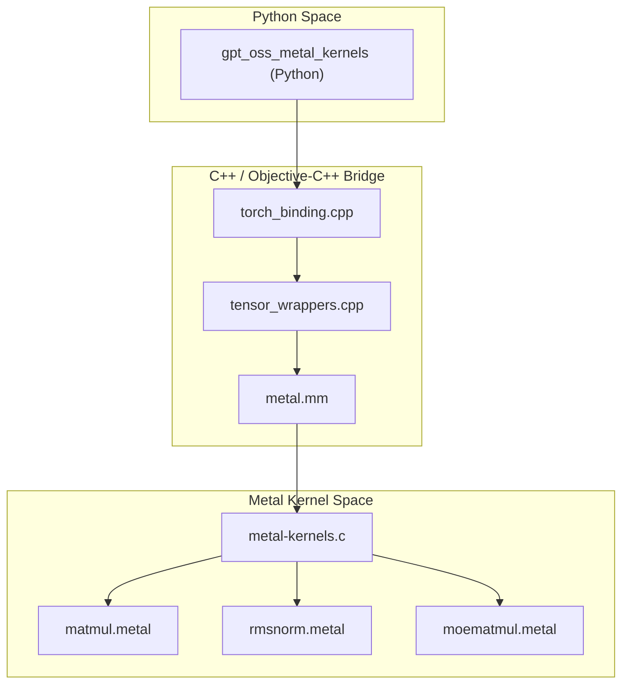
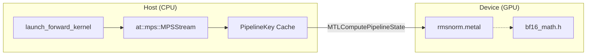

<!-- source: DeepWiki mcp.deepwiki.com · repo huggingface/kernels-community · extra page Metal Kernels Suite and CV Utilities · fetched 2026-10-26 -->

# Metal Kernels Suite and CV Utilities

Relevant source files

The following files were used as context for generating this wiki page:

- [cv-utils/README.md](cv-utils/README.md)
- [cv-utils/build.toml](cv-utils/build.toml)
- [cv-utils/cv_utils/connected_components.cu](cv-utils/cv_utils/connected_components.cu)
- [cv-utils/cv_utils/generic_nms.cu](cv-utils/cv_utils/generic_nms.cu)
- [cv-utils/flake.lock](cv-utils/flake.lock)
- [cv-utils/flake.nix](cv-utils/flake.nix)
- [cv-utils/torch-ext/cv_utils/__init__.py](cv-utils/torch-ext/cv_utils/__init__.py)
- [cv-utils/torch-ext/torch_binding.cpp](cv-utils/torch-ext/torch_binding.cpp)
- [cv-utils/torch-ext/torch_binding.h](cv-utils/torch-ext/torch_binding.h)
- [gpt-oss-metal-kernels/build.toml](gpt-oss-metal-kernels/build.toml)
- [gpt-oss-metal-kernels/flake.lock](gpt-oss-metal-kernels/flake.lock)
- [gpt-oss-metal-kernels/flake.nix](gpt-oss-metal-kernels/flake.nix)
- [mlx-rmsnorm/README](mlx-rmsnorm/README)
- [mlx-rmsnorm/build.toml](mlx-rmsnorm/build.toml)
- [mlx-rmsnorm/flake.lock](mlx-rmsnorm/flake.lock)
- [mlx-rmsnorm/flake.nix](mlx-rmsnorm/flake.nix)
- [mlx-rmsnorm/mlx_rmsnorm/bf16.h](mlx-rmsnorm/mlx_rmsnorm/bf16.h)
- [mlx-rmsnorm/mlx_rmsnorm/bf16_math.h](mlx-rmsnorm/mlx_rmsnorm/bf16_math.h)
- [mlx-rmsnorm/mlx_rmsnorm/complex.h](mlx-rmsnorm/mlx_rmsnorm/complex.h)
- [mlx-rmsnorm/mlx_rmsnorm/defines.h](mlx-rmsnorm/mlx_rmsnorm/defines.h)
- [mlx-rmsnorm/mlx_rmsnorm/metal_rmsnorm.h](mlx-rmsnorm/mlx_rmsnorm/metal_rmsnorm.h)
- [mlx-rmsnorm/mlx_rmsnorm/metal_rmsnorm.mm](mlx-rmsnorm/mlx_rmsnorm/metal_rmsnorm.mm)
- [mlx-rmsnorm/mlx_rmsnorm/rmsnorm.metal](mlx-rmsnorm/mlx_rmsnorm/rmsnorm.metal)
- [mlx-rmsnorm/torch-ext/mlx_rmsnorm/__init__.py](mlx-rmsnorm/torch-ext/mlx_rmsnorm/__init__.py)

This page documents specialized kernel suites for Apple Silicon (Metal) and general-purpose Computer Vision (CV) utilities. These include the **GPT-OSS Metal Kernels** for comprehensive transformer operations on Mac, the **MLX RMSNorm** port for optimized normalization, and **CV-Utils** for common vision tasks like Non-Maximum Suppression (NMS).

## 1. GPT-OSS Metal Kernels Suite

The `gpt-oss-metal-kernels` package provides a comprehensive suite of Metal Shading Language (MSL) kernels specifically optimized for Apple Silicon. It covers the essential operations required for Large Language Model (LLM) inference and training on macOS [gpt-oss-metal-kernels/build.toml:1-5]().

### 1.1 Implementation and Data Flow
The suite uses a unified build system where Metal source files (`.metal`) are compiled and linked via Objective-C++ (`.mm`) wrappers [gpt-oss-metal-kernels/build.toml:24-46](). The data flow typically involves wrapping PyTorch tensors into internal C++ abstractions before dispatching to the Metal GPU.

**Core Kernel Categories:**
| Category | Source Files | Purpose |
| :--- | :--- | :--- |
| **Linear Algebra** | `matmul.metal`, `moematmul.metal` | Optimized GEMM and Mixture-of-Experts (MoE) matrix multiplication [gpt-oss-metal-kernels/build.toml:40,43](). |
| **Normalization** | `rmsnorm.metal` | Root Mean Square Layer Normalization [gpt-oss-metal-kernels/build.toml:41](). |
| **Attention** | `sdpa.metal`, `rope.metal` | Scaled Dot-Product Attention and Rotary Positional Embeddings [gpt-oss-metal-kernels/build.toml:39,45](). |
| **MoE Routing** | `expert_routing_metadata.metal`, `scatter.metal`, `gather_and_accumulate.metal` | Infrastructure for expert dispatch and result aggregation [gpt-oss-metal-kernels/build.toml:31,33,46](). |
| **Sampling** | `topk.metal`, `sample.metal`, `random.metal` | Token generation utilities including Top-K and stochastic sampling [gpt-oss-metal-kernels/build.toml:34,42,38](). |

### 1.2 System Architecture Diagram
The following diagram illustrates how the Python-facing PyTorch extension interacts with the underlying Metal infrastructure.

**GPT-OSS Metal Dispatch Architecture**

Sources: [gpt-oss-metal-kernels/build.toml:12-14](), [gpt-oss-metal-kernels/build.toml:32-46]()

---

## 2. MLX RMSNorm (Metal)

The `mlx-rmsnorm` kernel is a high-performance implementation of RMSNorm ported from Apple's MLX framework to work as a PyTorch extension on MPS (Metal Performance Shaders) devices [mlx-rmsnorm/build.toml:1-5]().

### 2.1 Key Components
*   **Kernel Specialization**: The implementation provides specialized kernels for `float32`, `float16`, and `bfloat16` [mlx-rmsnorm/mlx_rmsnorm/metal_rmsnorm.mm:140-152]().
*   **BFloat16 Support**: Since Metal Shading Language (MSL) lacks native `bfloat16` math functions in some versions, the project includes `bf16_math.h` which provides overloaded instantiations for `abs`, `cos`, `exp`, `log`, etc., by handling explicit casting to `float` and back [mlx-rmsnorm/mlx_rmsnorm/bf16_math.h:33-85]().
*   **Pipeline Caching**: To minimize latency, the `getPipeline` function caches `MTLComputePipelineState` objects using a `PipelineKey` that tracks the function name and whether weight gradient computation is enabled [mlx-rmsnorm/mlx_rmsnorm/metal_rmsnorm.mm:85-138]().

### 2.2 Kernel Dispatch Logic
The dispatch system calculates optimal grid sizes based on whether the feature size is within the "looped limit" (4096) or requires SIMD-level optimizations [mlx-rmsnorm/mlx_rmsnorm/metal_rmsnorm.mm:38-40]().

**MLX RMSNorm Entity Relationship**

Sources: [mlx-rmsnorm/mlx_rmsnorm/metal_rmsnorm.mm:206-210](), [mlx-rmsnorm/mlx_rmsnorm/metal_rmsnorm.mm:174-193](), [mlx-rmsnorm/mlx_rmsnorm/bf16_math.h:1-31]()

---

## 3. CV-Utils (CUDA)

The `cv-utils` package provides optimized CUDA kernels for common computer vision post-processing tasks that are often bottlenecks in object detection pipelines [cv-utils/build.toml:1-3]().

### 3.1 Kernel Implementations
*   **Generic NMS**: A CUDA implementation of Non-Maximum Suppression that can be used across different object detection architectures [cv-utils/build.toml:26]().
*   **Connected Components**: A parallel implementation for labeling connected regions in binary images or masks [cv-utils/build.toml:25]().

### 3.2 Build Configuration
The kernels are compiled with specific CUDA flags to manage half-precision (`fp16`) behavior, disabling standard half operators and conversions to ensure manual control over precision within the `.cu` files [cv-utils/build.toml:17-22]().

| Feature | File | Backend |
| :--- | :--- | :--- |
| Connected Components | `cv_utils/connected_components.cu` | CUDA [cv-utils/build.toml:25]() |
| Generic NMS | `cv_utils/generic_nms.cu` | CUDA [cv-utils/build.toml:26]() |

---

## 4. Build and Dependency Management

All three suites utilize the Nix-based `kernel-builder` system to ensure reproducible builds and cross-platform compatibility [gpt-oss-metal-kernels/flake.nix:4-6](), [mlx-rmsnorm/flake.nix:4-6](), [cv-utils/flake.nix:4-6]().

### 4.1 Flake Configuration
The `flake.nix` for these kernels invokes `genKernelFlakeOutputs` or `genFlakeOutputs` from the `kernel-builder` library. This automatically generates build targets for the specified backends (Metal for Mac, CUDA for Linux/Windows) [gpt-oss-metal-kernels/flake.nix:8-13](), [mlx-rmsnorm/flake.nix:8-13]().

### 4.2 Hub Integration
Each kernel is configured for distribution via the Hugging Face Hub, allowing users to load them dynamically [gpt-oss-metal-kernels/build.toml:7-9](), [cv-utils/build.toml:6-7]().

Sources: [gpt-oss-metal-kernels/flake.lock:1-117](), [mlx-rmsnorm/flake.lock:1-117](), [cv-utils/flake.lock:1-117]()

---

