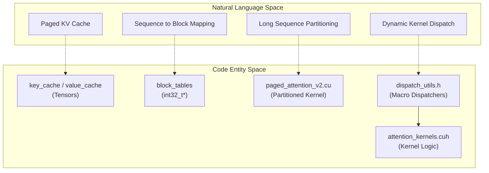
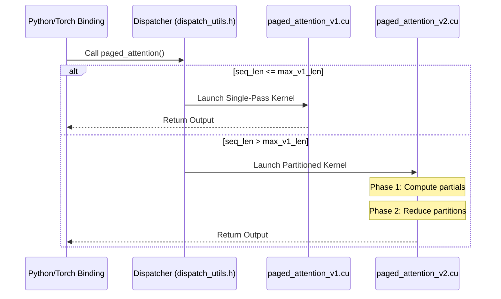

<!-- source: DeepWiki mcp.deepwiki.com · repo huggingface/kernels-community · extra page Paged Attention: CUDA Implementation · fetched 2026-10-26 -->

# Paged Attention: CUDA Implementation

Relevant source files

The following files were used as context for generating this wiki page:

- [paged-attention/build.toml](paged-attention/build.toml)
- [paged-attention/flake.lock](paged-attention/flake.lock)
- [paged-attention/flake.nix](paged-attention/flake.nix)

## Purpose and Scope

This page documents the CUDA implementation of paged attention kernels for memory-efficient inference with variable-length sequences. The CUDA implementation provides optimized kernels for NVIDIA GPUs, featuring specialized block-based KV cache management and support for diverse data types including FP8.

For the Metal/Apple Silicon implementation, see [Paged Attention: Metal Implementation](). For general paged attention concepts and Python API usage, see [Paged Attention]().

## Overview

The CUDA paged attention implementation is designed to handle the Key-Value (KV) cache in non-contiguous memory blocks, solving the memory fragmentation issues common in LLM inference. The implementation is organized into several key components:

- **Core Attention Kernels**: Specialized CUDA kernels (`paged_attention_v1` and `paged_attention_v2`) for computing attention scores and weighted sums.
- **Cache Management**: Kernels for reshaping, caching, and copying KV blocks.
- **CUDA Utilities**: Helper functions for memory operations and kernel dispatch.
- **Quantization Support**: Specialized logic for FP8 (E4M3/E5M2) KV caches on both NVIDIA and AMD (ROCm) architectures.

Sources: [paged-attention/build.toml:64-88](), [paged-attention/attention/paged_attention_v1.cu:1-50](), [paged-attention/attention/paged_attention_v2.cu:1-50]()

## Kernel Architecture

### Kernel Template Specialization

The implementation uses extensive C++ templating to generate optimized machine code for specific head sizes, block sizes, and data types. This avoids runtime branching in performance-critical paths.

| Parameter | Description | File Reference |
|-----------|-------------|----------------|
| `T` | Main computation dtype (FP16, BF16, FP32) | [paged-attention/attention/attention_kernels.cuh:30-40]() |
| `CACHE_T` | KV cache storage dtype (includes FP8) | [paged-attention/attention/attention_kernels.cuh:41-45]() |
| `BLOCK_SIZE` | Number of tokens per KV block (8, 16, 32) | [paged-attention/attention/attention_kernels.cuh:46-50]() |
| `NUM_THREADS` | Threads per block (typically 128 or 256) | [paged-attention/attention/attention_kernels.cuh:51-55]() |
| `PARTITION_SIZE` | Sequence partition size for v2 (default 512) | [paged-attention/attention/paged_attention_v2.cu:40-60]() |

Sources: [paged-attention/attention/attention_kernels.cuh:20-100](), [paged-attention/attention/paged_attention_v1.cu:10-80]()

### System Mapping: Code Entities to Natural Language

The following diagram bridges the high-level paged attention concepts to the specific C++ entities in the codebase.

Sources: [paged-attention/attention/attention_kernels.cuh:1-100](), [paged-attention/dispatch_utils.h:1-50](), [paged-attention/attention/paged_attention_v2.cu:1-100]()

## Memory Layout and Data Flow

### KV Cache Organization

The CUDA implementation expects a specific memory layout for the KV cache to enable coalesced memory access:

- **Key Cache**: `[num_blocks, num_kv_heads, head_size/x, block_size, x]`. The `x` dimension is typically 16 bytes divided by the size of the data type (e.g., 8 for FP16) to ensure vectorized loads.
- **Value Cache**: `[num_blocks, num_kv_heads, head_size, block_size]`. This layout is optimized for the weighted sum accumulation phase.

Sources: [paged-attention/attention/attention_generic.cuh:10-100](), [paged-attention/cache_kernels.cu:1-150]()

### Execution Flow: paged_attention_v1 vs v2

Sources: [paged-attention/attention/paged_attention_v1.cu:1-100](), [paged-attention/attention/paged_attention_v2.cu:1-150](), [paged-attention/dispatch_utils.h:1-100]()

## Key Implementation Details

### CUDA Utilities and Helpers

The implementation relies on a set of low-level CUDA utilities located in `cuda-utils/`. These provide foundational operations for the attention kernels:

- **cuda_utils.h**: Defines common macros, error checking, and device constants.
- **cuda_utils_kernels.cu**: Contains generic utility kernels used across different attention variants.

Sources: [paged-attention/cuda-utils/cuda_utils.h:1-50](), [paged-attention/cuda-utils/cuda_utils_kernels.cu:1-100]()

### Multi-Platform Quantization

The implementation supports FP8 quantization for both NVIDIA and AMD GPUs, using architecture-specific headers:

- **NVIDIA**: Uses `quantization/fp8/nvidia/quant_utils.cuh` for optimized FP8 conversion.
- **AMD (ROCm)**: Uses `quantization/fp8/amd/quant_utils.cuh` to handle ROCm-specific FP8 intrinsics.

Sources: [paged-attention/quantization/fp8/nvidia/quant_utils.cuh:1-50](), [paged-attention/quantization/fp8/amd/quant_utils.cuh:1-50]()

### Kernel Logic (attention_kernels.cuh)

The core mathematical logic resides in `attention_kernels.cuh`. This file implements:

1.  **Query Loading**: Efficiently loading query vectors into shared memory or registers.
2.  **Softmax Computation**: Online softmax calculation to maintain numerical stability without multiple passes.
3.  **Weighted Sum**: The final accumulation of values based on attention weights.

Sources: [paged-attention/attention/attention_kernels.cuh:100-500]()

## Summary of Key Files

| File Path | Role |
|-----------|------|
| `paged-attention/attention/paged_attention_v1.cu` | Entry point for single-pass attention kernel. |
| `paged-attention/attention/paged_attention_v2.cu` | Entry point for partitioned attention (long sequences). |
| `paged-attention/attention/attention_kernels.cuh` | Core templated logic for attention computation. |
| `paged-attention/cache_kernels.cu` | Implementation of `reshape_and_cache` and `copy_blocks`. |
| `paged-attention/dispatch_utils.h` | Macros for dispatching to specific template instantiations. |
| `paged-attention/cuda-utils/cuda_utils.h` | Low-level CUDA helper functions and macros. |

Sources: [paged-attention/build.toml:64-125]()

---

