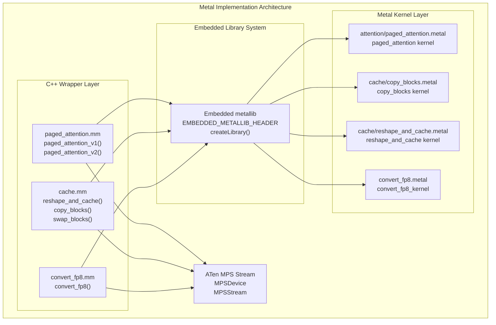
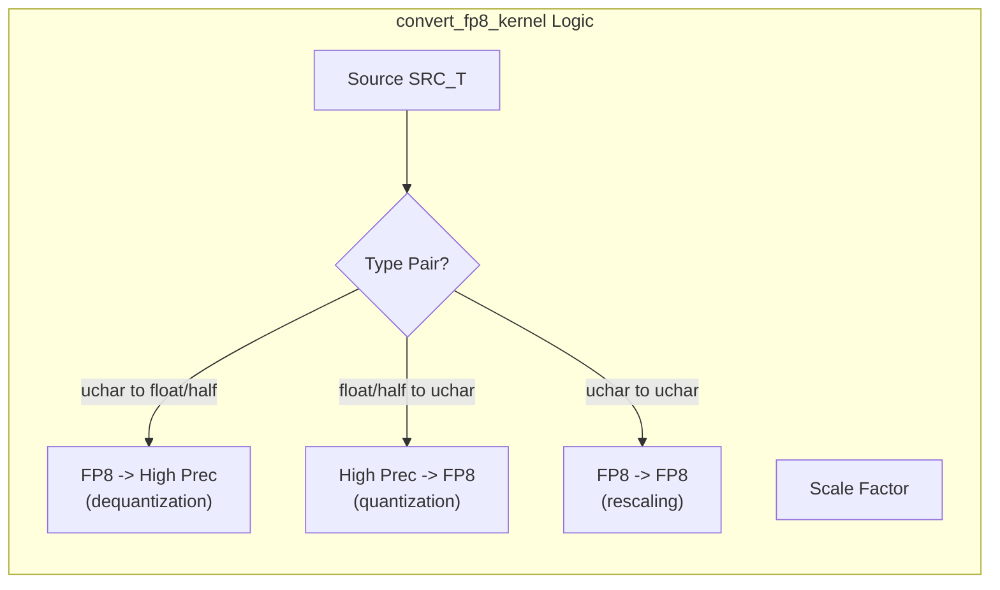

<!-- source: DeepWiki mcp.deepwiki.com · repo huggingface/kernels-community · extra page Paged Attention: Metal Implementation · fetched 2026-10-26 -->

# Paged Attention: Metal Implementation

Relevant source files

The following files were used as context for generating this wiki page:

- [paged-attention/cuda-utils/cuda_utils.h](paged-attention/cuda-utils/cuda_utils.h)
- [paged-attention/cuda-utils/cuda_utils_kernels.cu](paged-attention/cuda-utils/cuda_utils_kernels.cu)
- [paged-attention/paged-attention-metal/attention/paged_attention.metal](paged-attention/paged-attention-metal/attention/paged_attention.metal)
- [paged-attention/paged-attention-metal/cache.mm](paged-attention/paged-attention-metal/cache.mm)
- [paged-attention/paged-attention-metal/cache/copy_blocks.metal](paged-attention/paged-attention-metal/cache/copy_blocks.metal)
- [paged-attention/paged-attention-metal/cache/reshape_and_cache.metal](paged-attention/paged-attention-metal/cache/reshape_and_cache.metal)
- [paged-attention/paged-attention-metal/convert_fp8.metal](paged-attention/paged-attention-metal/convert_fp8.metal)
- [paged-attention/paged-attention-metal/convert_fp8.mm](paged-attention/paged-attention-metal/convert_fp8.mm)
- [paged-attention/paged-attention-metal/paged_attention.mm](paged-attention/paged-attention-metal/paged_attention.mm)

## Purpose and Scope

This page documents the Metal Shading Language (MSL) implementation of paged attention for Apple Silicon GPUs. The Metal backend provides efficient KV cache management for LLM inference on Mac devices through specialized compute kernels. For the CUDA implementation details, see [Paged Attention: CUDA Implementation](). The Metal implementation includes template-based paged attention kernels, cache management operations (copying and reshaping), and FP8 quantization support for reduced memory footprint.

## Architecture Overview

The Metal implementation consists of several primary components organized as separate compilation units, orchestrated through an embedded Metal library mechanism.

**Embedded Metal Library System**

The Metal implementation uses an embedded library approach where compiled Metal shaders are embedded directly into the binary. This is managed through a build-time process that defines `EMBEDDED_METALLIB_HEADER` [paged-attention/paged-attention-metal/paged_attention.mm:12-16](). The `EMBEDDED_METALLIB_NAMESPACE::createLibrary(device, &error)` function provides access to the pre-compiled Metal library without requiring external file dependencies [paged-attention/paged-attention-metal/paged_attention.mm:182-183]().

**Sources:** [paged-attention/paged-attention-metal/paged_attention.mm:11-16](), [paged-attention/paged-attention-metal/cache.mm:9-14](), [paged-attention/paged-attention-metal/convert_fp8.mm:11-16]()

## Kernel Specialization and Naming

The Metal paged attention kernels are instantiated with multiple template parameters to support various configurations. The kernel naming scheme encodes these parameters for dynamic dispatch.

| Parameter | Description |
|-----------|-------------|
| `dtype` | Query/output precision (`float`, `half`, `bfloat16_t`) |
| `cache_dtype` | KV cache storage type (`float`, `half`, `bfloat16_t`, `uchar` for FP8) |
| `head_size` | Attention head dimension (e.g., 32, 64, 128) |
| `block_size` | KV cache block size (8, 16, 32) |
| `num_threads` | Threads per threadgroup (typically 256) |
| `partition_size` | Sequence partitioning for v2 (0 for v1) |

The helper function `getKernelName` constructs the string used to look up the specific kernel in the Metal library [paged-attention/paged-attention-metal/paged_attention.mm:23-72]().

**Sources:** [paged-attention/paged-attention-metal/paged_attention.mm:23-72]()

## Paged Attention V1 Implementation

The `paged_attention_v1` function processes entire sequences in a single kernel invocation without partitioning [paged-attention/paged-attention-metal/paged_attention.mm:101-118]().

1.  **Validation**: Checks if the `head_size` and `block_size` combination is supported [paged-attention/paged-attention-metal/paged_attention.mm:154-156]().
2.  **Shared Memory**: Calculates requirements for logits and reduction workspaces [paged-attention/paged-attention-metal/paged_attention.mm:164-170]().
3.  **Kernel Dispatch**: 
    - Loads the embedded library [paged-attention/paged-attention-metal/paged_attention.mm:182-183]().
    - Sets function constants for FP8 scaling if applicable [paged-attention/paged-attention-metal/paged_attention.mm:196-198]().
    - Configures a threadgroup of 256 threads [paged-attention/paged-attention-metal/paged_attention.mm:160]().
    - Dispatches a grid of `(num_heads, num_seqs, 1)` [paged-attention/paged-attention-metal/paged_attention.mm:325-327]().

**Sources:** [paged-attention/paged-attention-metal/paged_attention.mm:101-335]()

## Cache Management Operations

The Metal backend provides specialized kernels for managing the paged KV cache memory.

### Reshape and Cache
The `reshape_and_cache` kernel converts K/V tensors from standard layout to the paged block layout [paged-attention/paged-attention-metal/cache/reshape_and_cache.metal:33-56](). It supports optional FP8 quantization during the caching process if `use_fp8_scales` is enabled [paged-attention/paged-attention-metal/cache/reshape_and_cache.metal:86-94]().

### Copy Blocks
The `copy_blocks` kernel performs efficient block-level copies between cache tensors, typically used during beam search or sequence duplication [paged-attention/paged-attention-metal/cache/copy_blocks.metal:7-14](). It is instantiated for `float`, `half`, `bfloat16_t`, and `uchar` (FP8) [paged-attention/paged-attention-metal/cache/copy_blocks.metal:48-51]().

### Swap Blocks
The `swap_blocks` function handles memory transfers between different devices [paged-attention/paged-attention-metal/cache.mm:20-21]():
- **MPS to MPS**: Uses a `MTLBlitCommandEncoder` for high-performance GPU-side copies [paged-attention/paged-attention-metal/cache.mm:40-42]().
- **Cross-device**: Falls back to PyTorch's `copy_` method for CPU-to-MPS or MPS-to-CPU transfers [paged-attention/paged-attention-metal/cache.mm:65-72]().

**Sources:** [paged-attention/paged-attention-metal/cache/reshape_and_cache.metal:33-96](), [paged-attention/paged-attention-metal/cache/copy_blocks.metal:7-36](), [paged-attention/paged-attention-metal/cache.mm:20-74]()

## FP8 Conversion and Vector Operations

The implementation includes dedicated kernels for converting tensors to and from FP8 (E4M3) format.

The `convert_fp8_kernel` uses `is_same_v` template logic to select the correct conversion path [paged-attention/paged-attention-metal/convert_fp8.metal:26-42](). It relies on utility functions like `fp8_e4m3_to_float` and `float_to_fp8_e4m3` defined in `float8.metal` [paged-attention/paged-attention-metal/convert_fp8.metal:28-33]().

**Vector Types**: The attention kernel uses a custom `Vec<T, VEC_SIZE>` template to abstract over different data types and SIMD widths [paged-attention/paged-attention-metal/attention/paged_attention.metal:13](). Specializations exist for `float`, `bfloat16_t`, and `half` across various vector sizes (1, 2, 4, 8) [paged-attention/paged-attention-metal/attention/paged_attention.metal:37-61]().

**Sources:** [paged-attention/paged-attention-metal/convert_fp8.metal:11-43](), [paged-attention/paged-attention-metal/attention/paged_attention.metal:10-95](), [paged-attention/paged-attention-metal/convert_fp8.mm:23-46]()

---

