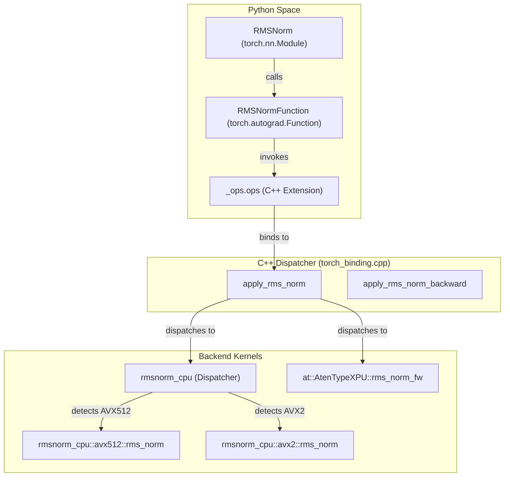
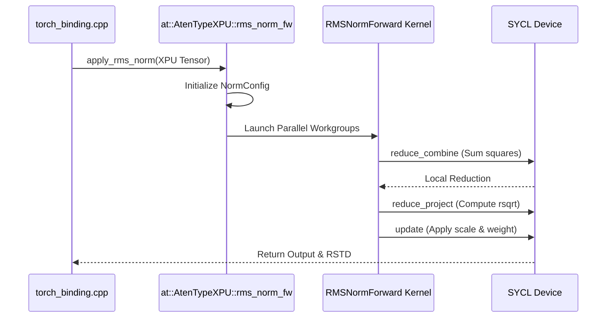

<!-- source: DeepWiki mcp.deepwiki.com · repo huggingface/kernels-community · extra page RMSNorm: Multi-Backend Implementation · fetched 2026-10-26 -->

# RMSNorm: Multi-Backend Implementation

<details>
<summary>Relevant source files</summary>

The following files were used as context for generating this wiki page:

- [rmsnorm/build.toml](rmsnorm/build.toml)
- [rmsnorm/flake.lock](rmsnorm/flake.lock)
- [rmsnorm/flake.nix](rmsnorm/flake.nix)
- [rmsnorm/rmsnorm_cpu/cpu_features.hpp](rmsnorm/rmsnorm_cpu/cpu_features.hpp)
- [rmsnorm/rmsnorm_cpu/cpu_types_avx2.hpp](rmsnorm/rmsnorm_cpu/cpu_types_avx2.hpp)
- [rmsnorm/rmsnorm_cpu/cpu_types_avx512.hpp](rmsnorm/rmsnorm_cpu/cpu_types_avx512.hpp)
- [rmsnorm/rmsnorm_cpu/rmsnorm_avx2.cpp](rmsnorm/rmsnorm_cpu/rmsnorm_avx2.cpp)
- [rmsnorm/rmsnorm_cpu/rmsnorm_avx2.hpp](rmsnorm/rmsnorm_cpu/rmsnorm_avx2.hpp)
- [rmsnorm/rmsnorm_cpu/rmsnorm_avx512.cpp](rmsnorm/rmsnorm_cpu/rmsnorm_avx512.cpp)
- [rmsnorm/rmsnorm_cpu/rmsnorm_avx512.hpp](rmsnorm/rmsnorm_cpu/rmsnorm_avx512.hpp)
- [rmsnorm/rmsnorm_cpu/rmsnorm_cpu.cpp](rmsnorm/rmsnorm_cpu/rmsnorm_cpu.cpp)
- [rmsnorm/rmsnorm_cpu/rmsnorm_cpu_torch.cpp](rmsnorm/rmsnorm_cpu/rmsnorm_cpu_torch.cpp)
- [rmsnorm/rmsnorm_xpu/RMSNorm.cpp](rmsnorm/rmsnorm_xpu/RMSNorm.cpp)
- [rmsnorm/rmsnorm_xpu/dpcpp/Numerics.h](rmsnorm/rmsnorm_xpu/dpcpp/Numerics.h)
- [rmsnorm/tests/test_rmsnorm.py](rmsnorm/tests/test_rmsnorm.py)
- [rmsnorm/torch-ext/rmsnorm/__init__.py](rmsnorm/torch-ext/rmsnorm/__init__.py)
- [rmsnorm/torch-ext/rmsnorm/layers.py](rmsnorm/torch-ext/rmsnorm/layers.py)
- [rmsnorm/torch-ext/torch_binding.cpp](rmsnorm/torch-ext/torch_binding.cpp)

</details>


The RMSNorm kernel provides high-performance Root Mean Square Layer Normalization across multiple hardware backends, specifically targeting CPU (with SIMD optimizations) and Intel XPU (via SYCL/DPC++). It includes a full autograd wrapper and is designed to be compatible with `torch.compile` for seamless integration into modern Transformer architectures.

## Architecture and Data Flow

The implementation is structured into three layers: a Python frontend providing a `torch.nn.Module`, a C++ dispatcher that handles backend selection and tensor validation, and specialized backend kernels.

### High-Level Component Mapping
The following diagram illustrates how Python entities map to their C++ and kernel-level implementations.

**Entity Relationship Diagram**

**Sources:** [rmsnorm/torch-ext/rmsnorm/layers.py:4-57](), [rmsnorm/torch-ext/torch_binding.cpp:20-84](), [rmsnorm/rmsnorm_cpu/rmsnorm_cpu.cpp:10-33]()

## Python API and Autograd

The implementation provides a standard `RMSNorm` module [rmsnorm/torch-ext/rmsnorm/layers.py:27-57](). It uses `RMSNormFunction` [rmsnorm/torch-ext/rmsnorm/layers.py:4-25]() to wrap the optimized kernels in PyTorch's autograd engine.

### Key Functions
- `forward`: Computes the normalization and saves `hidden_states`, `weight`, `output`, and `rstd` (reciprocal standard deviation) for the backward pass [rmsnorm/torch-ext/rmsnorm/layers.py:6-10]().
- `backward`: Receives the gradient of the output and computes gradients for both input states and weights using `apply_rms_norm_backward` [rmsnorm/torch-ext/rmsnorm/layers.py:13-25]().

## CPU Implementation (AVX2 / AVX512)

The CPU backend uses a multi-stage dispatch system. At runtime, the `rmsnorm_cpu::rmsnorm` function detects hardware capabilities via `CPUFeatures` [rmsnorm/rmsnorm_cpu/rmsnorm_cpu.cpp:14-24]().

### SIMD Optimizations
- **AVX-512**: Targeted for modern Intel CPUs, using 512-bit vectors and supporting BF16 via `-mavx512bf16` [rmsnorm/build.toml:87-96]().
- **AVX2**: Targeted for older x86_64 systems, utilizing 256-bit vectors and FMA instructions [rmsnorm/build.toml:60-67]().
- **Parallelization**: Both implementations utilize OpenMP (`#pragma omp parallel for`) to distribute token processing across multiple CPU cores [rmsnorm/rmsnorm_cpu/rmsnorm_avx2.cpp:24-26]().

### Kernel Logic (AVX2 Example)
The kernel calculates the variance in a first pass across the hidden dimension [rmsnorm/rmsnorm_cpu/rmsnorm_avx2.cpp:30-35](), computes the scaling factor [rmsnorm/rmsnorm_cpu/rmsnorm_avx2.cpp:37-39](), and applies it along with the learned weights in a second pass [rmsnorm/rmsnorm_cpu/rmsnorm_avx2.cpp:41-53]().

**Sources:** [rmsnorm/rmsnorm_cpu/rmsnorm_cpu.cpp:1-83](), [rmsnorm/rmsnorm_cpu/rmsnorm_avx2.cpp:13-55]()

## XPU Implementation (SYCL/DPC++)

The XPU implementation is designed for Intel GPUs using the SYCL abstraction. It leverages a specialized `NormConfig` to manage workgroup sizing and memory alignment.

### SYCL Kernel Architecture
The XPU backend defines `RMSNormForward` and `RMSNormBackward` classes that inherit from generic normalization templates [rmsnorm/rmsnorm_xpu/RMSNorm.cpp:31-32]().

**XPU Execution Flow**

**Sources:** [rmsnorm/rmsnorm_xpu/RMSNorm.cpp:17-146](), [rmsnorm/torch-ext/torch_binding.cpp:34-40]()

### Vectorization and Reduction
The XPU kernel uses a `reduce_combine` method to calculate the sum of squares across the normalization dimension [rmsnorm/rmsnorm_xpu/RMSNorm.cpp:64-85](). It supports vectorized memory access (`vec_size`) to maximize bandwidth utilization on the GPU [rmsnorm/rmsnorm_xpu/RMSNorm.cpp:74-84]().

## Build Configuration

The build is orchestrated by `build.toml`, which defines the source files and compiler flags for each backend variant.

| Backend | Flags | Key Sources |
| :--- | :--- | :--- |
| **CPU (AVX2)** | `-mavx2`, `-mfma`, `-fopenmp` | `rmsnorm_avx2.cpp` |
| **CPU (AVX512)** | `-mavx512f`, `-mavx512bf16`, `-mfma` | `rmsnorm_avx512.cpp` |
| **XPU** | SYCL/DPC++ toolchain | `RMSNorm.cpp`, `Device.cpp` |

**Sources:** [rmsnorm/build.toml:1-104]()

## Usage and Compilation

The kernel is compatible with `torch.compile` via the `inductor` backend [rmsnorm/tests/test_rmsnorm.py:48-60]().

### Example Usage
```python
from rmsnorm.layers import RMSNorm
import torch

model = RMSNorm()
model.weight = torch.nn.Parameter(torch.ones(1024))
model.variance_epsilon = 1e-6

# Standard usage
output = model(input_tensor)

# Compiled usage
compiled_model = torch.compile(model)
output = compiled_model(input_tensor)
```
**Sources:** [rmsnorm/tests/test_rmsnorm.py:7-22](), [rmsnorm/tests/test_rmsnorm.py:48-75]()

---

