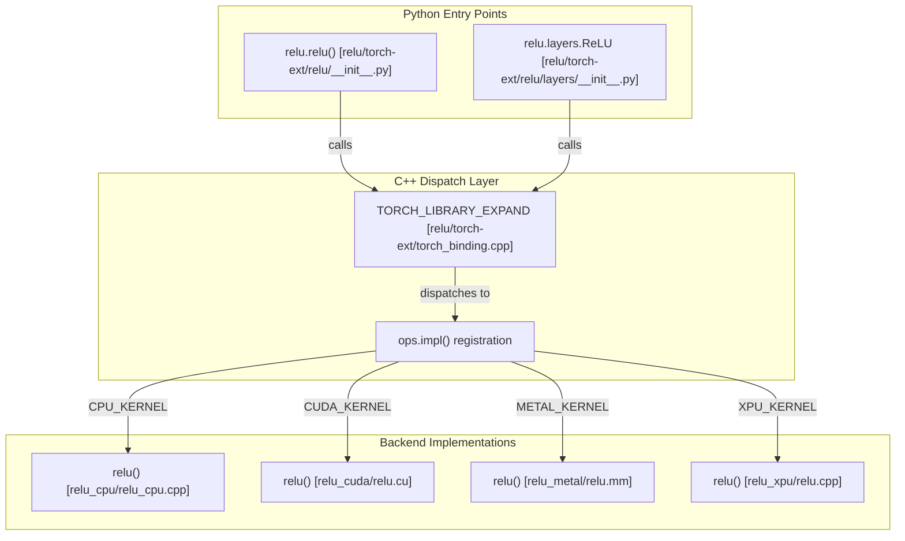
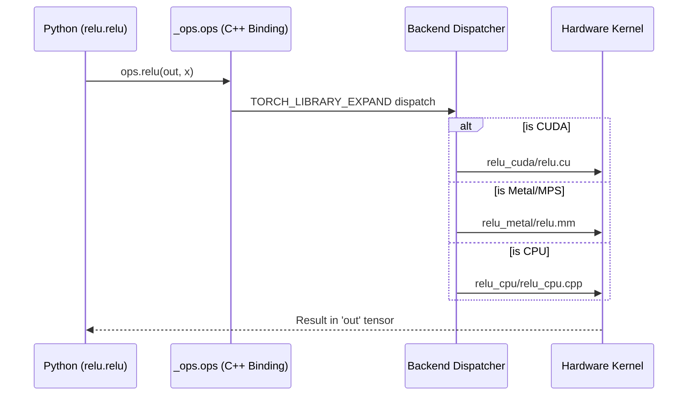

<!-- source: DeepWiki mcp.deepwiki.com · repo huggingface/kernels-community · extra page ReLU: Multi-Backend Reference Implementation · fetched 2026-10-26 -->

# ReLU: Multi-Backend Reference Implementation

Relevant source files

The following files were used as context for generating this wiki page:

- [relu/README.md](relu/README.md)
- [relu/build.toml](relu/build.toml)
- [relu/flake.lock](relu/flake.lock)
- [relu/flake.nix](relu/flake.nix)
- [relu/relu_cpu/relu_cpu.cpp](relu/relu_cpu/relu_cpu.cpp)
- [relu/relu_cuda/relu.cu](relu/relu_cuda/relu.cu)
- [relu/relu_metal/common.h](relu/relu_metal/common.h)
- [relu/relu_metal/relu.metal](relu/relu_metal/relu.metal)
- [relu/relu_metal/relu.mm](relu/relu_metal/relu.mm)
- [relu/relu_xpu/relu.cpp](relu/relu_xpu/relu.cpp)
- [relu/tests/__init__.py](relu/tests/__init__.py)
- [relu/tests/test_relu.py](relu/tests/test_relu.py)
- [relu/torch-ext/relu/__init__.py](relu/torch-ext/relu/__init__.py)
- [relu/torch-ext/relu/layers/__init__.py](relu/torch-ext/relu/layers/__init__.py)
- [relu/torch-ext/torch_binding.cpp](relu/torch-ext/torch_binding.cpp)

## Purpose and Scope

The ReLU kernel serves as a **reference implementation** for the kernels-community multi-backend build system and CI/CD pipeline. As explicitly noted in [relu/README.md:1-7](), this kernel is **not intended for production use** (the production activation kernels are documented in [Activation Kernel: SiLU, SwiGLU, and Fused Activations](#4.4.2)). Instead, it functions as a template and validation tool for:

1.  **Multi-Backend Support**: Demonstrating how to implement a single operation across CUDA, Metal (Apple Silicon), XPU (Intel GPUs), ROCm (AMD GPUs), and SIMD-optimized CPU paths.
2.  **Build Infrastructure**: Validating the Nix-based `kernel-builder` system's ability to orchestrate complex multi-platform builds [relu/flake.nix:1-17]().
3.  **Standard API Pattern**: Providing a reference for the `torch-ext` Python API structure, including the `_ops` namespace and high-level `nn.Module` layers [relu/torch-ext/relu/__init__.py:1-17]().

Sources: [relu/README.md:1-7](), [relu/flake.nix:1-17](), [relu/torch-ext/relu/__init__.py:1-17]()

---

## Multi-Backend Architecture

The ReLU kernel implements the mathematical operation $y = \max(0, x)$ across five distinct execution paths.

### Backend Coverage Matrix

| Backend | Platform | Source File | Tech Stack | Vectorization/SIMD |
| :--- | :--- | :--- | :--- | :--- |
| **CPU** | x86 / ARM | `relu_cpu/relu_cpu.cpp` | C++ / Intrinsics | SSE / NEON |
| **CUDA** | NVIDIA | `relu_cuda/relu.cu` | CUDA C++ | Warp-level |
| **Metal** | Apple Silicon | `relu_metal/relu.mm` | MSL / Objective-C++ | Thread-grid |
| **XPU** | Intel GPU | `relu_xpu/relu.cpp` | SYCL / DPC++ | SIMD-lane |
| **ROCm** | AMD GPU | `relu_cuda/relu.cu` | HIP (reused CUDA) | Wavefront |

Sources: [relu/build.toml:5-11](), [relu/relu_cpu/relu_cpu.cpp:1-57](), [relu/relu_xpu/relu.cpp:1-41]()

### Code Entity Space Mapping

The following diagram maps the high-level system components to specific code entities within the `relu/` directory.

Sources: [relu/torch-ext/relu/__init__.py:10-14](), [relu/torch-ext/relu/layers/__init__.py:7-12](), [relu/torch-ext/torch_binding.cpp:6-17]()

---

## Implementation Details

### SIMD CPU Path (SSE/NEON)

The CPU implementation [relu/relu_cpu/relu_cpu.cpp:1-57]() uses architecture-specific intrinsics to provide high-performance execution on local development machines.

*   **x86_64 (SSE)**: Uses `_mm_load_ps`, `_mm_max_ps`, and `_mm_store_ps` to process 4 floats per instruction [relu/relu_cpu/relu_cpu.cpp:12-25]().
*   **ARM (NEON)**: Uses `vld1q_f32`, `vmaxq_f32`, and `vst1q_f32` for Apple Silicon or Graviton CPUs [relu/relu_cpu/relu_cpu.cpp:29-42]().
*   **Fallback**: Includes a scalar loop for remaining elements not fitting into 4-wide vectors [relu/relu_cpu/relu_cpu.cpp:22-24]().

Sources: [relu/relu_cpu/relu_cpu.cpp:12-42]()

### Metal Implementation (Apple Silicon)

The Metal backend utilizes the `MPS` (Metal Performance Shaders) device type in PyTorch.

1.  **Shader**: [relu/relu_metal/relu.metal:5-17]() defines `relu_forward_kernel_float` and `relu_forward_kernel_half`.
2.  **Host Bridge**: [relu/relu_metal/relu.mm:18-83]() manages the `MTLComputePipelineState` and encodes commands into the PyTorch MPS stream via `torch::mps::get_command_buffer()`.
3.  **Embedded Library**: The kernel uses an auto-generated header `EMBEDDED_METALLIB_HEADER` to bundle the shader source directly into the binary [relu/relu_metal/relu.mm:7-11]().

Sources: [relu/relu_metal/relu.metal:5-17](), [relu/relu_metal/relu.mm:7-11](), [relu/relu_metal/relu.mm:47-55]()

### XPU Implementation (Intel SYCL)

The XPU path [relu/relu_xpu/relu.cpp:1-41]() demonstrates the SYCL programming model:

*   **Queue Management**: Creates a `sycl::queue` to handle command submission [relu/relu_xpu/relu.cpp:8]().
*   **Parallel For**: Uses `queue.parallel_for` with a `range<1>` corresponding to the tensor's `numel()` [relu/relu_xpu/relu.cpp:15]().
*   **Device Checks**: Validates that tensors are on the `is_xpu()` device and are contiguous [relu/relu_xpu/relu.cpp:22-23]().

Sources: [relu/relu_xpu/relu.cpp:6-19](), [relu/relu_xpu/relu.cpp:21-37]()

---

## Python API and Integration

The ReLU kernel follows the standard `torch-ext` pattern used throughout the repository.

### Data Flow Diagram

Sources: [relu/torch-ext/relu/__init__.py:10-14](), [relu/torch-ext/torch_binding.cpp:6-17]()

### API Surface

*   **Functional API**: `relu.relu(x, out=None)` handles output tensor allocation and calls the underlying C++ op [relu/torch-ext/relu/__init__.py:10-14]().
*   **Layer API**: `relu.layers.ReLU` provides a standard `nn.Module` wrapper [relu/torch-ext/relu/layers/__init__.py:7-12]().
*   **Registration**: The C++ binding uses `ops.impl` to map the generic "relu" operation to backend-specific C++ functions based on the tensor device type (e.g., `torch::kCPU`, `torch::kCUDA`, `torch::kMPS`, `torch::kXPU`) [relu/torch-ext/torch_binding.cpp:8-16]().

Sources: [relu/torch-ext/relu/__init__.py:10-14](), [relu/torch-ext/relu/layers/__init__.py:7-12](), [relu/torch-ext/torch_binding.cpp:8-16]()

---

## Testing and Validation

The implementation is validated using `pytest` across all supported platforms. The test suite [relu/tests/test_relu.py:10-36]() automatically detects the available hardware:

*   **Device Selection**: Logic branches between `mps`, `xpu`, `cuda`, and `cpu` based on the environment [relu/tests/test_relu.py:12-19]().
*   **Correctness**: Uses `torch.testing.assert_close` to compare the custom kernel output against the reference `torch.nn.functional.relu` [relu/tests/test_relu.py:21,35]().

Sources: [relu/tests/test_relu.py:10-36]()

---

