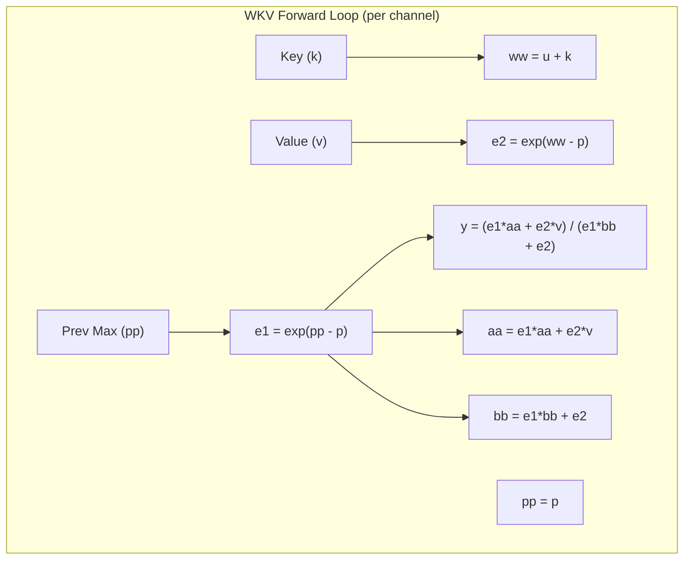
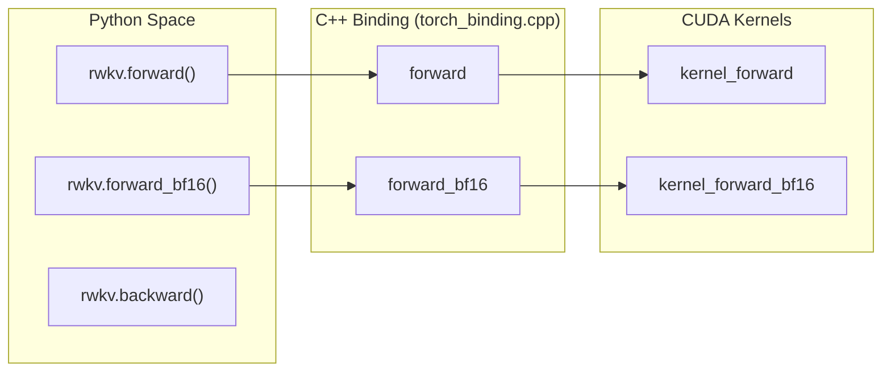

<!-- source: DeepWiki mcp.deepwiki.com · repo huggingface/kernels-community · extra page Causal Conv1D and RWKV · fetched 2026-10-26 -->

# Causal Conv1D and RWKV

Relevant source files

The following files were used as context for generating this wiki page:

- [causal-conv1d/build.toml](causal-conv1d/build.toml)
- [causal-conv1d/causal-conv1d/causal_conv1d.cpp](causal-conv1d/causal-conv1d/causal_conv1d.cpp)
- [causal-conv1d/causal-conv1d/causal_conv1d.h](causal-conv1d/causal-conv1d/causal_conv1d.h)
- [causal-conv1d/causal-conv1d/causal_conv1d_bwd.cu](causal-conv1d/causal-conv1d/causal_conv1d_bwd.cu)
- [causal-conv1d/causal-conv1d/causal_conv1d_common.h](causal-conv1d/causal-conv1d/causal_conv1d_common.h)
- [causal-conv1d/causal-conv1d/causal_conv1d_fwd.cu](causal-conv1d/causal-conv1d/causal_conv1d_fwd.cu)
- [causal-conv1d/causal-conv1d/causal_conv1d_update.cu](causal-conv1d/causal-conv1d/causal_conv1d_update.cu)
- [causal-conv1d/causal-conv1d/static_switch.h](causal-conv1d/causal-conv1d/static_switch.h)
- [causal-conv1d/flake.lock](causal-conv1d/flake.lock)
- [causal-conv1d/flake.nix](causal-conv1d/flake.nix)
- [rwkv/README.md](rwkv/README.md)
- [rwkv/build.toml](rwkv/build.toml)
- [rwkv/flake.lock](rwkv/flake.lock)
- [rwkv/flake.nix](rwkv/flake.nix)
- [rwkv/rwkv/wkv_cuda.cu](rwkv/rwkv/wkv_cuda.cu)
- [rwkv/rwkv/wkv_cuda_bf16.cu](rwkv/rwkv/wkv_cuda_bf16.cu)
- [rwkv/torch-ext/rwkv/__init__.py](rwkv/torch-ext/rwkv/__init__.py)
- [rwkv/torch-ext/torch_binding.cpp](rwkv/torch-ext/torch_binding.cpp)

This section documents optimized CUDA kernels for sequence models, specifically focusing on causal depthwise 1D convolutions used in State Space Models (SSMs) like Mamba, and the WKV (Weight-Key-Value) mechanism used in RWKV architectures. These kernels are designed to bypass the overhead of standard PyTorch convolution and attention implementations by providing fused, memory-efficient operations.

## 1. Causal Conv1D

The `causal-conv1d` kernel provides a highly optimized implementation of depthwise 1D convolutions with a causal constraint. This is a critical component in models like Mamba, where each channel is convolved independently with a small kernel (typically size 4) to provide local context before the state space expansion [causal-conv1d/build.toml:18-30]().

### Implementation Details
The implementation is split into three primary CUDA kernels:
*   **Forward Pass**: Computes the causal convolution. It is specialized for small kernel widths and uses shared memory to minimize global memory access [causal-conv1d/causal-conv1d/causal_conv1d_fwd.cu]().
*   **Backward Pass**: Computes gradients for the input and the weights [causal-conv1d/causal-conv1d/causal_conv1d_bwd.cu]().
*   **Update Kernel**: A specialized kernel for auto-regressive inference (generation). Instead of processing a full sequence, it updates the state with a single new token, making it extremely efficient for decoding [causal-conv1d/causal-conv1d/causal_conv1d_update.cu]().

### Technical Architecture
The kernel uses a `static_switch` mechanism to dispatch to specialized C++ templates based on the kernel size and data type at runtime [causal-conv1d/causal-conv1d/static_switch.h](). It supports `float16`, `bfloat16`, and `float32` precisions [causal-conv1d/causal-conv1d/causal_conv1d_common.h:8-42]().

| Feature | Description |
| :--- | :--- |
| **Operation** | Depthwise Causal 1D Convolution |
| **Backends** | CUDA [causal-conv1d/build.toml:5]() |
| **Key Files** | `causal_conv1d_fwd.cu`, `causal_conv1d_bwd.cu`, `causal_conv1d_update.cu` |
| **Registration** | `torch_binding.cpp` [causal-conv1d/build.toml:14]() |

**Sources:** [causal-conv1d/build.toml:1-30](), [causal-conv1d/causal-conv1d/causal_conv1d_common.h:1-42]()

---

## 2. RWKV WKV Kernel

The RWKV kernel implements the core "WKV" (Weight-Key-Value) computation, which allows the model to act as both a Transformer (parallelizable training) and an RNN (constant-time inference). The kernel computes a time-weighted average of values, governed by a decay factor `w` and an "extra" attention weight `u` [rwkv/rwkv/wkv_cuda.cu:7-43]().

### Data Flow and Numerical Stability
To prevent overflow during the exponential summation, the kernel employs a "running max" technique similar to the log-sum-exp trick. It maintains:
1.  `aa`: The numerator running sum (weighted values).
2.  `bb`: The denominator running sum (weighted coefficients).
3.  `pp`: The running maximum exponent used for normalization.

**Sources:** [rwkv/rwkv/wkv_cuda.cu:23-42](), [rwkv/rwkv/wkv_cuda_bf16.cu:23-42]()

### State Management
The implementation supports two modes of operation:
*   **Sequence Mode**: Processes a full sequence of length `T` in parallel [rwkv/rwkv/wkv_cuda.cu:7-43]().
*   **Stateful Mode**: Takes an additional `s` (state) tensor of shape `[B, C, 3]`. This stores the `aa`, `bb`, and `pp` values between calls, enabling incremental decoding [rwkv/rwkv/wkv_cuda.cu:46-87]().

### Python API and Bindings
The kernel is exposed via the `rwkv` namespace. It provides specialized versions for `float32` and `bfloat16` [rwkv/torch-ext/rwkv/__init__.py:7-44]().

**Sources:** [rwkv/torch-ext/rwkv/__init__.py:1-170](), [rwkv/torch-ext/torch_binding.cpp:16-72](), [rwkv/rwkv/wkv_cuda.cu:168-187]()

### Backward Pass
The backward kernel [rwkv/rwkv/wkv_cuda.cu:90-166]() computes gradients for weights `w`, keys `k`, values `v`, and the initial state `u`. It performs a forward sweep to cache intermediate normalization factors `q` and `r` in shared memory/registers [rwkv/rwkv/wkv_cuda.cu:110-137](), followed by a backward sweep to accumulate gradients [rwkv/rwkv/wkv_cuda.cu:143-165]().

**Sources:** [rwkv/rwkv/wkv_cuda.cu:90-166](), [rwkv/rwkv/wkv_cuda_bf16.cu:89-165]()

## 3. Configuration and Build
Both kernels use the Nix-based build system.
*   **Causal Conv1D**: Depends on `torch` and includes the `causal-conv1d` directory for headers [causal-conv1d/build.toml:18-30]().
*   **RWKV**: Includes specific optimization flags like `--use_fast_math` and `-DTmax=1024` to bound sequence length for register-based caching in the backward pass [rwkv/build.toml:23-29]().

**Sources:** [causal-conv1d/build.toml:1-30](), [rwkv/build.toml:1-36]()

---

