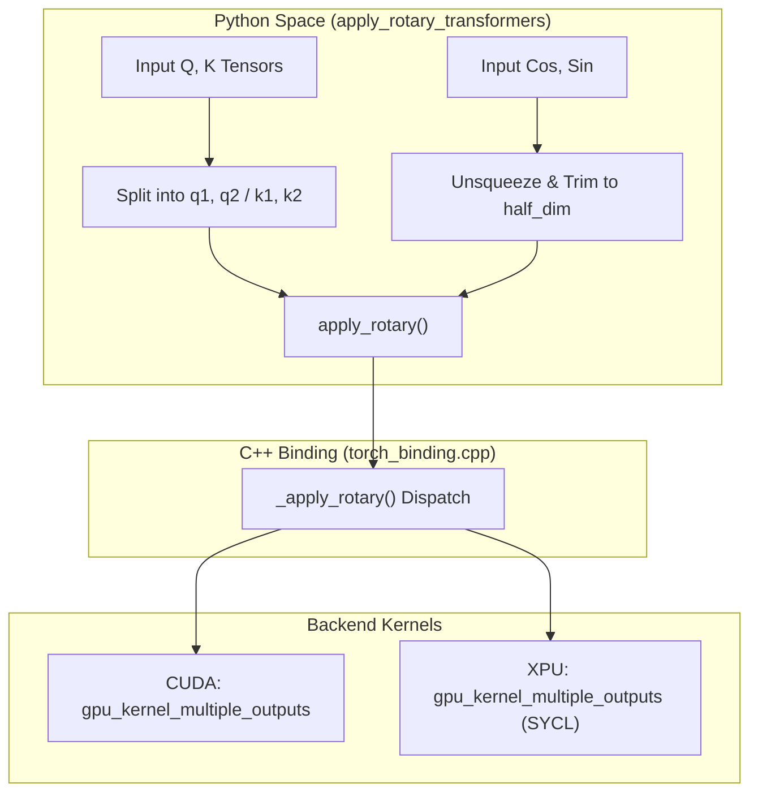
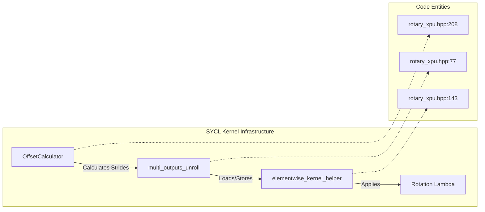

<!-- source: DeepWiki mcp.deepwiki.com · repo huggingface/kernels-community · extra page Rotary Positional Embeddings (RoPE) · fetched 2026-10-26 -->

# Rotary Positional Embeddings (RoPE)

<details>
<summary>Relevant source files</summary>

The following files were used as context for generating this wiki page:

- [rotary/README.md](rotary/README.md)
- [rotary/build.toml](rotary/build.toml)
- [rotary/flake.lock](rotary/flake.lock)
- [rotary/flake.nix](rotary/flake.nix)
- [rotary/rotary-xpu/rotary_xpu.cpp](rotary/rotary-xpu/rotary_xpu.cpp)
- [rotary/rotary-xpu/rotary_xpu.hpp](rotary/rotary-xpu/rotary_xpu.hpp)
- [rotary/rotary/rotary_cuda.cu](rotary/rotary/rotary_cuda.cu)
- [rotary/tests/__init__.py](rotary/tests/__init__.py)
- [rotary/tests/test_rotary.py](rotary/tests/test_rotary.py)
- [rotary/tests/utils.py](rotary/tests/utils.py)
- [rotary/torch-ext/rotary/__init__.py](rotary/torch-ext/rotary/__init__.py)

</details>


The rotary kernel provides an optimized implementation of Rotary Positional Embeddings (RoPE) for both CUDA and XPU (Intel GPU) backends. It is based on the implementation from Flash Attention and is designed to perform in-place or out-of-place rotary transformations on query and key tensors in Transformer models.

### Purpose and Scope
The kernel implements the rotation of pairs of elements in a hidden dimension. Given a vector $x$ and a rotation angle $\theta$, it transforms pairs $(x_1, x_2)$ into $(x_1 \cos \theta - x_2 \sin \theta, x_1 \sin \theta + x_2 \cos \theta)$. This operation is fundamental for models like Llama that use rotary embeddings to encode relative positional information.

Sources: [rotary/README.md:9-11](), [rotary/tests/test_rotary.py:19-28]()

---

## Architecture and Data Flow

The implementation is split into a Python frontend that handles tensor reshaping and a C++/CUDA/SYCL backend that executes the element-wise rotation logic.

### Python API
The kernel exposes two primary functions through the `rotary` package:
1.  `apply_rotary`: A low-level interface that directly calls the compiled operator. It requires pre-split tensors for the two halves of the rotary dimension.
2.  `apply_rotary_transformers`: A high-level wrapper designed to match the signature of `apply_rotary_pos_emb` commonly found in Hugging Face Transformers. It handles the splitting of the input tensor into `q1, q2` and `k1, k2` based on the `half_dim`.

**Data Flow Diagram: Transformers Wrapper to Kernel**


Sources: [rotary/torch-ext/rotary/__init__.py:7-49](), [rotary/build.toml:14-29]()

---

## Backend Implementations

### CUDA Implementation
The CUDA backend utilizes PyTorch's `TensorIterator` to handle broadcasting and contiguous memory access. It employs `at::native::gpu_kernel_multiple_outputs` to perform the rotation logic within a GPU lambda.

*   **Dispatch**: It supports `float32`, `bfloat16`, and `float16` using `AT_DISPATCH_FLOATING_TYPES_AND2`.
*   **Conjugate Support**: The kernel includes a `conj` boolean parameter. If true, it performs the conjugate rotation (negating the sine component for the second output).

Sources: [rotary/rotary/rotary_cuda.cu:9-45]()

### XPU (Intel GPU) Implementation
The XPU implementation mimics the `TensorIterator` pattern but uses a custom SYCL-based infrastructure to handle Intel GPUs.

#### OffsetCalculator and Indexing
Because XPU requires explicit handling of tensor strides in SYCL kernels, the implementation includes a specialized `OffsetCalculator`.
*   **`IntDivider`**: Optimized integer division for calculating coordinates from a linear index [rotary/rotary-xpu/rotary_xpu.hpp:190-205]().
*   **`OffsetCalculator`**: Manages multidimensional offsets for up to 12 dimensions (`MAX_DIMS`) [rotary/rotary-xpu/rotary_xpu.hpp:16-213]().

#### Kernel Dispatch
The XPU backend defines `UnrolledElementwiseForMultiOutputsKernel`, which uses a `multi_outputs_unroll` policy to load data, apply the rotation function, and store results [rotary/rotary-xpu/rotary_xpu.hpp:165-187]().

**Entity Mapping: XPU Kernel Structure**


Sources: [rotary/rotary-xpu/rotary_xpu.cpp:4-40](), [rotary/rotary-xpu/rotary_xpu.hpp:77-187]()

---

## Build and Configuration

The kernel is configured to build for both `cuda` and `xpu` backends.

| Section | Key | Value |
| :--- | :--- | :--- |
| `[general]` | `backends` | `["cuda", "xpu"]` |
| `[torch]` | `src` | `["torch-ext/torch_binding.cpp"]` |
| `[kernel.rotary_xpu]` | `backend` | `xpu` |
| `[kernel.activation]` | `backend` | `cuda` |

Sources: [rotary/build.toml:1-29]()

### Dependencies
The build process is managed via Nix Flakes, pulling in the `kernel-builder` from the main repository to ensure reproducible environments for both CUDA and SYCL toolchains.

Sources: [rotary/flake.nix:1-12](), [rotary/flake.lock:36-56]()

---

## Usage Example

The kernel is typically used to rotate the first `rotary_dim` of the head dimension.

```python
import torch
from kernels import get_kernel

rotary = get_kernel("kernels-community/rotary")
# q1, q2 are chunks of the query tensor of size [..., rotary_dim]
# cos, sin are positional embeddings of size [seqlen, 1, rotary_dim]
rotary.apply_rotary(q1, q2, cos, sin, q1, q2, conj=False)
```
Sources: [rotary/README.md:23-50](), [rotary/tests/test_rotary.py:50-63]()

---

