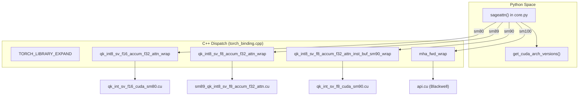
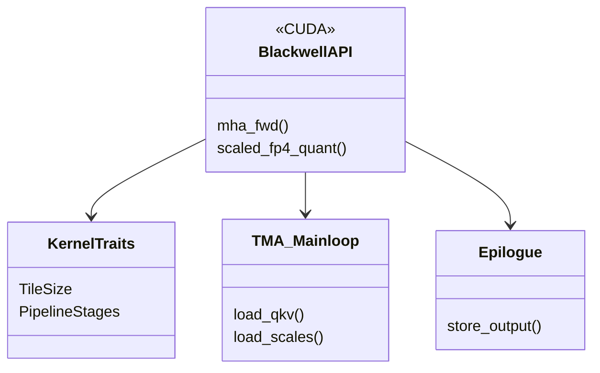

<!-- source: DeepWiki mcp.deepwiki.com · repo huggingface/kernels-community · extra page SageAttention: Quantized Attention · fetched 2026-10-26 -->

# SageAttention: Quantized Attention

<details>
<summary>Relevant source files</summary>

The following files were used as context for generating this wiki page:

- [sage-attention/build.toml](sage-attention/build.toml)
- [sage-attention/flake.lock](sage-attention/flake.lock)
- [sage-attention/flake.nix](sage-attention/flake.nix)
- [sage-attention/tests/test_quant.py](sage-attention/tests/test_quant.py)
- [sage-attention/torch-ext/sage_attention/__init__.py](sage-attention/torch-ext/sage_attention/__init__.py)
- [sage-attention/torch-ext/sage_attention/core.py](sage-attention/torch-ext/sage_attention/core.py)
- [sage-attention/torch-ext/sage_attention/sm80_compile.py](sage-attention/torch-ext/sage_attention/sm80_compile.py)
- [sage-attention/torch-ext/sage_attention/sm89_compile.py](sage-attention/torch-ext/sage_attention/sm89_compile.py)
- [sage-attention/torch-ext/sage_attention/sm90_compile.py](sage-attention/torch-ext/sage_attention/sm90_compile.py)
- [sage-attention/torch-ext/torch_binding.cpp](sage-attention/torch-ext/torch_binding.cpp)
- [sage-attention/torch-ext/torch_binding.h](sage-attention/torch-ext/torch_binding.h)

</details>


SageAttention is a high-performance quantized attention kernel designed to accelerate transformer inference by using 8-bit (INT8/FP8) and 4-bit (FP4) quantization for Query (Q), Key (K), and Value (V) tensors. It provides specialized implementations for multiple generations of NVIDIA GPUs, including Ampere (SM80), Ada Lovelace (SM89), Hopper (SM90), and Blackwell (SM100).

## Overview and Architecture

The SageAttention implementation is structured to provide a unified Python API (`sageattn`) that dynamically dispatches to architecture-specific CUDA kernels based on the GPU's compute capability [sage-attention/torch-ext/sage_attention/core.py:88-150]().

### Core Components
- **Quantization Suite**: Implements various granularities including per-block, per-warp, and per-channel quantization [sage-attention/torch-ext/sage_attention/quant.py:1-26]().
- **Architecture Specialization**: Separate compilation units for SM80, SM89, SM90, and SM100 to utilize specific hardware instructions like DP4A (INT8 dot product) or Blackwell's native FP4 support [sage-attention/build.toml:19-270]().
- **Fused Operations**: CUDA kernels that combine quantization with other operations like mean subtraction to reduce memory passes [sage-attention/torch-ext/torch_binding.h:180-222]().

### Data Flow and Dispatch
The following diagram illustrates how a call to `sageattn` flows from the high-level Python API to the specialized CUDA backends.

**SageAttention Dispatch Logic**

**Sources:** [sage-attention/torch-ext/sage_attention/core.py:151-200](), [sage-attention/torch-ext/torch_binding.cpp:7-83](), [sage-attention/build.toml:42-82]()

---

## Quantization Strategies

SageAttention employs several quantization techniques to balance speed and numerical accuracy.

### 1. Per-Block and Per-Warp INT8
Used primarily for Q and K tensors to accelerate the $QK^T$ computation.
- **Per-Block**: Quantizes tensors in blocks (typically 128 for Q, 64 for K) [sage-attention/tests/test_quant.py:18-50]().
- **Per-Warp**: Provides finer granularity by calculating scales at the CUDA warp level, improving accuracy for outliers [sage-attention/torch-ext/sage_attention/quant.py:24]().

### 2. Per-Channel FP8
Used for the Value (V) tensor, often combined with "smoothing" (mean subtraction) to narrow the dynamic range before quantization [sage-attention/tests/test_quant.py:123-152]().

### 3. Blackwell FP4
On SM100 architectures, SageAttention utilizes 4-bit floating point (FP4) for Q, K, and V, leveraging the hardware's block-scaled layout [sage-attention/build.toml:185-209]().

| Strategy | Target Tensors | Hardware | Key Function |
| :--- | :--- | :--- | :--- |
| **INT8 Per-Block** | Q, K | SM80+ | `per_block_int8` |
| **INT8 Per-Warp** | Q, K | SM80+ | `per_warp_int8` |
| **FP8 Per-Channel** | V | SM89+ | `per_channel_fp8` |
| **FP4 Block-Scaled**| Q, K, V | SM100 | `scaled_fp4_quant` |

**Sources:** [sage-attention/torch-ext/sage_attention/quant.py:1-26](), [sage-attention/torch-ext/torch_binding.h:172-222](), [sage-attention/tests/test_quant.py:5-10]()

---

## Implementation Details

### SM80 (Ampere) Specialization
The SM80 implementation focuses on INT8 for $QK^T$ and FP16 for the $PV$ (Softmax output $\times$ Value) accumulation. It includes variants for different accumulation precisions (FP16 vs FP32) [sage-attention/torch-ext/sage_attention/sm80_compile.py:19-54]().

### SM89/SM90 (Ada/Hopper) Specialization
These kernels introduce FP8 for the $V$ tensor and $PV$ accumulation. They often use "Instruction Buffers" (`inst_buf`) to optimize memory throughput [sage-attention/torch-ext/sage_attention/sm89_compile.py:19-54](). The SM90 variant specifically targets Hopper-specific instructions [sage-attention/torch-ext/sage_attention/sm90_compile.py:27-32]().

### SM100 (Blackwell) Specialization
The Blackwell implementation is built using CUTLASS 4.0 [sage-attention/build.toml:216](). It features a sophisticated TMA (Tensor Memory Accelerator) based mainloop and epilogue [sage-attention/build.toml:226-230]().

**Code Entity Relationship: Blackwell Implementation**

**Sources:** [sage-attention/build.toml:214-237](), [sage-attention/torch-ext/torch_binding.cpp:70-83]()

---

## Python API Usage

The primary entry point is the `sageattn` function. It supports both `HND` (Head, Number, Dimension) and `NHD` (Number, Head, Dimension) tensor layouts [sage-attention/torch-ext/sage_attention/core.py:92-120]().

```python
from sage_attention import sageattn

# q, k, v are torch.float16 or torch.bfloat16
output = sageattn(
    q, k, v, 
    tensor_layout="HND", 
    is_causal=True, 
    sm_scale=0.125
)
```

### Key Parameters [sage-attention/torch-ext/sage_attention/core.py:103-131]():
- `q, k, v`: Input tensors (FP16/BF16).
- `tensor_layout`: "HND" (Batch, Head, Seq, Dim) or "NHD" (Batch, Seq, Head, Dim).
- `is_causal`: Apply causal masking.
- `return_lse`: Return LogSumExp for use in Ring Attention or Gradient Checkpointing.

**Sources:** [sage-attention/torch-ext/sage_attention/core.py:88-150](), [sage-attention/torch-ext/sage_attention/__init__.py:1-17]()

---

## Build Configuration

The kernel is configured via `build.toml`, which defines the requirements for each architecture-specific sub-kernel.

- **CUDA Requirement**: Minimum version 12.8 [sage-attention/build.toml:8]().
- **Compute Capabilities**: Targets `8.0`, `8.9`, `9.0a`, and `10.0a` [sage-attention/build.toml:86-90, 187, 242]().
- **Dependencies**: Integrates with `cutlass_4_0` for Blackwell support [sage-attention/build.toml:216]().

**Sources:** [sage-attention/build.toml:1-270](), [sage-attention/flake.nix:1-14]()

---

