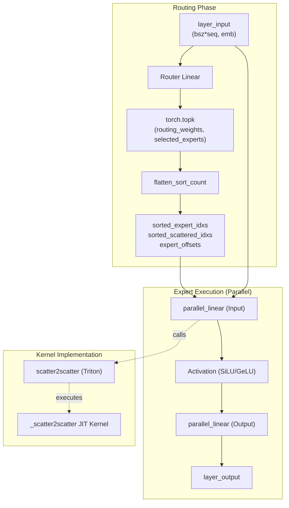
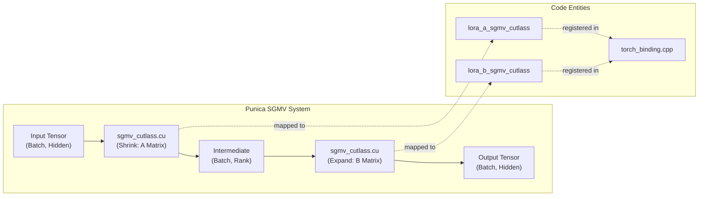

<!-- source: DeepWiki mcp.deepwiki.com · repo huggingface/kernels-community · extra page ScatterMoE and Punica SGMV · fetched 2026-10-26 -->

# ScatterMoE and Punica SGMV

<details>
<summary>Relevant source files</summary>

The following files were used as context for generating this wiki page:

- [punica-sgmv/build.toml](punica-sgmv/build.toml)
- [punica-sgmv/flake.lock](punica-sgmv/flake.lock)
- [punica-sgmv/flake.nix](punica-sgmv/flake.nix)
- [scattermoe/README.md](scattermoe/README.md)
- [scattermoe/build.toml](scattermoe/build.toml)
- [scattermoe/flake.lock](scattermoe/flake.lock)
- [scattermoe/flake.nix](scattermoe/flake.nix)
- [scattermoe/torch-ext/scattermoe/__init__.py](scattermoe/torch-ext/scattermoe/__init__.py)
- [scattermoe/torch-ext/scattermoe/kernels/__init__.py](scattermoe/torch-ext/scattermoe/kernels/__init__.py)
- [scattermoe/torch-ext/scattermoe/kernels/ops.py](scattermoe/torch-ext/scattermoe/kernels/ops.py)
- [scattermoe/torch-ext/scattermoe/kernels/single.py](scattermoe/torch-ext/scattermoe/kernels/single.py)
- [scattermoe/torch-ext/scattermoe/layers.py](scattermoe/torch-ext/scattermoe/layers.py)
- [scattermoe/torch-ext/scattermoe/parallel_experts.py](scattermoe/torch-ext/scattermoe/parallel_experts.py)

</details>


## Purpose and Scope

This page documents two specialized kernel implementations for Mixture of Experts (MoE) and Parameter-Efficient Fine-Tuning (PEFT):
1.  **ScatterMoE**: A Triton-based implementation of MoE that utilizes scatter and gather operations to achieve high efficiency without the padding overhead typically found in grouped GEMM approaches.
2.  **Punica SGMV**: A CUDA/CUTLASS-based implementation of Sparse Grouped Matrix-Vector multiplication, optimized for serving multiple LoRA (Low-Rank Adaptation) adapters in a single batch.

These kernels are designed for high-throughput inference and training of large-scale transformer models using MoE or multi-adapter configurations.

---

## ScatterMoE: Efficient MoE with Scatter/Gather

ScatterMoE implements the strategy described in the [ScatterMoE paper](https://arxiv.org/abs/2403.08245) using Triton. Unlike standard MoE implementations that group tokens by expert (often requiring padding to fixed block sizes), ScatterMoE operates on "scattered" indices, allowing for dynamic load balancing across experts.

### Architecture and Data Flow

The core of ScatterMoE is the `ScatterMoEGatedMLP` layer, which orchestrates routing, expert computation, and output projection.


**Diagram: ScatterMoE Forward Pass Architecture**

**Sources:** [scattermoe/torch-ext/scattermoe/layers.py:7-51](), [scattermoe/torch-ext/scattermoe/parallel_experts.py:1-10]()

### Key Components

*   **`flatten_sort_count`**: A utility that takes the `selected_experts` from the router and produces the indexing tensors required for the scatter kernels. It maps which tokens go to which expert and identifies the contiguous blocks for each expert. [scattermoe/torch-ext/scattermoe/layers.py:30-31]()
*   **`parallel_linear`**: A high-level wrapper that dispatches to the underlying Triton kernels. It supports `grouped_in` and `grouped_out` flags to handle cases where the input is already organized by expert or needs to be scattered back to the original sequence order. [scattermoe/torch-ext/scattermoe/layers.py:34-49]()
*   **`_scatter2scatter`**: The primary Triton JIT kernel. It performs the matrix multiplication by loading blocks of the input `X` using the `grouped_idx_ptr` (scattered indices) and multiplying them by the corresponding expert weights `W` indexed by `expert_idxs_ptr`. [scattermoe/torch-ext/scattermoe/kernels/ops.py:56-119]()

### Triton Kernel Implementation Details

The `_scatter2scatter` kernel handles the expert-parallel GEMM by iterating through expert blocks. It uses a custom `_compute_expert_block` function to perform the inner loop of the matrix multiplication.

| Parameter | Role |
| :--- | :--- |
| `X_ptr` | Pointer to input features. |
| `W_ptr` | Pointer to expert weights, shaped `(E, K, N)`. [scattermoe/torch-ext/scattermoe/kernels/ops.py:58-58]() |
| `grouped_idx_ptr` | Maps the current thread's row to the original token index. [scattermoe/torch-ext/scattermoe/kernels/ops.py:89-89]() |
| `expert_idxs_ptr` | Maps the current thread's row to the expert ID. [scattermoe/torch-ext/scattermoe/kernels/ops.py:82-82]() |
| `FAN_OUT` | The `top_k` value (number of experts per token). [scattermoe/torch-ext/scattermoe/kernels/ops.py:63-63]() |

**Sources:** [scattermoe/torch-ext/scattermoe/kernels/ops.py:56-119](), [scattermoe/torch-ext/scattermoe/kernels/single.py:6-40]()

---

## Punica SGMV: LoRA Adaptation

The Punica SGMV (Sparse Grouped Matrix-Vector multiplication) kernel enables efficient LoRA inference on CUDA devices. It allows a single batch of requests to use different LoRA adapters (different ranks or weights) without requiring multiple kernel launches or significant padding.

### SGMV Operation Model

LoRA adaptation typically involves two stages: a "shrink" operation (A matrix) and an "expand" operation (B matrix). Punica SGMV optimizes these as segmented grouped operations.


**Diagram: Punica SGMV Multi-Adapter Flow**

**Sources:** [punica-sgmv/build.toml:17-26](), [punica-sgmv/build.toml:49-71]()

### Kernel Variants

The Punica implementation provides multiple kernel strategies for SGMV and BGMV (Batched Grouped Matrix-Vector):

1.  **`sgmv_cutlass`**: Uses CUTLASS 3.8 to perform the grouped GEMM. This is the primary high-performance path for modern NVIDIA GPUs. [punica-sgmv/build.toml:17-22]()
2.  **`sgmv_flashinfer`**: An alternative implementation using techniques from the FlashInfer library, including specialized `mma.cuh` and `cp_async.cuh` for asynchronous data movement. [punica-sgmv/build.toml:49-71]()
3.  **`bgmv`**: A batched variant for cases where segments are uniform or simplified. [punica-sgmv/build.toml:28-47]()

### API and Metadata

The SGMV kernels rely on segment metadata to identify which parts of the batch belong to which adapter:
*   `s_start` / `s_end`: Tensors defining the start and end indices of each segment in the batch.
*   `wa_ptr` / `wb_ptr`: Arrays of pointers to the weights for each adapter.
*   `lora_rank`: The rank of the LoRA adapter (can vary between segments in some implementations).

**Sources:** [punica-sgmv/build.toml:12-15](), [punica-sgmv/build.toml:73-82]()

---

## Build and Backend Support

Both kernels are integrated into the `kernels-community` repository with specific backend requirements.

### Backend Matrix

| Kernel | CUDA | ROCm | XPU | Metal |
| :--- | :---: | :---: | :---: | :---: |
| **ScatterMoE** | Yes | Yes | Yes | No |
| **Punica SGMV** | Yes | No | No | No |

**Sources:** [scattermoe/build.toml:5-9](), [punica-sgmv/build.toml:5-5]()

### Build Configuration

ScatterMoE uses a generic build setup since it relies on Triton for kernel generation. [scattermoe/build.toml:1-16]()

Punica SGMV has a more complex `build.toml` because it compiles multiple CUDA source files and links against CUTLASS. It targets specific CUDA compute capabilities from SM 8.0 up to SM 12.0 (Blackwell). [punica-sgmv/build.toml:30-39](), [punica-sgmv/build.toml:51-60]()

```toml
# Example SGMV build configuration
[kernel.sgmv]
backend = "cuda"
depends = [
    "cutlass_3_8",
    "torch",
]
src = [
    "sgmv/sgmv_cutlass.cu",
    "sgmv/sgmv_cutlass.cuh",
]
```
**Sources:** [punica-sgmv/build.toml:17-26]()

---

