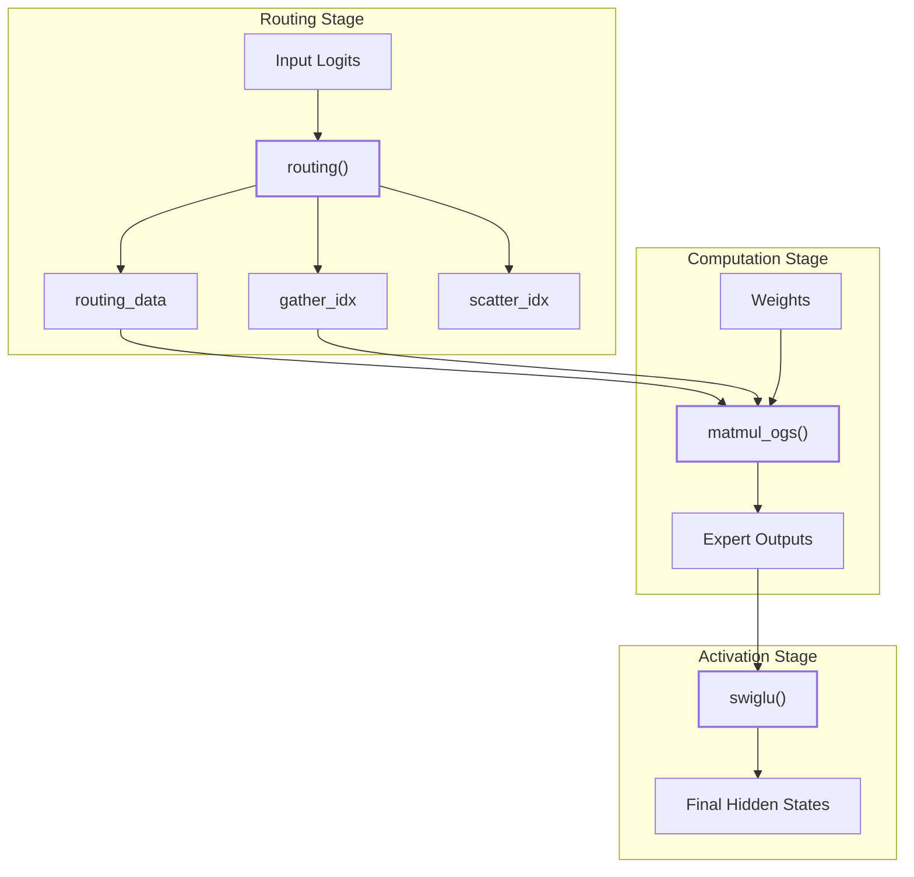
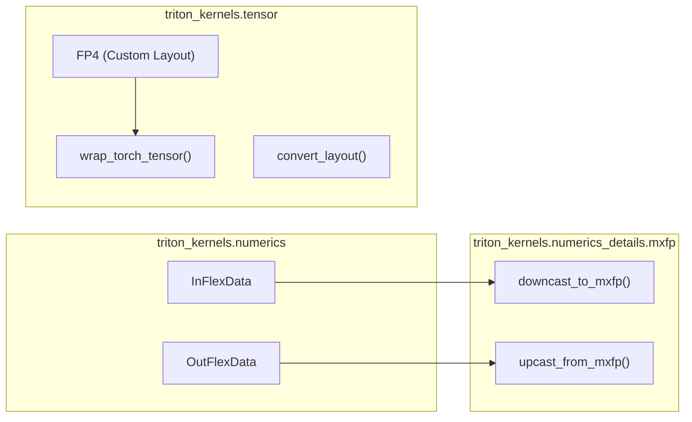

<!-- source: DeepWiki mcp.deepwiki.com · repo huggingface/kernels-community · extra page Triton Kernels: MoE and MXFP4 · fetched 2026-10-26 -->

# Triton Kernels: MoE and MXFP4

Relevant source files

The following files were used as context for generating this wiki page:

- [gpt-oss-triton-kernels/build.toml](gpt-oss-triton-kernels/build.toml)
- [gpt-oss-triton-kernels/flake.lock](gpt-oss-triton-kernels/flake.lock)
- [gpt-oss-triton-kernels/flake.nix](gpt-oss-triton-kernels/flake.nix)
- [gpt-oss-triton-kernels/torch-ext/gpt_oss_triton_kernels/__init__.py](gpt-oss-triton-kernels/torch-ext/gpt_oss_triton_kernels/__init__.py)
- [triton-kernels/README.md](triton-kernels/README.md)
- [triton-kernels/build.toml](triton-kernels/build.toml)
- [triton-kernels/flake.lock](triton-kernels/flake.lock)
- [triton-kernels/flake.nix](triton-kernels/flake.nix)
- [triton-kernels/readme_example.py](triton-kernels/readme_example.py)
- [triton-kernels/tests/__init__.py](triton-kernels/tests/__init__.py)
- [triton-kernels/tests/conftest.py](triton-kernels/tests/conftest.py)
- [triton-kernels/tests/test_compaction.py](triton-kernels/tests/test_compaction.py)
- [triton-kernels/tests/test_matmul.py](triton-kernels/tests/test_matmul.py)
- [triton-kernels/tests/test_mxfp.py](triton-kernels/tests/test_mxfp.py)

This page documents the Triton-based kernel implementations for Mixture of Experts (MoE) and Microscaling (MX) formats. These kernels are derived from the `triton-lang/triton` repository and provide high-performance operations for routing, fused activations, and matrix multiplication with advanced precision support including MXFP4 and MXFP8.

The repository contains two primary kernel collections for these tasks:
1. **triton-kernels**: Optimized MoE components (SwiGLU, Routing, MatMul OGS) with multi-precision support [triton-kernels/README.md:7-12]().
2. **gpt-oss-triton-kernels**: A specialized suite focusing on tensor details, numerics, and routing for open-source GPT-style models [gpt-oss-triton-kernels/torch-ext/gpt_oss_triton_kernels/__init__.py:3-5]().

## System Architecture and Data Flow

The MoE pipeline typically involves routing input tokens to specific experts, performing computation (often with fused activations like SwiGLU), and aggregating results. The Triton kernels in this collection are designed to handle these stages efficiently on GPU hardware.

### MoE Pipeline Data Flow

The following diagram illustrates how tokens move through the routing and computation kernels.

**MoE Kernel Interaction Diagram**

Sources: [triton-kernels/tests/test_matmul.py:47-53](), [triton-kernels/tests/test_matmul.py:112-125](), [triton-kernels/README.md:42-48]()

## Key Kernel Modules

### Routing and Compaction
The routing module determines token-to-expert assignments. It produces `routing_data` containing expert histograms and indices for gathering/scattering tokens.

*   **`routing()`**: Computes token assignments based on logits and the number of active experts (`n_expts_act`) [triton-kernels/tests/test_matmul.py:47-50]().
*   **`compaction()`**: Handles token dropping and bitmask-based compaction of sparse indices [triton-kernels/tests/test_compaction.py:3-26]().

### SwiGLU (Swish-Gated Linear Unit)
A fused activation kernel commonly used in Transformer FFN layers. It supports various precision configurations through `PrecisionConfig`.

*   **`swiglu()`**: The main Triton entry point for fused SwiGLU [triton-kernels/tests/test_matmul.py:14]().
*   **`swiglu_torch()`**: A PyTorch-compatible wrapper for the kernel [triton-kernels/README.md:54]().

### MatMul OGS (Optimized Grouped Storage)
The `matmul_ogs` module provides specialized matrix multiplication for MoE, supporting batched, plain, and ragged layouts.

| Entity | Role |
| :--- | :--- |
| `FlexCtx` | Context for managing FlexPoint scaling and data [triton-kernels/tests/test_matmul.py:12](). |
| `PrecisionConfig` | Configures output dtypes and accumulation scales [triton-kernels/tests/test_matmul.py:101-102](). |
| `FnSpecs` / `FnName` | Metadata for kernel dispatch and specialization [triton-kernels/tests/test_matmul.py:12](). |
| `Epilogue` | Defines post-matmul operations like bias addition or activation [triton-kernels/tests/test_matmul.py:12](). |

Sources: [triton-kernels/tests/test_matmul.py:12-14](), [triton-kernels/tests/test_matmul.py:59-65]()

## MXFP4 and Microscaling Support

The kernels provide extensive support for Microscaling (MX) formats, specifically targeting MXFP4 and MXFP8. These formats use block-based scaling to maintain high precision at low bit-widths.

### MX Numerics Utilities
The `mxfp` module handles the conversion and dequantization logic required for these formats.

*   **`downcast_to_mxfp` / `upcast_from_mxfp`**: Convert between standard floating point and MX formats [triton-kernels/tests/test_matmul.py:19]().
*   **`dequantize_mxfp8_fn`**: Specifically handles the dequantization of 8-bit microscaled tensors [triton-kernels/tests/test_matmul.py:19]().
*   **`MXFP_BLOCK_SIZE`**: Defined as the standard granularity for scaling factors [triton-kernels/tests/test_matmul.py:19]().

### Precision Management in Code

**Code Entity Mapping: Precision & Tensors**

Sources: [triton-kernels/tests/test_matmul.py:15-19](), [triton-kernels/tests/test_matmul.py:90-100]()

## Implementation Details

### Backend Support
The kernels are primarily optimized for CUDA but include infrastructure for multi-backend support.

*   **`triton-kernels`**: Currently restricted to `cuda` [triton-kernels/build.toml:3-5]().
*   **`gpt-oss-triton-kernels`**: Supports `cuda`, `rocm`, `xpu`, and `cpu` [gpt-oss-triton-kernels/build.toml:5-10]().

### Testing and Validation
The test suite uses a `device` fixture to dispatch across different hardware [triton-kernels/tests/conftest.py:8-10](). It includes specialized checks for:
1.  **Layout Consistency**: Ensuring `convert_layout` correctly transforms tensors for specific kernel requirements [triton-kernels/tests/test_matmul.py:15]().
2.  **Numerical Accuracy**: Comparing Triton outputs against `_torch` reference implementations (e.g., `swiglu_torch`, `compaction_torch`) [triton-kernels/tests/test_compaction.py:25-26](), [triton-kernels/README.md:54]().
3.  **Hardware Capability**: Heuristics to skip or adjust tests based on GPU capability (e.g., skipping FP8 on older CUDA devices) [triton-kernels/tests/test_matmul.py:73-74]().

Sources: [triton-kernels/tests/conftest.py:4-10](), [triton-kernels/tests/test_matmul.py:23](), [triton-kernels/tests/test_compaction.py:25-28]()

---

