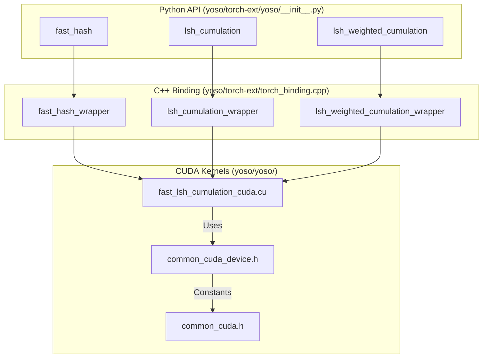
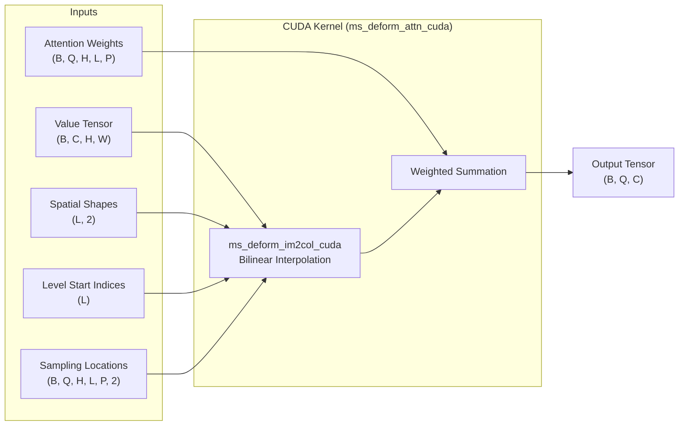

<!-- source: DeepWiki mcp.deepwiki.com · repo huggingface/kernels-community · extra page YOSO and Deformable DETR · fetched 2026-10-26 -->

# YOSO and Deformable DETR

Relevant source files

The following files were used as context for generating this wiki page:

- [deformable-detr/README.md](deformable-detr/README.md)
- [deformable-detr/build.toml](deformable-detr/build.toml)
- [deformable-detr/deformable_detr/ms_deform_attn_cuda.cu](deformable-detr/deformable_detr/ms_deform_attn_cuda.cu)
- [deformable-detr/deformable_detr/ms_deform_attn_cuda.cuh](deformable-detr/deformable_detr/ms_deform_attn_cuda.cuh)
- [deformable-detr/deformable_detr/ms_deform_attn_cuda.h](deformable-detr/deformable_detr/ms_deform_attn_cuda.h)
- [deformable-detr/deformable_detr/ms_deform_im2col_cuda.cuh](deformable-detr/deformable_detr/ms_deform_im2col_cuda.cuh)
- [deformable-detr/flake.nix](deformable-detr/flake.nix)
- [deformable-detr/torch-ext/deformable_detr/__init__.py](deformable-detr/torch-ext/deformable_detr/__init__.py)
- [deformable-detr/torch-ext/deformable_detr/layers.py](deformable-detr/torch-ext/deformable_detr/layers.py)
- [deformable-detr/torch-ext/ms_deform_attn_cpu.cpp](deformable-detr/torch-ext/ms_deform_attn_cpu.cpp)
- [yoso/README.md](yoso/README.md)
- [yoso/build.toml](yoso/build.toml)
- [yoso/flake.lock](yoso/flake.lock)
- [yoso/flake.nix](yoso/flake.nix)
- [yoso/torch-ext/torch_binding.cpp](yoso/torch-ext/torch_binding.cpp)
- [yoso/torch-ext/torch_binding.h](yoso/torch-ext/torch_binding.h)
- [yoso/torch-ext/yoso/__init__.py](yoso/torch-ext/yoso/__init__.py)
- [yoso/yoso/common.h](yoso/yoso/common.h)
- [yoso/yoso/common_cuda.h](yoso/yoso/common_cuda.h)
- [yoso/yoso/common_cuda_device.h](yoso/yoso/common_cuda_device.h)

## Purpose and Scope

This section documents two specialized vision and attention kernels: **YOSO** (You Only Sample Once) and **Deformable DETR**. 

The **YOSO** kernel implements a Fast Locality-Sensitive Hashing (LSH) mechanism for efficient attention in Transformers. It approximates the attention matrix by sampling hash codes, significantly reducing the $O(N^2)$ complexity of standard attention to linear complexity.

The **Deformable DETR** kernel implements Multi-Scale Deformable Attention (`ms_deform_attn`). This is a critical component for object detection models (like Deformable DETR) that allows each query to attend to a small set of sampling points across multiple feature map scales, rather than the entire image.

**Sources**: [yoso/README.md:1]()

---

## YOSO: Fast LSH Attention

YOSO approximates the softmax attention mechanism using Locality-Sensitive Hashing. The implementation provides specialized CUDA kernels for hashing and weighted cumulation of values based on hash collisions.

### Core Components

The YOSO implementation is divided into three primary operations exposed to Python:
1.  **`fast_hash`**: Generates hash codes for query and key vectors.
2.  **`lsh_cumulation`**: Aggregates values into a hash table and retrieves them for queries.
3.  **`lsh_weighted_cumulation`**: An extension of cumulation that supports weighted queries and keys.

### Implementation Architecture

**Sources**: [yoso/torch-ext/yoso/__init__.py:1-11](), [yoso/torch-ext/torch_binding.cpp:7-85](), [yoso/yoso/fast_lsh_cumulation_cuda.cu:1-30]()

### CUDA Device Utilities

The YOSO kernels rely on a custom hash-set implementation for managing collisions on the GPU. Key device functions include:

-   **`set_insert`**: Uses `atomicCAS` (Compare-And-Swap) to insert a value into a hash table slot. It handles collisions using linear probing.
-   **`set_lookup`**: Searches for a value in the hash table using the same linear probing logic.
-   **`init_buffer` / `copy_data`**: Utility functions for synchronized and non-blocking memory operations within a block.

**Sources**: [yoso/yoso/common_cuda_device.h:4-35](), [yoso/yoso/common_cuda_device.h:37-79]()

### Hardware Configuration

The kernels are tuned for specific CUDA thread geometries:
-   `MAX_THREADS_PER_BLOCK`: 1024
-   `OPTIMAL_THREADS_PER_BLOCK`: 256
-   `WARP_SIZE`: 32
-   `MAX_SHARED_MEM_PER_BLOCK`: 48000 bytes

**Sources**: [yoso/yoso/common_cuda.h:2-9]()

---

## Deformable DETR: Multi-Scale Deformable Attention

Deformable DETR addresses the high complexity of global attention by attending only to a small set of key sampling points around a reference point.

### Implementation Details

The core of this kernel is `ms_deform_attn_cuda.cu`, which implements the forward and backward passes for multi-scale deformable attention. It uses an optimized `im2col` variant (`ms_deform_im2col_cuda.cuh`) to sample features from multiple levels of a feature pyramid.

### Data Flow Diagram

**Sources**: [deformable-detr/deformable_detr/ms_deform_attn_cuda.cu:1-50](), [deformable-detr/deformable_detr/ms_deform_im2col_cuda.cuh:1-40]()

### Python Layers

The kernel is wrapped in a high-level `MSDeformAttn` layer in `deformable_detr/layers.py`. This layer handles the projection of queries to sampling offsets and attention weights before calling the custom CUDA op.

**Sources**: [deformable-detr/torch-ext/deformable_detr/layers.py:1-20]()

---

## Build and Infrastructure

Both kernels utilize the Nix-based build system provided by the `kernel-builder`.

### Build Configurations

| Feature | YOSO | Deformable DETR |
| :--- | :--- | :--- |
| **Backend** | CUDA | CUDA |
| **CUDA Capabilities** | 8.0, 8.9, 9.0, 10.0, 12.0 | Default (CUDA) |
| **Hub Repo** | `kernels-community/yoso` | `kernels-community/deformable-detr` |
| **Source Files** | `fast_lsh_cumulation_cuda.cu`, etc. | `ms_deform_attn_cuda.cu`, etc. |

**Sources**: [yoso/build.toml:1-36](), [deformable-detr/build.toml:1-27]()

### Dependency Management

Both kernels use Flake inputs to pin the `kernel-builder` version, ensuring reproducible builds.

**Sources**: [yoso/flake.nix:1-17](), [deformable-detr/flake.nix:1-17](), [yoso/flake.lock:1-50]()

---

